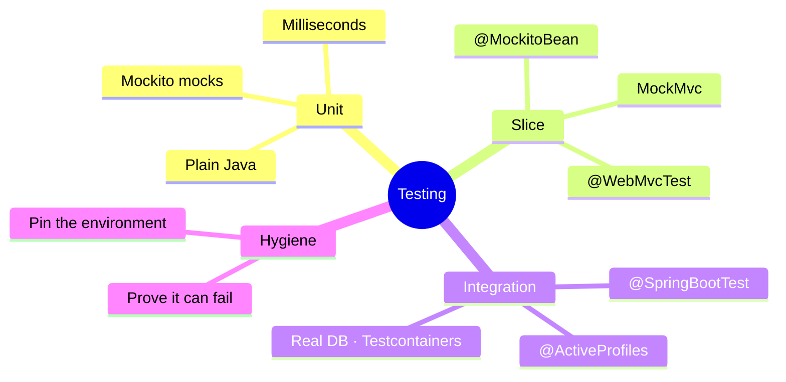
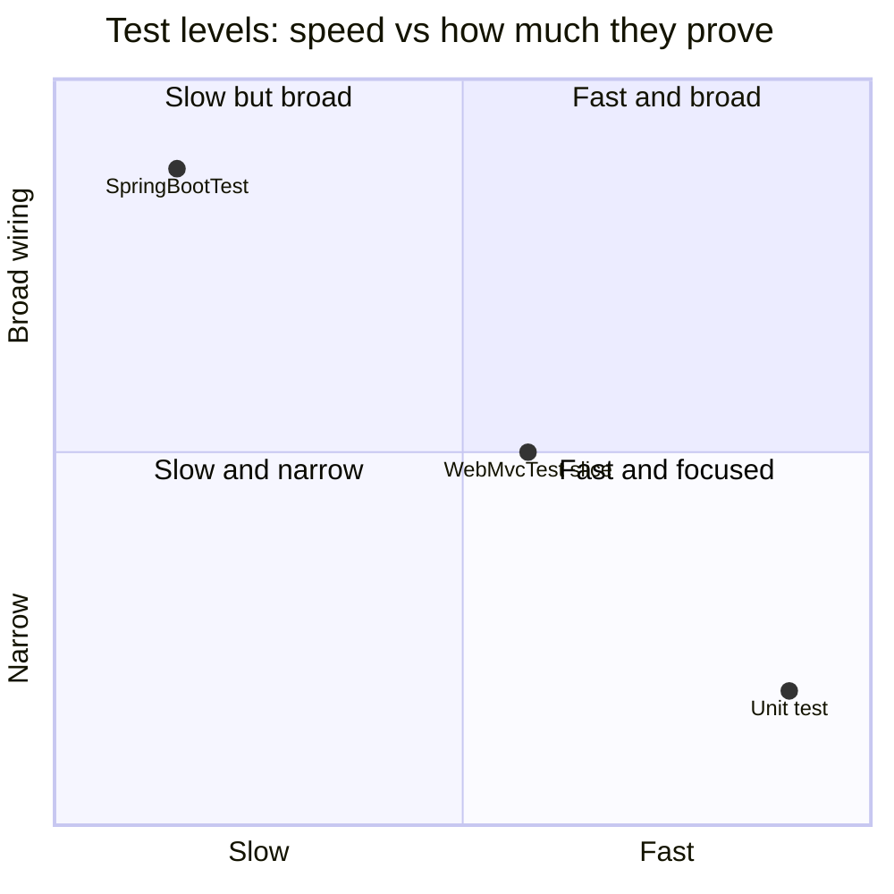
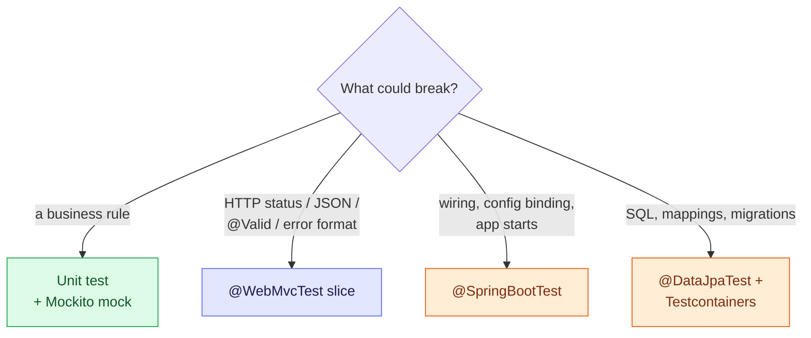

# 6. Testing — Unit, Slice and Full-Context Tests

Testing a Spring app is about **how much of the container you start**. Start nothing and the
test is milliseconds; start everything and it proves the wiring but costs seconds. Choose
the smallest level that can catch the bug you care about.

> [!TIP]
> **TL;DR: the 30-second interview answer**
> - **Unit** (no Spring, `new` + fakes) for business rules; **`@WebMvcTest` slice** for HTTP behaviour (status, JSON, `@Valid`, error handler); **`@SpringBootTest`** for wiring and config.
> - Replace a bean with **`@MockitoBean`** (Spring 6.2+, replaces `@MockBean`). Drive the web layer in memory with **MockMvc**.
> - A test that has never failed proves nothing. **Break the code once** to see it go red.

## At a glance



## Three levels



| Level | What starts | Real | Faked | Speed |
|-------|-------------|------|-------|-------|
| Unit | Nothing (plain Java) | The class under test | Its collaborators | Milliseconds |
| Slice, `@WebMvcTest` | Controllers, `@RestControllerAdvice`, JSON converters, validation | Routing, binding, `@Valid`, error handler | The service (a mock bean) | Seconds (5.4 s for the first start here, then fast) |
| Integration, `@SpringBootTest` | Everything: all beans, config, profiles | The full wiring | Nothing, or external systems | Slowest |

Many unit tests, a moderate number of slice tests, few integration tests.

## Which test catches what



| Behaviour | Best test |
|-----------|-----------|
| `MessageService` strips whitespace, throws not-found | Unit with a Mockito mock of the repository |
| Blank input returns 400 in our `ErrorResponse` | `@WebMvcTest` |
| Wrong `Content-Type` returns 415 in our format | `@WebMvcTest` |
| `@Valid` is actually present (the silent-200 trap) | `@WebMvcTest` |
| Lost update returns 409 | `@WebMvcTest` with the service throwing `ObjectOptimisticLockingFailureException` |
| Config binds and the app starts | `@SpringBootTest` |

## What we wrote

```java
// Unit test: no Spring. Constructor injection lets us hand over our own values.
private final GreetingService service = new GreetingService(new GreetingProperties("Yo", "Friend"));

// Slice test: web layer only, the service replaced by a mock bean.
@WebMvcTest(MessageController.class)
class MessageControllerTest {
    @Autowired MockMvc mockMvc;
    @MockitoBean MessageService service;
    // mockMvc.perform(post("/messages")...).andExpect(status().isBadRequest())
    //        .andExpect(jsonPath("$.fieldErrors.text").value("must not be blank"));
}

// Integration test with the profile pinned so it does not depend on the environment.
@SpringBootTest
@ActiveProfiles("test")
class GreetingPropertiesTest { ... }
```

Suite: **20 tests** green (`GreetingServiceTest` 3, `MessageServiceTest` 4,
`HelloControllerTest` 4, `MessageControllerTest` 7, context-loads 1, config binding 1).

> [!NOTE]
> **Boot 4 moved the test annotations** *(verified in the jars)*:
> `org.springframework.boot.webmvc.test.autoconfigure.WebMvcTest` (new
> `spring-boot-webmvc-test` module) and
> `org.springframework.test.context.bean.override.mockito.MockitoBean`. Old tutorials use
> `@MockBean` and the old package; whether those still compile on Boot 4 was not tested.

## What we saw *(verified)*

> [!IMPORTANT]
> **A test must be able to fail.** Removing `@Valid` made exactly one test fail:
> `Status expected:<400> but was:<200>`. Removing `@ResponseStatus(CREATED)` failed exactly
> the 201 test. Until you've seen a test go red, you don't know it tests anything.

> [!WARNING]
> **The container's `SPRING_PROFILES_ACTIVE=dev` leaks into every test.** A config test
> expecting the base value failed with `expected: <Hello> but was: <Hi>`.
> `@ActiveProfiles("test")` fixed it. Pin anything environment-dependent inside the test.

> [!CAUTION]
> **`@SpringBootTest` runs Flyway against the dev database.** It starts Hikari and migrates
> the real dev DB; `@WebMvcTest` slices never touch it. Fix planned: a throwaway Postgres
> (see `02-persistence`, note 6).

## Commands

```bash
docker compose exec dev mvn test                              # all tests
docker compose exec dev mvn test -Dtest=MessageControllerTest # one class
```

Use the Git Bash tool with `MSYS_NO_PATHCONV=1` for `docker compose exec` commands
containing pipes or paths: PowerShell mangles the quoting.

## Interview questions

<details>
<summary>Bug report: blank text returns 200. Which test catches it fastest, and what exactly does it assert?</summary>

A `@WebMvcTest` slice. It starts only the web layer, so it runs real binding, `@Valid` and the
advice in seconds:
`mockMvc.perform(post("/messages").contentType(JSON).content("{\"text\":\"\"}"))`
`.andExpect(status().isBadRequest()).andExpect(jsonPath("$.fieldErrors.text").value("must not be blank"))`.
A unit test can't catch it, because `@Valid` is applied by Spring MVC, not by your class.
</details>

<details>
<summary>@WebMvcTest(MessageController.class) fails with "No qualifying bean of type MessageService". Why?</summary>

The slice only registers web components (controllers, advice, converters, filters); services
and repositories aren't scanned. The controller still needs its constructor argument, so
provide one with `@MockitoBean MessageService service`.
</details>

<details>
<summary>Tests pass on your laptop and fail inside the dev container with expected Hello but was Hi. Explain and fix.</summary>

The container sets `SPRING_PROFILES_ACTIVE=dev`, and the test JVM inherits it, so the `dev`
profile file overrides the expected base value *(verified)*. Pin `@ActiveProfiles("test")`
and set test-specific properties explicitly. The test must not depend on the machine it runs on.
</details>

<details>
<summary>Why is @SpringBootTest risky in this project right now, and what's the fix?</summary>

It starts the full context, which means Hikari connects and **Flyway migrates the shared
dev database** during a test run. Tests can corrupt or depend on dev data. The fix is a
disposable database per test run: Testcontainers Postgres (see `02-persistence`, note 6).
</details>

<details>
<summary>You've just written a test and it's green. How do you know it actually tests something?</summary>

Make it fail on purpose: remove `@Valid`, change the status, break the rule. Check that
exactly this test goes red with a meaningful message, then revert. We did this
*(verified)*: removing `@Valid` failed exactly one test with `expected:<400> but was:<200>`.
</details>

<details>
<summary>@MockBean vs @MockitoBean?</summary>

`@MockitoBean` is Spring Framework's own bean-override support (6.2+), the replacement for
Boot's `@MockBean`, which Boot 3.4 deprecated. Both put a Mockito mock in the test context in
place of the real bean. On Boot 4, use `@MockitoBean`.
</details>

## Key takeaways

| Remember | Because |
|---|---|
| Smallest level that catches the bug | Speed scales with how much container starts |
| `@WebMvcTest` for HTTP contracts | Status, JSON, `@Valid`, advice, all in seconds |
| `@MockitoBean` replaces `@MockBean` | Spring 6.2+ / Boot 4 |
| See every new test fail once | A test that can't fail proves nothing |
| Pin profiles in tests | Container env vars leak in |

**Next module:** [02 Persistence overview](/notebook/spring-boot-system-design/02-persistence/overview)
