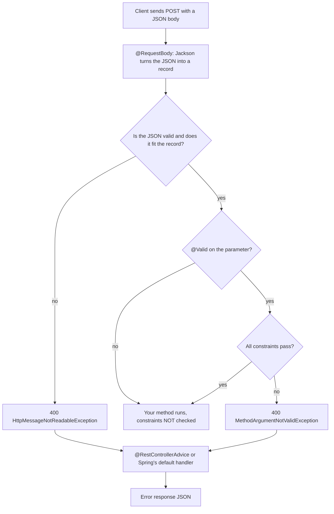

# 4. Validation and error handling

## The flow

Bad data must be rejected **before** it reaches business logic, and in one consistent format.



Two different failures can happen before your method runs: **malformed or mismatched JSON** fails in Jackson, and **valid JSON with invalid values** fails in Bean Validation, but only if `@Valid` triggers it.

## The pieces

| Piece | Job |
|-------|-----|
| `@RequestBody` | Reads the body and deserialises it with Jackson |
| Constraint annotations (`@NotBlank`, `@Min`, `@Size`, `@Email`) | Declare rules on the fields of a record or class |
| `@Valid` | Tells Spring to **run** those rules on this parameter |
| `@RestControllerAdvice` | One class that catches exceptions from all controllers |
| `@ExceptionHandler` | A method inside it that handles one exception type |

Validation is a separate library (Jakarta Bean Validation), so it has its own starter, `spring-boot-starter-validation`.

```java
public record CreateMessageRequest(@NotBlank @Size(max = 500) String text) {}

@PostMapping
@ResponseStatus(HttpStatus.CREATED)
public MessageResponse create(@Valid @RequestBody CreateMessageRequest request) { ... }
```

> [!WARNING]
> A constraint annotation only **describes** a rule. Without `@Valid` on the parameter nothing runs it, and a blank value reaches your method with a 200. We reproduced this *(verified)*.

## What we saw *(verified)*

| Request | Result |
|---------|--------|
| Blank value, **no `@Valid`** | **200**, constraint never checked |
| Blank value, with `@Valid` | 400 `MethodArgumentNotValidException` |
| Two rules broken | 400, both violations reported (order not guaranteed) |
| Broken JSON syntax | 400 `HttpMessageNotReadableException` (fails in Jackson, before validation) |
| Wrong `Content-Type` | 415 `HttpMediaTypeNotSupportedException` |
| Wrong HTTP method | 405 `HttpRequestMethodNotSupportedException`, with an `Allow` header |

Default error bodies carry a huge `trace` string (in dev), with the useful facts buried inside it.

## The error contract

```java
public record ErrorResponse(int status, String error, Map<String, String> fieldErrors) {}
```

```json
{"status":400,"error":"Validation failed","fieldErrors":{"text":"must not be blank"}}
```

## The handler that covers everything

```java
@RestControllerAdvice
public class GlobalExceptionHandler extends ResponseEntityExceptionHandler {

    @Override protected ResponseEntity<Object> handleMethodArgumentNotValid(...) { /* field errors */ }
    @Override protected ResponseEntity<Object> handleHttpMessageNotReadable(...) { /* malformed JSON */ }
    @Override protected ResponseEntity<Object> handleExceptionInternal(...)      { /* every other standard error */ }

    // Our own exceptions: the base class does not know them, so no clash.
    @ExceptionHandler(MessageNotFoundException.class)                     // 404
    @ExceptionHandler(ObjectOptimisticLockingFailureException.class)      // 409
}
```

> [!IMPORTANT]
> A first version had two `@ExceptionHandler` methods. They covered only those two exceptions, so 415 and 405 still came back in Spring's default shape: **two error formats in one API**. `@ExceptionHandler(Exception.class)` looks like the fix but also catches 415 and 405 and turns client mistakes into 500. Extend `ResponseEntityExceptionHandler` and override its hooks. Do **not** declare your own `@ExceptionHandler` for an exception the base class already handles (ambiguous-handler error at startup).

## Interview questions

**Why is `@Valid` needed?**
The constraint annotations are only metadata. `@Valid` (or `@Validated`) tells Spring's argument resolver to call the validator on that object. Without it, no check runs.

**`@Valid` vs `@Validated`?**
`@Valid` is the standard Jakarta annotation and also cascades into nested objects. `@Validated` is Spring's, adds validation **groups**, and enables method-level validation on beans (and `@ConfigurationProperties`).

**`@ControllerAdvice` vs `@RestControllerAdvice`?**
The second is `@ControllerAdvice` plus `@ResponseBody`: handler return values are written to the body (JSON) instead of resolved as view names.

**How would you return one error format for every failure?**
Extend `ResponseEntityExceptionHandler` (it already maps the standard MVC exceptions to the right status codes) and override `handleExceptionInternal`, then add handlers for your own exceptions.

**Which exceptions does Jackson fail with, and which does validation fail with?**
`HttpMessageNotReadableException` for unreadable or mismatched JSON, `MethodArgumentNotValidException` for constraint violations on a `@RequestBody`.

> [!NOTE]
> Spring 6 also supports the standard `ProblemDetail` error body (RFC 7807/9457). We used our own `ErrorResponse`; `ProblemDetail` was not tried here.
