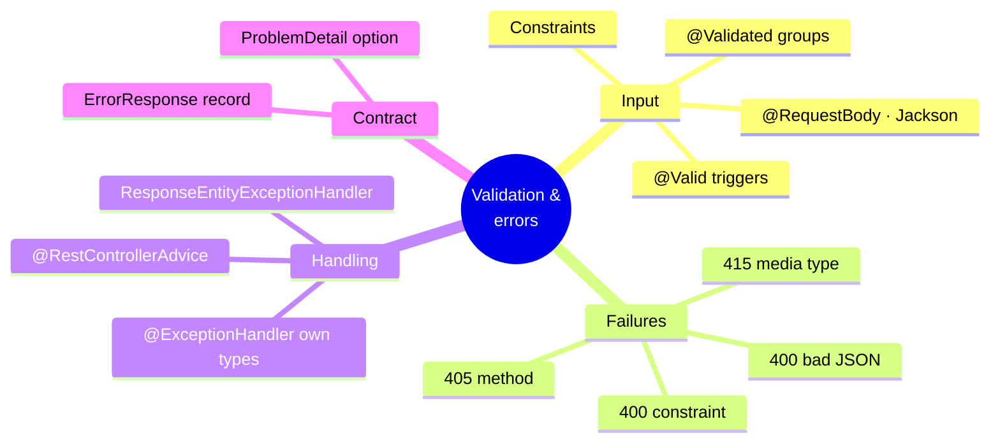
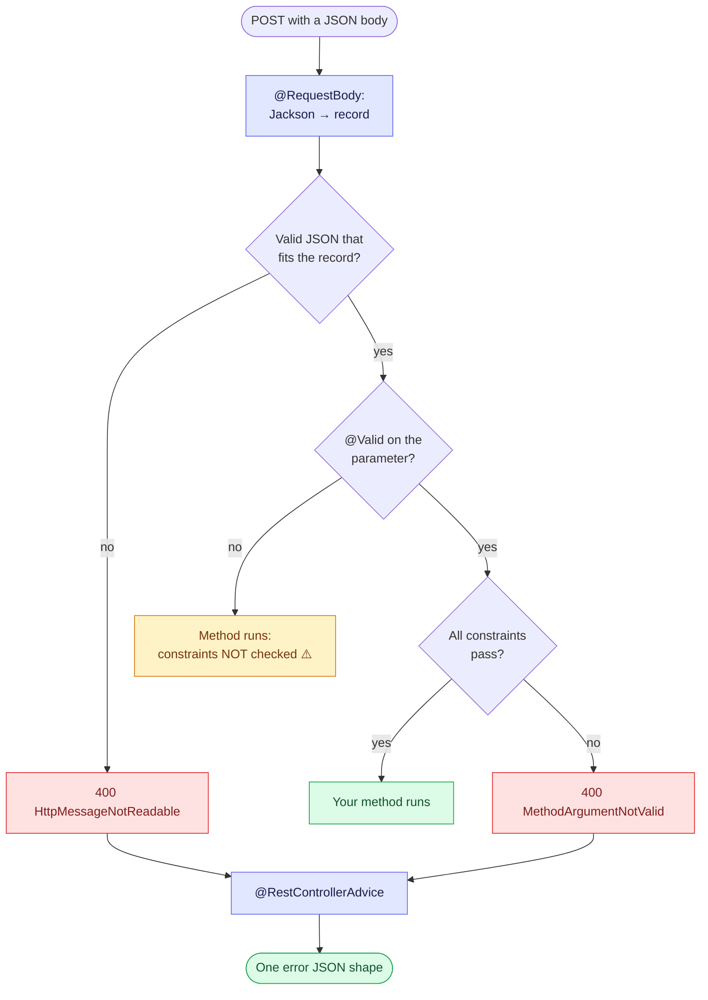

# 4. Validation and Error Handling — One Error Format for Every Failure

Bad data must be rejected **before** it reaches business logic, and every failure, whether
yours or Spring's, should come back in **one consistent JSON shape**. Two separate
mechanisms make that happen: Bean Validation for the input, and a controller advice for the
output.

> [!TIP]
> **TL;DR: the 30-second interview answer**
> - Constraint annotations (`@NotBlank`, `@Size`…) only **describe** rules. **`@Valid`** on the parameter makes Spring **run** them.
> - Two different 400s: malformed JSON fails in **Jackson** (`HttpMessageNotReadableException`), invalid values fail in **validation** (`MethodArgumentNotValidException`).
> - For one error format: **extend `ResponseEntityExceptionHandler`** in a `@RestControllerAdvice`. Don't catch `Exception.class`.

## At a glance



## The flow



The yellow box is the trap: valid JSON with a blank field walks straight into your code if
`@Valid` is missing.

## The pieces

| Piece | Job |
|-------|-----|
| `@RequestBody` | Reads the body and deserialises it with Jackson |
| Constraint annotations (`@NotBlank`, `@Min`, `@Size`, `@Email`) | Declare rules on the fields of a record or class |
| `@Valid` | Tells Spring to **run** those rules on this parameter |
| `@RestControllerAdvice` | One class that catches exceptions from all controllers |
| `@ExceptionHandler` | A method inside it that handles one exception type |

Validation is a separate library (Jakarta Bean Validation), so it has its own starter,
`spring-boot-starter-validation`.

```java
public record CreateMessageRequest(@NotBlank @Size(max = 500) String text) {}

@PostMapping
@ResponseStatus(HttpStatus.CREATED)
public MessageResponse create(@Valid @RequestBody CreateMessageRequest request) { ... }
```

> [!WARNING]
> **A constraint without `@Valid` is just a comment.** Nothing runs it, and a blank value
> reaches your method with a 200. We reproduced this *(verified)*.

## What we saw *(verified)*

| Request | Result |
|---------|--------|
| Blank value, **no `@Valid`** | **200**, constraint never checked |
| Blank value, with `@Valid` | 400 `MethodArgumentNotValidException` |
| Two rules broken | 400, both violations reported (order not guaranteed) |
| Broken JSON syntax | 400 `HttpMessageNotReadableException` (fails in Jackson, before validation) |
| Wrong `Content-Type` | 415 `HttpMediaTypeNotSupportedException` |
| Wrong HTTP method | 405 `HttpRequestMethodNotSupportedException`, with an `Allow` header |

Default error bodies carry a huge `trace` string (in dev), with the useful facts buried inside it.

## The error contract

```java
public record ErrorResponse(int status, String error, Map<String, String> fieldErrors) {}
```

```json
{"status":400,"error":"Validation failed","fieldErrors":{"text":"must not be blank"}}
```

## Three ways to write the advice

| Approach | 415 / 405 shape | Client errors stay 4xx? | Verdict |
|---|---|---|---|
| A few `@ExceptionHandler`s for your exceptions | ❌ Spring's default shape | ✅ | Two error formats in one API |
| `@ExceptionHandler(Exception.class)` catch-all | ✅ Your shape | ❌ Turns 415/405 into **500** | Hides client mistakes |
| **Extend `ResponseEntityExceptionHandler`** + override hooks | ✅ Your shape | ✅ Correct status codes | ✅ Use this |

## The handler that covers everything

```java
@RestControllerAdvice
public class GlobalExceptionHandler extends ResponseEntityExceptionHandler {

    @Override protected ResponseEntity<Object> handleMethodArgumentNotValid(...) { /* field errors */ }
    @Override protected ResponseEntity<Object> handleHttpMessageNotReadable(...) { /* malformed JSON */ }
    @Override protected ResponseEntity<Object> handleExceptionInternal(...)      { /* every other standard error */ }

    // Our own exceptions: the base class does not know them, so no clash.
    @ExceptionHandler(MessageNotFoundException.class)                     // 404
    @ExceptionHandler(ObjectOptimisticLockingFailureException.class)      // 409
}
```

> [!IMPORTANT]
> **Never add your own `@ExceptionHandler` for an exception the base class already
> handles.** It's an ambiguous-handler error at startup. Override the base class's hook instead.

> [!NOTE]
> Spring 6 also supports the standard `ProblemDetail` error body (RFC 7807/9457). We used
> our own `ErrorResponse`; `ProblemDetail` was not tried here.

## Interview questions

<details>
<summary>POST {"text": ""} returns 200 and saves an empty message, although the record field has @NotBlank. Give two possible causes.</summary>

1. **No `@Valid`** on the `@RequestBody` parameter. The annotation is metadata, and nothing
   asks the validator to run (our verified case).
2. **No Bean Validation provider** on the classpath (`spring-boot-starter-validation`
   missing). Without Hibernate Validator there is no validator, so even `@Valid` checks nothing.

A `@WebMvcTest` asserting 400 on blank input catches both.
</details>

<details>
<summary>One client sends broken JSON, another sends {"text": ""}. Both get 400. Which exception for each, and at which step?</summary>

Broken JSON fails while the **message converter** (Jackson) reads the body:
`HttpMessageNotReadableException`. Valid JSON with a blank value binds fine, then fails in
**validation**: `MethodArgumentNotValidException`, which carries the per-field errors.
Different steps, so you get different handler hooks for each.
</details>

<details>
<summary>The advice has @ExceptionHandler(Exception.class). A client sends the wrong Content-Type. What do they get, and why is that a problem?</summary>

A **500**. The catch-all also grabs Spring's `HttpMediaTypeNotSupportedException`, which
should be a 415. Clients can't tell their own mistake from a server bug, and your error-rate
alerts fire on client errors. Extend `ResponseEntityExceptionHandler` instead, so standard
exceptions keep their correct status codes.
</details>

<details>
<summary>You add @ExceptionHandler(MethodArgumentNotValidException.class) to an advice that extends ResponseEntityExceptionHandler, and the app won't start. Why?</summary>

The base class already declares a handler for that exception, so there are now two
handlers for the same type: an ambiguous `@ExceptionHandler` mapping, rejected at startup.
Override the base class's `handleMethodArgumentNotValid` hook instead.
</details>

<details>
<summary>How do you validate a query parameter such as page ≥ 1? Does @Valid help?</summary>

`@Valid` is for objects. Put the constraint on the parameter itself:
`@RequestParam @Min(1) int page`. On Spring Framework 6.1+ (Boot 3.2+), MVC validates
constraint-annotated controller parameters itself and raises `HandlerMethodValidationException`
(a 400). On older versions you needed `@Validated` on the controller class, and violations
surfaced as `ConstraintViolationException`, a 500 unless you handled it.
</details>

<details>
<summary>An Order request has List&lt;OrderLine&gt; lines, and constraints on OrderLine are ignored. Why?</summary>

Validation doesn't cascade into nested objects by default. Mark the element type or field for
cascading: `List<@Valid OrderLine> lines`. Then each line is validated and errors come back
with paths like `lines[2].quantity`.
</details>

## Key takeaways

| Remember | Because |
|---|---|
| No `@Valid`, no validation | Constraints are only metadata |
| Jackson fails first, validation second | Two different exceptions, both 400 |
| Extend `ResponseEntityExceptionHandler` | One shape *and* correct status codes |
| Don't catch `Exception.class` | Client errors become 500s |
| `@ExceptionHandler` only for your own exceptions | Duplicates are ambiguous at startup |

**Next:** [5. Configuration and profiles](/notebook/spring-boot-system-design/01-spring-boot-basics/configuration-and-profiles)
