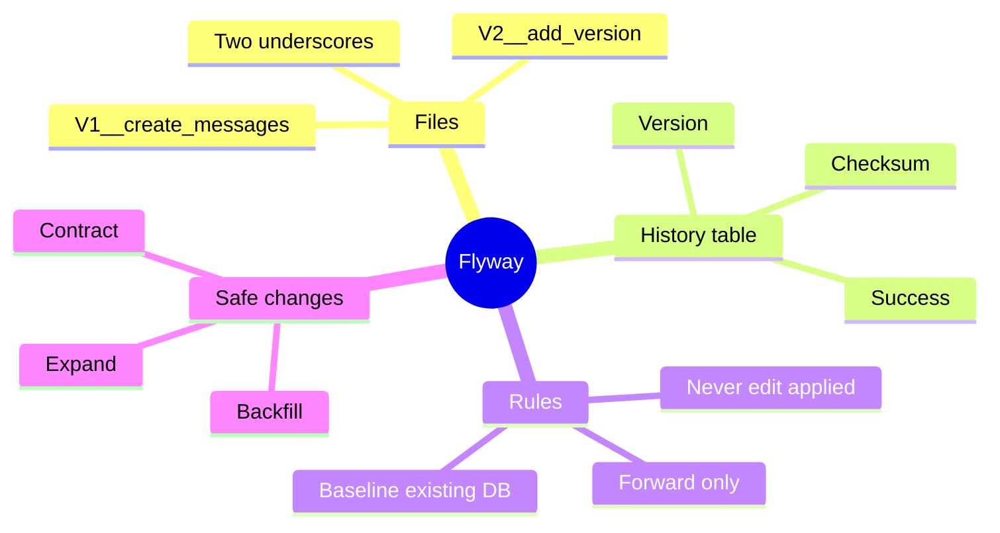
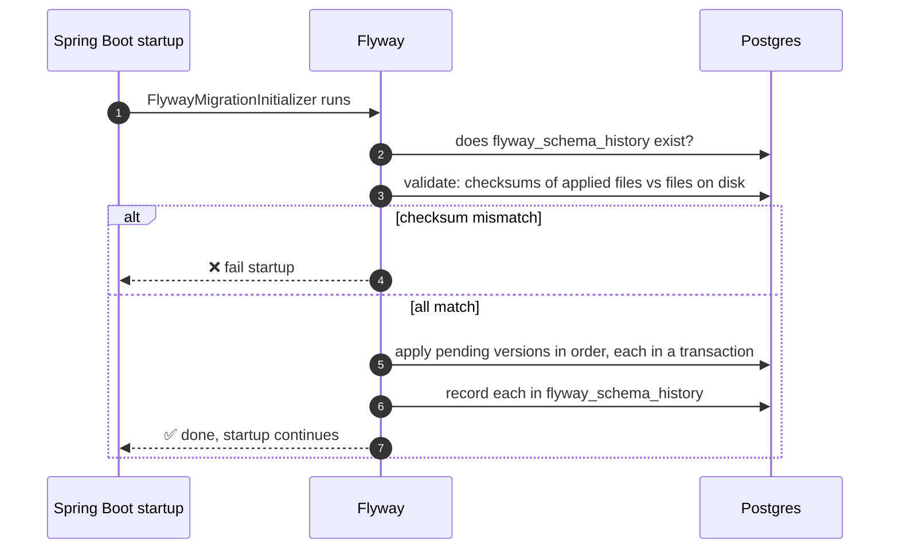
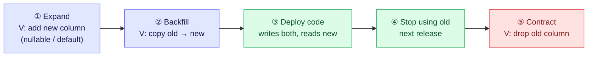

# 3. Flyway Migrations — Who Owns the Schema

The schema is code: it should be **versioned, reviewed and applied the same way
everywhere**. Flyway keeps it as numbered SQL files, applies each one **once per
database**, and remembers what it did in a history table. It never edits the past; it only
moves forward.

> [!TIP]
> **TL;DR: the 30-second interview answer**
> - Files `V<n>__<desc>.sql` run **in order, once**, recorded (with a **checksum**) in `flyway_schema_history`.
> - **Never edit an applied migration**: the checksum check fails startup. Fix forward with a new version.
> - Production changes use **expand → migrate data → contract**, so old and new code both work during a deploy.

## At a glance



## How it works at startup



Files live in `src/main/resources/db/migration` and are named `V<version>__<description>.sql`
(two underscores).

```sql
-- V1__create_messages.sql
CREATE TABLE messages (
    id         BIGSERIAL PRIMARY KEY,
    text       TEXT        NOT NULL,
    created_at TIMESTAMPTZ NOT NULL DEFAULT now()
);

-- V2__add_version_to_messages.sql  (expand step before the code uses it)
ALTER TABLE messages ADD COLUMN version BIGINT NOT NULL DEFAULT 0;
```

## What we saw *(verified)*

| Experiment | Result |
|------------|--------|
| Add Flyway to a **non-empty** database with no history table | Startup **fails**: `Found non-empty schema(s) "public" but no schema history table. Use baseline() or set baselineOnMigrate`, even with zero migration files |
| Edit an applied `V1` (add a comment) | Startup **fails**: `Migration checksum mismatch for migration version 1`, showing the applied and the local checksum |
| Add `V2`, restart | Log: `Successfully validated 2 migrations`, then `Migrating schema "public" to version "2 - add version to messages"` |
| Old entity code after `V2` | Still works: `ddl-auto=validate` allows extra database columns |

> [!IMPORTANT]
> **Flyway checksums the raw file contents, so even a comment change breaks an applied
> migration.** Never edit an applied file; add a new one.

To adopt Flyway on an existing database use **baseline** (tell Flyway "the current state is
version N"). For our throwaway dev database we dropped the hand-made table and let `V1`
build it.

## Changing a live schema: expand → contract



Every intermediate state works with **both** the old and the new code version, which is what
a rolling deploy needs. Our `V2` was an expand step: the column existed before any code used it.

## Reverting a migration

- Flyway is **forward-only**: it does not generate a revert.
- Undo files (`U2__...sql`) are, as far as I know, a paid-edition feature, and you still write the SQL. The CLI table has an `Undoable` column; it said `No` for ours. Not verified for 12.4.0.
- Normal practice: **roll forward**. Write `V3` that undoes `V2`; the history keeps both.
- In dev: rebuild the database from the migrations (`docker compose down -v`).
- Data cannot be reverted by any tool: a dropped column's values need a backup.
- Prisma Migrate is, as far as I know, also forward-only; Liquibase supports per-change rollback.
- Postgres supports transactional DDL, so a failing migration should leave nothing half-applied. MySQL cannot do this. (Not demonstrated here.)

> [!CAUTION]
> **The contract step is the only irreversible one.** Once `DROP COLUMN` runs, the data is
> gone unless you have a backup. Ship it in a *later* release, after nothing reads the column.

## Viewing migrations

The dependency in `pom.xml` is only the engine inside the app. To see status, run the Flyway
**CLI** in a throwaway container. `info` is read-only:

```bash
docker run --rm --network system-design-projects_default \
  -v "E:/projects/system-design-projects/playground/hello-boot/src/main/resources/db/migration:/flyway/sql:ro" \
  flyway/flyway:12.4.0 -url=jdbc:postgresql://postgres:5432/hello_db -user=app -password=app info
```

```text
| Category  | Version | Description             | Type | Installed On        | State   | Undoable |
| Versioned | 1       | create messages         | SQL  | 2026-10-11 12:24:40 | Success | No       |
| Versioned | 2       | add version to messages | SQL  | 2026-10-14 01:18:49 | Success | No       |
```

| Tool | What it is |
|------|------------|
| Flyway CLI (the OSS edition, `flyway/flyway` image) | `info`, `migrate`, `validate`, `repair`, `baseline`. We used `info` only |
| Flyway Desktop (Redgate GUI) | A Community edition exists with manual scripting. Auto-generating migrations from a schema diff is an Enterprise (paid) feature, per Redgate's articles |
| Database GUI (DBeaver, pgAdmin) | Just read the `flyway_schema_history` table |

I found no official npm package for the CLI. The Community-edition details come from a 2022
announcement, so check Redgate's current comparison.

## Coming from Prisma

Prisma bundles the ORM and the migrations; in Java they are two tools.

| Job | Prisma | Java / Spring |
|-----|--------|---------------|
| Describe the model | `schema.prisma` | JPA entities |
| Generate query code | Prisma Client | Hibernate builds SQL at runtime; Spring Data generates repositories |
| Generate migration SQL from a model change | `prisma migrate dev` | No built-in equivalent (Liquibase diff, IDE tools, or Flyway Desktop Enterprise) |
| Apply migrations, keep history | `prisma migrate deploy` | Flyway or Liquibase |

Common practice: hand-write the Flyway SQL, review it, and let Hibernate `validate` check the
entities against it (note 4).

## Interview questions

<details>
<summary>You add Flyway to a dev database that already has tables, with zero migration files. Startup fails. Why, and what are your options?</summary>

Flyway refuses a **non-empty schema without a history table** *(verified)*: it can't tell
which migrations the existing tables correspond to. Either **baseline** (declare "this state
is version N"; `baselineOnMigrate=true` or the `baseline` command), then add migrations from
N+1, or, for a throwaway database, drop the objects and let `V1` create them (what we did).
</details>

<details>
<summary>A teammate "fixes a typo in a comment" in V1, which already ran everywhere. What happens on the next deploy, and how do you recover?</summary>

Every environment fails startup with `Migration checksum mismatch for migration version 1`
*(verified)*: Flyway checksums the raw file, comments included. Recover by **reverting the
edit**. `flyway repair` can rewrite the stored checksums, but that rewrites history and
should be a deliberate, reviewed act. The rule: applied migrations are immutable.
</details>

<details>
<summary>V5 dropped a column in production and you need it back. What do you do?</summary>

Roll **forward**: `V6` re-adds the column. The schema is easy; the **data** isn't, because
no migration tool can restore dropped values, so they come from a backup. This is why
destructive "contract" steps ship only after nothing reads the column, ideally a release later.
</details>

<details>
<summary>Rename messages.text to body with a rolling deploy and zero downtime. Walk through it.</summary>

1. `V`: add `body` (nullable). 2. `V`: backfill `body` from `text`. 3. Deploy code that
**writes both** and reads `body`. 4. Next release: stop writing `text`. 5. `V`: drop `text`.
A single `ALTER TABLE ... RENAME` would break whichever app version is still running
mid-deploy, because old pods query `text`.
</details>

<details>
<summary>A migration fails halfway through on Postgres. What state is the schema in? Would MySQL differ?</summary>

On Postgres, DDL is **transactional**: Flyway runs the migration in a transaction, so the
failure rolls everything back and the version is not recorded. MySQL implicitly commits
each DDL statement, so you can be left half-applied and must clean up by hand. (Stated from
documentation, not demonstrated here.)
</details>

<details>
<summary>Why Flyway instead of ddl-auto=update?</summary>

`update` applies a diff straight to the live database with no reviewable file and no
history, can't express renames or data fixes, and can differ between environments. Flyway
gives versioned, reviewed, repeatable changes, identical everywhere. Hibernate then runs in
`validate` to catch entity/schema drift at startup.
</details>

## Key takeaways

| Remember | Because |
|---|---|
| Applied migrations are immutable | Checksums fail startup on any edit |
| Forward-only: fix with a new version | Undo is paid-edition and data can't be undone |
| Existing DB → baseline first | Flyway won't guess a non-empty schema's version |
| Expand → backfill → contract | Old and new code both work mid-deploy |
| Postgres DDL is transactional | Failed migrations roll back cleanly |

Sources: [Introducing Flyway Desktop in Community](https://www.red-gate.com/blog/introducing-flyway-desktop-in-community/), [Flyway Desktop overview](https://www.red-gate.com/hub/product-learning/flyway/flyway-desktop-in-database-development-work-an-overview), [Installing and upgrading the Flyway CLI](https://www.red-gate.com/hub/product-learning/flyway/installing-and-upgrading-the-flyway-cli).

**Next:** [4. JPA, Hibernate and Spring Data](/notebook/spring-boot-system-design/02-persistence/jpa-hibernate-and-spring-data)
