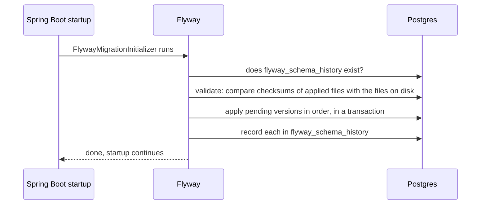

# 3. Flyway migrations

## How it works

Flyway keeps the schema as **versioned SQL files** and applies them in order, once per database, recording each in the table `flyway_schema_history`.



Files live in `src/main/resources/db/migration` and are named `V<version>__<description>.sql` (two underscores).

```sql
-- V1__create_messages.sql
CREATE TABLE messages (
    id         BIGSERIAL PRIMARY KEY,
    text       TEXT        NOT NULL,
    created_at TIMESTAMPTZ NOT NULL DEFAULT now()
);

-- V2__add_version_to_messages.sql  (expand step before the code uses it)
ALTER TABLE messages ADD COLUMN version BIGINT NOT NULL DEFAULT 0;
```

## What we saw *(verified)*

| Experiment | Result |
|------------|--------|
| Add Flyway to a **non-empty** database with no history table | Startup **fails**: `Found non-empty schema(s) "public" but no schema history table. Use baseline() or set baselineOnMigrate`, even with zero migration files |
| Edit an applied `V1` (add a comment) | Startup **fails**: `Migration checksum mismatch for migration version 1`, showing the applied and the local checksum |
| Add `V2`, restart | Log: `Successfully validated 2 migrations`, then `Migrating schema "public" to version "2 - add version to messages"` |
| Old entity code after `V2` | Still works: `ddl-auto=validate` allows extra database columns |

> [!IMPORTANT]
> Flyway checksums the **raw file contents**, so even a comment change breaks an applied migration. Never edit an applied file; add a new one.

To adopt Flyway on an existing database use **baseline** (tell Flyway "the current state is version N"). For our throwaway dev database we dropped the hand-made table and let `V1` build it.

## Reverting a migration

- Flyway is **forward-only**: it does not generate a revert.
- Undo files (`U2__...sql`) are, as far as I know, a paid-edition feature, and you still write the SQL. The CLI table has an `Undoable` column; it said `No` for ours. Not verified for 12.4.0.
- Normal practice: **roll forward**. Write `V3` that undoes `V2`; the history keeps both.
- In dev: rebuild the database from the migrations (`docker compose down -v`).
- Data cannot be reverted by any tool: a dropped column's values need a backup.
- Production pattern: **expand then contract**. Add the new column, copy data, deploy code that uses it, drop the old column in a later release. Our `V2` followed this.
- Prisma Migrate is, as far as I know, also forward-only; Liquibase supports per-change rollback.
- Postgres supports transactional DDL, so a failing migration should leave nothing half-applied. MySQL cannot do this. (Not demonstrated here.)

## Viewing migrations

The dependency in `pom.xml` is only the engine inside the app. To see status, run the Flyway **CLI** in a throwaway container. `info` is read-only:

```bash
docker run --rm --network system-design-projects_default \
  -v "E:/projects/system-design-projects/playground/hello-boot/src/main/resources/db/migration:/flyway/sql:ro" \
  flyway/flyway:12.4.0 -url=jdbc:postgresql://postgres:5432/hello_db -user=app -password=app info
```

```text
| Category  | Version | Description             | Type | Installed On        | State   | Undoable |
| Versioned | 1       | create messages         | SQL  | 2026-10-11 12:24:40 | Success | No       |
| Versioned | 2       | add version to messages | SQL  | 2026-10-14 01:18:49 | Success | No       |
```

| Tool | What it is |
|------|------------|
| Flyway CLI (the OSS edition, `flyway/flyway` image) | `info`, `migrate`, `validate`, `repair`, `baseline`. We used `info` only |
| Flyway Desktop (Redgate GUI) | A Community edition exists with manual scripting. Auto-generating migrations from a schema diff is an Enterprise (paid) feature, per Redgate's articles |
| Database GUI (DBeaver, pgAdmin) | Just read the `flyway_schema_history` table |

I found no official npm package for the CLI. The Community-edition details come from a 2022 announcement, so check Redgate's current comparison.

## Coming from Prisma

Prisma bundles the ORM and the migrations; in Java they are two tools.

| Job | Prisma | Java / Spring |
|-----|--------|---------------|
| Describe the model | `schema.prisma` | JPA entities |
| Generate query code | Prisma Client | Hibernate builds SQL at runtime; Spring Data generates repositories |
| Generate migration SQL from a model change | `prisma migrate dev` | No built-in equivalent (Liquibase diff, IDE tools, or Flyway Desktop Enterprise) |
| Apply migrations, keep history | `prisma migrate deploy` | Flyway or Liquibase |

Common practice: hand-write the Flyway SQL, review it, and let Hibernate `validate` check the entities against it (note 4).

## Interview questions

**Why Flyway instead of `spring.jpa.hibernate.ddl-auto=update`?**
`update` applies a diff straight to the live database with no reviewable file, no history, and it cannot express renames or data fixes safely. Flyway gives versioned, reviewed, repeatable changes, identical on every environment.

**How do you roll back a bad migration?**
Roll forward with a new migration that undoes it; undo scripts are a paid feature. For data-destroying changes you need a backup. Prevent the problem with expand-then-contract.

**What is in `flyway_schema_history`?**
One row per applied migration: version, description, script name, checksum, who and when, execution time and success.

**What happens if someone edits an applied migration?**
Flyway's validate step compares checksums on startup and fails with a checksum mismatch.

**You inherit a production database with no Flyway. What do you do?**
Baseline it at the current version (`baselineOnMigrate` or the `baseline` command), then add new migrations from there.

Sources: [Introducing Flyway Desktop in Community](https://www.red-gate.com/blog/introducing-flyway-desktop-in-community/), [Flyway Desktop overview](https://www.red-gate.com/hub/product-learning/flyway/flyway-desktop-in-database-development-work-an-overview), [Installing and upgrading the Flyway CLI](https://www.red-gate.com/hub/product-learning/flyway/installing-and-upgrading-the-flyway-cli).
