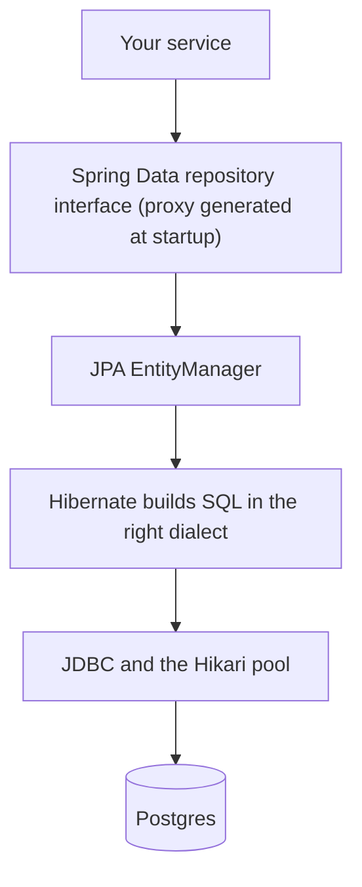
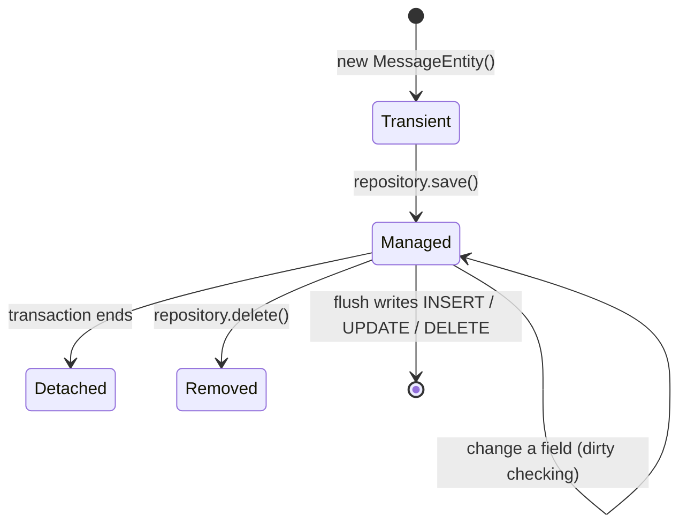

# 4. JPA, Hibernate and Spring Data

## Three names, three layers

| Name | What it is |
|------|------------|
| **JPA** (Jakarta Persistence) | A **specification**: the annotations (`@Entity`, `@Id`) and the `EntityManager` API |
| **Hibernate** | The **implementation** that runs: it turns entity operations into SQL for the detected dialect (7.4.5, `PostgreSQLDialect` in our log) |
| **Spring Data JPA** | A convenience layer: you declare a repository **interface** and Spring generates the implementation at startup |



JPA does not replace JDBC; it **writes the JDBC code and SQL for you**.

## An entity: a class mapped to a table

```java
@Entity
@Table(name = "messages")
public class MessageEntity {
    @Id
    @GeneratedValue(strategy = GenerationType.IDENTITY)   // the database fills the id
    private Long id;

    @Column(nullable = false)
    private String text;

    @Column(name = "created_at", nullable = false)
    private Instant createdAt;

    @Version
    private Long version;                                  // optimistic locking, see note 5

    protected MessageEntity() {}                           // JPA needs a no-arg constructor
}
```

| Rule | Why |
|------|-----|
| Not `final`, no-arg constructor | Hibernate creates instances and proxies by reflection |
| A Java `record` cannot be an entity | Records are final and immutable. Our `Message` record stays a plain model |
| `IDENTITY` | Matches `BIGSERIAL`; the id exists only after the INSERT |
| Names map by convention and annotation | `created_at` to `createdAt` needs `@Column(name = ...)` |

## The persistence context

Hibernate keeps the entities it loads in a **persistence context**, a first-level cache scoped to a transaction.



- **Managed** entities are watched. Change a field inside a transaction and Hibernate writes the UPDATE at flush, with no `update` call (**dirty checking**).
- The same row loaded twice in one transaction is the **same Java object**.
- SQL is sent at **flush** (usually commit), not at the moment you call `save`, except where an INSERT is needed to obtain an `IDENTITY` id.

## Spring Data JPA

```java
public interface MessageJpaRepository extends JpaRepository<MessageEntity, Long> {
    List<MessageEntity> findByTextContaining(String fragment);   // SQL derived from the method name
}
```

`save`, `findById`, `findAll`, `deleteById`, paging and sorting come free. Boot logged `Found 1 JPA repository interface` when it scanned.

## Who owns the schema?

| `spring.jpa.hibernate.ddl-auto` | Behaviour | Use |
|-------|-----------|-----|
| `none` | Leaves the schema alone | Production with Flyway |
| **`validate`** | Checks entities against the tables, fails startup if they disagree | Production with Flyway (ours) |
| `update` | Applies a diff directly, no files | Throwaway prototypes only |
| `create`, `create-drop` | Drops and recreates | Tests, demos |

## What we saw *(verified)*

**Hibernate-generated DDL versus our hand-written `V1`**

| Column | `V1` | Hibernate generated |
|--------|------|---------------------|
| `id` | `BIGSERIAL PRIMARY KEY` | `bigint generated by default as identity` |
| `text` | `TEXT NOT NULL` | **`varchar(255)`** not null |
| `created_at` | `TIMESTAMPTZ NOT NULL DEFAULT now()` | `timestamp(6) with time zone` not null, no default |

A `String` has no length, so Hibernate defaults to 255. Our API allows 500 characters, so a generated schema would fail on long messages. Generated SQL is a draft to review.

**`validate`**: a wrong column name stops startup with `Schema validation: missing column [created_on] in table [messages]`. A `TEXT` column is accepted for a `String` field (types are compared, lengths are not).

> [!WARNING]
> Leaving the JPA schema-generation script settings (`jakarta.persistence.schema-generation.scripts.*`) active **suppressed `validate`** in our run: the wrong column started fine until those lines were removed (mechanism unconfirmed, effect confirmed). Prove a check can fail before you trust that it passed.

**SQL Hibernate wrote** (logged through `logging.level.org.hibernate.SQL=DEBUG`):

```sql
insert into messages (created_at,text) values (?,?)
select me1_0.id,me1_0.created_at,me1_0.text from messages me1_0          -- findAll: NO ORDER BY
select me1_0.id,me1_0.created_at,me1_0.text from messages me1_0 where me1_0.id=?
update messages set created_at=?,text=?,version=? where id=? and version=?   -- dirty checking, all columns
```

- `findAll()` has no ordering guarantee; ask for it (`findAll(Sort.by("id"))`).
- `Instant.now()` has nanoseconds but `timestamp(6)` stores microseconds, so a response built from the in-memory entity differs from a later read.
- `spring.jpa.show-sql` prints to stdout and **bypasses logging** (no traceId), so we log SQL through the `org.hibernate.SQL` logger.

**Dirty checking and transactions**

```java
@Transactional
public Message rename(long id, String newText) {
    MessageEntity entity = repository.findById(id).orElseThrow(...);
    entity.rename(newText.strip());       // no save() call
    return toMessage(entity);
}
```

With `@Transactional` the UPDATE ran at commit. **Without it the PUT returned 200 with the new text, Postgres kept the old text, and no UPDATE ran**: the entity was no longer managed after `findById`'s own short transaction. A silent lost update with no error.

> [!NOTE]
> The startup log warns `spring.jpa.open-in-view is enabled by default`. Open-session-in-view keeps the persistence context open for the whole web request so lazy loading works in the view layer. It is on by default in Boot; many teams turn it off to avoid database access outside the service layer.

## Not covered yet

Lazy loading versus eager fetching, `LazyInitializationException`, and the **N+1 query problem** were not demonstrated.

## Interview questions

**JPA vs Hibernate vs Spring Data JPA?**
JPA is the specification. Hibernate implements it. Spring Data JPA generates repository implementations on top, so you write an interface.

**Explain the entity states and dirty checking.**
Transient (new object), managed (attached to a persistence context, changes tracked), detached (context closed), removed. Inside a transaction, changes to a managed entity are written as an UPDATE at flush with no explicit save.

**Why did my change not reach the database?**
Most likely the entity was detached or the code ran outside a transaction (no flush). Put `@Transactional` on the service method.

**What does `ddl-auto=validate` do?**
It compares the entity mappings with the actual schema at startup and fails if they disagree. Used with a migration tool that owns the schema.

**Can a record be an entity?**
No. Entities must be non-final with a no-arg constructor, which Hibernate needs to instantiate and proxy them.

**What is the N+1 problem?** *(standard answer, not demonstrated here)*
One query loads N parents, then each parent's lazy association triggers another query. Fix with a fetch join, an entity graph, or batch fetching.
