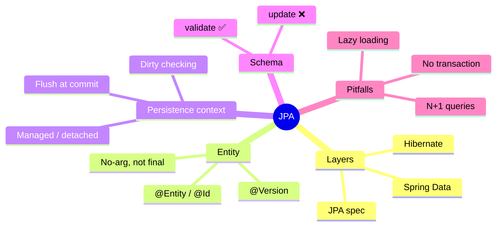
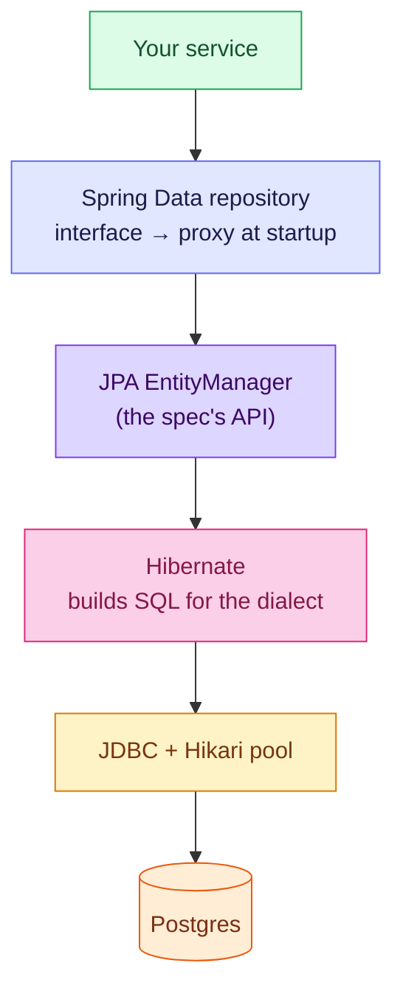
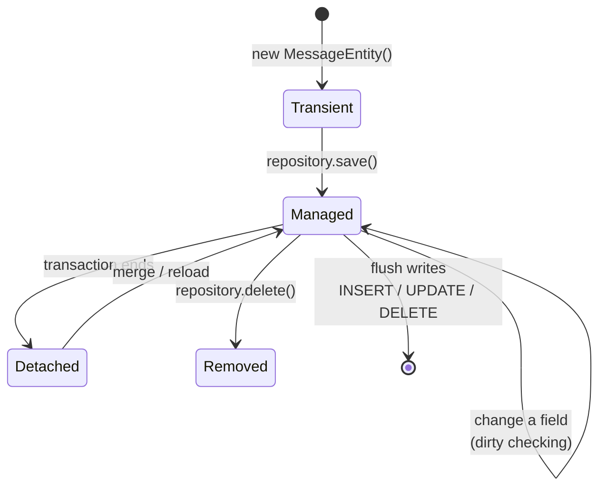
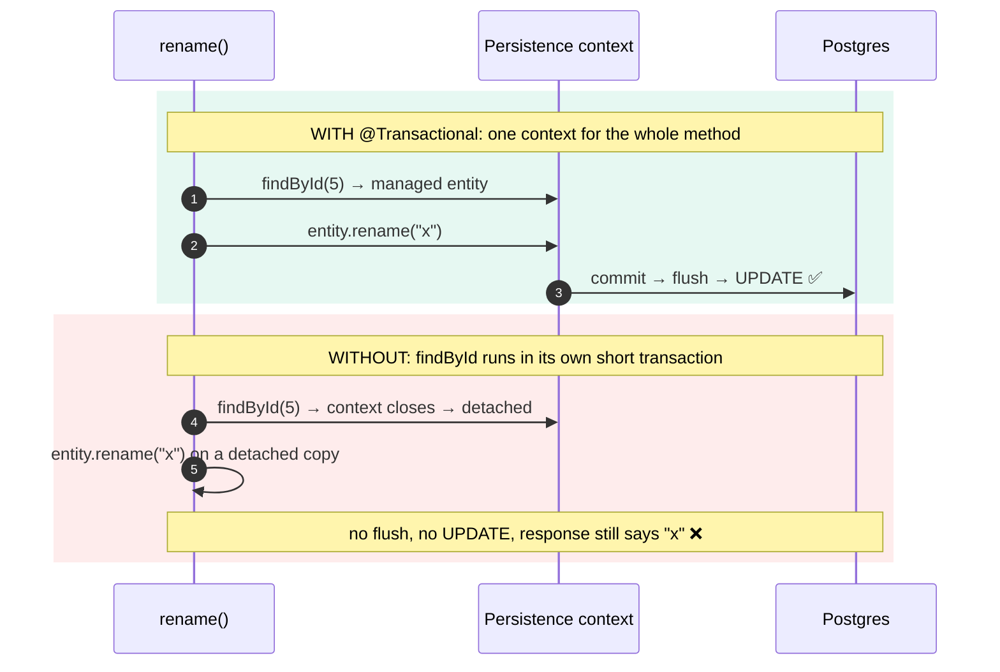

# 4. JPA, Hibernate and Spring Data — Objects In, SQL Out

JPA doesn't replace JDBC: it **writes the JDBC code and the SQL for you**, and keeps a
watchful copy of every entity it loads. That watchfulness, the **persistence context**, is
both the magic (no `update` calls) and the source of most JPA surprises (changes that never
save, queries that multiply).

> [!TIP]
> **TL;DR: the 30-second interview answer**
> - **JPA** = the spec, **Hibernate** = the implementation that builds SQL, **Spring Data JPA** = generated repositories from an interface.
> - Inside a transaction, entities are **managed**: change a field and Hibernate writes the `UPDATE` at **flush** (dirty checking). Outside a transaction, nothing is tracked.
> - Let Flyway own the schema and run Hibernate with **`ddl-auto=validate`**. Generated DDL is only a draft (`String` → `varchar(255)`).

## At a glance



## Three names, three layers



| Name | What it is |
|------|------------|
| **JPA** (Jakarta Persistence) | A **specification**: the annotations (`@Entity`, `@Id`) and the `EntityManager` API |
| **Hibernate** | The **implementation** that runs: it turns entity operations into SQL for the detected dialect (7.4.5, `PostgreSQLDialect` in our log) |
| **Spring Data JPA** | A convenience layer: you declare a repository **interface** and Spring generates the implementation at startup |

## An entity: a class mapped to a table

```java
@Entity
@Table(name = "messages")
public class MessageEntity {
    @Id
    @GeneratedValue(strategy = GenerationType.IDENTITY)   // the database fills the id
    private Long id;

    @Column(nullable = false)
    private String text;

    @Column(name = "created_at", nullable = false)
    private Instant createdAt;

    @Version
    private Long version;                                  // optimistic locking, see note 5

    protected MessageEntity() {}                           // JPA needs a no-arg constructor
}
```

| Rule | Why |
|------|-----|
| Not `final`, no-arg constructor | Hibernate creates instances and proxies by reflection |
| A Java `record` cannot be an entity | Records are final and immutable. Our `Message` record stays a plain model |
| `IDENTITY` | Matches `BIGSERIAL`; the id exists only after the INSERT |
| Names map by convention and annotation | `created_at` to `createdAt` needs `@Column(name = ...)` |

## The persistence context

Hibernate keeps the entities it loads in a **persistence context**, a first-level cache
scoped to a transaction.



- **Managed** entities are watched. Change a field inside a transaction and Hibernate writes the UPDATE at flush, with no `update` call (**dirty checking**).
- The same row loaded twice in one transaction is the **same Java object**.
- SQL is sent at **flush** (usually commit), not at the moment you call `save`, except where an INSERT is needed to obtain an `IDENTITY` id.

## Spring Data JPA

```java
public interface MessageJpaRepository extends JpaRepository<MessageEntity, Long> {
    List<MessageEntity> findByTextContaining(String fragment);   // SQL derived from the method name
}
```

`save`, `findById`, `findAll`, `deleteById`, paging and sorting come free. Boot logged
`Found 1 JPA repository interface` when it scanned.

## Who owns the schema?

| `spring.jpa.hibernate.ddl-auto` | Behaviour | Use |
|-------|-----------|-----|
| `none` | Leaves the schema alone | Production with Flyway |
| **`validate`** | Checks entities against the tables, fails startup if they disagree | ✅ Production with Flyway (ours) |
| `update` | Applies a diff directly, no files | ⚠️ Throwaway prototypes only |
| `create`, `create-drop` | Drops and recreates | Tests, demos |

## What we saw *(verified)*

**Hibernate-generated DDL versus our hand-written `V1`**

| Column | `V1` | Hibernate generated |
|--------|------|---------------------|
| `id` | `BIGSERIAL PRIMARY KEY` | `bigint generated by default as identity` |
| `text` | `TEXT NOT NULL` | **`varchar(255)`** not null |
| `created_at` | `TIMESTAMPTZ NOT NULL DEFAULT now()` | `timestamp(6) with time zone` not null, no default |

A `String` has no length, so Hibernate defaults to 255. Our API allows 500 characters, so a
generated schema would fail on long messages. Generated SQL is a draft to review.

**`validate`**: a wrong column name stops startup with `Schema validation: missing column
[created_on] in table [messages]`. A `TEXT` column is accepted for a `String` field (types
are compared, lengths are not).

> [!WARNING]
> **Schema-generation script settings suppressed `validate` in our run.** With
> `jakarta.persistence.schema-generation.scripts.*` active, the wrong column started fine
> until those lines were removed (mechanism unconfirmed, effect confirmed). Prove a check
> can fail before you trust that it passed.

**SQL Hibernate wrote** (logged through `logging.level.org.hibernate.SQL=DEBUG`):

```sql
insert into messages (created_at,text) values (?,?)
select me1_0.id,me1_0.created_at,me1_0.text from messages me1_0          -- findAll: NO ORDER BY
select me1_0.id,me1_0.created_at,me1_0.text from messages me1_0 where me1_0.id=?
update messages set created_at=?,text=?,version=? where id=? and version=?   -- dirty checking, all columns
```

- `findAll()` has no ordering guarantee; ask for it (`findAll(Sort.by("id"))`).
- `Instant.now()` has nanoseconds but `timestamp(6)` stores microseconds, so a response built from the in-memory entity differs from a later read.
- `spring.jpa.show-sql` prints to stdout and **bypasses logging** (no traceId), so we log SQL through the `org.hibernate.SQL` logger.

## Dirty checking needs a transaction

```java
@Transactional
public Message rename(long id, String newText) {
    MessageEntity entity = repository.findById(id).orElseThrow(...);
    entity.rename(newText.strip());       // no save() call
    return toMessage(entity);
}
```



**Without `@Transactional` the PUT returned 200 with the new text, Postgres kept the old
text, and no UPDATE ran** *(verified)*: a silent lost update with no error.

> [!NOTE]
> **`spring.jpa.open-in-view` is enabled by default**, and the startup log warns about it.
> Open-session-in-view keeps the persistence context open for the whole web request so
> lazy loading works in the view layer. Many teams turn it off to keep database access
> inside the service layer.

## Not covered yet

Lazy loading versus eager fetching, `LazyInitializationException`, and the **N+1 query
problem** were not demonstrated. The answers below on those are the standard ones.

## Interview questions

<details>
<summary>PUT /messages/5 returns 200 with the new text, but the database still has the old text and no UPDATE appears in the SQL log. What happened?</summary>

The method had no `@Transactional` *(verified)*. `findById` ran in the repository's own short
transaction, which closed and left the entity **detached**. Changing a detached entity is
just changing a Java object: there's no persistence context to dirty-check it and no flush,
so no `UPDATE`. The response was built from the in-memory object, so it looked fine.
Fix: `@Transactional` on the service method.
</details>

<details>
<summary>GET /orders loads 100 orders and the SQL log shows 101 queries. What is this and how do you fix it?</summary>

The **N+1 problem**: one query for the orders, then one per order when the lazy
`order.getLines()` is first touched (often during JSON serialisation). Fix by fetching what
you need in the first query: a `join fetch` JPQL query, an `@EntityGraph` on the repository
method, or `hibernate.default_batch_fetch_size` to load lazy collections in batches. *(Standard
answer, not demonstrated here.)*
</details>

<details>
<summary>With open-in-view disabled, serialising order.getLines() in the controller throws LazyInitializationException. Why, and what's the right fix?</summary>

The lazy collection is a proxy that needs an open persistence context to load. The context
closed when the service's transaction ended, before the controller touched it. Don't re-enable
open-in-view: load the data **inside the service** (fetch join / entity graph) and return a
**DTO**, so nothing lazy escapes the transaction. *(Standard answer, not demonstrated.)*
</details>

<details>
<summary>You let Hibernate generate the schema; in production, messages over 255 characters fail to insert. Why?</summary>

A Java `String` has no length, so Hibernate generates `varchar(255)` *(verified: our generated
DDL)*. Our API accepts 500 characters, so longer texts exceed the column. Own the schema in
Flyway (`TEXT` here) and use `validate`. Note that `validate` compares types, not lengths, so
it wouldn't catch this mismatch either.
</details>

<details>
<summary>POST /messages returns createdAt with 9 fractional digits; a later GET returns 6. Bug?</summary>

Not a bug, a precision difference *(verified)*. The response was built from the in-memory
entity holding `Instant.now()` (nanoseconds); Postgres `timestamp(6)` stores microseconds, so a
re-read returns the truncated value. Truncate on creation (`Instant.now().truncatedTo(MICROS)`)
if clients compare timestamps.
</details>

<details>
<summary>A teammate converts MessageEntity into a record to remove boilerplate. What breaks?</summary>

Records are `final` with no no-arg constructor and immutable fields. Hibernate needs to
instantiate entities reflectively, **subclass** them for lazy proxies, and **mutate** them for
dirty checking. A record entity is rejected. Records work well as DTOs and projections (and
as `@Embeddable` values in recent Hibernate), just not as entities.
</details>

<details>
<summary>A test asserts the first element of findAll() and fails intermittently. Why?</summary>

`findAll()` generates SQL with **no `ORDER BY`** *(verified)*, and SQL row order without one is
unspecified. Postgres may return a different order after updates or vacuuming. Ask for an order
explicitly: `findAll(Sort.by("id"))`.
</details>

## Key takeaways

| Remember | Because |
|---|---|
| Dirty checking needs a transaction | Detached entities are never flushed |
| SQL goes out at flush, usually commit | `save` isn't an immediate INSERT (except `IDENTITY`) |
| `validate`, not `update` | Flyway owns the schema |
| `String` → `varchar(255)` when generated | Review generated DDL as a draft |
| Fetch what you need in the service, return DTOs | Avoids N+1 and lazy-loading errors |

**Next:** [5. Transactions and locking](/notebook/spring-boot-system-design/02-persistence/transactions-in-spring)
