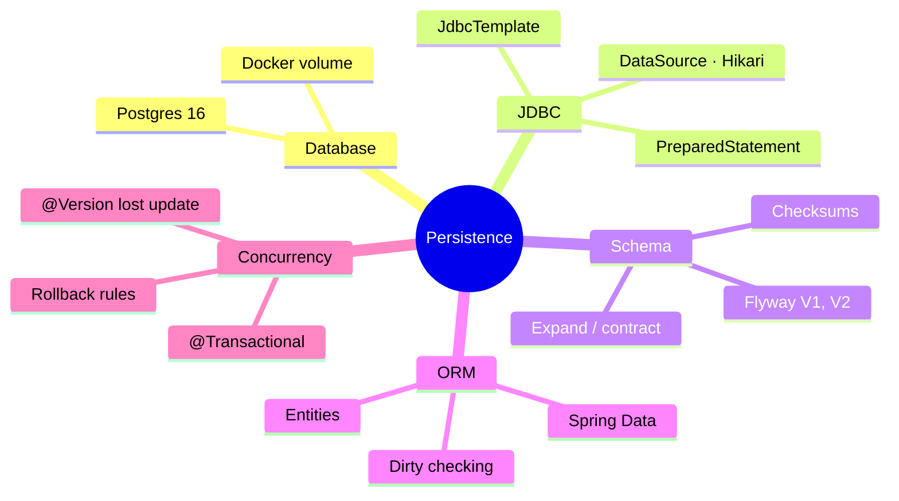
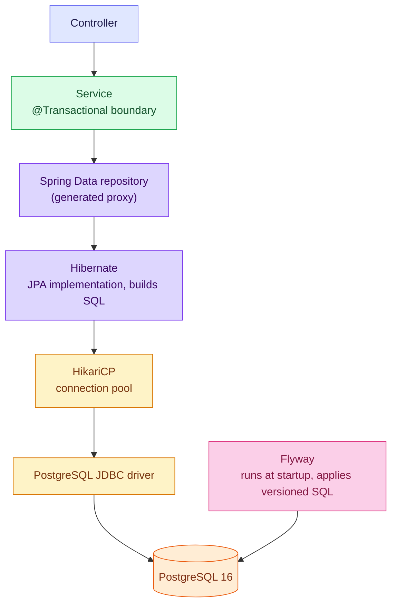
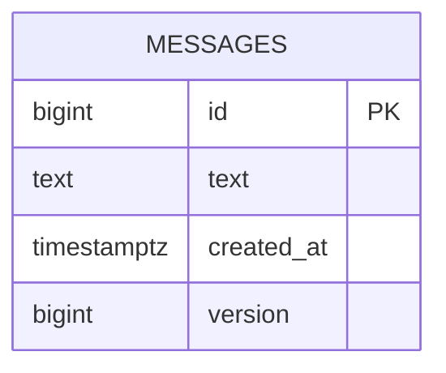

# 1. Overview — Durable State in Spring Boot

Every persistence question is about one of three things: **who owns the schema**, **how a
Java call becomes SQL**, and **what happens when two things write at once**. This module
builds up the stack layer by layer: Postgres, JDBC, Flyway, JPA, transactions.

> [!TIP]
> **TL;DR: the 30-second interview answer**
> - Request path: **service (`@Transactional`) → Spring Data proxy → Hibernate → HikariCP → JDBC driver → Postgres**.
> - **Flyway owns the schema** (versioned SQL). Hibernate only **validates** entities against it.
> - A transaction **holds a pooled connection** for its whole duration, so long transactions starve the pool (Hikari default max: 10).

> [!NOTE]
> Versions in our stack *(verified)*: PostgreSQL 16.15, Flyway 12.4.0, Hibernate ORM 7.4.5
> with the `PostgreSQLDialect`, HikariCP as the pool.

## The module at a glance

| # | Note | Question it answers |
|---|------|---------------------|
| 2 | Postgres, JDBC and JdbcTemplate | How does the app talk to the database underneath the frameworks? |
| 3 | Flyway migrations | Who owns the schema, and how does it change safely? |
| 4 | JPA, Hibernate and Spring Data | What do the ORM and the generated repositories do for me? |
| 5 | Transactions and locking | What goes wrong with partial failure and concurrent writes? |
| 6 | Testcontainers and JPA tests (planned) | How do I test persistence against a real Postgres? |

## The stack

Read it top to bottom as "who calls whom". Notice Flyway talks to the database **directly**:
it isn't part of the request path, it shapes the schema before any request runs.

## What we built

| Piece | Detail |
|-------|--------|
| API | `POST /messages` (201), `GET /messages`, `GET /messages/{id}` (404 if missing), `PUT /messages/{id}` (409 on a lost update) |
| Schema | Table `messages`, created by Flyway `V1`, `version` column added by `V2` |
| Layers | Controller, `MessageService`, `MessageJpaRepository`, entity `MessageEntity` |

## Status

| Topic | State |
|-------|-------|
| Postgres in Docker, JDBC, `JdbcTemplate` | ✅ Done |
| Flyway `V1`, `V2`, checksum, baseline behaviour | ✅ Done |
| JPA entity, `validate`, Spring Data, dirty checking | ✅ Done |
| Rollback rules, self-invocation, lost update, `@Version` | ✅ Done |
| Propagation (`REQUIRES_NEW`), isolation levels in practice, pessimistic locking | Not yet |
| `V3` roll-forward revert | Not yet |
| Testcontainers and `@DataJpaTest` | Planned, paused |
| Lazy loading and the N+1 problem | Not yet |

> [!WARNING]
> **Temporary leftovers** in `playground/hello-boot`, kept until you decide to delete them:
> the unused JdbcTemplate `MessageRepository`, `JdbcDemoRepository` with `/db/version`, and
> the transaction demo classes behind `/demo/tx/*`.

## Interview questions

Trace what happens when a service calls repository.save(new MessageEntity("hi")).

The call hits the **Spring Data proxy**, which delegates to `SimpleJpaRepository.save`, itself
`@Transactional` (it joins your service's transaction if one is open). The entity has a
null id, so it's **persisted** (an existing one would be merged). With
`GenerationType.IDENTITY` Hibernate must run the `INSERT` immediately to learn the generated
id; otherwise SQL waits for the flush at commit. The statement runs on a connection
borrowed from Hikari, through the Postgres driver.

Under load, requests fail with "Connection is not available, request timed out after 30000ms", yet DB CPU is low. What's going on?

The **pool is exhausted**, not the database. Hikari lends at most 10 connections by default,
and each transaction holds one until it ends. Typical causes: a slow remote call (HTTP,
Kafka) *inside* a `@Transactional` method, a leaked connection, or simply more concurrent
transactions than connections. Fix the cause (keep transactions short, no remote I/O inside
them) before resizing the pool.

A teammate sets spring.jpa.hibernate.ddl-auto=update "to save time". What's your objection?

`update` diffs entities against the live schema and alters it with no reviewable file, no
history, and no way to express renames or data backfills. It can't be the same on every
environment. Let Flyway own the schema with versioned SQL, and run Hibernate in `validate`
so a mismatch fails at startup instead of mutating production.

Why is the transaction boundary on the service rather than the controller or the repository?

A use case (create order = check stock + insert order + publish event) spans **several**
repository calls that must commit or roll back together, and the service is where that use
case lives. Repository-level transactions would commit each call separately. Controller-level
transactions would keep a connection open through JSON parsing and HTTP concerns.

## Key takeaways

| Remember | Because |
|---|---|
| Service → Spring Data → Hibernate → Hikari → driver → Postgres | Every persistence bug sits at one of these hops |
| Flyway owns the schema, Hibernate validates | Reviewed, repeatable, identical everywhere |
| A transaction holds a connection | Long transactions starve the pool |
| Transaction boundary = the use case = the service | All-or-nothing across repository calls |

**Next:** [2. Postgres, JDBC and JdbcTemplate](/notebook/spring-boot-system-design/02-persistence/postgres-and-jdbc)
