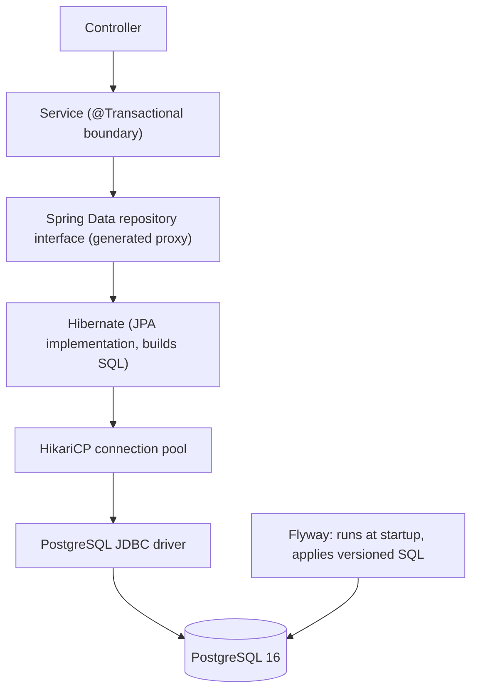
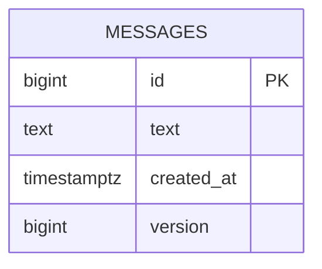

# 1. Overview

> [!NOTE]
> Module 2 is about durable state: Postgres, JDBC, schema migrations with Flyway, JPA/Hibernate, and transactions. Versions in our stack *(verified)*: PostgreSQL 16.15, Flyway 12.4.0, Hibernate ORM 7.4.5 with the `PostgreSQLDialect`, HikariCP as the pool.

## Notes in this module

| # | Note | Question it answers |
|---|------|---------------------|
| 2 | Postgres, JDBC and JdbcTemplate | How does the app talk to the database underneath the frameworks? |
| 3 | Flyway migrations | Who owns the schema, and how does it change safely? |
| 4 | JPA, Hibernate and Spring Data | What do the ORM and the generated repositories do for me? |
| 5 | Transactions and locking | What goes wrong with partial failure and concurrent writes? |
| 6 | Testcontainers and JPA tests (planned) | How do I test persistence against a real Postgres? |

## The stack

## What we built

| Piece | Detail |
|-------|--------|
| API | `POST /messages` (201), `GET /messages`, `GET /messages/{id}` (404 if missing), `PUT /messages/{id}` (409 on a lost update) |
| Schema | Table `messages`, created by Flyway `V1`, `version` column added by `V2` |
| Layers | Controller, `MessageService`, `MessageJpaRepository`, entity `MessageEntity` |

## Status

| Topic | State |
|-------|-------|
| Postgres in Docker, JDBC, `JdbcTemplate` | Done |
| Flyway `V1`, `V2`, checksum, baseline behaviour | Done |
| JPA entity, `validate`, Spring Data, dirty checking | Done |
| Rollback rules, self-invocation, lost update, `@Version` | Done |
| Propagation (`REQUIRES_NEW`), isolation levels in practice, pessimistic locking | Not yet |
| `V3` roll-forward revert | Not yet |
| Testcontainers and `@DataJpaTest` | Planned, paused |
| Lazy loading and the N+1 problem | Not yet |

> [!WARNING]
> Temporary leftovers in `playground/hello-boot`, kept until you decide to delete them: the unused JdbcTemplate `MessageRepository`, `JdbcDemoRepository` with `/db/version`, and the transaction demo classes behind `/demo/tx/*`.

## Interview questions

**What happens when you call `repository.save(entity)`?**
The call goes through the Spring Data proxy to `SimpleJpaRepository.save`, which is itself `@Transactional`. A new entity (null id) is persisted, an existing one merged. With `GenerationType.IDENTITY` Hibernate has to run the INSERT immediately to learn the generated id; otherwise SQL waits for flush at commit. The statement goes through a Hikari connection to Postgres.

**Why a connection pool?**
Opening a database connection (TCP, authentication) is expensive. The pool keeps connections open and lends them. A transaction holds one connection for its whole duration, so pool size and transaction length limit throughput.

**Who should own the schema, Hibernate or a migration tool?**
A migration tool (Flyway or Liquibase): versioned, reviewed, repeatable. Hibernate then runs in `validate` mode to check the entities against the schema.
