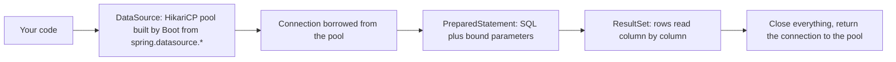

# 2. Postgres, JDBC and JdbcTemplate

## Postgres in our stack

```yaml
postgres:
  image: postgres:16-alpine
  environment:
    POSTGRES_USER: app
    POSTGRES_PASSWORD: app        # dev-only credentials
    POSTGRES_DB: hello_db
  ports:
    - "5433:5432"                 # host:container
  volumes:
    - pgdata:/var/lib/postgresql/data
  healthcheck:
    test: ["CMD-SHELL", "pg_isready -U app -d hello_db"]
```

`dev` has `depends_on: postgres: condition: service_healthy`, so the app starts only after Postgres accepts connections.

| From | Address | Verified |
|------|---------|----------|
| The Spring app in the `dev` container | `postgres:5432` (service-name DNS) | Port open |
| The same app to `localhost:5432` | refused | `localhost` inside `dev` is `dev` itself |
| Your machine (psql, IDE) | `localhost:5433` | Connects |

> [!NOTE]
> The host runs its own native PostgreSQL on 5432, so the container is published on **5433**. That native instance is not ours and is left untouched. Data lives in the named volume `pgdata`: `docker compose down` keeps it, `down -v` wipes it. We also confirmed the data survives an app restart and a Docker daemon restart.

## JDBC: what sits under the frameworks



```java
// Raw JDBC: try-with-resources returns the connection to the pool
try (Connection c = dataSource.getConnection();
     PreparedStatement ps = c.prepareStatement("select version()");
     ResultSet rs = ps.executeQuery()) {
    rs.next();
    return rs.getString(1);
}
```

| Object | Meaning |
|--------|---------|
| `DataSource` | Factory for connections. Boot builds a pooled one when it finds `spring.datasource.*` |
| `Connection` | A live session. Expensive to open, so it is borrowed and **must be closed** (returned) |
| `PreparedStatement` | SQL with `?` placeholders. Prevents SQL injection; never concatenate user input into SQL |
| `ResultSet` | A cursor over the rows |

> [!IMPORTANT]
> **Hikari starts lazily.** The log showed `HikariPool-1 - Starting...` on the first request's thread, not at startup. Adding Flyway changes that: it forces a connection **during startup**, so a wrong password or a down database then fails the boot immediately. (That a plain JDBC app could start with a wrong password is inferred from the lazy start; it was not tested.)

## JdbcTemplate

`JdbcTemplate` removes the boilerplate (borrow, run, map, close) while keeping SQL explicit, and translates `SQLException` into Spring's unchecked `DataAccessException` hierarchy.

```java
private static final RowMapper<Message> MAPPER = (rows, n) -> new Message(
        rows.getLong("id"),
        rows.getString("text"),
        rows.getObject("created_at", OffsetDateTime.class).toInstant());

public Message save(String text) {
    return jdbc.queryForObject(
        "insert into messages (text) values (?) returning id, text, created_at", MAPPER, text);
}
```

`insert ... returning` is **Postgres-specific** SQL, as is `BIGSERIAL` in the migration. With JdbcTemplate the SQL is yours and per-dialect; with JPA, Hibernate generates the row-level SQL for the detected dialect.

> [!NOTE]
> This JdbcTemplate repository was our stepping stone and is now unused: the service uses Spring Data JPA (note 4). The classes remain as temporary leftovers.

## Interview questions

**Why use a connection pool, and what is HikariCP's default size?**
Connections are expensive to create. Hikari keeps a fixed pool (default maximum 10) and lends connections. If every connection is held, new callers wait until `connectionTimeout` and then fail, so a leaked connection or a long transaction can stall the whole app.

**`JdbcTemplate` vs JPA?**
`JdbcTemplate` is a thin helper: you write the SQL and map rows yourself. JPA maps objects to tables and generates SQL, at the cost of hiding what runs. Use `JdbcTemplate` for reporting or bulk queries, JPA for entity-centred CRUD.

**How do you prevent SQL injection?**
Use `PreparedStatement` parameters (`?`) or named parameters, never string concatenation. JPA and Spring Data parameterise for you.

**What does `@Repository` add?**
It marks the class for component scan and enables translation of persistence exceptions into Spring's `DataAccessException` hierarchy.

**What happens if you forget to close a connection?**
It is never returned to the pool. Enough of them exhaust the pool and requests block. (We read about this and did not run the leak experiment.)
