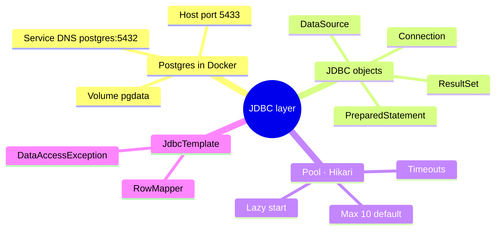
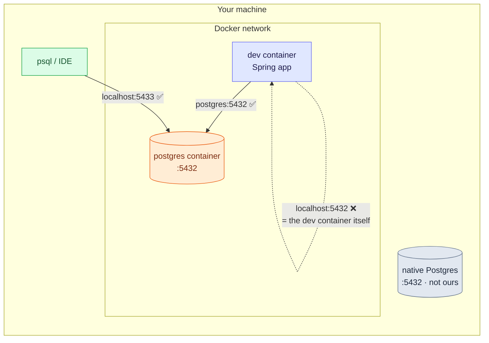
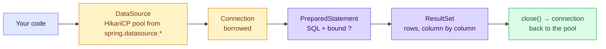

# 2. Postgres, JDBC and JdbcTemplate — What Sits Under the Frameworks

JPA and Spring Data are conveniences on top of one plain API: **JDBC**. Borrow a
connection, send a parameterised statement, read rows, give the connection back. When
something goes wrong with persistence (timeouts, injection, a pool that runs dry), the
explanation is almost always down here.

> [!TIP]
> **TL;DR: the 30-second interview answer**
> - `DataSource` (HikariCP) lends **pooled connections**; every connection must be **returned** (try-with-resources), or the pool runs dry.
> - Always **`PreparedStatement` with `?` parameters**: no SQL injection, ever.
> - `JdbcTemplate` = JDBC minus the boilerplate, plus translation to Spring's unchecked `DataAccessException`. Good for reports and bulk SQL.

## At a glance



## Postgres in our stack

```yaml
postgres:
  image: postgres:16-alpine
  environment:
    POSTGRES_USER: app
    POSTGRES_PASSWORD: app        # dev-only credentials
    POSTGRES_DB: hello_db
  ports:
    - "5433:5432"                 # host:container
  volumes:
    - pgdata:/var/lib/postgresql/data
  healthcheck:
    test: ["CMD-SHELL", "pg_isready -U app -d hello_db"]
```

`dev` has `depends_on: postgres: condition: service_healthy`, so the app starts only after
Postgres accepts connections.



| From | Address | Verified |
|------|---------|----------|
| The Spring app in the `dev` container | `postgres:5432` (service-name DNS) | Port open |
| The same app to `localhost:5432` | refused | `localhost` inside `dev` is `dev` itself |
| Your machine (psql, IDE) | `localhost:5433` | Connects |

> [!NOTE]
> The host runs its own native PostgreSQL on 5432, so the container is published on
> **5433**. That native instance is not ours and is left untouched. Data lives in the named
> volume `pgdata`: `docker compose down` keeps it, `down -v` wipes it. We also confirmed the
> data survives an app restart and a Docker daemon restart.

## JDBC: borrow, run, read, return



```java
// Raw JDBC: try-with-resources returns the connection to the pool
try (Connection c = dataSource.getConnection();
     PreparedStatement ps = c.prepareStatement("select version()");
     ResultSet rs = ps.executeQuery()) {
    rs.next();
    return rs.getString(1);
}
```

| Object | Meaning |
|--------|---------|
| `DataSource` | Factory for connections. Boot builds a pooled one when it finds `spring.datasource.*` |
| `Connection` | A live session. Expensive to open, so it is borrowed and **must be closed** (returned) |
| `PreparedStatement` | SQL with `?` placeholders. Prevents SQL injection; never concatenate user input into SQL |
| `ResultSet` | A cursor over the rows |

> [!IMPORTANT]
> **Hikari starts lazily.** The log showed `HikariPool-1 - Starting...` on the first
> request's thread, not at startup. Adding Flyway changes that: it forces a connection
> **during startup**, so a wrong password or a down database then fails the boot
> immediately. (That a plain JDBC app could start with a wrong password is inferred from the
> lazy start; it was not tested.)

## JdbcTemplate

`JdbcTemplate` removes the boilerplate (borrow, run, map, close) while keeping SQL explicit,
and translates `SQLException` into Spring's unchecked `DataAccessException` hierarchy.

```java
private static final RowMapper<Message> MAPPER = (rows, n) -> new Message(
        rows.getLong("id"),
        rows.getString("text"),
        rows.getObject("created_at", OffsetDateTime.class).toInstant());

public Message save(String text) {
    return jdbc.queryForObject(
        "insert into messages (text) values (?) returning id, text, created_at", MAPPER, text);
}
```

`insert ... returning` is **Postgres-specific** SQL, as is `BIGSERIAL` in the migration. With
JdbcTemplate the SQL is yours and per-dialect; with JPA, Hibernate generates the row-level SQL
for the detected dialect.

| | Raw JDBC | `JdbcTemplate` | JPA / Spring Data |
|---|---|---|---|
| You write SQL | ✅ | ✅ | ❌ Generated (JPQL optional) |
| Resource handling | Manual | Automatic | Automatic |
| Exceptions | Checked `SQLException` | `DataAccessException` | `DataAccessException` |
| Best for | Rarely needed | Reports, bulk SQL, DB-specific features | Entity CRUD, dirty checking |

> [!NOTE]
> This JdbcTemplate repository was our stepping stone and is now unused: the service uses
> Spring Data JPA (note 4). The classes remain as temporary leftovers.

## Interview questions

<details>
<summary>From your laptop psql connects to localhost:5433, but the app in the dev container fails on localhost:5432. Why?</summary>

Inside a container, `localhost` is **that container**: nothing listens on 5432 in `dev`
*(verified)*. Containers on the same Compose network reach each other by **service name**,
so the app must use `postgres:5432`. Port `5433` is only the host-side publish mapping for
tools running on your machine.
</details>

<details>
<summary>With a wrong DB password the app starts fine and only the first request fails. After adding Flyway, it fails at boot. Why the difference?</summary>

Hikari opens connections **lazily**, on first use *(verified: `HikariPool-1 - Starting...`
on the first request's thread)*. Nothing needed a connection during startup, so a bad
password went unnoticed. Flyway runs during startup and needs a connection to migrate, which
forces the pool to connect, so the boot fails fast. (The plain-JDBC startup with a wrong
password is inferred from the lazy start, not tested.)
</details>

<details>
<summary>A search endpoint builds "... where text like '%" + q + "%'". What's wrong, and what's the fix?</summary>

**SQL injection**: `q = "x' or '1'='1"` rewrites the query. Keep the SQL constant and bind
the value: `where text like ?` with the parameter `"%" + q + "%"`. The driver sends it as
data, never as SQL. JPA/Spring Data parameterise for you, but string-built JPQL is just as
injectable.
</details>

<details>
<summary>Requests start hanging, then fail after 30 s; restarting the app fixes it for a while. What would you suspect?</summary>

A **connection leak**: some code path borrows a connection and never closes it, so the pool
(max 10 by default) slowly drains until every borrower waits `connectionTimeout` (30 s) and
fails. Look for manual `getConnection()` without try-with-resources. Hikari's
`leakDetectionThreshold` logs the stack trace of the borrower. (We read about this and did
not run the leak experiment.)
</details>

<details>
<summary>You need a monthly report: joins across five tables, aggregates, a window function. JdbcTemplate or JPA?</summary>

`JdbcTemplate` (or a native query mapped to a DTO). The result isn't an entity you'll modify,
so the ORM's dirty checking and identity map add cost and nothing else, and hand-written
SQL lets you use Postgres features (window functions, `returning`) directly.
</details>

<details>
<summary>An INSERT violates a unique constraint. What exception does your service see through JdbcTemplate, and why does that matter?</summary>

A `DuplicateKeyException`, a subclass of Spring's unchecked `DataAccessException`.
`JdbcTemplate` translates the vendor `SQLException` (by SQL state / error code), so your code
can catch a portable, meaningful type and map it to a 409, instead of parsing Postgres error
codes.
</details>

## Key takeaways

| Remember | Because |
|---|---|
| Containers reach each other by service name | `localhost` is the container itself |
| Always return connections (try-with-resources) | Leaks drain the pool, then everything waits 30 s |
| Bind parameters, never concatenate | SQL injection |
| Hikari is lazy; Flyway forces early connection | Bad credentials fail at boot only with Flyway |
| `JdbcTemplate` for reports, JPA for entities | Use the ORM where it adds value |

**Next:** [3. Flyway migrations](/notebook/spring-boot-system-design/02-persistence/flyway-migrations)
