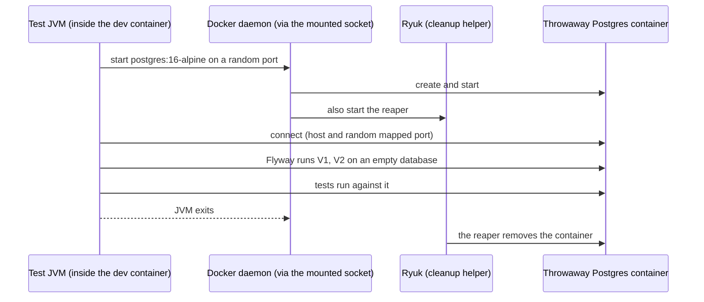

# 6. Testcontainers and JPA tests (planned)

> [!IMPORTANT]
> **Status: planned, not implemented.** We paused after the feasibility check. Nothing in this note has been run beyond the checks listed under "Verified so far".

## The problem

1. `@SpringBootTest` tests connect to the **real dev database** and run Flyway on it. They need it running and touch your data.
2. Nothing tests the **JPA layer for real**: dirty checking, `@Version`, the Flyway migrations from scratch, and `validate` against the migrations are only checked by hand. A mocked repository cannot find these bugs.

An in-memory database such as H2 is a **different engine** (types, identity columns, `timestamptz`, locking, errors), so a test can pass on H2 and fail on Postgres. We want the same engine as production, but disposable.

## How Testcontainers works

- The container gets a **random host port**, so tests never collide.
- Boot wires it with `@ServiceConnection`: URL, user and password come from the container, not from properties or environment variables.
- Ryuk removes leftovers even if the test JVM crashes.

## `@DataJpaTest`: the JPA slice

Like `@WebMvcTest` for the web layer, it starts **only** the persistence layer: entities, repositories, Hibernate, the datasource and Flyway.

- Each test runs in a transaction that is **rolled back** at the end, so tests leave no data behind.
- Because of the rollback, to see what Hibernate really wrote you must `flush()` (send pending SQL) and `clear()` (forget cached entities) before reading back.

| Behaviour | How it is proven |
|-----------|------------------|
| `V1` + `V2` apply on an **empty** database | Flyway runs when the context starts |
| Entities match the migrations | `ddl-auto=validate` fails the context otherwise |
| Generated id and round trip | Real INSERT and SELECT |
| Dirty checking | Change a field, `flush`, `clear`, reload |
| `@Version` conflict | Bump the version in SQL behind Hibernate's back, then update the stale entity |

## Our setup and its cost

Tests run **inside** the `dev` container, so it would need the Docker socket mounted (`/var/run/docker.sock`).

> [!CAUTION]
> Mounting the Docker socket lets anything running in `dev` control every container on the Docker VM (start, stop, mount host paths). That is acceptable on a personal learning machine and not on a shared one. The alternative without the socket is a second database (`hello_test`) in the existing Postgres, selected by a `test` profile.

Container-to-container networking (the test JVM reaching the Postgres it started) may need an extra setting. That is unverified until we run it.

## Verified so far

| Check | Result |
|-------|--------|
| Docker socket exists in the Docker VM and a root container can mount it | Yes |
| Socket available inside the `dev` container today | No |
| Testcontainers already a dependency of `hello-boot` | No |
| Boot 4.1.1 coordinates (from Spring Initializr), all `test` scope | `spring-boot-starter-data-jpa-test`, `spring-boot-testcontainers`, `org.testcontainers:testcontainers-junit-jupiter`, `org.testcontainers:testcontainers-postgresql` |

## Plan

1. Mount the socket into `dev`, add the four test dependencies, restart.
2. `MessageJpaRepositoryTest` with `@DataJpaTest` and a Postgres container: round trip, dirty checking, `@Version` conflict.
3. Break it on purpose (a migration and entity mismatch) and watch the test catch it.
4. Point the `@SpringBootTest` classes at the container so nothing uses the dev database.

## Interview questions

**Why Testcontainers instead of H2?**
It runs the real database engine, so SQL dialect, types, locking and constraint behaviour match production. H2 can hide production bugs.

**What does `@ServiceConnection` do?**
It derives the connection details (URL, credentials) from the container bean and registers them as Spring Boot connection details, replacing manual property wiring.

**Why must you `flush()` in a `@DataJpaTest`?**
The test transaction is rolled back and Hibernate delays SQL until flush. Without `flush()` and `clear()` you would only read back the cached in-memory entity and never see the real SQL effect.
