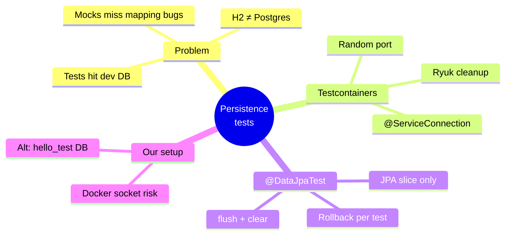
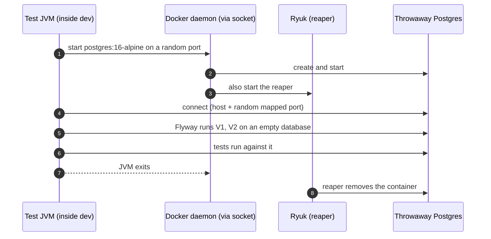

# 6. Testcontainers and JPA Tests — A Real Postgres, Thrown Away After (planned)

A mocked repository can't find a mapping bug, and an in-memory H2 is a **different
database engine**. To test persistence honestly you want the **same engine as production,
but disposable**: start a real Postgres in Docker for the test run, migrate it from scratch,
and delete it afterwards.

> [!IMPORTANT]
> **Status: planned, not implemented.** We paused after the feasibility check. Nothing in
> this note has been run beyond the checks listed under "Verified so far".

> [!TIP]
> **TL;DR: the 30-second interview answer**
> - **Testcontainers** starts a throwaway Postgres on a random port; **Ryuk** removes it even if the JVM crashes.
> - **`@DataJpaTest`** starts only the persistence layer, and each test **rolls back**, so it leaves no data behind.
> - **`@ServiceConnection`** wires URL/user/password from the container. To see real SQL effects, **`flush()` then `clear()`** before reading back.

## At a glance

## The problem

1. `@SpringBootTest` tests connect to the **real dev database** and run Flyway on it. They need it running and touch your data.
2. Nothing tests the **JPA layer for real**: dirty checking, `@Version`, the Flyway migrations from scratch, and `validate` against the migrations are only checked by hand. A mocked repository cannot find these bugs.

| Option | Same engine as prod? | Isolated per run? | Cost |
|---|---|---|---|
| Shared dev database | ✅ | ❌ Touches your data | Flaky, order-dependent tests |
| H2 in memory | ❌ Different types, identity, `timestamptz`, locking, errors | ✅ | Passes on H2, fails on Postgres |
| **Testcontainers Postgres** | ✅ | ✅ | Needs Docker; seconds to start |

## How Testcontainers works

- The container gets a **random host port**, so tests never collide.
- Boot wires it with `@ServiceConnection`: URL, user and password come from the container, not from properties or environment variables.
- Ryuk removes leftovers even if the test JVM crashes.

## `@DataJpaTest`: the JPA slice

Like `@WebMvcTest` for the web layer, it starts **only** the persistence layer: entities,
repositories, Hibernate, the datasource and Flyway.

- Each test runs in a transaction that is **rolled back** at the end, so tests leave no data behind.
- Because of the rollback, to see what Hibernate really wrote you must `flush()` (send pending SQL) and `clear()` (forget cached entities) before reading back.

| Behaviour | How it is proven |
|-----------|------------------|
| `V1` + `V2` apply on an **empty** database | Flyway runs when the context starts |
| Entities match the migrations | `ddl-auto=validate` fails the context otherwise |
| Generated id and round trip | Real INSERT and SELECT |
| Dirty checking | Change a field, `flush`, `clear`, reload |
| `@Version` conflict | Bump the version in SQL behind Hibernate's back, then update the stale entity |

## Our setup and its cost

Tests run **inside** the `dev` container, so it would need the Docker socket mounted
(`/var/run/docker.sock`).

> [!CAUTION]
> **Mounting the Docker socket lets anything in `dev` control every container on the
> Docker VM** (start, stop, mount host paths). That is acceptable on a personal learning
> machine and not on a shared one. The alternative without the socket is a second database
> (`hello_test`) in the existing Postgres, selected by a `test` profile.

Container-to-container networking (the test JVM reaching the Postgres it started) may need an
extra setting. That is unverified until we run it.

## Verified so far

| Check | Result |
|-------|--------|
| Docker socket exists in the Docker VM and a root container can mount it | Yes |
| Socket available inside the `dev` container today | No |
| Testcontainers already a dependency of `hello-boot` | No |
| Boot 4.1.1 coordinates (from Spring Initializr), all `test` scope | `spring-boot-starter-data-jpa-test`, `spring-boot-testcontainers`, `org.testcontainers:testcontainers-junit-jupiter`, `org.testcontainers:testcontainers-postgresql` |

## Plan

1. Mount the socket into `dev`, add the four test dependencies, restart.
2. `MessageJpaRepositoryTest` with `@DataJpaTest` and a Postgres container: round trip, dirty checking, `@Version` conflict.
3. Break it on purpose (a migration and entity mismatch) and watch the test catch it.
4. Point the `@SpringBootTest` classes at the container so nothing uses the dev database.

## Interview questions

Your repository tests pass on H2 but the same query fails in production on Postgres. How does that happen?

H2 is a different engine with a compatibility mode, not Postgres. Types (`timestamptz`,
`jsonb`), identity/sequence behaviour, Postgres-only SQL (`insert … returning`), locking and
constraint error codes all differ, so tests prove "works on H2". Testcontainers runs the real
Postgres image, so the test exercises the same SQL dialect and behaviour as production.

In a @DataJpaTest you save an entity, findById it, and assert the fields. The test passes even with a broken column mapping. Why?

`findById` returned the **same managed object** from the persistence context (the first-level
cache). No `INSERT` and no `SELECT` necessarily hit the database, so the mapping was never
exercised. Call `entityManager.flush()` (send the SQL) and `entityManager.clear()` (empty the
cache) before reading back, so the read is a real round trip.

A @DataJpaTest checks that an @TransactionalEventListener(phase = AFTER_COMMIT) fires, and it never does. Why?

`@DataJpaTest` wraps each test in a transaction that is **rolled back**, so there is never a
commit, and after-commit listeners never run. Test that behaviour with a committing test (e.g.
`@Transactional(propagation = NOT_SUPPORTED)` on the test, or a `@SpringBootTest` that
commits) and clean up explicitly.

The container starts on a random port each run. How does Spring Boot know the JDBC URL?

`@ServiceConnection` on the container bean (Boot 3.1+): Boot reads host, port and credentials
from the running container and registers them as connection details, overriding
`spring.datasource.*`. The older equivalent is `@DynamicPropertySource`, which sets the
properties from the container's getters.

Why is mounting /var/run/docker.sock into the dev container a security decision, not just configuration?

The socket is full control of the Docker daemon: anything in the container can start
privileged containers, mount host paths and stop other containers, which is effectively root
on the Docker host. Fine on a personal machine, not on shared infrastructure. A dedicated
`hello_test` database is the socket-free alternative.

## Key takeaways

| Remember | Because |
|---|---|
| Same engine, disposable instance | H2 hides Postgres-specific bugs |
| `@DataJpaTest` rolls back each test | No leftovers, but no commits either |
| `flush()` + `clear()` before asserting | Otherwise you read the cached object |
| `@ServiceConnection` wires the random port | No hard-coded URLs |
| The Docker socket = root on the host | Decide consciously; `hello_test` is the alternative |

**Next module:** [03 Observability overview](/notebook/spring-boot-system-design/03-observability/overview)
