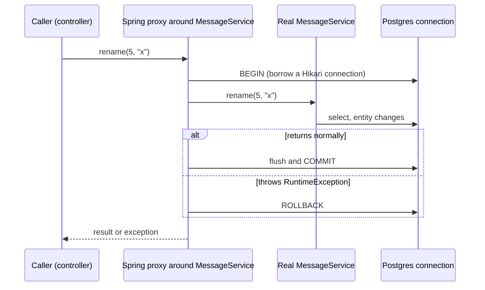

# 5. Transactions and locking

## Why transactions

Real operations touch several rows and must be **all-or-nothing**. Placing an order means insert the order, reduce stock, record the payment; if step 2 fails you cannot keep step 1.

| Letter | Guarantee |
|--------|-----------|
| **A**tomic | All statements commit, or none do |
| **C**onsistent | Constraints hold before and after |
| **I**solated | Concurrent transactions do not see each other's half-done work, to a degree you choose |
| **D**urable | Once committed, it survives a crash |

This is what a **single database** gives you. Across services (order and payment) there is no shared transaction, which is why the distributed stage needs the outbox pattern and sagas.

## How `@Transactional` works: a proxy



Spring does not change your class. A `BeanPostProcessor` wraps the bean in a proxy that opens the transaction before the method and commits or rolls back after. The transaction holds **one pooled connection** for its whole duration.

## What we reproduced *(verified in Postgres)*

| Scenario | Result |
|----------|--------|
| `@Transactional`, save "first", then a `RuntimeException` | **Nothing stored.** The INSERT was sent, then rolled back |
| Same, **without** `@Transactional` | `first` stays committed while the client gets a 500: **partial data** |
| `@Transactional`, then a **checked** `Exception` | **Committed**: the default only rolls back unchecked exceptions |
| Same with `@Transactional(rollbackFor = Exception.class)` | Rolled back |
| `outer()` (no annotation) calls `this.inner()` (`@Transactional`), which throws | Row stays: **no transaction** |
| Annotation moved to `outer()` | Rolled back |
| Two overlapping updates, no version | Both 200, the later commit **silently overwrites** the earlier |
| Same race with `@Version` | First commit 200, second **409**, first value survives |

> [!IMPORTANT]
> A rolled-back INSERT still consumed its sequence value, so ids have gaps (5 and 9 were skipped). Never rely on gap-free ids.

## The rules to remember

| Rule | Detail |
|------|--------|
| Default rollback | `RuntimeException` and `Error` roll back; **checked exceptions commit**. Change with `rollbackFor` |
| Self-invocation | The transaction lives in the **proxy**. `this.inner()` inside the same object bypasses it. Annotate the entry method that outside callers use, or call through another bean |
| `private` or `final` methods | `@Transactional` is ignored (a CGLIB proxy cannot override them) |
| Boundary | Put `@Transactional` on service methods, not on controllers or repositories |

> [!WARNING]
> A transaction holds a database connection for its whole duration. Keep transactions short and do not call slow remote services inside them. In the messaging stage this is why publishing to Kafka needs the outbox pattern.

## Propagation (not demonstrated)

| Propagation | Meaning | Typical use |
|-------------|---------|-------------|
| `REQUIRED` (default) | Join the current transaction or start one | Almost everything |
| `REQUIRES_NEW` | Suspend the current one, run in a new independent transaction | An audit row that must survive an outer rollback |
| `NESTED` | Savepoint inside the current transaction | Partial rollback |
| `SUPPORTS`, `MANDATORY`, `NEVER`, `NOT_SUPPORTED` | Run with, require, or forbid a transaction | Rare |

## Isolation (not demonstrated)

| Anomaly | Example |
|---------|---------|
| Dirty read | See another transaction's uncommitted change |
| Non-repeatable read | Same row read twice, different values |
| Phantom read | Same query, new rows appear |
| **Lost update** | Two transactions read, both write, one overwrite silently wins |

| Level | Postgres behaviour |
|-------|--------------------|
| `READ COMMITTED` (**default**; the Hibernate log showed `READ_COMMITTED`) | No dirty reads; the others possible |
| `REPEATABLE READ` | Snapshot per transaction; can fail with a serialization error to retry |
| `SERIALIZABLE` | As if run one after another; can fail and need retry |

Postgres treats `READ UNCOMMITTED` as `READ COMMITTED`. A higher level costs retries and contention.

## Preventing lost updates

| Approach | Idea | Cost |
|----------|------|------|
| **Optimistic locking** (`@Version`) | `UPDATE ... where id=? and version=?`; 0 rows matched means someone else won | No locks held; the loser must retry or report 409 |
| **Pessimistic locking** (`SELECT ... FOR UPDATE`) | Lock the row until commit | Blocks writers; deadlock and long-wait risk |

Optimistic locking as we built it *(verified)*:

```sql
-- V2 first (the "expand" step), then @Version on the entity
ALTER TABLE messages ADD COLUMN version BIGINT NOT NULL DEFAULT 0;
```

```text
update messages set created_at=?,text=?,version=? where id=? and version=?
```

0 rows updated makes Hibernate throw `ObjectOptimisticLockingFailureException`. Unhandled it is a 500; the central handler maps it to **409 Conflict**, and a controller slice test locks that in. For **inventory stock** in the capstone, both approaches appear.

## Not covered yet

Propagation in practice (`REQUIRES_NEW`), isolation with two `psql` sessions, pessimistic locking and deadlocks.

## Interview questions

**How does `@Transactional` work?**
A proxy created by a `BeanPostProcessor` wraps the bean. It begins a transaction before the method and commits afterwards, or rolls back on a `RuntimeException`. The target object is unaware.

**Why did my `@Transactional` method not roll back?**
Either it threw a checked exception (no rollback by default, use `rollbackFor`), or it was called from another method of the same class (self-invocation bypasses the proxy), or it is `private`/`final`, or the call was not made on the Spring bean.

**Default propagation and isolation?**
`REQUIRED` and the database default isolation (`READ COMMITTED` on Postgres).

**Optimistic vs pessimistic locking?**
Optimistic detects a conflict at write time with a version column and fails the loser; it holds no locks and suits low contention. Pessimistic locks rows up front (`FOR UPDATE`); it suits high contention but blocks and can deadlock.

**What does `@Transactional(readOnly = true)` do?** *(standard answer, not demonstrated)*
It is a hint: Hibernate can skip dirty checking and some drivers or databases can optimise. It does not make writes impossible by itself.

**Why can't a database transaction span two microservices?**
Each service owns its own database, so there is no shared transaction. You need patterns such as the transactional outbox and sagas, with eventual consistency.
