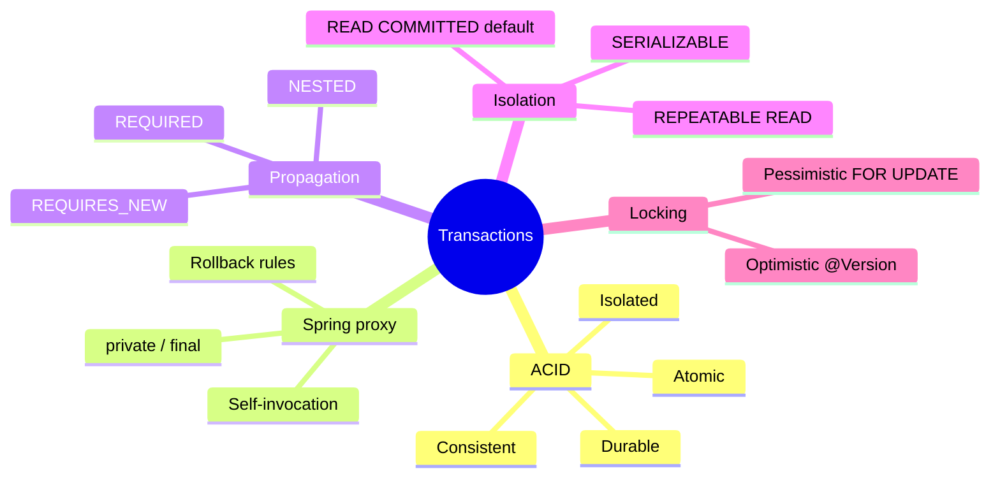
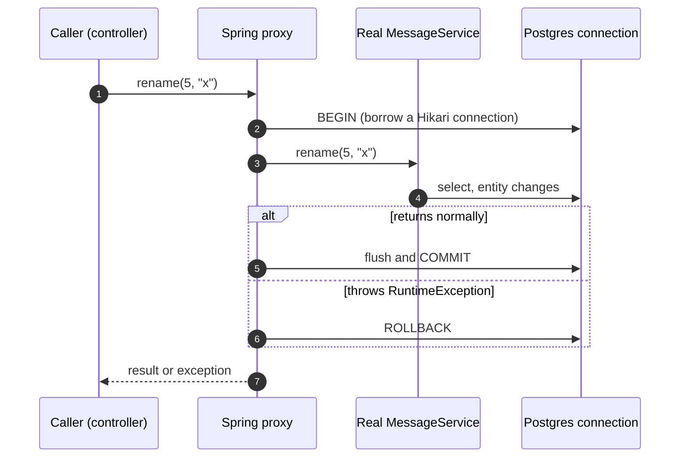
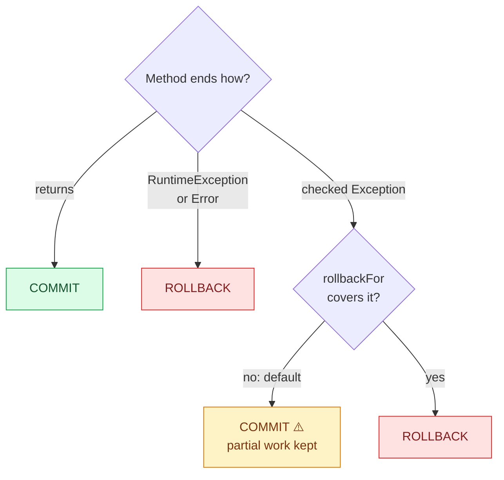
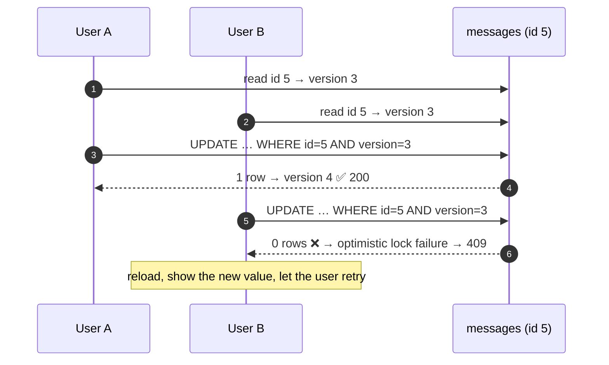

# 5. Transactions and Locking — All-or-Nothing, and Who Wins a Race

Real operations touch several rows and must be **all-or-nothing**: placing an order means
insert the order, reduce stock, record the payment. If step 2 fails you can't keep step 1.
And when two requests change the same row at once, **someone has to lose loudly**, not silently.

> [!TIP]
> **TL;DR: the 30-second interview answer**
> - `@Transactional` is a **proxy**: it begins before your method and commits after, or rolls back on a **`RuntimeException`**. **Checked exceptions commit** unless you set `rollbackFor`.
> - The proxy is bypassed by **self-invocation** (`this.inner()`) and doesn't apply to `private`/`final` methods.
> - Concurrent edits: **`@Version` optimistic locking** turns a silent lost update into a **409**. Use `SELECT … FOR UPDATE` only for high-contention rows.

## At a glance



## Why transactions

| Letter | Guarantee |
|--------|-----------|
| **A**tomic | All statements commit, or none do |
| **C**onsistent | Constraints hold before and after |
| **I**solated | Concurrent transactions do not see each other's half-done work, to a degree you choose |
| **D**urable | Once committed, it survives a crash |

This is what a **single database** gives you. Across services (order and payment) there is
no shared transaction, which is why the distributed stage needs the outbox pattern and sagas.

## How `@Transactional` works: a proxy



Spring does not change your class. A `BeanPostProcessor` wraps the bean in a proxy that opens
the transaction before the method and commits or rolls back after. The transaction holds
**one pooled connection** for its whole duration.

## Commit or roll back?



## What we reproduced *(verified in Postgres)*

| Scenario | Result |
|----------|--------|
| `@Transactional`, save "first", then a `RuntimeException` | **Nothing stored.** The INSERT was sent, then rolled back |
| Same, **without** `@Transactional` | `first` stays committed while the client gets a 500: **partial data** |
| `@Transactional`, then a **checked** `Exception` | **Committed**: the default only rolls back unchecked exceptions |
| Same with `@Transactional(rollbackFor = Exception.class)` | Rolled back |
| `outer()` (no annotation) calls `this.inner()` (`@Transactional`), which throws | Row stays: **no transaction** |
| Annotation moved to `outer()` | Rolled back |
| Two overlapping updates, no version | Both 200, the later commit **silently overwrites** the earlier |
| Same race with `@Version` | First commit 200, second **409**, first value survives |
| `create` saves a message, then an outbox row, and fails between them, **without** `@Transactional` on `create` | HTTP 500, but the message stays **committed** with 0 outbox rows |
| Same, with `@Transactional` on `create` | HTTP 500 and **no rows at all**: both saves joined one transaction (`REQUIRED`) |
| An `AFTER_COMMIT` listener throws after the commit | HTTP **200**, both rows committed, the exception only logged |

> [!IMPORTANT]
> **A rolled-back INSERT still consumed its sequence value**, so ids have gaps (5 and 9 were
> skipped). Never rely on gap-free ids.

## The rules to remember

| Rule | Detail |
|------|--------|
| Default rollback | `RuntimeException` and `Error` roll back; **checked exceptions commit**. Change with `rollbackFor` |
| Self-invocation | The transaction lives in the **proxy**. `this.inner()` inside the same object bypasses it. Annotate the entry method that outside callers use, or call through another bean |
| `private` or `final` methods | `@Transactional` is ignored (a CGLIB proxy cannot override them) |
| Boundary | Put `@Transactional` on service methods, not on controllers or repositories |

> [!WARNING]
> **A transaction holds a database connection for its whole duration.** Keep transactions
> short and don't call slow remote services inside them. In the messaging stage this is why
> publishing to Kafka needs the outbox pattern.

## Propagation (`REQUIRED` shown, the rest not demonstrated)

| Propagation | Meaning | Typical use |
|-------------|---------|-------------|
| `REQUIRED` (default) | Join the current transaction or start one | Almost everything |
| `REQUIRES_NEW` | Suspend the current one, run in a new independent transaction | An audit row that must survive an outer rollback |
| `NESTED` | Savepoint inside the current transaction | Partial rollback |
| `SUPPORTS`, `MANDATORY`, `NEVER`, `NOT_SUPPORTED` | Run with, require, or forbid a transaction | Rare |

`REQUIRED` was shown in the outbox work: `repository.save` and `outbox.save` each carry their own `@Transactional`, and wrapping them in a `@Transactional` `create` made both **join** one transaction, so a failure rolled both back (see [3. Transactional outbox](/notebook/spring-boot-system-design/05-distributed-problems/transactional-outbox)). `REQUIRES_NEW`, `NESTED` and the others are still undemonstrated.

## Isolation (not demonstrated)

| Anomaly | Example |
|---------|---------|
| Dirty read | See another transaction's uncommitted change |
| Non-repeatable read | Same row read twice, different values |
| Phantom read | Same query, new rows appear |
| **Lost update** | Two transactions read, both write, one overwrite silently wins |

| Level | Postgres behaviour |
|-------|--------------------|
| `READ COMMITTED` (**default**; the Hibernate log showed `READ_COMMITTED`) | No dirty reads; the others possible |
| `REPEATABLE READ` | Snapshot per transaction; can fail with a serialization error to retry |
| `SERIALIZABLE` | As if run one after another; can fail and need retry |

Postgres treats `READ UNCOMMITTED` as `READ COMMITTED`. A higher level costs retries and contention.

## Preventing lost updates



| Approach | Idea | Cost |
|----------|------|------|
| **Optimistic locking** (`@Version`) | `UPDATE ... where id=? and version=?`; 0 rows matched means someone else won | No locks held; the loser must retry or report 409 |
| **Pessimistic locking** (`SELECT ... FOR UPDATE`) | Lock the row until commit | Blocks writers; deadlock and long-wait risk |

Optimistic locking as we built it *(verified)*:

```sql
-- V2 first (the "expand" step), then @Version on the entity
ALTER TABLE messages ADD COLUMN version BIGINT NOT NULL DEFAULT 0;
```

```text
update messages set created_at=?,text=?,version=? where id=? and version=?
```

0 rows updated makes Hibernate throw `ObjectOptimisticLockingFailureException`. Unhandled it is
a 500; the central handler maps it to **409 Conflict**, and a controller slice test locks
that in. For **inventory stock** in the capstone, both approaches appear.

## Not covered yet

Propagation in practice (`REQUIRES_NEW`), isolation with two `psql` sessions, pessimistic
locking and deadlocks.

## Interview questions

<details>
<summary>placeOrder() saves the order, then a payment call throws a checked IOException. The method is @Transactional. Is the order saved?</summary>

**Yes**, it's committed *(verified with a checked exception)*. By default Spring rolls back
only on `RuntimeException` and `Error`; checked exceptions are treated as "expected outcomes"
and commit. Use `@Transactional(rollbackFor = Exception.class)` (or wrap the checked
exception in an unchecked one). Better still, don't make the remote call inside the
transaction at all.
</details>

<details>
<summary>outer() has no annotation and calls this.inner(), which is @Transactional and throws. The row inner() wrote is still there. Why?</summary>

Self-invocation *(verified)*. The transaction behaviour lives in the **proxy** around the
bean. `outer()` was called through the proxy, but it had no annotation, so no transaction
started; `this.inner()` is a plain Java call on the target object, so the proxy never sees it.
Fix: annotate the entry point (`outer()`), or move `inner()` to another bean so the call goes
through a proxy.
</details>

<details>
<summary>Two users edit message 5 at the same time; both get 200, and one edit vanishes. Explain and fix.</summary>

A **lost update** *(verified)*: both read the same state, both write, and the later commit
overwrites the earlier without any error. Add a `@Version` column. The `UPDATE` then includes
`and version = ?`, the second writer matches 0 rows, and Hibernate throws
`ObjectOptimisticLockingFailureException`, which we map to **409** so the client can reload
and retry *(verified)*.
</details>

<details>
<summary>An audit row must be written even when the business transaction rolls back. How, and what's the trap?</summary>

Write it in a separate transaction: `@Transactional(propagation = REQUIRES_NEW)` suspends the
outer transaction and commits independently. The trap is the same proxy rule: the
`REQUIRES_NEW` method must live in **another bean**, or self-invocation silently runs it inside
the outer transaction, which then rolls it back too. *(Not demonstrated here.)*
</details>

<details>
<summary>placeOrder() is @Transactional and calls the payment provider over HTTP. What goes wrong under load, and in failure cases?</summary>

Each in-flight order **holds a pooled DB connection** for the whole HTTP round-trip, so
slow payments exhaust Hikari (default 10) and unrelated requests time out. Worse, if the
charge succeeds and the commit then fails, the customer is charged for an order that
doesn't exist, because the HTTP call can't be rolled back. Keep the DB transaction short and
coordinate with the outbox pattern or a saga.
</details>

<details>
<summary>Order ids jump from 4 to 6 to 9. Is something deleting rows?</summary>

No *(verified)*. Sequences are non-transactional: a rolled-back `INSERT` still consumed its id,
so failed or rolled-back transactions leave gaps. Never rely on gap-free ids; use a separate
counter if the business truly needs consecutive numbers (e.g. invoice numbers).
</details>

<details>
<summary>A flash sale oversells: stock goes negative under concurrency. Optimistic or pessimistic locking?</summary>

With heavy contention on one row, optimistic locking makes almost every buyer fail and retry.
Use a **conditional atomic update**,
`UPDATE stock SET qty = qty - 1 WHERE id = ? AND qty >= 1`, and check the affected-row count,
or `SELECT … FOR UPDATE` to serialise buyers. Keep `@Version` for low-contention edits like
profile updates. *(Standard answer; pessimistic locking not yet demonstrated.)*
</details>

## Key takeaways

| Remember | Because |
|---|---|
| Rollback only on unchecked by default | Checked exceptions commit partial work |
| The proxy is the transaction | Self-invocation, `private`, `final` bypass it |
| `@Version` → 409 instead of silent overwrite | Lost updates become visible |
| No remote calls inside a transaction | Pool exhaustion + uncompensatable side effects |
| Sequence ids have gaps | Rolled-back inserts consume values |

**Next:** [6. Testcontainers and JPA tests](/notebook/spring-boot-system-design/02-persistence/testcontainers-and-jpa-tests)
