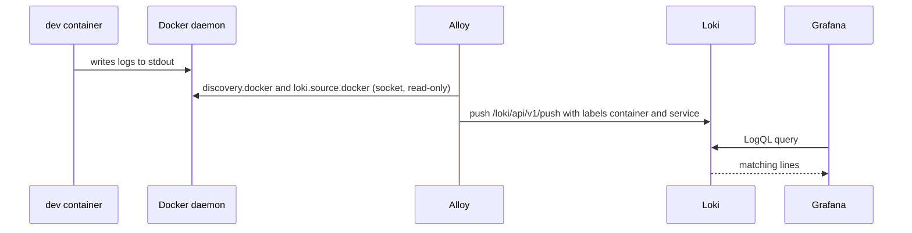

# 3. Log pipeline: Alloy, Loki and Grafana

## The pieces

| Piece | Job | Image |
|-------|-----|-------|
| **Alloy** | Collector: reads every container's stdout/stderr through the Docker socket and pushes it to Loki | `grafana/alloy:v1.20.1` |
| **Loki** | Log store: indexes only **labels** and stores the log lines compressed | `grafana/loki:3.6.18` |
| **Grafana** | UI: Explore with the Loki datasource and the LogQL query language | `grafana/grafana:13.2.4` |



## Configuration

```yaml
# compose.yaml (excerpt)
loki:
  image: grafana/loki:3.6.18
  ports: ["3100:3100"]

alloy:
  image: grafana/alloy:v1.20.1
  volumes:
    - ./infra/alloy/config.alloy:/etc/alloy/config.alloy:ro
    - /var/run/docker.sock:/var/run/docker.sock:ro
  depends_on: [loki]

grafana:
  image: grafana/grafana:13.2.4
  ports: ["3000:3000"]
  environment:
    GF_AUTH_ANONYMOUS_ENABLED: "true"
    GF_AUTH_ANONYMOUS_ORG_ROLE: Admin
    GF_AUTH_DISABLE_LOGIN_FORM: "true"
  volumes:
    - ./infra/grafana/provisioning:/etc/grafana/provisioning:ro
  depends_on: [loki]
```

```text
// infra/alloy/config.alloy (shape)
discovery.docker "containers"   { host = "unix:///var/run/docker.sock" }
discovery.relabel "containers"  { ... container name -> label container; compose service -> label service ... }
loki.source.docker "containers" { targets = discovery.docker.containers.targets, forward_to = [loki.write.local.receiver] }
loki.write "local"              { endpoint { url = "http://loki:3100/loki/api/v1/push" } }
```

The Loki datasource is provisioned by a file under `infra/grafana/provisioning/datasources/`, so Grafana starts with it ready.

## Querying one request *(verified)*

Open `http://localhost:3000`, Explore, datasource Loki:

```text
{service="dev"} |= "6ad34a82d9da13e3df4d1d56fccd1530"
```

| Request | Lines returned for its `traceId` |
|---------|----------------------------------|
| Failing `POST /messages` (blank text) | 2: the exception resolver `WARN` and the `http` line |
| `GET /messages/1` | 2: the `org.hibernate.SQL` select and the `http` line |

Labels seen on the stream: `container`, `service`, plus `service_name` and `detected_level` added automatically.

> [!IMPORTANT]
> The `traceId` is deliberately **not** a Loki label. Every label combination creates a separate stream, and a unique id per request would create millions of streams (high cardinality), which is what Loki is built to avoid. Labels select the stream (`service="dev"`), and `|=` filters lines inside it.

## Why this replaced Dozzle

Dozzle (a browser log viewer) was fine for tailing a container, but it only does text search. Loki gives label selection, line filters and a query language, and Grafana can later show metrics next to logs.

> [!WARNING]
> Alloy mounts the Docker socket read-only, but a socket mount is still broad access to the Docker VM. Grafana runs with anonymous admin and no login. Both are acceptable for local learning only.

## Interview questions

**How does Loki differ from Elasticsearch/ELK?**
Loki indexes only the labels and keeps the log text unindexed and compressed, so it is cheaper to run. Queries select streams by label first and then filter text. Elasticsearch indexes the full text, which is faster for arbitrary search and much heavier.

**What is LogQL?**
Loki's query language. A selector picks streams (`{service="dev"}`), then pipeline stages filter or parse lines (`|= "text"`, `|~ "regex"`, `| json`).

**Why must labels have low cardinality?**
Each unique label set is a separate stream with its own index and chunks. High-cardinality labels such as a trace id or user id blow up the index and slow queries.

**How would you ship logs from many services?**
A collector (Alloy, Promtail, Fluent Bit) per host or as a sidecar tails container logs and pushes to Loki. With structured JSON logs you can parse fields in the query instead of adding labels.
