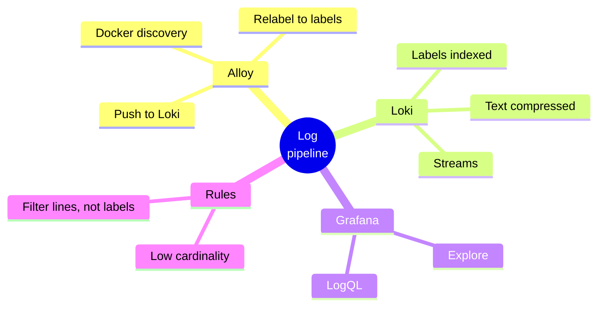
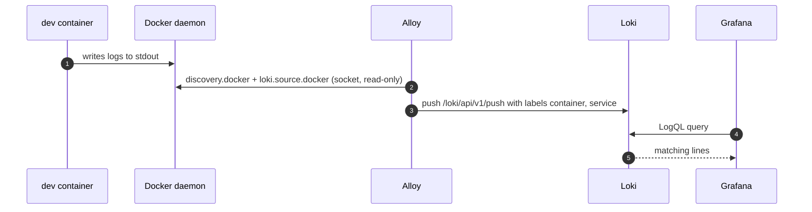
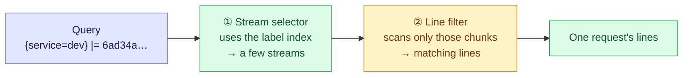

# 3. Log Pipeline: Alloy, Loki and Grafana — From stdout to a Query

Containers write logs to stdout; something has to **collect** them, **store** them cheaply
and let you **query** them. Loki's design choice is the whole story: it indexes **labels
only** (which service, which container), not the text, so it's cheap. In exchange, every
query must first narrow to a few streams.

> [!TIP]
> **TL;DR: the 30-second interview answer**
> - **Alloy** reads container logs via the Docker socket and pushes them to **Loki**; **Grafana** queries Loki with **LogQL**.
> - Loki indexes **labels**, not text. A query = **stream selector** `{service="dev"}` + **line filters** `|= "traceId"`.
> - Keep labels **low-cardinality**: a `traceId` or user id as a label would create millions of streams.

## At a glance



## The pieces

| Piece | Job | Image |
|-------|-----|-------|
| **Alloy** | Collector: reads every container's stdout/stderr through the Docker socket and pushes it to Loki | `grafana/alloy:v1.20.1` |
| **Loki** | Log store: indexes only **labels** and stores the log lines compressed | `grafana/loki:3.6.18` |
| **Grafana** | UI: Explore with the Loki datasource and the LogQL query language | `grafana/grafana:13.2.4` |



## Configuration

```yaml
# compose.yaml (excerpt)
loki:
  image: grafana/loki:3.6.18
  ports: ["3100:3100"]

alloy:
  image: grafana/alloy:v1.20.1
  volumes:
    - ./infra/alloy/config.alloy:/etc/alloy/config.alloy:ro
    - /var/run/docker.sock:/var/run/docker.sock:ro
  depends_on: [loki]

grafana:
  image: grafana/grafana:13.2.4
  ports: ["3000:3000"]
  environment:
    GF_AUTH_ANONYMOUS_ENABLED: "true"
    GF_AUTH_ANONYMOUS_ORG_ROLE: Admin
    GF_AUTH_DISABLE_LOGIN_FORM: "true"
  volumes:
    - ./infra/grafana/provisioning:/etc/grafana/provisioning:ro
  depends_on: [loki]
```

```text
// infra/alloy/config.alloy (shape)
discovery.docker "containers"   { host = "unix:///var/run/docker.sock" }
discovery.relabel "containers"  { ... container name -> label container; compose service -> label service ... }
loki.source.docker "containers" { targets = discovery.docker.containers.targets, forward_to = [loki.write.local.receiver] }
loki.write "local"              { endpoint { url = "http://loki:3100/loki/api/v1/push" } }
```

The Loki datasource is provisioned by a file under `infra/grafana/provisioning/datasources/`,
so Grafana starts with it ready.

## How a LogQL query runs



The selector is cheap (index lookup); the filter is a scan, so the narrower the selector, the
faster the query.

## Querying one request *(verified)*

Open `http://localhost:3000`, Explore, datasource Loki:

```text
{service="dev"} |= "6ad34a82d9da13e3df4d1d56fccd1530"
```

| Request | Lines returned for its `traceId` |
|---------|----------------------------------|
| Failing `POST /messages` (blank text) | 2: the exception resolver `WARN` and the `http` line |
| `GET /messages/1` | 2: the `org.hibernate.SQL` select and the `http` line |

Labels seen on the stream: `container`, `service`, plus `service_name` and `detected_level`
added automatically.

> [!IMPORTANT]
> **The `traceId` is deliberately not a Loki label.** Every label combination creates a
> separate stream, and a unique id per request would create millions of streams (high
> cardinality), which is what Loki is built to avoid. Labels select the stream
> (`service="dev"`), and `|=` filters lines inside it.

## Why this replaced Dozzle

Dozzle (a browser log viewer) was fine for tailing a container, but it only does text search.
Loki gives label selection, line filters and a query language, and Grafana can later show
metrics next to logs.

> [!WARNING]
> **Local-only security shortcuts.** Alloy mounts the Docker socket read-only, but a socket
> mount is still broad access to the Docker VM. Grafana runs with anonymous admin and no
> login. Both are acceptable for local learning only.

## Interview questions

<details>
<summary>A teammate wants traceId as a Loki label "so lookups are instant". What do you tell them?</summary>

Each unique label set is a separate **stream** with its own index entries and chunks. A
per-request id means one stream per request: millions of tiny streams, a bloated index, and
slower queries and ingestion. That high cardinality is exactly what Loki is designed to avoid.
Keep `traceId` in the line and filter it: `{service="dev"} |= "<id>"` is fast because the
selector already narrows to one service's streams.
</details>

<details>
<summary>Write a LogQL query for every 5xx request line from the dev service, then one that charts 5xx per minute.</summary>

Lines: `{service="dev"} |~ "-> 5[0-9]{2}"` (our `http` line format is `… -> 500 (12 ms)`).
Rate: `sum(count_over_time({service="dev"} |~ "-> 5[0-9]{2}" [1m]))`, a LogQL metric query
Grafana can graph. In production you'd alert on a real metric (`http.server.requests`) instead,
since counting log lines is fragile and costly at volume.
</details>

<details>
<summary>Loki vs Elasticsearch (ELK): when would you pick which?</summary>

Loki indexes only labels and stores compressed text, so it's **cheap** to run and scales on
object storage, but free-text search over a broad selector is a scan. Elasticsearch
**indexes the full text**, so arbitrary searches and aggregations are fast, at much higher
storage, memory and operational cost. Pick Loki for "find this request / this service's
errors" with a disciplined label set; ELK when people need ad-hoc full-text analytics.
</details>

<details>
<summary>Logs from a newly added container never show up in Grafana. How do you debug the pipeline?</summary>

Walk the pipeline in order:

1. Does the container log to **stdout/stderr** (not a file inside it)?
2. Did **Alloy** discover it? Check `discovery.docker` targets in Alloy's UI/logs, and that the relabel rules give it a `service` label.
3. Is Alloy's push to **Loki** succeeding (errors in Alloy's logs, Loki reachable at `loki:3100`)?
4. In Grafana, query by `{container="..."}` without filters to rule out a label mismatch.
</details>

<details>
<summary>Your logs are plain text. What would switching to structured JSON logs buy you in Loki?</summary>

With JSON lines, `| json` parses fields at query time, so you can filter on `status >= 500`
or `path="/messages"` precisely, without regexes and **without making those fields labels**,
which keeps cardinality low. It also makes queries robust to wording changes. Boot 3.4+
supports structured logging formats natively.
</details>

## Key takeaways

| Remember | Because |
|---|---|
| Alloy collects, Loki stores, Grafana queries | Three separate jobs, separately replaceable |
| Labels select streams, filters scan lines | Narrow selector = fast query |
| Never label by traceId / user id | High cardinality kills Loki |
| Alert on metrics, not log counts | Cheaper and less fragile |
| Socket mount + anonymous admin = local only | Both are broad access |

**Back to:** [Progress tracker](/notebook/spring-boot-system-design/progress)