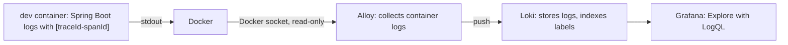

# 1. Overview

> [!NOTE]
> Module 3 is about seeing what a running service does. So far we built the **logs** half: every request writes one line, every line carries a `traceId`, and all container logs are queryable in Grafana. Metrics and exported traces are planned.

## Notes in this module

| # | Note | Question it answers |
|---|------|---------------------|
| 2 | Request logging and traceId | How do I find every log line of one request? |
| 3 | Log pipeline: Alloy, Loki and Grafana | Where do the logs go, and how do I query them? |

## The three signals

| Signal | Question it answers | Our stack | State |
|--------|--------------------|-----------|-------|
| **Logs** | What happened during this request? | Container stdout, Alloy, Loki, Grafana | Built |
| **Traces** | Where did the time go inside one request? | Micrometer Tracing creates the trace and span ids | Ids appear in logs; spans are not exported anywhere yet (no Zipkin or OpenTelemetry backend) |
| **Metrics** | How is the system behaving overall (rate, latency, errors, pool usage)? | Actuator + Micrometer + Prometheus + Grafana | Planned: Actuator is not a dependency yet |

Logs explain why one request failed; metrics tell you that the failure rate jumped at 3pm. Traces connect the two across services, which matters once Kafka sits between them.

## The log pipeline

> [!NOTE]
> We first used Dozzle, a browser viewer for container logs. It only does text search, so it was replaced by the pipeline above, which can query by label and by `traceId`.

## Interview questions

**Logs, metrics and traces: what is the difference?**
Logs are discrete events with context. Metrics are numeric time series aggregated over time (cheap to store, good for alerting). Traces follow one request across components and services, as spans with timings.

**What is a trace and what is a span?**
A trace is the whole journey of one request, identified by a `traceId`. A span is one timed step inside it (an HTTP handler, a SQL call), identified by a `spanId` with a parent span.

**Why do you want a `traceId` in every log line?**
To pull up every line, including SQL and errors, belonging to one request. In microservices the same id travels in request headers so one search covers all services.

**Prometheus vs Grafana?**
Prometheus scrapes and stores metrics as time series. Grafana visualises data from sources such as Prometheus or Loki and raises alerts. In Spring Boot, Actuator and Micrometer expose the metrics at `/actuator/prometheus`.
