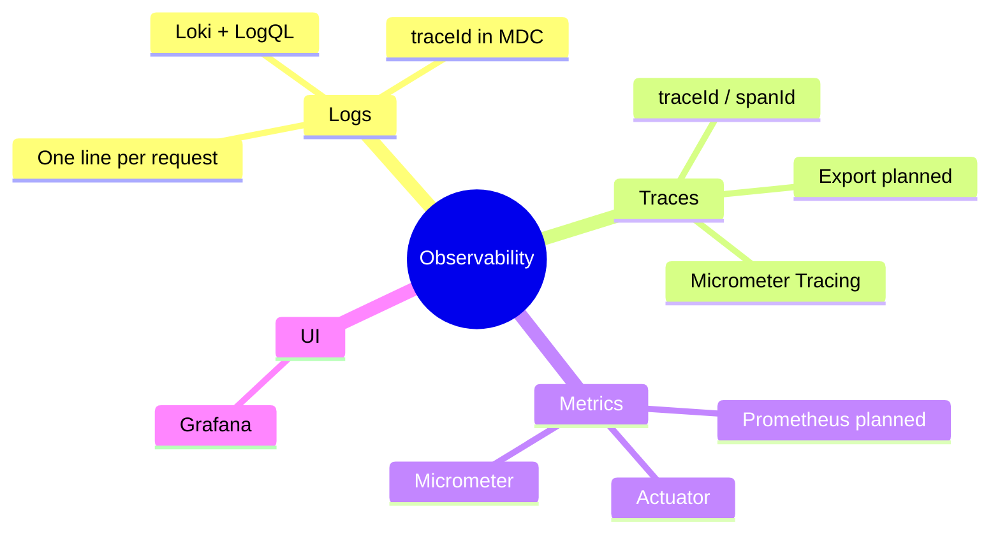
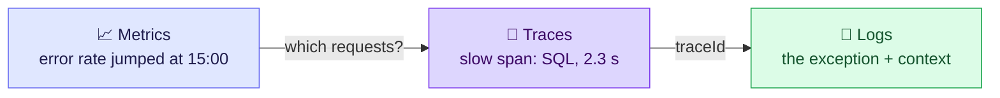
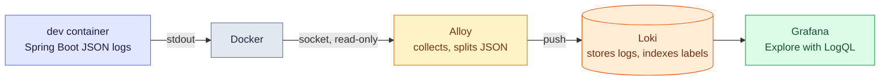

# 1. Overview — Seeing What a Running Service Does

A service in production is a black box until it tells you what it's doing. Observability
is three complementary signals: **metrics** tell you *that* something is wrong, **traces**
tell you *where*, and **logs** tell you *why*. Today we have the logs half, with a
`traceId` on every line, which is the thread that ties the other two together later.

> [!TIP]
> **TL;DR: the 30-second interview answer**
> - **Metrics** = cheap numeric time series for dashboards and alerts. **Logs** = detailed events. **Traces** = one request's path, as timed spans.
> - A **`traceId` in every log line** lets you pull up exactly one request's lines, across services once headers carry it.
> - Our pipeline: Spring Boot stdout → Docker → **Alloy** → **Loki** → **Grafana** (LogQL).

> [!NOTE]
> So far we built the **logs** half: every request writes one line, every line carries a
> `traceId`, and all container logs are queryable in Grafana. Metrics and exported traces
> are planned.

## At a glance

| # | Note | Question it answers |
|---|------|---------------------|
| 2 | Request logging and traceId | How do I find every log line of one request? |
| 3 | Log pipeline: Alloy, Loki and Grafana | Where do the logs go, and how do I query them? |
| 4 | Structured logs and the Logs viewer | How does a JSON line become labels and fields, and how do I search them in Grafana? |

## The three signals

That arrow is the investigation path: **alert on metrics, narrow with traces, explain with logs.**

| Signal | Question it answers | Our stack | State |
|--------|--------------------|-----------|-------|
| **Logs** | What happened during this request? | Container stdout, Alloy, Loki, Grafana | ✅ Built |
| **Traces** | Where did the time go inside one request? | Micrometer Tracing creates the trace and span ids | Ids appear in logs; spans are not exported anywhere yet (no Zipkin or OpenTelemetry backend) |
| **Metrics** | How is the system behaving overall (rate, latency, errors, pool usage)? | Actuator + Micrometer + Prometheus + Grafana | Planned: Actuator is not a dependency yet |

| | Metrics | Logs | Traces |
|---|---|---|---|
| Unit | Numbers over time | Events | Spans of one request |
| Cost at volume | ✅ Cheap (pre-aggregated) | ⚠️ Grows with traffic | ⚠️ Usually sampled |
| Best for | Alerts, dashboards | Root cause detail | Latency breakdown across services |

## The log pipeline

> [!NOTE]
> We first used Dozzle, a browser viewer for container logs. It only does text search, so it
> was replaced by the pipeline above, which can query by label and by `traceId`.

## Interview questions

An alert fires: 5xx rate jumped at 15:00. Walk through how you'd get from the alert to the failing line of code.

1. **Metrics** give the when and where: which service, which endpoint, since 15:00.
2. **Traces** for failing requests in that window show which span failed or was slow (a SQL
   call, a downstream service).
3. Take a failing request's **`traceId`** and query the **logs** for it: the exception, its
   stack trace and the request context.

Today we can only do step 3 (logs with traceId); metrics and exported traces are planned.

Why not just count errors from the logs instead of running a metrics system?

Logs scale with traffic: counting means scanning every line, which is slow and expensive at
volume, and a format change silently breaks the count. Metrics are **pre-aggregated
counters** (one number per interval per series), cheap to store and query, so they're what
alerting should run on. Logs are for the detail once you know where to look.

A customer says "my checkout failed around 10:42". How do you find their request, now and ideally?

**Now:** search the logs around 10:42 for the endpoint and status, find their line, take its
`traceId`, then query everything with that id. **Ideally:** return the `traceId` in a response
header (`X-Trace-Id`) or show it on the error page, so the customer or support hands you the
exact id. That's not done yet in our app.

Order service publishes to Kafka and payment service consumes. How does one trace span both?

The producer adds the trace context to the **message headers** (W3C `traceparent` / B3), and
the consumer extracts it and starts a child span, so both services log the same `traceId`.
Micrometer Tracing instruments Spring Kafka for this when observation is enabled. *(Standard
behaviour, not tested here.)*

Dev records 100% of traces. Would you do that in production?

Usually not: exporting every span costs network, storage and money at high traffic. Sample
a fraction (`management.tracing.sampling.probability`), and/or use **tail-based sampling** in
a collector to keep all errors and slow traces while dropping routine ones.

## Key takeaways

| Remember | Because |
|---|---|
| Metrics alert, traces locate, logs explain | Each signal answers a different question |
| `traceId` in every log line | One query returns one request's story |
| Metrics for counting, not logs | Pre-aggregated is cheap and stable |
| Propagate trace context in headers | That's how a trace crosses services and Kafka |

**Next:** [2. Request logging and traceId](/notebook/spring-boot-system-design/03-observability/request-logging-and-traceid)
