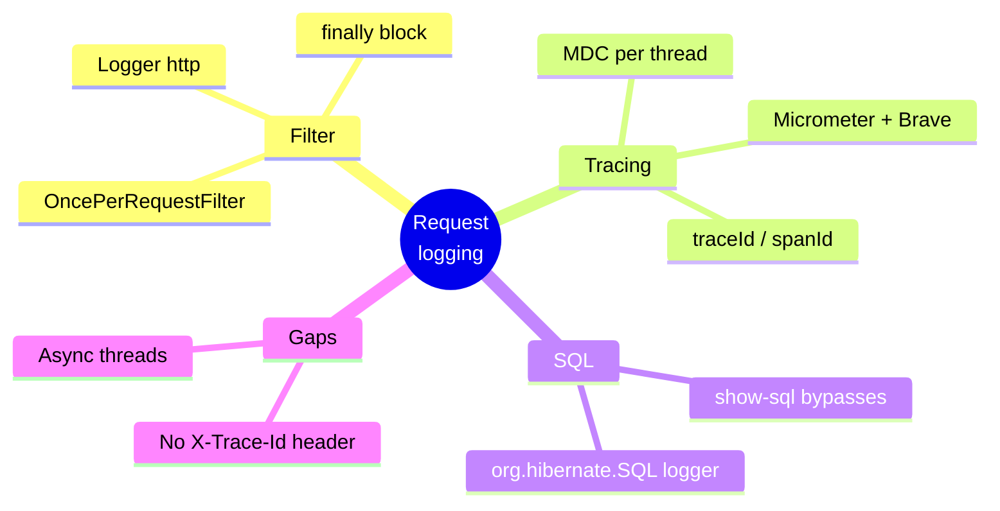
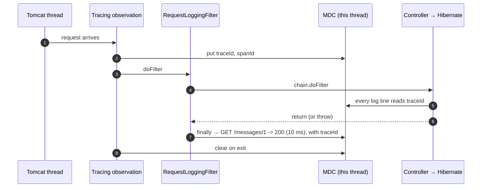

# 2. Request Logging and traceId — Every Line of One Request

The goal: find every log line of **one** request, without the startup noise and without
other requests mixed in. Two pieces do it: a filter that writes **one summary line per
request**, and tracing that stamps a **`traceId`** on every line logged while that request runs.

> [!TIP]
> **TL;DR: the 30-second interview answer**
> - A **`OncePerRequestFilter`** logs `METHOD path -> status (ms)` in a `finally` block, so failures are logged too.
> - **Micrometer Tracing** puts `traceId`/`spanId` into the logging **MDC** (a per-thread map); the log pattern prints them on every line.
> - MDC is **thread-bound**: async work loses the id unless the context is propagated. `show-sql` bypasses logging, so use the `org.hibernate.SQL` logger.

## At a glance



## How a line gets its traceId



The filter runs **inside** the observation, so the MDC is still populated when its `finally`
executes.

## One line per request

```java
@Component
public class RequestLoggingFilter extends OncePerRequestFilter {

    private static final Logger log = LoggerFactory.getLogger("http");

    @Override
    protected void doFilterInternal(HttpServletRequest request, HttpServletResponse response,
            FilterChain chain) throws ServletException, IOException {
        long start = System.nanoTime();
        try {
            chain.doFilter(request, response);
        }
        finally {
            long ms = (System.nanoTime() - start) / 1_000_000;
            String query = request.getQueryString() == null ? "" : "?" + request.getQueryString();
            log.info("{} {}{} -> {} ({} ms)", request.getMethod(), request.getRequestURI(), query,
                    response.getStatus(), ms);
        }
    }
}
```

`OncePerRequestFilter` guarantees one execution per request even with forwards and error
dispatches. The log happens in `finally`, so the status and duration are known and it is
written even when the request failed.

## The traceId

Two dependencies add tracing *(coordinates taken from Spring Initializr for Boot 4.1.1)*:

```xml
<dependency>
    <groupId>org.springframework.boot</groupId>
    <artifactId>spring-boot-micrometer-tracing-brave</artifactId>
</dependency>
<dependency>
    <groupId>io.micrometer</groupId>
    <artifactId>micrometer-tracing-bridge-brave</artifactId>
</dependency>
```

```properties
# application-dev.properties
management.tracing.sampling.probability=1.0
```

For each request, Micrometer Tracing creates a trace context and puts `traceId` and `spanId`
into the logging **MDC**. Boot's log pattern then prints them as `[traceId-spanId]`. Real
output *(verified)*:

```text
INFO 154 --- [hello-boot] [nio-8080-exec-2] [6ad34a82d9da13e3df4d1d56fccd1530-df4d1d56fccd1530] http : GET /messages/1 -> 200 (10 ms)
```

For a failing `POST`, the exception resolver's `WARN` and our `http` line carried the **same**
`traceId`, so the two are linked.

> [!NOTE]
> The dev profile now logs **JSON** (`logging.structured.format.console=logstash`) instead of
> this text pattern; `traceId`, `spanId` and the request fields become JSON keys. See
> [note 4](/notebook/spring-boot-system-design/03-observability/structured-logs-and-logs-viewer).

> [!WARNING]
> **`management.tracing.sampling.probability` is flagged as unknown in Boot 4 by the
> editor.** The `traceId` appears in the logs regardless, but I did not confirm that this
> property takes effect, so treat it as unverified.

## SQL carries the traceId too

| Setting | Goes through logging? | Has traceId? |
|---|---|---|
| `spring.jpa.show-sql=true` | ❌ Writes straight to stdout | ❌ |
| `logging.level.org.hibernate.SQL=DEBUG` | ✅ A normal logger | ✅ |

A `GET /messages/1` then produced two lines with the same trace *(verified)*: the `select`
from `org.hibernate.SQL` and the `http` line.

## Where the remaining noise comes from

Most clutter is not from requests. Every file save makes Spring DevTools restart the
application context, which reprints the whole startup block (banner, Hikari, Flyway, the
Hibernate "Database info" block). Earlier we also tried `logging.level.web=DEBUG`; it gave
per-request detail (`Mapped to ...`) but was too loud, so the dedicated `http` logger replaced it.

## Not done

The client does not receive the `traceId`, so you read it from a log line. A response header
such as `X-Trace-Id` would let `curl -i` show it directly.

## Interview questions

<details>
<summary>A @Service method hands work to an @Async method; its log lines have no traceId. Why, and how do you fix it?</summary>

The MDC is a **per-thread** map. `@Async` runs on an executor thread that never received the
request's context, so its lines have empty trace fields. Propagate the context when handing
work over: a `TaskDecorator` that captures and restores it (Spring's
`ContextPropagatingTaskDecorator`, backed by Micrometer's context-propagation library) on the
executor. The same applies to `CompletableFuture` on custom pools. *(Standard answer, not
tested here.)*
</details>

<details>
<summary>An exception escapes the whole MVC stack; the client gets a 500, but our http line logs 200. How is that possible?</summary>

The `finally` runs **as the exception passes through the filter**, before the container's
error handling sets the 500 and renders the error page. At that moment `response.getStatus()`
is still the default 200. Handled exceptions don't show this, because Spring sets the status
before returning to the filter. Fix: catch the exception in the filter, record 500 for the
log line, and rethrow. *(Reasoned from the servlet lifecycle, not reproduced.)*
</details>

<details>
<summary>Why OncePerRequestFilter rather than a plain Filter for request logging?</summary>

A request can pass the filter chain more than once: an internal forward, or the **error
dispatch** to `/error` after a failure. A plain `Filter` would log twice (or more) for one
client request. `OncePerRequestFilter` marks the request and skips re-entry.
</details>

<details>
<summary>Hibernate SQL lines appear in the console but are missing in Grafana when you filter by traceId. Why?</summary>

`spring.jpa.show-sql=true` prints with `System.out`, bypassing the logging framework, so those
lines have no pattern, no MDC and no `traceId` *(verified)*. Turn it off and enable
`logging.level.org.hibernate.SQL=DEBUG`, so SQL goes through a logger and carries the trace.
</details>

<details>
<summary>Support wants customers to quote an id when they report errors. What would you add?</summary>

Return the trace id in a response header (`X-Trace-Id`) from a filter that reads the current
span, and include it in the JSON error body. Then a support ticket contains the exact
`traceId` to paste into Grafana, with no searching by time window.
</details>

<details>
<summary>Why not log request and response bodies by default?</summary>

Bodies can contain passwords, tokens and personal data, and logs are widely accessible and
long-lived. They also multiply log volume and cost. Log metadata (method, path, status,
duration, traceId) and add body logging deliberately, redacted, for specific endpoints.
</details>

## Key takeaways

| Remember | Because |
|---|---|
| Log in `finally` inside `OncePerRequestFilter` | Status/duration known; no double logs |
| traceId lives in the MDC | Every logger on that thread prints it |
| MDC is per thread | Async work needs context propagation |
| Use the `org.hibernate.SQL` logger | `show-sql` bypasses logging |
| No bodies by default | Secrets, PII, volume |

**Next:** [3. Log pipeline: Alloy, Loki and Grafana](/notebook/spring-boot-system-design/03-observability/log-pipeline-loki-grafana)