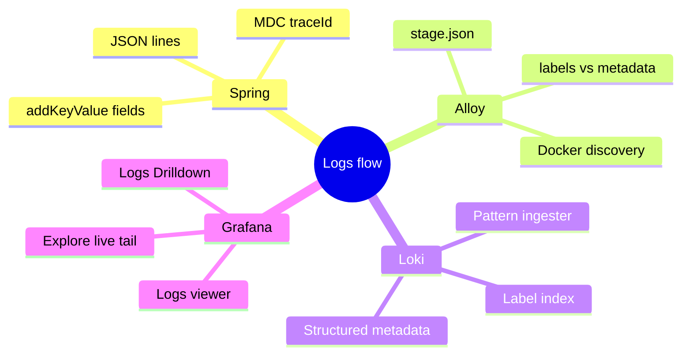
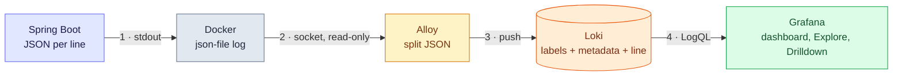
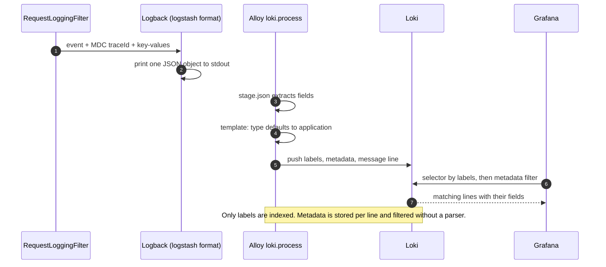
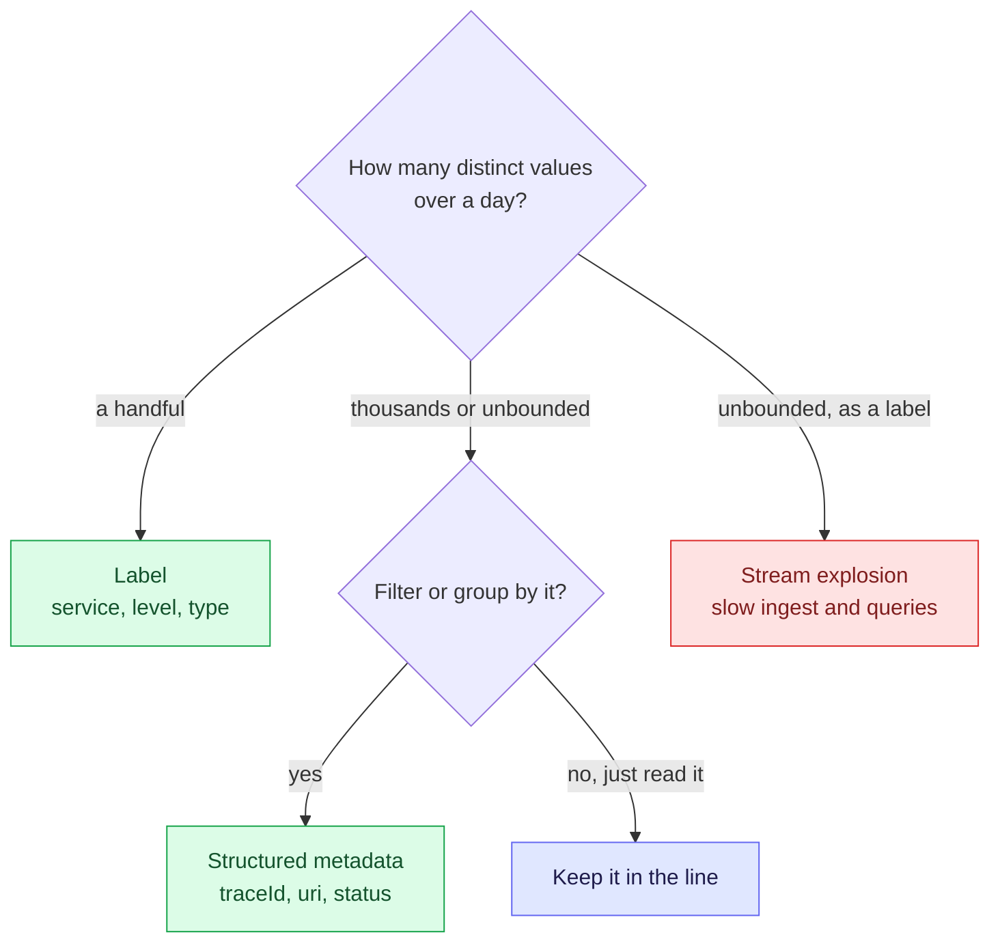

# 4. Structured Logs and the Logs Viewer — How the Grafana Flow Really Works

A log line only becomes searchable by field once something has **split it into fields**. In this
workspace Spring writes JSON, Alloy splits it, Loki stores the pieces in three different places
(labels, structured metadata, the line), and Grafana queries them. Knowing **which piece lives
where** explains every query that is fast, slow or impossible.

> [!TIP]
> **TL;DR: the 30-second interview answer**
> - Spring Boot's **structured logging** (`logging.structured.format.console=logstash`) prints one JSON object per line; MDC values (`traceId`) and SLF4J **key-value pairs** (`uri`, `status`) become JSON fields.
> - **Alloy** parses the JSON and sends low-cardinality fields as **labels** (`service`, `level`, `type`) and high-cardinality ones as **structured metadata** (`traceId`, `uri`, `status`); the line itself keeps only the message.
> - **Grafana** queries Loki with LogQL: `{service="dev", type="request"} | uri=~".*/foo.*" and status >= 400`. Labels pick the streams (index), metadata filters lines (no parser needed).

## At a glance



| # | Stage | Lives in | Question it answers |
|---|-------|----------|---------------------|
| 1 | Spring structured logging | `application-dev.properties`, `RequestLoggingFilter` | What does one log line look like? |
| 2 | Alloy | `infra/alloy/config.alloy` | How does a JSON line become labels and fields? |
| 3 | Loki | `infra/loki/config.yaml` | Where is each field stored, and what is indexed? |
| 4 | Grafana | `infra/grafana/provisioning/`, `infra/grafana/dashgen/` | How do I search and read logs? |

## Mental model



Notice that **Alloy is where the meaning is added**. Spring only prints text; Loki only stores what
it is given. If Alloy did not split the JSON, Loki would hold one opaque string per line and every
query would need a parser or a regex.

## How one request line travels

The same `GET /foo/y3` request, at each stage *(verified, values from the running stack)*:

| Stage | What it looks like |
|-------|--------------------|
| Java | `log.atInfo().addKeyValue("uri", ...).addKeyValue("status", ...).log("{} {} -> {} ({} ms)", ...)` |
| stdout (JSON) | `{"message":"GET /foo/y3 -> 404 (7 ms)","logger_name":"http","level":"INFO","traceId":"6adc…","type":"request","method":"GET","uri":"/foo/y3","status":404,"duration_ms":7}` |
| Loki labels | `service="dev"`, `container=…`, `level="INFO"`, `type="request"` (+ `service_name`, `detected_level` added by Loki) |
| Loki structured metadata | `traceId`, `spanId`, `logger`, `thread`, `method`, `uri`, `status`, `duration_ms` |
| Loki line | `GET /foo/y3 -> 404 (7 ms)` |
| Grafana row | `20:47:28.942  INFO  GET /foo/y3 -> 404 (7 ms)`; click it to see the fields and a **"All logs of this request"** link on `traceId` |



Steps 3 to 5 are the heart of it: Alloy decides, field by field, whether something becomes a
label, metadata, or part of the line.

## Labels vs structured metadata vs the line

| | **Label** | **Structured metadata** | **Line** |
|---|---|---|---|
| Our fields | `service`, `container`, `level`, `type` | `traceId`, `spanId`, `uri`, `status`, `duration_ms`, `logger`, `method`, `thread` | the message (+ stack trace) |
| Indexed? | ✅ Yes, defines the **stream** | ❌ No, stored next to each line | ❌ No, compressed text |
| Query syntax | `{type="request"}` | `\| uri=~".*/foo.*"` | `\|= "timeout"` |
| Cost of many values | ⚠️ Each new combination = a new stream | ✅ Fine | ✅ Fine |
| Use for | Few, stable values you always narrow by | Per-request values you filter or group by | Free text a human reads |

## Choosing where a field goes



The red box is the classic mistake: a `traceId` or `uri` as a label creates one stream per value.

## In code

**1 · Spring: JSON lines and extra fields.** One property switches Boot's console appender to a
structured formatter; MDC entries (Micrometer Tracing puts `traceId`/`spanId` there) are included
automatically.

```properties
# application-dev.properties
logging.structured.format.console=logstash
```

```java
// RequestLoggingFilter: key-value pairs become top-level JSON fields (verified)
log.atInfo()
    .addKeyValue("type", "request")
    .addKeyValue("method", request.getMethod())
    .addKeyValue("uri", request.getRequestURI())
    .addKeyValue("status", response.getStatus())
    .addKeyValue("duration_ms", ms)
    .log("{} {}{} -> {} ({} ms)", request.getMethod(), request.getRequestURI(), query,
            response.getStatus(), ms);
```

**2 · Alloy: split the JSON.** Only lines from `service="dev"` are JSON, so the parsing sits in a
`stage.match`. Stages run top to bottom on each line.

```text
// infra/alloy/config.alloy (excerpt)
loki.process "fields" {
  stage.match {
    selector = "{service=\"dev\"}"
    stage.json { expressions = { msg = "message", level = "", logger = "logger_name", traceId = "", type = "", uri = "", status = "" } }
    stage.template { source = "type"  template = "{{ if .type }}{{ .type }}{{ else }}application{{ end }}" }
    stage.labels              { values = { level = "", type = "" } }
    stage.structured_metadata { values = { logger = "", traceId = "", uri = "", status = "" } }
    stage.output { source = "msg" }   // the stored line becomes just the message
  }
  stage.match {
    selector = "{service!=\"dev\"}"
    stage.static_labels { values = { type = "infra" } }   // postgres, kafka: plain text
  }
  forward_to = [loki.write.local.receiver]
}
```

**3 · Loki: the image default plus three additions.**

```yaml
# infra/loki/config.yaml (added part)
pattern_ingester:
  enabled: true                     # "Patterns" tab in Logs Drilldown
limits_config:
  allow_structured_metadata: true
  volume_enabled: true              # volume queries used by Logs Drilldown
  discover_log_levels: true         # detected_level for plain-text lines
```

**4 · Grafana: provisioned data source with a derived field.** The uid is pinned so the
generated dashboard can refer to it; the derived field turns `traceId` into a link.

```yaml
# infra/grafana/provisioning/datasources/loki.yaml (excerpt)
- name: Loki
  uid: loki
  type: loki
  url: http://loki:3100
  jsonData:
    derivedFields:
      - name: traceId
        matcherType: label          # read from labels/metadata, not a regex on the text
        matcherRegex: traceId
        datasourceUid: loki
        url: '{service=~".+"} | traceId="${__value.raw}"'
        urlDisplayLabel: All logs of this request
```

Every panel of the dashboard is built from the same template, so the filter bar applies everywhere:

```text
{service=~"$service", type=~"$type", level=~"$level"} $noise |= `$search` $query
```

`$query` is the free **Query (LogQL)** box: whatever pipeline you type is appended as is. `$noise`
hides `OutboxRelay`'s poll SQL (`!= "published_at is null"`) unless switched to Show.

## The three viewers

| Viewer | Open | Best for | Refresh |
|--------|------|----------|---------|
| **Logs viewer** dashboard | `localhost:3000/d/app-logs-live` | Overview: stats, charts, endpoint tables, separate log panels, one filter bar | Off by default; click Refresh |
| **Explore** | Grafana → Explore → Loki | Writing a query (code or builder mode), **Live** tail | Live streams new lines without redrawing old ones |
| **Logs Drilldown** | Grafana → Drilldown → Logs | Clicking instead of typing: per-service volume, levels, fields, patterns | On demand |

The dashboard JSON is **generated**: edit `infra/grafana/dashgen/build.cjs`, run it, run
`test.cjs` (runs every panel query against Loki), then `docker compose restart grafana`.

### Query cheat sheet *(the first three verified)*

| I want | LogQL |
|--------|-------|
| Requests to paths containing `/foo` | `{service="dev", type="request"} \| uri=~".*/foo.*"` |
| Failed requests | `{type="request"} \| status >= 400` |
| Warnings from the app | `{service="dev", type="application", level="WARN"}` |
| Every line of one request | `{service=~".+"} \| traceId="6adc…"` (or click the link in log details) |
| Outbox and Kafka activity | `{service="dev"} \| logger=~".*(Outbox\|MessageEvents).*"` |
| p95 latency per endpoint | `quantile_over_time(0.95, {type="request"} \| unwrap duration_ms [5m]) by (uri)` |

## Pitfalls we hit

> [!WARNING]
> **An auto-refreshing dashboard is a bad log reader.** The first dashboard refreshed every 5 s;
> each refresh re-ran every query and redrew the log panels, so an expanded row collapsed while
> being read. Fix: refresh off by default, and use Explore's Live mode for streaming.

> [!WARNING]
> **A JSON string in the line is not fields.** When OpenObserve was tried, a JSON line pushed
> through its Loki-compatible endpoint landed as one string in `message` *(verified)*. Loki is
> the same: without Alloy's `stage.json` you need `| json` at query time. Parse once, at
> collection, and send fields as metadata.

> [!CAUTION]
> **Loki has no volume here.** Recreating the `loki` container (for example after changing its
> config mount) drops all stored logs. Fine for learning; add a named volume if history matters.

| Symptom | Cause | Fix |
|---------|-------|-----|
| Expanded log row collapses every few seconds | Dashboard auto-refresh redraws panels | Refresh off; Explore Live for tailing |
| Grafana page crashes: `Unsupported 'dark-gray' color` | Panel JSON used a colour name Grafana doesn't know | Use hex colours (`#9ca3af`) or base palette names only |
| Edited dashboard JSON, Grafana shows the old one | Provisioned file not reloaded yet | `docker compose restart grafana` |
| `docker compose logs dev` is unreadable JSON | Structured logging is on in the dev profile | Read logs in Grafana; or remove the property |
| Metric query returns hundreds of series | Metadata fields act like labels in metric queries | Always aggregate: `sum(...)`, `sum by (status)`, `quantile_over_time(...) by ()` *(why we aggregate; the un-aggregated case was not tested)* |
| OpenObserve needed `CAST(status AS INT)` | Metadata values travel as strings | In LogQL, `status >= 400` converts the string itself *(verified)* |

## Interview questions

<details>
<summary>You add uri as a Loki label "so filtering by path is fast". A week later ingestion slows and queries time out. Explain.</summary>

Every distinct label combination is a separate **stream** with its own index entries and chunks.
`uri` includes ids (`/messages/992`), so each new id creates a new stream: high cardinality, a
bloated index and thousands of tiny chunks. Keep labels to a few stable values (`service`,
`level`, `type`) and put `uri` in **structured metadata**, where `| uri=~"..."` filters it
without creating streams.
</details>

<details>
<summary>Your Spring app logs plain text. Walk me through making status filterable in Loki without regexes.</summary>

1. Turn on Boot's structured logging: `logging.structured.format.console=logstash` (or `ecs`).
2. Add the field to the event with SLF4J's fluent API, `log.atInfo().addKeyValue("status", ...)`, or put it in the MDC. The formatter writes it as a JSON key.
3. In the collector (Alloy), parse with `stage.json` and send `status` as structured metadata.
4. Query `{service="dev"} | status >= 500`. Without step 3 you can still use `| json | status >= 500`, but every query pays the parse.
</details>

<details>
<summary>A user expands a log row on a dashboard set to refresh every 5 s, and the row keeps closing. Why, and what would you change?</summary>

A dashboard refresh re-runs every panel query and re-renders the panel with the new result set,
so UI state such as an expanded row is lost. Logs are read, not glanced at, so turn auto-refresh
off for log panels (refresh on demand) and use Explore's **Live** mode, which appends new lines
without replacing the old ones.
</details>

<details>
<summary>An incident ticket gives you one traceId. How do you get every log line of that request, and why is it fast?</summary>

Query `{service=~".+"} | traceId="<id>"`, or click the derived-field link "All logs of this
request" in any line's details. The selector uses the label index to pick the streams; the
`traceId` filter then checks structured metadata stored next to each line, without parsing the
text. Narrowing the selector (`{service="dev"}`) makes it faster still.
</details>

<details>
<summary>Why does this setup parse JSON in Alloy instead of at query time with | json?</summary>

Parsing at collection happens once per line; `| json` runs on every query over every line in the
range. Collection-time parsing also lets you decide storage per field (label vs metadata), set
defaults (`type` = `application`), and keep the stored line human-readable (just the message).
The trade-off: a new field needs an Alloy config change, while `| json` sees every field
immediately.
</details>

## Key takeaways

| Remember | Because |
|---|---|
| Structured logging = one Boot property | `logging.structured.format.console` prints JSON with MDC and key-value pairs |
| Alloy decides label vs metadata vs line | Loki stores exactly what it is given |
| Labels: few values; metadata: per-request values | Labels create streams, metadata doesn't |
| Selector first, then filters | The index narrows streams; filters scan only those |
| Log panels: no auto refresh | Re-render loses expanded rows; use Explore Live |
| The dashboard is generated and tested | Edit `build.cjs`, run `test.cjs`, restart Grafana |

**Related:** [Log pipeline: Alloy, Loki and Grafana](/notebook/spring-boot-system-design/03-observability/log-pipeline-loki-grafana) · [Request logging and traceId](/notebook/spring-boot-system-design/03-observability/request-logging-and-traceid) · [Dev environment](/notebook/spring-boot-system-design/00-workspace/dev-environment)
