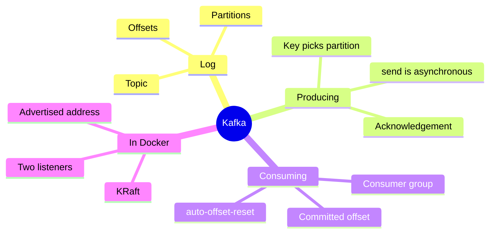
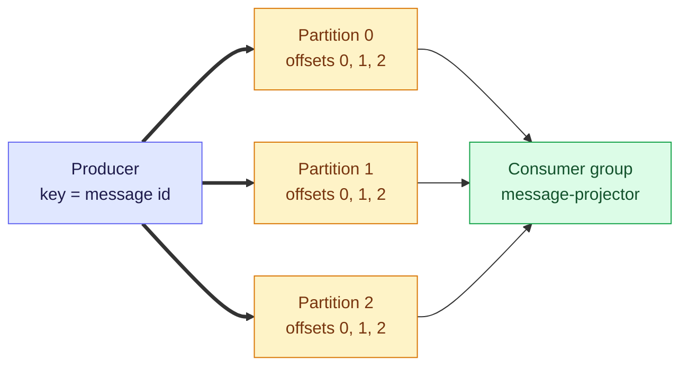
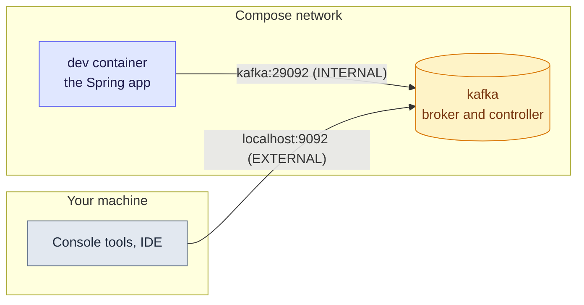

# 2. Kafka with Spring Boot — Topics, Partitions and Consumer Groups

Kafka is a **durable log**, not a queue that forgets. Producers append, consumers remember their own position, and the one setting that causes most Docker pain is *which address the broker tells clients to use*. Everything below was run on this machine (broker `apache/kafka:4.2.2`, kafka-clients 4.2.1, spring-kafka 4.1.1).

> [!TIP]
> **TL;DR: the 30-second interview answer**
> - A **topic** is split into **partitions**. The record key picks the partition, so order is guaranteed per partition, and an **offset** is a position inside one partition.
> - A **consumer group** splits the partitions among its consumers, and keeps one committed offset per partition.
> - In Spring: `KafkaTemplate` produces (wait for the acknowledgement), and `@KafkaListener` builds a **listener container** that polls on its own thread. In Docker you need two listeners: `kafka:29092` for containers and `localhost:9092` for the host.

## Kafka at a glance



## Mental model: lanes, a key and a team



A partition is a lane, the key picks the lane, and the group is the staff covering the lanes. Each partition counts its own offsets, so "offset 5" means nothing without a partition.

### What we ran *(verified)*

Three keyed messages (`a`, `b`, `a`) to a topic with 3 partitions:

| Key | Partition | Offset |
|---|---|---|
| `a` (first) | 1 | 0 |
| `a` (third) | 1 | 1 |
| `b` | 2 | 0 |

Partition 0 stayed empty. The same key always went to the same partition and kept its order, while the consumer printed `b` before `a`: there is no order across partitions.

The consumer group of the app after two events *(verified)*:

| Partition | Current offset | Log end offset | Lag |
|---|---|---|---|
| 0 | 1 | 1 | 0 |
| 1 | 1 | 1 | 0 |
| 2 | none (empty) | 0 | none |

One consumer (the single app instance) owned all three partitions. `CURRENT-OFFSET` is the next offset the group will read, so equal values mean it has caught up.

## Two listeners: the classic Docker trap



`KAFKA_ADVERTISED_LISTENERS` is what the broker **tells clients to connect to** after the first contact. If it advertised only `localhost:9092`, the app container would be told to connect to itself and fail. So there is one listener per audience:

| Listener | Address | Used by | Published to the host |
|---|---|---|---|
| `INTERNAL` | `kafka:29092` | Containers such as `dev` | no |
| `EXTERNAL` | `localhost:9092` | Tools on your machine | yes |
| `CONTROLLER` | `kafka:9093` | The KRaft controller talking to itself | no |

The `dev` container reached `kafka:29092` (checked with `nc`), and the host consumer scripts used `localhost:9092` *(both verified)*.

### The compose service, key by key

| Key | Meaning |
|---|---|
| `image: apache/kafka:4.2.2` | The skill's draft recipe said 3.9.0, which was stale. 4.2.2 shares the minor line with the `kafka.version` 4.2.1 that Boot manages. The newest tag was 4.4.0 |
| `KAFKA_PROCESS_ROLES: broker,controller` | **KRaft**: Kafka manages its own metadata, so no ZooKeeper container |
| `KAFKA_CONTROLLER_QUORUM_VOTERS: 1@kafka:9093` | A single-node quorum |
| `..._REPLICATION_FACTOR: 1` (offsets, transaction log) | One broker, so every internal topic has one replica. The default of 3 would make them impossible to create |
| `KAFKA_GROUP_INITIAL_REBALANCE_DELAY_MS: 0` | No 3 second wait before the first group rebalance |
| `KAFKA_HEAP_OPTS: "-Xmx512m -Xms512m"` | Caps the JVM so the Rancher Desktop VM does not run out of memory |
| `kafka-data:/var/lib/kafka/data` | A named volume. `docker compose down` keeps topics, `down -v` wipes them |
| healthcheck on `kafka-broker-api-versions.sh` | The broker reported healthy 16 s after start *(verified)* |

## In Spring Boot

1. The dependency is `spring-boot-starter-kafka` with no version (the BOM manages it; `spring-boot-starter-kafka-test` also exists). A new library needs `docker compose restart dev`.
2. The app finds the broker through `SPRING_KAFKA_BOOTSTRAP_SERVERS: kafka:29092` on the `dev` service. Without it Boot defaults to `localhost:9092`, which inside the container is the container itself.
3. A `NewTopic` bean makes Boot's `KafkaAdmin` create the topic at startup:

```java
@Configuration
public class KafkaTopicConfig {
    public static final String MESSAGE_EVENTS = "message-events";

    @Bean
    NewTopic messageEventsTopic() {
        return TopicBuilder.name(MESSAGE_EVENTS).partitions(3).replicas(1).build();
    }
}
```

`kafka-topics.sh --describe` then showed `PartitionCount: 3` and `ReplicationFactor: 1` *(verified)*.

4. Producing: `send()` is asynchronous, so the outbox relay waits for the acknowledgement before it marks a row published:

```java
ProducerRecord<String, String> record = new ProducerRecord<>(
        KafkaTopicConfig.MESSAGE_EVENTS, String.valueOf(event.getAggregateId()), event.getPayload());
record.headers().add("event-id", String.valueOf(event.getId()).getBytes(StandardCharsets.UTF_8));
kafka.send(record).get(10, TimeUnit.SECONDS);   // block until the broker acknowledges
```

The key (the message id) keeps one message's events in order, and the `event-id` header lets a consumer recognise a duplicate. A record read back showed header `event-id:5`, key `45`, partition 0, offset 0, value `{"messageId":45}` *(verified)*.

5. Consuming: `@KafkaListener` is found at startup like `@EventListener`, but a **listener container** is built for it. The container owns a consumer that polls the topic and calls your method once per record on its own thread (the log showed a thread name ending in `ntainer#0-0-C-1`):

```java
@KafkaListener(topics = KafkaTopicConfig.MESSAGE_EVENTS, groupId = "message-projector")
public void onEvent(ConsumerRecord<String, String> record) { /* log key, partition, offset */ }
```

```properties
# application-dev.properties
spring.kafka.consumer.auto-offset-reset=earliest
```

With `earliest`, a group that has no committed offset starts at the beginning, so the first start also read the older event 5 and then the new event 6 *(verified)*. The default `latest` would have skipped older records.

> [!WARNING]
> **`send()` returning is not delivery.** The call is asynchronous. If the relay marked the outbox row published before the broker acknowledged, a failed send would lose the event for good. Wait on the returned future, as the publisher above does.

> [!WARNING]
> **`auto-offset-reset` only applies to a group with no committed offset.** After the group has committed, changing the setting does nothing. Reset the group's offsets instead.

> [!IMPORTANT]
> **Changing the partition count later reshuffles which partition a key maps to** (from knowledge, not tested), which breaks per-key ordering for records already in the topic. Choose the count with growth in mind.

## Failure modes

| You see | Likely cause |
|---|---|
| The app container cannot connect, or connects and then times out | It was handed an advertised address that is not reachable from inside the network. Use `kafka:29092` |
| The console consumer ends with `TimeoutException` | Expected: `--timeout-ms` gave up after the idle window. It is not a failure |
| `--property is deprecated` warnings from the CLI scripts | Newer scripts want `--reader-property` and `--formatter-property` |
| A new group reads nothing old | `auto-offset-reset` defaults to `latest` |
| The relay marked an event but Kafka has nothing | The relay did not wait for the acknowledgement |
| Internal topics fail to create | Replication factor above the number of brokers |

## Interview questions

<details>
<summary>Three messages with keys a, b and a are produced to a topic with 3 partitions. Where do they land, and in what order are they consumed?</summary>

The key is hashed to a partition, so both `a` records go to the same partition and keep their order (in our run partition 1, offsets 0 and 1), while `b` lands elsewhere (partition 2, offset 0). Order is guaranteed only inside a partition, so the consumer may see `b` before `a`.
</details>

<details>
<summary>Your Spring app runs in a container and cannot connect to Kafka, although the console tools on your laptop work. What is wrong?</summary>

Almost certainly the advertised listener. The broker answers the first connection with the address in `KAFKA_ADVERTISED_LISTENERS`. If that is `localhost:9092`, the container is told to connect to itself. Give the broker a second listener advertised as `kafka:29092` for containers, and set `SPRING_KAFKA_BOOTSTRAP_SERVERS` to it.
</details>

<details>
<summary>Walk me through what happens between a @KafkaListener annotation and your method being called.</summary>

At startup Spring Kafka finds the annotated method and builds a listener container for it. The container creates a consumer in the group, polls the topic on its own thread, and calls your method once per record. The thread name in our logs ended in `ntainer#0-0-C-1`. Nothing links the method to the topic except the annotation attributes.
</details>

<details>
<summary>A new consumer group starts and ignores all the old records. Why, and what would you change?</summary>

A group with no committed offset follows `auto-offset-reset`, which defaults to `latest`, so it starts at the end. Set it to `earliest` for the dev profile to read from the beginning. Once the group has committed offsets, the setting no longer matters.
</details>

<details>
<summary>The outbox relay calls kafka.send(record) and marks the row published immediately. What can go wrong?</summary>

`send` is asynchronous and only queues the record. If the broker is unreachable, the send fails later, but the row is already marked published, so the event is lost permanently. Block on the returned future (we used a 10 second timeout) before marking, and let an exception roll the relay's transaction back.
</details>

<details>
<summary>What does consumer lag mean, and what did our group show?</summary>

Lag is the log end offset minus the group's current offset: how many records are waiting. Our group showed current offset equal to log end offset (1 and 1) on partitions 0 and 1, so lag was 0, and partition 2 was empty.
</details>

## Key takeaways

| Remember | Because |
|---|---|
| The key picks the partition | Same key, same partition, same order |
| An offset is per partition | "Offset 5" needs a partition to mean anything |
| Advertise one listener per audience | Clients connect to the advertised address, not the one they dialled |
| Wait for the acknowledgement | `send()` alone only queues the record |
| `auto-offset-reset` matters only for new groups | Committed offsets win afterwards |

**Related:** [1. Overview](/notebook/spring-boot-system-design/04-messaging/overview) · [Transactional outbox](/notebook/spring-boot-system-design/05-distributed-problems/transactional-outbox) · [Dev environment](/notebook/spring-boot-system-design/00-workspace/dev-environment)
