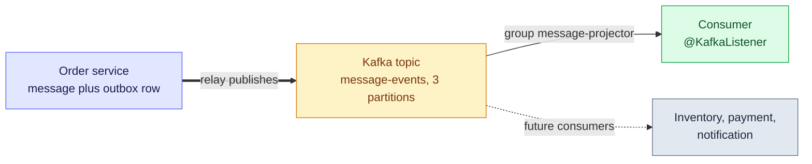

# 1. Overview — Messaging with Kafka and Spring

Messaging separates the service that produces a fact from the services that react to it. The broker is a durable middleman, and the hard parts are never "does it send?" but **ordering, duplicates and failure**.

> [!TIP]
> **TL;DR: the 30-second interview answer**
> - **Kafka** is a durable log split into partitions. Producers append records by key, and consumers in a group read them by offset.
> - In this project the outbox relay publishes with `KafkaTemplate`, and a `@KafkaListener` container consumes. Delivery is **at-least-once**, so consumers must tolerate duplicates.
> - A single-node Kafka (KRaft) runs in `compose.yaml`. RabbitMQ, dead-letter topics and rebalancing are not started yet.

## The shape of the capstone

Solid arrows exist today in the playground. The dotted one is the capstone direction: new consumers join without the producer knowing them.

## What is covered

| Topic | Status | Where |
|---|---|---|
| Kafka in `compose.yaml` (KRaft, two listeners) | Done | [2. Kafka with Spring Boot](/notebook/spring-boot-system-design/04-messaging/kafka-with-spring-boot) |
| Producer through the outbox relay | Done | [Transactional outbox](/notebook/spring-boot-system-design/05-distributed-problems/transactional-outbox) |
| Listener container, consumer group, offsets | Done (basics) | [2. Kafka with Spring Boot](/notebook/spring-boot-system-design/04-messaging/kafka-with-spring-boot) |
| Idempotent consumer, redelivery drill | Next | [Module 2 plan](/notebook/spring-boot-system-design/quick-sessions/core-patterns-spring-maven/plan-module-2) |
| Rebalancing, dead-letter topics, ordering across partitions, exactly-once | Not started | |
| RabbitMQ and when to pick it | Not started | |

## Interview questions

Your service saves an order and must publish an event to Kafka. What can go wrong if you do both directly, and what delivery guarantee do you end up with using the outbox?

Two writes to two systems have no shared transaction, so a failure between them loses the event or publishes one for data that was rolled back. With the outbox the event is a row in the same database transaction, and a relay publishes it afterwards. A crash between publishing and marking republishes it, so the guarantee is at-least-once, and consumers need an idempotency key such as the event id.

Two events for the same order must be processed in order. How do you choose the Kafka key, and what is only guaranteed within a partition?

Use the order id as the key: the same key always maps to the same partition, and order is guaranteed only inside one partition. In our run both records with key `a` landed in partition 1 at offsets 0 and 1, while `b` went to partition 2, and the consumer printed `b` before `a`.

## Key takeaways

| Remember | Because |
|---|---|
| The key picks the partition | Order is guaranteed per partition, not per topic |
| Outbox plus relay means at-least-once | A crash between publish and mark repeats the event |
| Consumers dedupe on an event id | Duplicates are the price of never losing an event |

**Related:** [Dev environment](/notebook/spring-boot-system-design/00-workspace/dev-environment) · [Sprint cheat sheet](/notebook/spring-boot-system-design/quick-sessions/core-patterns-spring-maven/cheatsheet)
