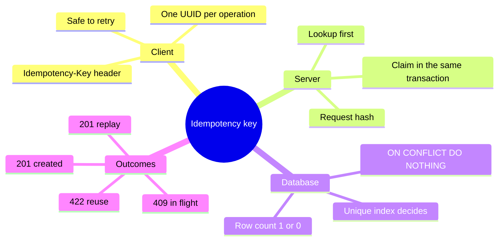
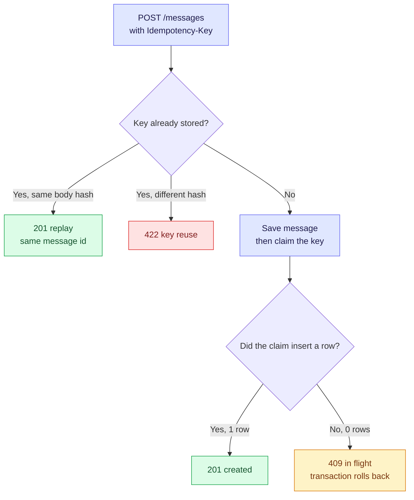
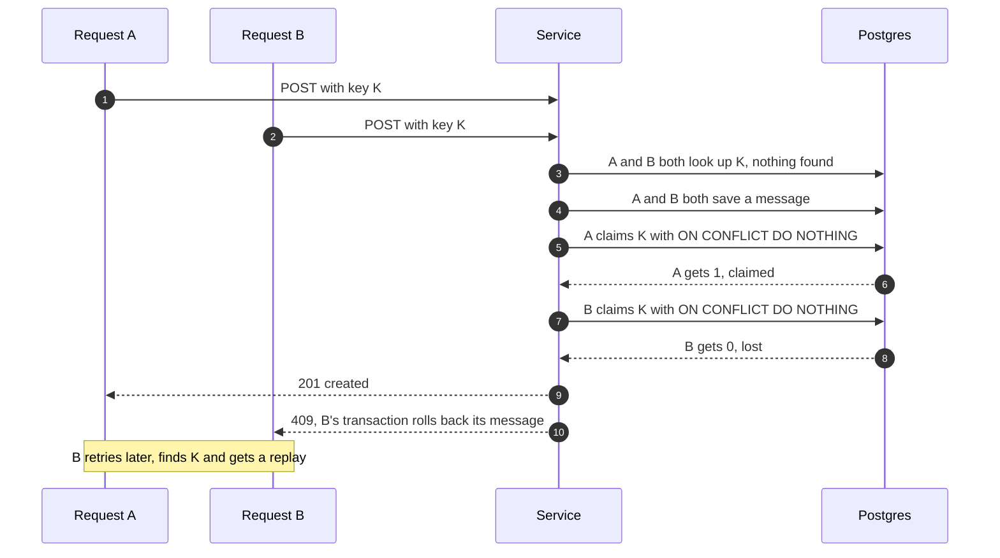

# 2. Idempotency Keys — Making a Retry Safe

A network can fail between "the server committed" and "the client got the answer", so the client cannot know whether its request worked. It retries, and without protection a retry is a **second order, a second charge**. Everything below was reproduced on the running `hello-boot` playground (Postgres 16, Spring Boot 4.1.1).

> [!TIP]
> **TL;DR: the 30-second interview answer**
> - The client invents one **idempotency key** per logical operation and sends it as a header. The server stores the key with the result, in the same transaction as the work.
> - A **unique index** decides a race between identical requests: exactly one insert of the key wins, the others roll back and are told to retry (409).
> - A retry with the same key and body is **replayed** (the stored result, 201), a different body is rejected (422). It is never an error for a genuine retry.

## Idempotency at a glance



## Mental model: a receipt number

Think of the key as a receipt number. The same number with the same order is a reprint. The same number with a different order is a mistake. Two people holding the same number at the same instant: the till lets one through.



Notice the two questions. The first is answered by a read and can be wrong for a moment. The second is answered by the database's unique index and is always right.

## The problem, on the running app

The same `POST /messages` sent twice returned two 201 responses and created two rows (ids 24 and 25) *(verified)*. For a message that is harmless. For an order or a payment it is a double charge.

## How the race is decided

Why "check, then insert" is not enough: two identical requests can both see "no key" and both insert. Only a unique constraint is atomic.



### What we ran *(verified)*

| Test | Result |
|---|---|
| New key `k-test-1` | 201, message id 27 |
| Same key, same body | 201, **the same id 27**, no new row |
| Same key, different body | 422 with `Idempotency-Key 'k-test-1' was already used with a different request body` |
| 8 parallel identical requests, first attempt | 8 × 201 and 1 row. **Not a race test**: the curl processes started a few milliseconds apart, so the first request committed before the others looked, and the lost-race path never ran |
| 8 parallel requests with a temporary 300 ms pause between the message save and the claim | **1 × 201 and 7 × 409**, exactly 1 `race-2` message and 1 key row. A retry afterwards returned 201 (a replay) |

The seven losers left no rows: their `RequestInFlightException` left the `@Transactional` method, so each loser's transaction and its saved message rolled back.

## The code

### Schema (`V3__create_idempotency_keys.sql`)

```sql
CREATE TABLE idempotency_keys (
    idempotency_key VARCHAR(64) PRIMARY KEY,
    request_hash    VARCHAR(64) NOT NULL,
    message_id      BIGINT      NOT NULL REFERENCES messages (id),
    created_at      TIMESTAMPTZ NOT NULL DEFAULT now()
);
```

The primary key builds the unique index `idempotency_keys_pkey`, which is the arbiter. The foreign key means a key cannot point at a message that does not exist. Flyway applied it at startup (`now at version v3`, 80 ms) *(verified)*.

### Why the insert is native `ON CONFLICT DO NOTHING`

In Postgres a failed statement aborts the whole transaction. Proved in psql *(verified)*:

```text
BEGIN;
INSERT INTO idempotency_keys ... ('proof-key', ...);        -> INSERT 0 1
INSERT INTO idempotency_keys ... ('proof-key', ...);        -> ERROR: duplicate key value violates unique constraint
SELECT 1;                                                   -> ERROR: current transaction is aborted, commands ignored until end of transaction block
ROLLBACK;
-- with ON CONFLICT (idempotency_key) DO NOTHING: INSERT 0 1, then INSERT 0 0, and SELECT 1 still works
```

So catching a unique-violation exception inside the same transaction leaves you unable to query the winner's row. `ON CONFLICT DO NOTHING` answers with a row count instead:

```java
@Modifying
@Query(value = """
        INSERT INTO idempotency_keys (idempotency_key, request_hash, message_id)
        VALUES (:key, :hash, :messageId)
        ON CONFLICT (idempotency_key) DO NOTHING
        """, nativeQuery = true)
int insertIfAbsent(@Param("key") String key, @Param("hash") String hash, @Param("messageId") long messageId);
```

The `int` is the affected-row count: 1 means this call claimed the key, 0 means someone else already had it.

> [!WARNING]
> **Do not use `save()` for the key row.** From knowledge, not tested: for an entity with an assigned id and no `@Version`, Spring Data's `save()` does a merge, which selects first and updates if the row exists. A duplicate key would silently overwrite the winner instead of failing. That is why `IdempotencyKeyEntity` has no setters and is read-only.

### The service method

```java
@Transactional
public Message createIdempotent(String key, String text) {
    String hash = sha256Hex(text.strip());

    IdempotencyKeyEntity stored = keys.findById(key).orElse(null);
    if (stored != null) {
        if (!stored.getRequestHash().equals(hash)) {
            throw new IdempotencyKeyReuseException(key);   // same key, different body: misuse
        }
        return get(stored.getMessageId());                  // same key, same body: replay
    }

    Message created = create(text);                         // also writes the outbox row, same transaction
    if (keys.insertIfAbsent(key, hash, created.id()) == 0) {
        throw new RequestInFlightException(key);            // lost the race: rolls back the message above
    }
    return created;
}
```

The message, its outbox row and the key claim are one transaction. The controller reads `@RequestHeader(value = "Idempotency-Key", required = false)`, and with no header the old `create` path runs unchanged. `GlobalExceptionHandler` maps `IdempotencyKeyReuseException` to 422 and `RequestInFlightException` to 409.

> [!NOTE]
> **Spring 7 deprecated `HttpStatus.UNPROCESSABLE_ENTITY`.** Both constants exist in the jar *(verified with `javap`)*, and the handler uses `UNPROCESSABLE_CONTENT`.

## What went wrong in the first draft

The method was first written without the full picture. The first problem was reproduced, the others were found by reading:

| First draft | Problem | Fix |
|---|---|---|
| `findById(key).orElseThrow()` | A fresh key has no row, so the first ever request returned **HTTP 500** (`NoSuchElementException: No value present`) with 0 rows written *(reproduced)* | Handle the empty case: a missing row is the normal first-request path |
| `if (hash equals) throw reuse` | The check was inverted: a genuine retry would have been rejected as misuse | Equal hash means replay, different hash means 422 |
| `insertIfAbsent(key, hash, 0)` | No message has id 0, so the foreign key rejects it, and the key could never point at the new message | Save the message first, then claim the key with its real id *(found by reading)* |

A related misconception worth keeping: a sequential retry with the same key is **not rejected**. It returns the stored result, because the client cannot tell whether the first attempt charged the card. An error would leave it guessing or retrying with a new key, which would double-charge.

## Side effects of the change

- `MessageService` gained constructor parameters, so `MessageServiceTest` (which builds it with `new`) needed a mock for each new repository. The 11 existing message tests still pass *(verified)*.
- The replay is rebuilt from the database. The replayed `createdAt` had microsecond precision where the first response had nanoseconds, so the replay is a replay of the data, not a byte-identical stored response *(observed)*.
- Rows created by the demos (`retry-demo` ids 24 and 25, and later test rows) are still in the dev database.

## Failure modes

| You see | Likely cause |
|---|---|
| Duplicate rows after a client retry | No key, or the key is not claimed in the same transaction as the work |
| HTTP 500 `NoSuchElementException` on the first request | `orElseThrow()` on an empty `Optional` |
| `current transaction is aborted` after catching a unique violation | The failed insert poisoned the Postgres transaction. Use `ON CONFLICT DO NOTHING` |
| Every concurrent duplicate succeeds in a test | The test did not actually overlap. Widen the window to force the race |
| A retry gets 422 | The body changed, even by whitespace, so the hash differs |
| Losers return 409 forever | The winner never committed. Check for an exception after the claim |

## Interview questions

<details>
<summary>Two identical POSTs with the same Idempotency-Key arrive at the same instant. Walk me through what happens and who decides the winner.</summary>

Both look up the key and find nothing, both save a message, and both call the claim insert. The unique index on the key lets exactly one insert succeed (row count 1). The other gets 0, throws `RequestInFlightException`, returns 409, and its transaction rolls back together with its message. The client retries, finds the key and gets a replay. The database, not the Java code, decides the winner.
</details>

<details>
<summary>Why is "SELECT the key, and insert it if absent" not enough on its own?</summary>

Between the SELECT and the INSERT another request can insert the same key, so both requests pass the check. Only a unique constraint is atomic. The SELECT is still useful for the common replay path, but the insert must also be guarded by the constraint.
</details>

<details>
<summary>You catch DataIntegrityViolationException from the key insert and then query the winner's row in the same transactional method. It fails with "current transaction is aborted". Why?</summary>

In Postgres a failed statement aborts the entire transaction, and every later command is rejected until it ends. We proved it in psql: the duplicate insert errored and the next `SELECT 1` was refused. Use `INSERT ... ON CONFLICT DO NOTHING` and read the row count instead, or do the key claim in its own transaction.
</details>

<details>
<summary>Same idempotency key, different request body. What do you return, and why store a hash at all?</summary>

422. The request hash (SHA-256 of the body) tells a genuine retry from a client mistake. Without it, reusing a key for a different order would silently return the first order's result, which is wrong and hard to notice.
</details>

<details>
<summary>The replayed response has the same message id but a slightly different createdAt. Why?</summary>

The replay is rebuilt from the stored message row, and Postgres keeps timestamps to microseconds while the first response was built from an in-memory value with nanoseconds. If you need byte-identical replays, store the serialized response with the key.
</details>

<details>
<summary>Why must the key be claimed in the same transaction as the work?</summary>

If the claim commits separately, a crash between the two leaves a key with no message (the client's retry would be told it already succeeded) or a message with no key (the retry would create a second message). One transaction makes "the key is recorded" and "the work happened" the same fact.
</details>

## Key takeaways

| Remember | Because |
|---|---|
| A retry is replayed, not rejected | The client cannot tell whether the first attempt worked |
| The unique index is the arbiter | "Check, then insert" is a race, a constraint is atomic |
| Use `ON CONFLICT DO NOTHING` and the row count | A failed insert aborts the Postgres transaction |
| Store a hash of the body | It separates a retry from a mistake |
| Claim the key in the same transaction as the work | Otherwise a crash leaves one without the other |
| Force the race in a test | An accidental test may never overlap |

**Related:** [1. Overview](/notebook/spring-boot-system-design/05-distributed-problems/overview) · [3. Transactional outbox](/notebook/spring-boot-system-design/05-distributed-problems/transactional-outbox) · [5. Transactions and locking](/notebook/spring-boot-system-design/02-persistence/transactions-in-spring) · [Flyway migrations](/notebook/spring-boot-system-design/02-persistence/flyway-migrations)
