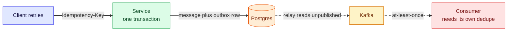

# 1. Overview — Distributed Problems: Duplicates, Lost Events and Partial Failure

Once a request crosses a process boundary, three things become normal: it **arrives twice**, it **half-succeeds**, and nobody knows which happened. This module collects the patterns that make that safe, each one built and broken on the running playground.

> [!TIP]
> **TL;DR: the 30-second interview answer**
> - **Idempotency keys** make a retry safe on the way in: the client sends a receipt number, and a unique constraint decides who wins a race.
> - The **transactional outbox** makes publishing safe on the way out: the event is a row in the same transaction as the data, and a relay publishes it later.
> - The price is **at-least-once** delivery, so every consumer needs an idempotency key too. Saga, retries with a circuit breaker and CAP come next.

## How the patterns fit together

Solid arrows protect the way in and are built. The dotted ones are the way out: the outbox and relay are built, while the consumer-side dedupe (red) is the next piece.

## What is covered

| Pattern | Status | Where |
|---|---|---|
| Idempotency keys | Done, race reproduced | [2. Idempotency keys](/notebook/spring-boot-system-design/05-distributed-problems/idempotency-keys) |
| Transactional outbox and relay | Done, duplicate reproduced | [3. Transactional outbox](/notebook/spring-boot-system-design/05-distributed-problems/transactional-outbox) |
| Idempotent consumer | Next | [Module 2 plan](/notebook/spring-boot-system-design/quick-sessions/core-patterns-spring-maven/plan-module-2) |
| Retry with backoff and circuit breaker | Next | Module 2 plan |
| Saga (orchestrated) | Concept note written, build in progress | [Saga pattern](/notebook/system-design/pattern/saga) |
| CAP, distributed locks | Not started | |

## Interview questions

A client times out on a payment request and retries. How do you make sure the customer is charged once?

Require an idempotency key. Store it with a unique constraint in the same transaction as the charge. A retry with the same key and body returns the stored result, a different body is rejected, and a concurrent duplicate loses the unique-index race and is told to retry later.

You save an order and publish an event. Which failures can you not avoid with a plain try and catch?

A crash or network failure between the two writes. With the commit first, the event can be lost. With the publish first, the event can describe data that was rolled back. The outbox removes the gap by writing both as one database transaction.

## Key takeaways

| Remember | Because |
|---|---|
| Retries are normal, so writes must be idempotent | Clients, gateways and consumers all retry |
| The database is the arbiter | A unique index is atomic, an "if exists" check is not |
| Outbox means at-least-once | Duplicates are the price of never losing an event |

**Related:** [4. Messaging overview](/notebook/spring-boot-system-design/04-messaging/overview) · [5. Transactions and locking](/notebook/spring-boot-system-design/02-persistence/transactions-in-spring)
