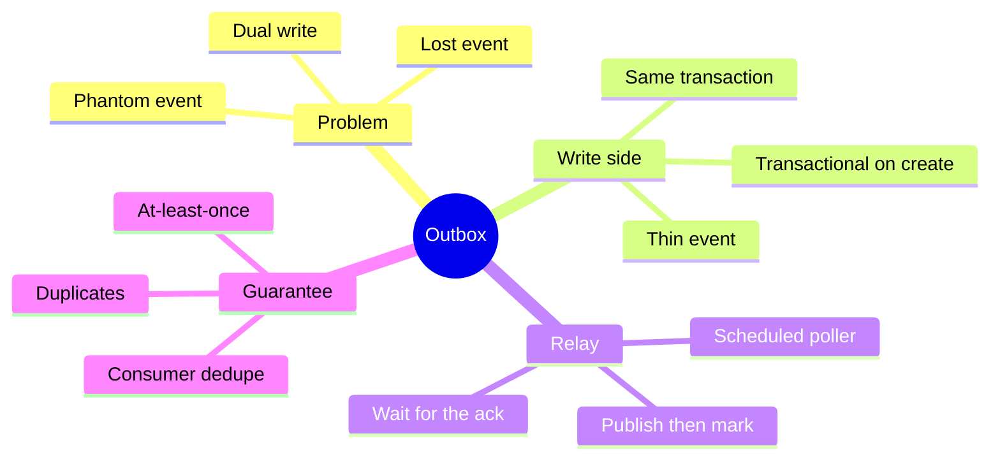
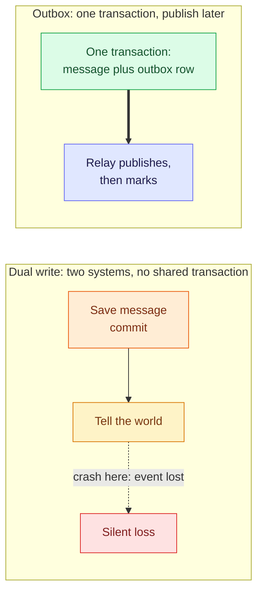
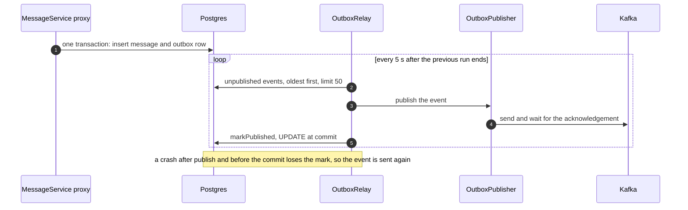

# 3. Transactional Outbox — One Write, Then Publish Later

Saving data and announcing it are two writes to two systems, and nothing makes them one. The outbox turns the announcement into **a row in the same database transaction**, then publishes it afterwards. You trade a lost event for a possible duplicate. Everything below was built and broken on the running playground (Postgres 16, Spring Boot 4.1.1, Kafka 4.2.2).

> [!TIP]
> **TL;DR: the 30-second interview answer**
> - **The problem:** save-then-publish can lose the event (crash after the commit), and publish-then-save can announce data that was rolled back. There is no shared transaction.
> - **The fix:** insert an `outbox_events` row in the same transaction as the data. A **relay** reads unpublished rows, publishes them, then marks them published.
> - **The price:** a crash between publish and mark sends the event again. That is **at-least-once** delivery, so consumers must dedupe, for example on the event id.

## The outbox at a glance



## Mental model: stop writing to two places



On the left, "saved" and "announced" can disagree. On the right, the commit means "the data is saved **and** the to-do 'publish this' is saved". Telling the world becomes a separate, retryable job.

## The gap, reproduced

We simulated a failure right after the commit by making the `AFTER_COMMIT` listener throw for a label starting with `crash` *(verified)*:

| What happened | Result |
|---|---|
| The two rows | Committed (ids 37 and 38) |
| The `AFTER_COMMIT` listener | Threw, and the exception was only logged |
| The HTTP response | **200**. I expected a 500: the listener's exception does not reach the client |
| The announcement | Lost, and nobody knows |

## Building it, step by step

### 1. The table (`V4__create_outbox_events.sql`)

```sql
CREATE TABLE outbox_events (
    id             BIGSERIAL PRIMARY KEY,
    aggregate_type VARCHAR(50) NOT NULL,
    aggregate_id   BIGINT      NOT NULL,
    event_type     VARCHAR(50) NOT NULL,
    payload        TEXT        NOT NULL,
    created_at     TIMESTAMPTZ NOT NULL DEFAULT now(),
    published_at   TIMESTAMPTZ
);

CREATE INDEX idx_outbox_unpublished ON outbox_events (id) WHERE published_at IS NULL;
```

`published_at` is nullable: NULL means not sent yet, and the relay marks rows instead of deleting them, which keeps an audit trail. The **partial index** covers only unpublished rows, because the relay asks for them over and over and published rows pile up. Flyway applied V4 at startup *(verified)*.

### 2. The entity and the derived query

`OutboxEventEntity` has `markPublished()`, which only sets a field. The UPDATE comes from dirty checking at commit, so the relay method must be `@Transactional`. The repository has one derived query, parsed from its name at startup (a bad name stops the app from starting; the app started):

```java
List<OutboxEventEntity> findTop50ByPublishedAtIsNullOrderByIdAsc();
// WHERE published_at IS NULL ORDER BY id ASC LIMIT 50
```

### 3. Write the event inside `create`, and make `create` transactional

```java
@Transactional
public Message create(String text) {
    MessageEntity saved = repository.save(new MessageEntity(text.strip()));
    // A thin event: just a reference. Consumers fetch the details themselves.
    outbox.save(new OutboxEventEntity("Message", saved.getId(), "MessageCreated",
            "{\"messageId\":" + saved.getId() + "}"));
    return toMessage(saved);
}
```

We reproduced the failure first with a temporary line that throws between the two saves *(verified)*:

| `create` | Failing call | Result |
|---|---|---|
| **Without** `@Transactional` | `boom-1` | HTTP 500, but message 39 is **committed with 0 outbox rows**. A normal call (message 40) got 1 row |
| **With** `@Transactional` | `boom-2` | HTTP 500 and **no message row at all**. A normal call (message 42) got outbox event 2, `published_at` still null |

`repository.save` and `outbox.save` each carry their own small `@Transactional` inside Spring Data. Without an outer one, they commit separately and we have rebuilt the dual write inside one database. The proxy's `TransactionInterceptor` now opens one transaction, both saves **join** it (`REQUIRED`, the default), and an exception rolls both back. Ids skip from 40 to 42 because the rolled-back insert still consumed a sequence value.

### 4. The relay

```java
@Scheduled(fixedDelay = 5000)   // wait 5 s AFTER the previous run ends, so runs never overlap
@Transactional
public void relay() {
    List<OutboxEventEntity> pending = outbox.findTop50ByPublishedAtIsNullOrderByIdAsc();
    for (OutboxEventEntity event : pending) {
        publisher.publish(event);
        event.markPublished();   // no save(): dirty checking writes the UPDATE at commit
    }
}
```



The order matters: **publish first, mark second**. Notice that the mark and the publish are in different systems, which is exactly why a duplicate is possible.

## How `@Scheduled` works

`@Scheduled` alone does nothing. `@EnableScheduling` on `HelloBootApplication` imports `SchedulingConfiguration`, which registers `ScheduledAnnotationBeanPostProcessor` (both classes exist in spring-context, *verified*). From knowledge, that is another `BeanPostProcessor`, the same mechanism as the proxies: it scans every bean for `@Scheduled` methods and hands each to a scheduler thread.

With a skeleton relay that only logged, the ticks ran on the thread `scheduling-1`, exactly 5 s apart (10:10:16.974, then 10:10:21.979), which matches `fixedDelay` *(verified)*. The scheduler is called through the bean's proxy, so `@Transactional` works on a scheduled method.

## Swapping the publisher: dependency injection by type

The relay depends on the interface `OutboxPublisher`. A log implementation came first (`LogOutboxPublisher`, a log line saying `PUBLISHED outbox event id=...`), then `KafkaOutboxPublisher`.

**Nothing maps the interface to the class.** Component scan registers each `@Component`, and Spring injects by the constructor parameter's **type**. To prove it we temporarily added a second `OutboxPublisher` bean, and the app refused to start *(verified)*:

```text
Parameter 1 of constructor in com.learn.hello_boot.event.OutboxRelay required a single bean, but 2 were found:
	- logOutboxPublisher: defined in file [.../LogOutboxPublisher.class]
	- tempSecondPublisher: defined by method 'tempSecondPublisher' in com.learn.hello_boot.HelloBootApplication
Consider marking one of the beans as @Primary, updating the consumer to accept multiple beans, or using @Qualifier
```

The temporary bean was removed. In the real code `KafkaOutboxPublisher` carries `@Primary`, so it wins, and the log one stays as a fallback. The relay never changed, which is the point of the interface. The Kafka side (the producer, waiting for the acknowledgement, the `event-id` header) is in [2. Kafka with Spring Boot](/notebook/spring-boot-system-design/04-messaging/kafka-with-spring-boot).

## What we observed in the relay *(verified)*

| Check | Result |
|---|---|
| Happy path | Message 43 created at 10:14:22.9, event 3 picked up at 10:14:25.5, published once, marked. All rows `published = t` and later ticks report `0 unpublished` |
| After the Kafka swap | Message 45 became outbox event 5 and arrived in Kafka at partition 0, offset 0, header `event-id:5`, key `45`. Message 46 (event 6) landed in partition 1 |

### Duplicates, twice

| Case | Timeline | Cause |
|---|---|---|
| **Accidental** | Events 1 and 2 were published at 10:13:02, again at 10:13:07 (5 s later, no restart between), and again at 10:13:16 (a restart) | An intermediate version of the loop published but never marked, so the same unmarked rows were re-sent every tick. That cause is inferred from the behaviour |
| **On purpose** | Event 4: `PUBLISHED` at 10:20:45.821, a temporary exception at 10:20:45.822, `PUBLISHED` again at 10:20:50.827, then marked | The failure between publish and mark rolled back the transaction, so the mark was lost |

## The delivery guarantee

| Order | After a crash between the two steps | Guarantee |
|---|---|---|
| Publish, then mark (the outbox) | The event is sent again | **At-least-once** |
| Mark, then publish | The event is marked sent but never was, and is lost for good | At-most-once |
| One transaction across the database and the broker | Not available | Exactly-once, which needs consumer dedupe in practice |

The outbox deliberately chooses duplicates over loss (reasoning, not run). From knowledge: the relay's batch is one transaction, so a crash re-publishes the whole batch of up to 50 events, not just one.

> [!WARNING]
> **Consumers must tolerate duplicates.** The event id is the natural idempotency key: record processed ids with a unique constraint, the same trick as the request keys. The consumer side was not built yet.

> [!WARNING]
> **A pitfall in the publisher: do not mark before the broker acknowledges.** `KafkaTemplate.send` is asynchronous. If the relay marked the row immediately, a failed send would lose the event permanently. Wait on the returned future first.

> [!CAUTION]
> **Several relay instances will publish the same rows** (from knowledge, not tested). The usual fix is to claim rows with `SELECT ... FOR UPDATE SKIP LOCKED`. The outbox table also grows forever unless published rows are archived or deleted.

## Side effects of the change

`MessageService` gained constructor parameters (the key repository, then the outbox repository), so `MessageServiceTest` had to pass a mock for each. The 11 existing message tests still pass *(verified)*.

## Failure modes

| You see | Likely cause |
|---|---|
| A message exists but its event does not | `create` is not `@Transactional`, so the saves commit separately |
| The same event published twice | The window between publish and mark: this is at-least-once working as designed |
| An event published on every tick forever | The loop never marks the row, or the mark never commits |
| The relay never runs | `@EnableScheduling` is missing |
| `NoUniqueBeanDefinitionException` at startup | Two `OutboxPublisher` beans and no `@Primary` or `@Qualifier` |
| The event is marked but Kafka has nothing | The relay did not wait for the acknowledgement |

## Interview questions

<details>
<summary>Your service saves an order and then publishes an event to Kafka in the same method. The process dies after the database commit. What is lost, and how does the outbox fix it?</summary>

The event is lost, because the commit and the publish are two writes to two systems with no shared transaction. With the outbox the event is a row inserted in the same transaction as the order, so it survives the crash. A relay reads unpublished rows and publishes them after the restart.
</details>

<details>
<summary>create saves a message and then an outbox row, but it is not annotated. A failure between the two saves leaves what, and why does one annotation fix it?</summary>

A committed message with no outbox row. `repository.save` and `outbox.save` each run in their own small transaction. With `@Transactional` on `create`, the proxy opens one transaction, both saves join it (REQUIRED), and an exception rolls both back. We saw message 39 survive without the annotation and no row at all with it.
</details>

<details>
<summary>Why does the relay publish first and mark second, and what does a crash between the two cause?</summary>

Publishing first means a crash can only cause a duplicate, because the mark is lost with the rolled-back transaction and the next tick sends the event again. Marking first would lose the event if the crash came before publishing. The outbox picks at-least-once over at-most-once, and relies on idempotent consumers.
</details>

<details>
<summary>Someone adds @Scheduled to a method and nothing ever runs. What are the likely causes?</summary>

`@EnableScheduling` is missing, so no `ScheduledAnnotationBeanPostProcessor` is registered to read the annotation. Or the class is not a Spring bean. Once enabled, the method runs on a scheduler thread (we saw `scheduling-1`), and `fixedDelay` counts from the end of the previous run.
</details>

<details>
<summary>OutboxRelay is injected with an OutboxPublisher, and nothing in the project maps the interface to LogOutboxPublisher. How does Spring choose?</summary>

By type. Component scan registers the `@Component` classes, and the constructor parameter asks for any bean assignable to `OutboxPublisher`. With exactly one candidate it is injected. With two the app fails at startup with a message naming both beans, and you resolve it with `@Primary`, `@Qualifier`, or by injecting a `List` of them.
</details>

<details>
<summary>The relay's consumer sees the same event twice after a restart. Is that a bug, and how should the consumer cope?</summary>

It is the designed behaviour of at-least-once delivery, not a bug. The consumer must be idempotent: record the event id (carried in a header) with a unique constraint and skip ids it has seen, using the same insert-or-ignore trick as the request keys.
</details>

<details>
<summary>You run two copies of the application, each with a relay. What goes wrong, and what would you change?</summary>

Both read the same unpublished rows and publish them, so every event is sent twice. From knowledge, the usual fix is to select the rows with `FOR UPDATE SKIP LOCKED` so each relay claims different rows, or to run a single relay instance.
</details>

## Key takeaways

| Remember | Because |
|---|---|
| Replace the second write with a row | One transaction covers the data and the intent to publish |
| `@Transactional` on the method that writes both | Otherwise each save commits alone |
| Publish first, mark second | A crash then causes a duplicate, never a loss |
| The relay needs `@EnableScheduling` | `@Scheduled` is only read by a post-processor that scheduling switches on |
| Spring wires by type | Two candidates fail at startup unless you choose one |
| Wait for the broker's acknowledgement | `send()` only queues the record |
| Consumers dedupe on the event id | At-least-once means duplicates are normal |

**Related:** [1. Overview](/notebook/spring-boot-system-design/05-distributed-problems/overview) · [2. Idempotency keys](/notebook/spring-boot-system-design/05-distributed-problems/idempotency-keys) · [Kafka with Spring Boot](/notebook/spring-boot-system-design/04-messaging/kafka-with-spring-boot) · [7. AOP aspects and events](/notebook/spring-boot-system-design/01-spring-boot-basics/aop-aspects-and-transactional-events) · [5. Transactions and locking](/notebook/spring-boot-system-design/02-persistence/transactions-in-spring)
