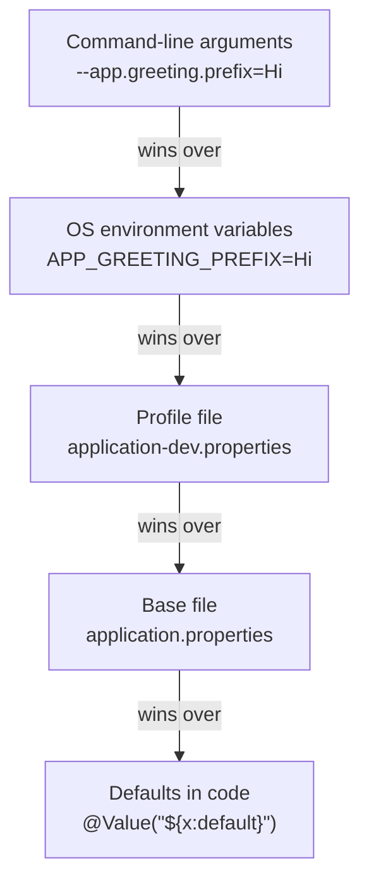

# Configuration and Profiles

## The problem

Values that change between environments (a database URL, a Kafka address, a password, a feature flag) must not be hard-coded in Java. The same build has to run on your laptop, in Docker, and in production, with different settings. In the capstone every service will need this the moment it talks to Postgres or Kafka.

## Where Spring Boot reads configuration from



The same property can be set in several places. **The higher one wins.** That is what lets you ship one JAR and change behaviour from outside, for example with an environment variable in `compose.yaml`.

Boot's *relaxed binding* maps names between styles: `app.greeting.prefix` in a file is the same property as the environment variable `APP_GREETING_PREFIX`.

## Two ways to read a property in code

| | `@Value` | `@ConfigurationProperties` |
|---|---|---|
| Shape | One property at a time: `@Value("${app.greeting.prefix}")` | A whole group bound into one typed object (a record works) |
| Type safety | Weak: a string key in a string | Strong: typed fields, one place to see all settings |
| Validation | Manual | `@Validated` plus constraints, so bad config fails at **startup** |
| Best for | A single quick value | Anything with more than one or two related settings |

```java
@ConfigurationProperties(prefix = "app.greeting")
public record GreetingProperties(String prefix, String defaultName) {}
```

The record is a bean only once Spring is told to bind it (for example `@ConfigurationPropertiesScan` or `@EnableConfigurationProperties`).

## Profiles

A **profile** is a named set of configuration, such as `dev` or `prod`.

| File | Used when |
|------|-----------|
| `application.properties` | Always (base values) |
| `application-dev.properties` | Profile `dev` is active; overrides the base file |
| `application-prod.properties` | Profile `prod` is active |

Activate one with the property `spring.profiles.active=dev`, or with the environment variable `SPRING_PROFILES_ACTIVE=dev`. In our setup that variable goes in `compose.yaml` under `environment:`.

## Rules of thumb
- **Never commit secrets** (passwords, API keys). Inject them with environment variables.
- Keep defaults in the base file; keep only the *differences* in profile files.
- Fail fast: validate required settings so a missing value stops the app at startup, not on the first request.

## What we saw (hands-on)

Same property, three sources:

| Source | Value | Result |
|--------|-------|--------|
| `application.properties` | `Hello` | used with no profile |
| `application-dev.properties` (profile `dev` active) | `Hi` | beat the base file |
| env var `APP_GREETING_PREFIX` | `Hey` | beat both |

A missing required value in a validated `@ConfigurationProperties` record stops the app at startup:

```
Binding to target com.learn.hello_boot.config.GreetingProperties failed:

Property: app.greeting.defaultName
Value: "null"
Reason: must not be blank
```

## Our setup (Docker + DevTools)
- Profile is activated in `compose.yaml` under `environment:` (`SPRING_PROFILES_ACTIVE: dev`).
- A container's environment is fixed at creation. After editing `environment:` run `docker compose up -d --force-recreate dev`.
- Spring reads the copy of the file in `target/classes`. The watch loop must also watch `src/main/**/resources/**`, otherwise a properties-only edit is never copied and never restarts the app.

## Gotchas
- `@Value("${key}")` without a default fails startup if the key is missing. `${key:default}` provides one.
- A `@ConfigurationProperties` record is not a bean until it is registered (`@ConfigurationPropertiesScan` or `@EnableConfigurationProperties`).
- After editing `compose.yaml`, run `docker compose config --quiet`. A broken edit makes `docker compose up` fail while the old container keeps serving old settings.
- Never commit secrets. Supply them with environment variables or a secret store, which outrank the files.
