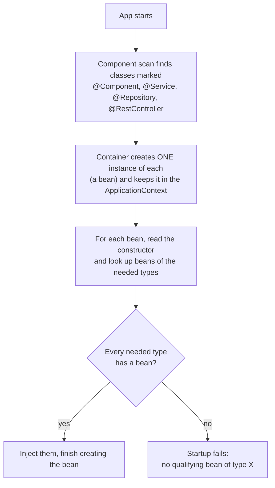
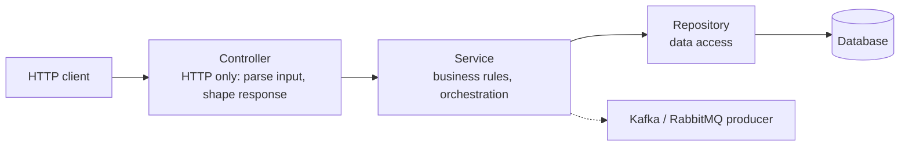

# Dependency Injection and Layers

## The problem

If a controller builds what it needs with `new GreetingService()`, it is hard-wired to one concrete class. You cannot swap it for a fake in a test, and if the service needs a database connection or a Kafka producer, the controller must know how to build those too.

## The idea

A class declares what it **needs** (constructor parameters). The Spring container supplies it.

```java
@RestController
public class HelloController {
    private final GreetingService service;

    public HelloController(GreetingService service) {   // "I need one of these"
        this.service = service;
    }
}
```

## How the container wires beans



| Term | Meaning |
|------|---------|
| Bean | An object created and managed by the Spring container |
| `@Component` and `@Service`, `@Repository`, `@RestController` | Mark a class so component scan registers it. Same behaviour; the name states the layer's role |
| Constructor injection | Dependencies arrive via the constructor. Preferred: fields can be `final`, the object is never half-built. With a single constructor, `@Autowired` is not needed |
| Singleton scope | Default: one instance per bean, shared by all requests |

## Why layers

Each layer has one job and depends only on the layer below it.



| Layer | Job | Capstone example |
|-------|-----|------------------|
| Controller | Parse input, call the service, return the response | `OrderController` |
| Service | Business rules and orchestration | `OrderService`: check stock, create order, publish event |
| Repository | Data access | `OrderRepository` |

With DI, `OrderService` gets its `OrderRepository` and producer through the constructor, so tests can pass fakes.

## What we saw (hands-on)

A controller constructor required `GreetingService`, but the class had no `@Service`:

```
APPLICATION FAILED TO START

Parameter 0 of constructor in HelloController required a bean of type
'GreetingService' that could not be found.
```

- It fails at **startup**, not at the first request, because the container checks every constructor when it boots.
- The **whole app** goes down (even `/hello`, which does not use the service). One bad bean takes the entire service out.
- Adding `@Service` fixed it. DevTools restarted by itself (~2 s).

## Gotchas
- The class must be in or below the `@SpringBootApplication` package, or component scan never sees it.
- Beans are **singletons**: one instance shared by every request, so do not keep per-request state in fields.
- Prefer constructor injection with `final` fields over field injection (`@Autowired` on a field), which hides dependencies and blocks easy testing.
