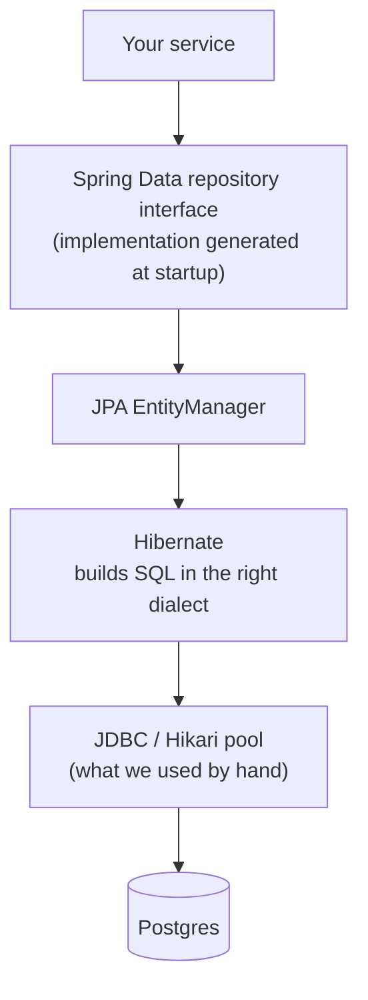
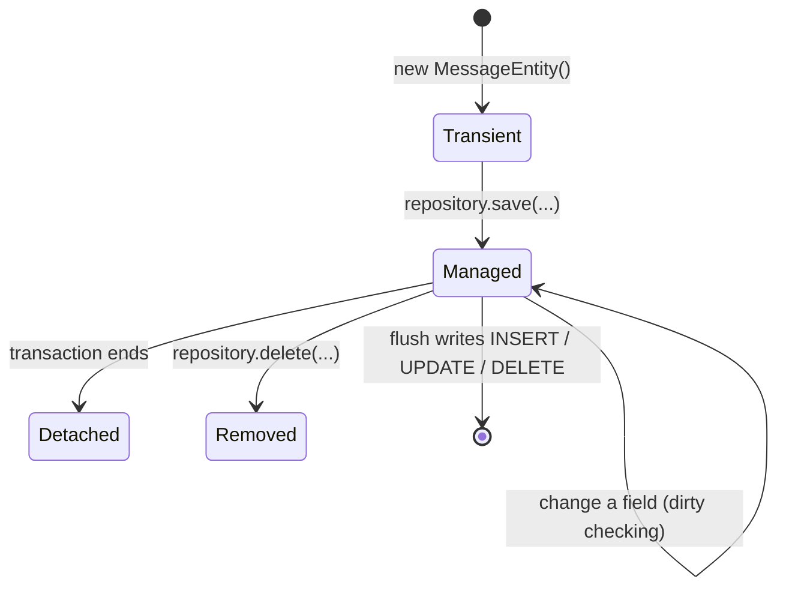

# JPA, Hibernate and Spring Data JPA

## Three names, three layers

| Name | What it is |
|------|------------|
| **JPA** (Jakarta Persistence) | A **specification**: the annotations (`@Entity`, `@Id`...) and the `EntityManager` API. Only interfaces and rules |
| **Hibernate** | The **implementation** of JPA that actually runs. It turns entity operations into SQL for the database's dialect |
| **Spring Data JPA** | A convenience layer on top: you declare a repository **interface** and Spring generates the implementation |



Everything below Hibernate is the JDBC we already know. JPA does not replace JDBC; it **writes the JDBC code and SQL for you**.

## An entity: a class mapped to a table

```java
@Entity
@Table(name = "messages")
public class MessageEntity {
    @Id
    @GeneratedValue(strategy = GenerationType.IDENTITY)   // the database fills the id (BIGSERIAL)
    private Long id;

    @Column(nullable = false)
    private String text;

    @Column(name = "created_at", nullable = false)
    private Instant createdAt;

    protected MessageEntity() {}                          // JPA needs a no-arg constructor
}
```

| Rule | Why |
|------|-----|
| Class is not `final`, has a no-arg constructor | Hibernate creates instances and proxies by reflection |
| **A Java `record` cannot be an entity** | Records are final and immutable. Our `Message` record stays a plain model/DTO; the entity is a separate class |
| `@Id` + `@GeneratedValue(IDENTITY)` | Matches Postgres `BIGSERIAL`; the id exists only after the INSERT |
| Mapping is by name and annotations | `created_at` column <-> `createdAt` field needs `@Column(name = ...)` or a naming strategy |

## The persistence context: the idea JDBC does not have

Hibernate keeps entities it has loaded in a **persistence context** (a first-level cache scoped to a transaction).



- **Managed** entities are watched. Change a field inside a transaction and Hibernate writes the UPDATE by itself at flush time (**dirty checking**). No explicit `update` call.
- The same row loaded twice in one transaction is the **same Java object**.
- SQL is not sent immediately; Hibernate batches and sends it at **flush** (usually commit).
- This is powerful and the source of most JPA surprises (lazy loading, the N+1 query problem, "why did it update?"). We will meet them on purpose.

## Spring Data JPA: the repository you do not implement

```java
public interface MessageJpaRepository extends JpaRepository<MessageEntity, Long> {
    List<MessageEntity> findByTextContaining(String fragment);   // SQL derived from the method name
}
```

`save`, `findById`, `findAll`, `deleteById`, paging and sorting come for free. Spring creates a proxy implementation at startup.

## Schema: who owns it?

`spring.jpa.hibernate.ddl-auto`:

| Value | Behaviour | Use |
|-------|-----------|-----|
| `none` | Hibernate leaves the schema alone | production with Flyway |
| **`validate`** | Checks entities match the tables; fails startup if not | production with Flyway (recommended) |
| `update` | Diffs and applies changes directly, no files | throwaway prototypes only |
| `create` / `create-drop` | Drops and recreates | tests / demos |

Hibernate can also **write the DDL to a file** (a JPA standard setting) instead of running it. That output is a full create script for the dialect, not an incremental diff, but it shows exactly what an entity implies for Postgres.

## What we saw (hands-on)

**Generated DDL vs our hand-written `V1`**

| Column | `V1` (hand-written) | Hibernate generated |
|--------|---------------------|---------------------|
| `id` | `BIGSERIAL PRIMARY KEY` | `bigint generated by default as identity`, `primary key (id)` |
| `text` | `TEXT NOT NULL` | **`varchar(255)`** not null |
| `created_at` | `TIMESTAMPTZ NOT NULL DEFAULT now()` | `timestamp(6) with time zone` not null, no default |

`String` has no length, so Hibernate defaults to 255. Our API allows 500 characters, so a generated schema would reject long messages at INSERT. Review generated SQL; do not trust it blindly.

**`validate`**
- Wrong column in the entity: `SchemaManagementException: Schema validation: missing column [created_on] in table [messages]`, startup stops.
- `TEXT` column vs `String` field: accepted (types are compared, lengths are not).
- **Do not leave the JPA schema-generation script settings in a profile where you rely on `validate`**: in our run they suppressed it.

**SQL Hibernate wrote** (`spring.jpa.show-sql=true`)
```
insert into messages (created_at,text) values (?,?)
select me1_0.id,me1_0.created_at,me1_0.text from messages me1_0                  -- findAll: NO ORDER BY
select me1_0.id,me1_0.created_at,me1_0.text from messages me1_0 where me1_0.id=? -- findById
update messages set created_at=?,text=? where id=?                               -- dirty checking: all columns
```
`findAll()` has no ordering guarantee; ask for it (`findAll(Sort.by("id"))`). `Instant.now()` has nanoseconds but `timestamp(6)` keeps microseconds, so a response built from the in-memory entity differs from a later read.

**Dirty checking and transactions**

```java
@Transactional
public Message rename(long id, String newText) {
    MessageEntity entity = repository.findById(id).orElseThrow(...);
    entity.rename(newText.strip());      // no save() call
    return toMessage(entity);
}
```
- With `@Transactional`: the UPDATE runs at commit. Verified in Postgres.
- Without it: the PUT returned `200` with the new text, **Postgres kept the old text**, no UPDATE ran. The entity was detached after `findById`'s own short transaction. A silent lost update, with no error.

## Gotchas
- Dirty checking only works inside a transaction. Put `@Transactional` on service methods that modify entities.
- Entities need a no-arg constructor and cannot be records. Keep a separate model/DTO for the outside world.
- Unit-testing a service that uses entities with generated ids needs `ReflectionTestUtils.setField(entity, "id", ...)`.
- A refactor of a constructor shows up as `Unresolved compilation problem` in tests when VS Code's Eclipse compiler wrote the class (inference).
- Use `show-sql` only in dev; read the SQL regularly to catch `findAll` without limits or surprise queries.
