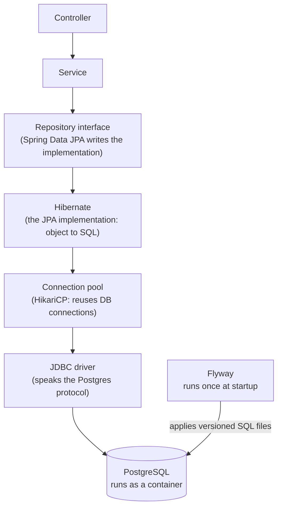
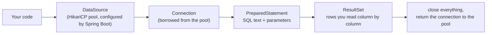

# Persistence: Postgres, JPA and Flyway

## The problem

Everything so far lives in memory. Restart the app and it is gone. A service that takes orders and payments needs a **durable store**: data that survives restarts, can be queried, and stays consistent when several requests touch it at once. That is the job of a database, and in the capstone every service (order, inventory, payment) gets its own.

## The pieces

| Piece | Job |
|-------|-----|
| **PostgreSQL** | The database server. In our setup a container on the compose network |
| **JDBC driver** | Library that speaks Postgres's wire protocol (`org.postgresql:postgresql`) |
| **DataSource + HikariCP** | A pool of open connections. Opening a connection per request is slow, so connections are reused. Pool size is a scaling knob later |
| **JPA / Hibernate** | ORM: maps a Java class (an *entity*) to a table row, and generates SQL for you |
| **Spring Data JPA repository** | You declare an interface (`extends JpaRepository<Entity, Id>`); Spring generates the implementation (save, findById, findAll, delete, derived queries) |
| **Flyway** | Schema as code: numbered SQL files (`V1__create_table.sql`) applied in order, once, and recorded in a `flyway_schema_history` table |

## Why Flyway and not "let Hibernate create the tables"

Hibernate can generate or alter tables itself (`spring.jpa.hibernate.ddl-auto=update`). That is fine for a throwaway demo and dangerous otherwise: no history, no review, no control over what changes in production. With Flyway the database structure is versioned like code, reviewed in PRs, and identical on every machine. Hibernate is then set to **`validate`**: it only checks that entities match the tables and fails the startup if they do not.

## Where the database lives in our setup

- The app runs inside the `dev` container, so it reaches Postgres by **service name**: `jdbc:postgresql://postgres:5432/<db>`, **not** `localhost`.
- From your host (a SQL client, `psql`) it is `localhost:5432`.
- Data lives in a **named Docker volume**: `docker compose down` keeps it, `docker compose down -v` wipes it.
- Database per service: each microservice owns its database and never reads another service's tables.
- Credentials come from environment variables, not committed files.

## Entity vs DTO

The entity is the database shape; the DTO is the API shape (the `dto` package). They change for different reasons, so a controller should return DTOs, not entities.

## Start at the bottom: plain JDBC

JPA and Spring Data are layers **on top of JDBC**. Starting with JDBC shows what they hide.

| Concept | Meaning |
|---------|---------|
| `DataSource` | Factory for connections. Spring Boot builds one from `spring.datasource.*` properties, wrapped in a HikariCP pool |
| `Connection` | One live session with the database. Expensive to open, so it is borrowed from the pool and **must be returned** (closed) |
| `PreparedStatement` | SQL with `?` placeholders and bound parameters. Prevents SQL injection; never build SQL by string concatenation |
| `ResultSet` | A cursor over the returned rows |
| `JdbcTemplate` | Spring's helper: opens, runs, maps and closes for you, and translates `SQLException` into Spring's exception hierarchy |

Plain JDBC is verbose and easy to leak connections (forgetting to close). `JdbcTemplate` removes that boilerplate while keeping SQL explicit. JPA then removes the SQL too, at the cost of hiding what happens.

## Lesson order (changed: JDBC first)
1. **Postgres container** in `compose.yaml` (done, with `add-infra`): healthy, reachable at `postgres:5432` from the app and `localhost:5433` from the host.
2. **JDBC connection:** add the driver and JDBC starter, configure `spring.datasource.*`, and run raw JDBC against the `DataSource`.
3. **JdbcTemplate:** a table, a repository class using SQL, wired through the service layer.
4. **Flyway:** move the table creation into a versioned migration.
5. **JPA:** replace the hand-written repository with an entity and a Spring Data repository.
6. **Break it** at each stage: database down, wrong password, wrong SQL, leaked connection, entity/table mismatch.

## Our Postgres setup
- Image `postgres:16-alpine`, user `app`, password `app`, database `hello_db` (dev-only credentials).
- App (in the `dev` container) connects to `jdbc:postgresql://postgres:5432/hello_db`.
- Your host's own Postgres owns port 5432, so the container is published on **5433**.
- Data in the named volume `pgdata`: `docker compose down` keeps it, `docker compose down -v` wipes it.
