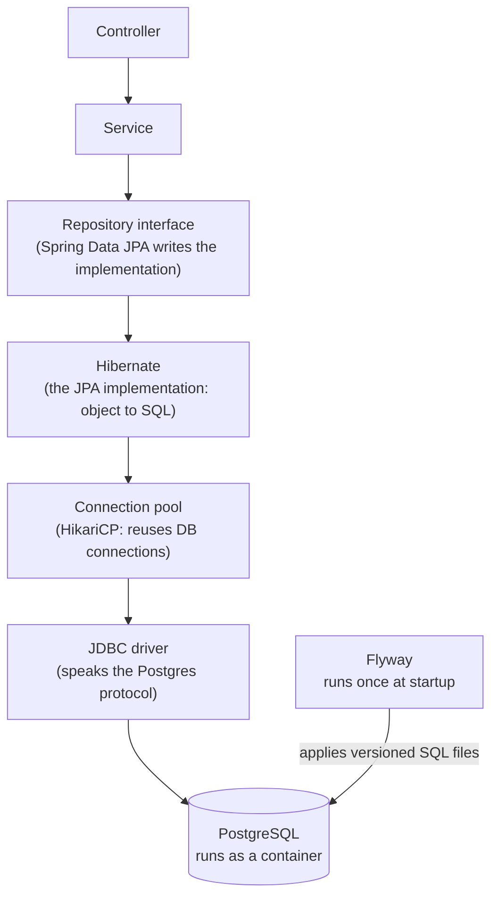
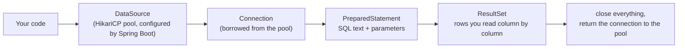

# Persistence: Postgres, JPA and Flyway

## The problem

Everything so far lives in memory. Restart the app and it is gone. A service that takes orders and payments needs a **durable store**: data that survives restarts, can be queried, and stays consistent when several requests touch it at once. That is the job of a database, and in the capstone every service (order, inventory, payment) gets its own.

## The pieces



| Piece | Job |
|-------|-----|
| **PostgreSQL** | The database server. In our setup a container on the compose network |
| **JDBC driver** | Library that speaks Postgres's wire protocol (`org.postgresql:postgresql`) |
| **DataSource + HikariCP** | A pool of open connections. Opening a connection per request is slow, so connections are reused. Pool size is a scaling knob later |
| **JPA / Hibernate** | ORM: maps a Java class (an *entity*) to a table row, and generates SQL for you |
| **Spring Data JPA repository** | You declare an interface (`extends JpaRepository<Entity, Id>`); Spring generates the implementation (save, findById, findAll, delete, derived queries) |
| **Flyway** | Schema as code: numbered SQL files (`V1__create_table.sql`) applied in order, once, and recorded in a `flyway_schema_history` table |

## Why Flyway and not "let Hibernate create the tables"

Hibernate can generate or alter tables itself (`spring.jpa.hibernate.ddl-auto=update`). That is fine for a throwaway demo and dangerous otherwise: no history, no review, no control over what changes in production. With Flyway the database structure is versioned like code, reviewed in PRs, and identical on every machine. Hibernate is then set to **`validate`**: it only checks that entities match the tables and fails the startup if they do not.

## Where the database lives in our setup

- The app runs inside the `dev` container, so it reaches Postgres by **service name**: `jdbc:postgresql://postgres:5432/<db>`, **not** `localhost`.
- From your host (a SQL client, `psql`) it is `localhost:5432`.
- Data lives in a **named Docker volume**: `docker compose down` keeps it, `docker compose down -v` wipes it.
- Database per service: each microservice owns its database and never reads another service's tables.
- Credentials come from environment variables, not committed files.

## Entity vs DTO

The entity is the database shape; the DTO is the API shape (the `dto` package). They change for different reasons, so a controller should return DTOs, not entities.

## Start at the bottom: plain JDBC

JPA and Spring Data are layers **on top of JDBC**. Starting with JDBC shows what they hide.



| Concept | Meaning |
|---------|---------|
| `DataSource` | Factory for connections. Spring Boot builds one from `spring.datasource.*` properties, wrapped in a HikariCP pool |
| `Connection` | One live session with the database. Expensive to open, so it is borrowed from the pool and **must be returned** (closed) |
| `PreparedStatement` | SQL with `?` placeholders and bound parameters. Prevents SQL injection; never build SQL by string concatenation |
| `ResultSet` | A cursor over the returned rows |
| `JdbcTemplate` | Spring's helper: opens, runs, maps and closes for you, and translates `SQLException` into Spring's exception hierarchy |

Plain JDBC is verbose and easy to leak connections (forgetting to close). `JdbcTemplate` removes that boilerplate while keeping SQL explicit. JPA then removes the SQL too, at the cost of hiding what happens.

## Coming from Prisma: what is generated and what is not

Prisma bundles the ORM and the migrations. In Java they are two separate tools.

| Job | Prisma | Java / Spring |
|-----|--------|---------------|
| Describe the model | `schema.prisma` | JPA entity classes (`@Entity`) |
| Generate query code | Prisma Client | Hibernate builds SQL at runtime in the driver's dialect; Spring Data generates repository implementations |
| Generate migration SQL from model changes | `prisma migrate dev` diffs and writes a SQL file you review and commit | No single built-in equivalent |
| Apply migrations, keep history | `prisma migrate deploy`, `_prisma_migrations` | Flyway or Liquibase, `flyway_schema_history` |

- **Hibernate = ORM only.** **Flyway = runs SQL files you wrote; it never generates.**
- Until JPA, all our SQL is hand-written and Postgres-specific (`insert ... returning`, `BIGSERIAL`). Hibernate will generate the DML (INSERT/SELECT/UPDATE) per dialect.
- Ways to get schema SQL generated (known to exist, not tried here): Hibernate `ddl-auto=update` (applies directly, no files: prototype only); Hibernate's JPA script generation (a full create script, not a diff); Liquibase (database-agnostic YAML/XML changelogs, optional diff against entities); IDE tools such as JPA Buddy that write a Flyway/Liquibase migration from an entity change.
- Common practice: hand-write the Flyway SQL, review it, run Hibernate in `validate` mode to check entities against the schema.
- Plan for the JPA step: write the entity, have Hibernate generate the Postgres DDL into a file, and compare it with our hand-written `V1`.

## Reverting a migration

- Flyway is **forward-only**: it runs pending `V<n>__*.sql` files once, in order, and records them. It does not generate a revert.
- Undo files (`U2__...sql`) are, as far as I know, a paid-edition feature, and you still write the SQL. Not verified for Flyway 12.4.0.
- Normal practice: **roll forward**. Write `V3` that undoes `V2`; history keeps both.
- Dev: rebuild from scratch (`docker compose down -v`, then start).
- Data cannot be reverted by any migration tool: a dropped column's values need a backup.
- Production pattern: **expand then contract**. Add the new column, copy data, deploy code that uses it, drop the old column in a *later* release.
- Prisma Migrate is, as far as I know, also forward-only (`migrate reset` for dev). Liquibase supports rollback via per-change rollback instructions.
- Postgres supports transactional DDL, so a failing migration should leave nothing half-applied (to be shown with a failing `V2`). MySQL cannot do this.

## Two kinds of SQL Hibernate generates

| | Row operations (DML) | Schema operations (DDL) |
|---|----------------------|-------------------------|
| Example | INSERT / UPDATE / SELECT | CREATE TABLE / ALTER TABLE |
| When | On every entity save/load | Only if schema generation is requested |
| Granularity | One statement per entity operation | A script for the whole schema |
| Revert | Normal transaction rollback | None |

Schema generation: **script to a file** = the full create script (not a diff); **`ddl-auto=update`** = a diff applied immediately to the live database, no file, no reverse. Neither gives incremental, reviewable migration files; that is why Flyway or Liquibase sit next to Hibernate.

## Lesson order (changed: JDBC first)
1. **Postgres container** in `compose.yaml` (done, with `add-infra`): healthy, reachable at `postgres:5432` from the app and `localhost:5433` from the host.
2. **JDBC connection:** add the driver and JDBC starter, configure `spring.datasource.*`, and run raw JDBC against the `DataSource`.
3. **JdbcTemplate:** a table, a repository class using SQL, wired through the service layer.
4. **Flyway:** move the table creation into a versioned migration.
5. **JPA:** replace the hand-written repository with an entity and a Spring Data repository.
6. **Break it** at each stage: database down, wrong password, wrong SQL, leaked connection, entity/table mismatch.

## Our Postgres setup
- Image `postgres:16-alpine`, user `app`, password `app`, database `hello_db` (dev-only credentials).
- App (in the `dev` container) connects to `jdbc:postgresql://postgres:5432/hello_db`.
- Your host's own Postgres owns port 5432, so the container is published on **5433**.
- Data in the named volume `pgdata`: `docker compose down` keeps it, `docker compose down -v` wipes it.

## What we built (verified)

```
POST/GET /messages -> MessageController -> MessageService -> MessageRepository (JdbcTemplate) -> Hikari -> Postgres
                      HTTP only            rules, 404         explicit SQL                                 schema owned by Flyway V1
```

```java
// Raw JDBC: try-with-resources returns the connection to the pool
try (Connection c = dataSource.getConnection();
     PreparedStatement ps = c.prepareStatement("select version()");
     ResultSet rs = ps.executeQuery()) { rs.next(); return rs.getString(1); }

// JdbcTemplate: same job, boilerplate removed, SQL still explicit
jdbc.queryForObject("insert into messages (text) values (?) returning id, text, created_at", MAPPER, text);
```

```sql
-- db/migration/V1__create_messages.sql
CREATE TABLE messages (
    id         BIGSERIAL PRIMARY KEY,
    text       TEXT        NOT NULL,
    created_at TIMESTAMPTZ NOT NULL DEFAULT now()
);
```

## What we saw

| Experiment | Result |
|------------|--------|
| App (in `dev` container) -> `postgres:5432` | Works (service-name DNS) |
| App -> `localhost:5432` | Refused: `localhost` inside `dev` is `dev` itself |
| Hikari pool | Starts lazily on the first query (log on the request thread) |
| Add Flyway to a non-empty DB with no history table | **Startup fails**: `Found non-empty schema(s) "public" but no schema history table` (even with zero migration files) |
| Edit applied `V1` (add a comment) | **Startup fails**: `Migration checksum mismatch for migration version 1` |
| Restart app, then restart Docker daemon | Row still there; Flyway history intact |

## Gotchas
- Host port 5432 may already be taken (we had a native Postgres). Publish the container on another host port (`5433:5432`); the app inside the network is unaffected.
- Adding Flyway makes the app connect **at startup**: a wrong password or a down database now fails the boot instead of the first request.
- `@SpringBootTest` tests run Flyway against the real dev database; `@WebMvcTest` slices never touch it. A throwaway test database (Testcontainers) is a planned follow-up.
- `insert ... returning` is Postgres-specific.
- Never edit an applied migration. Add `V2__...`. To adopt Flyway on an existing database use baseline; for a throwaway dev DB, drop and let `V1` build it.
- Dev-only credentials (`app`/`app`) live in `compose.yaml`; real services take them from the environment.
