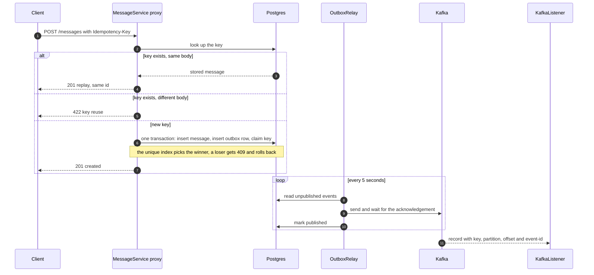

# 3. Cheat sheet: Core Patterns with Spring Boot and Maven (Module 1)

One request travels through every idea from this sprint: a proxy chain, a transaction, an idempotency key, an outbox row, a relay and a Kafka topic. Each one exists to fix a specific failure.

> [!TIP]
> **TL;DR: the 30-second interview answer**
> - **Spring AOP:** your bean is wrapped in a proxy that walks a chain of advice. Every link must call `proceed()` and let exceptions through, or the transaction commits.
> - **Idempotency key:** the client invents a receipt number, and the database's unique index decides who wins a race. A retry gets the stored result (replay), not an error.
> - **Outbox:** write the event as a row in the same transaction as the data, and let a relay publish it later. You get **at-least-once** delivery, so consumers must dedupe.

## The whole flow

Notice that the Postgres transaction is the only place where "saved" and "will be announced" become one fact.

## Mental models

| Topic | One sentence |
|---|---|
| Proxy | The container hands you a generated wrapper, and a `BeanPostProcessor` swaps it in after initialisation. |
| Advice chain | `TransactionInterceptor`, then your aspect, then the real method, each linked by `proceed()`. |
| Events | Routed by parameter type at runtime. Plain listeners run before commit, `AFTER_COMMIT` after it, and that is not durable. |
| Maven | The effective POM is the parent chain plus the BOM. Phases are names, plugin goals do the work, and `repackage` builds the launcher jar. |
| Version precedence | Version on the dependency beats your `dependencyManagement`, which beats the parent BOM, which beats what a transitive dependency asks for. |
| Idempotency | Claim the key in the same transaction as the work. Same body means replay, different body means 422, concurrent means 409. |
| Outbox | One write to one place, then publish later. Publish first and mark second, so a crash gives duplicates and never a loss. |
| Kafka | The key picks the partition, an offset belongs to one partition, and a group splits partitions among its consumers. |

## Symptom to cause

| You see | Likely cause |
|---|---|
| HTTP 200 and half-saved data | An aspect or `catch` swallowed the exception inside a transaction |
| `@Transactional` or an aspect silently does nothing | Self-invocation, `private`, `final`, or an object made with `new` |
| A notification for a row that was rolled back | A plain `@EventListener` instead of `AFTER_COMMIT` |
| An `AFTER_COMMIT` listener never fires | No active transaction, and `fallbackExecution` is false |
| The same event appears twice after a crash | The window between publish and mark (at-least-once) |
| A message exists but its event does not | `create` was not `@Transactional`, so the two saves committed separately |
| `NoUniqueBeanDefinitionException` at startup | Two beans of the same type: use `@Primary`, `@Qualifier` or inject a `List` |
| The app container cannot reach Kafka | It was told `localhost`, which is itself. Use the internal listener `kafka:29092` |
| Every endpoint returns 404 after edits | A stale instance from the compile race. Run `docker compose restart dev` |

## Interview answers in three lines

- **How do you make a retried payment safe?** An idempotency key stored with a unique constraint, claimed in the same transaction as the charge. A retry with the same body returns the stored result, a different body returns 422, and a concurrent duplicate returns 409 and rolls back.
- **How do you save a row and publish an event without losing either?** The transactional outbox: the event is a row in the same transaction. A relay publishes it and marks it, giving at-least-once delivery, and consumers dedupe on the event id.
- **Why did `@Transactional` not roll back?** Check for a swallowed exception, a self-invoked or private method, or a checked exception without `rollbackFor`.

Lookup material (not memorised): Maven commands (`help:effective-pom`, `dependency:tree -Dverbose`), Kafka CLI scripts in `/opt/kafka/bin`, and the compose keys in `compose.yaml`.

**Related:** [Plan](/notebook/spring-boot-system-design/quick-sessions/core-patterns-spring-maven/plan) · [Recall cards](/notebook/spring-boot-system-design/quick-sessions/core-patterns-spring-maven/cards) · [7. AOP aspects and events](/notebook/spring-boot-system-design/01-spring-boot-basics/aop-aspects-and-transactional-events) · [8. Maven in depth](/notebook/spring-boot-system-design/01-spring-boot-basics/maven-effective-pom-lifecycle-and-fat-jar) · [Idempotency keys](/notebook/spring-boot-system-design/05-distributed-problems/idempotency-keys) · [Transactional outbox](/notebook/spring-boot-system-design/05-distributed-problems/transactional-outbox) · [Kafka with Spring Boot](/notebook/spring-boot-system-design/04-messaging/kafka-with-spring-boot)
