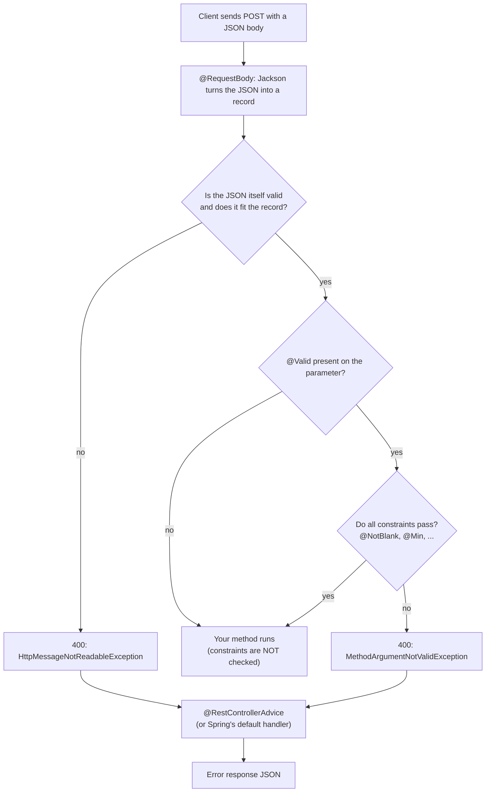

# Request Body, Validation and Error Handling

## The problem

`POST` and `PUT` carry data in the body. Bad data must be rejected **before** it reaches business logic. Every write endpoint in the capstone (`POST /orders`, `POST /payments`) depends on this.

## The flow



Two different failures can happen before your method runs:

1. **Malformed or mismatched JSON** (broken syntax, wrong type) fails while Jackson reads the body.
2. **Valid JSON, invalid values** (blank text, negative number) fails in Bean Validation, but only if `@Valid` triggers it.

## The pieces

| Piece | Job |
|-------|-----|
| `@RequestBody` | Reads the body and deserialises it with Jackson. The reverse of returning an object |
| Constraint annotations (`@NotBlank`, `@Min`, `@Size`, `@Email`...) | Declare rules on the fields of a record or class |
| `@Valid` | Tells Spring to **run** those rules on this parameter. Declaring a constraint alone does nothing |
| `@RestControllerAdvice` | One class that catches exceptions from all controllers and turns them into consistent error responses |
| `@ExceptionHandler` | A method inside the advice class that handles one exception type |

Validation lives in a separate library (Jakarta Bean Validation), so it needs its own starter in `pom.xml`. That is the usual chain: starter on the classpath, auto-configuration, beans.

## Example shape (what we will build)

```java
public record CreateGreetingRequest(
    @NotBlank String message,
    @Min(1) int id) {}

@PostMapping("/greetings")
public Greeting create(@Valid @RequestBody CreateGreetingRequest request) { ... }
```

## What we saw (hands-on)

| Request | Result |
|---------|--------|
| Blank message, **no `@Valid`** | **200**: the constraint was never checked |
| Blank message, with `@Valid` | 400 `MethodArgumentNotValidException` |
| Both rules broken | 400, both violations reported together (order not guaranteed) |
| Broken JSON syntax | 400 `HttpMessageNotReadableException` (fails in Jackson, before validation) |
| Wrong `Content-Type` | 415 `HttpMediaTypeNotSupportedException` |
| Wrong HTTP method | 405 `HttpRequestMethodNotSupportedException` (+ `Allow` header) |

Default error bodies contain a huge `trace` string. The useful facts (which field, which rule) are buried inside it.

## The error contract

```java
public record ErrorResponse(int status, String error, Map<String, String> fieldErrors) {}
```

Example: `{"status":400,"error":"Validation failed","fieldErrors":{"message":"must not be blank"}}`

## The handler that covers everything

```java
@RestControllerAdvice
public class GlobalExceptionHandler extends ResponseEntityExceptionHandler {
    @Override protected ResponseEntity<Object> handleMethodArgumentNotValid(...) { /* field errors */ }
    @Override protected ResponseEntity<Object> handleHttpMessageNotReadable(...) { /* "Malformed JSON request" */ }
    @Override protected ResponseEntity<Object> handleExceptionInternal(...)      { /* all other standard errors */ }
}
```

- Version 1 had two `@ExceptionHandler` methods. It only covered those two exceptions, so 415 and 405 still came back in Spring's default shape: **two error formats** in one API.
- `@ExceptionHandler(Exception.class)` looks like the fix but is a trap: it also catches 415/405 and returns 500 for client mistakes.
- `ResponseEntityExceptionHandler` already maps about a dozen standard MVC exceptions to correct status codes. Override the hooks; do **not** add your own `@ExceptionHandler` for an exception the base class handles (ambiguous handler error at startup).

## Why a central error handler

Without one, every failure comes out in Spring's default shape (and in dev, with a full stack trace). With a `@RestControllerAdvice` every endpoint returns the same error format, so clients and logs can rely on it. In the capstone, services will share one error contract.
