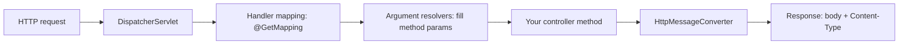

# Request Input and JSON in Spring MVC

## Request flow



Arguments are resolved and **converted before your method runs**. If that fails, Spring answers 400 itself and your code never executes. So you rarely write null or type checks for required input.

## Where input comes from

| Source | Example | Annotation | Notes |
|--------|---------|------------|-------|
| Query string | `/greet?name=Sri` | `@RequestParam` | `required=true` by default. `defaultValue` also covers an empty value. |
| Path | `/hello/42` | `@PathVariable` | Name in `{id}` must match the parameter name (or `@PathVariable("x")`). Text is converted to the parameter type. |
| Body | `POST` + JSON | `@RequestBody` | Not covered yet. |

## What happens on bad input

| Call | Result | Why |
|------|--------|-----|
| `/greet` (required param missing) | 400 `MissingServletRequestParameterException` | Resolver cannot find the value |
| `/hello/abc` with `int id` | 400 `MethodArgumentTypeMismatchException` | Conversion `"abc"` -> `int` fails |
| `/hello/42` when only `/hello/{d}i` exists | 404 "No static resource ..." | No mapping matched, so Spring tried static files |
| Mapping variable name != parameter name | 500 `MissingPathVariableException` | Variable `d` exists, `id` does not |

## Objects to JSON

```java
public record Greeting(String message, int id) {}

@GetMapping("/greeting/{id}")
public Greeting greeting(@PathVariable int id,
                         @RequestParam(defaultValue = "World") String name) {
    return new Greeting("Hello, " + name, id);
}
// GET /greeting/7?name=Sri  ->  {"message":"Hello, Sri","id":7}
```

- The **return type** selects the converter. `String` -> `text/plain`. A record/POJO -> Jackson -> `application/json`.
- `@RestController` = `@Controller` + `@ResponseBody`: it means "write the return value to the body", not "always JSON".
- No Jackson annotations are needed for a record. Field names come from the record components.
- Use records as DTOs at the API boundary (package `dto`), never return entities.

## Content negotiation

The client sends `Accept`. The server picks a converter that can write the type **and** matches `Accept`.

| `Accept` | Result |
|----------|--------|
| `application/json` or `*/*` | 200 JSON |
| `application/xml` (no XML converter) | **406 Not Acceptable**, no body |

Adding an XML library would add a converter and the same call would return 200. That is auto-configuration reacting to the classpath.

## Gotchas
- After moving classes between packages, check `target/classes` for **stale `.class` files**. A stale controller or service means duplicate beans or ambiguous mappings. Delete the specific stale file, not `target/` (our watch loop needs `target/.last-build`).
- DevTools puts stack traces into error responses (not confirmed why). Must not reach production.
