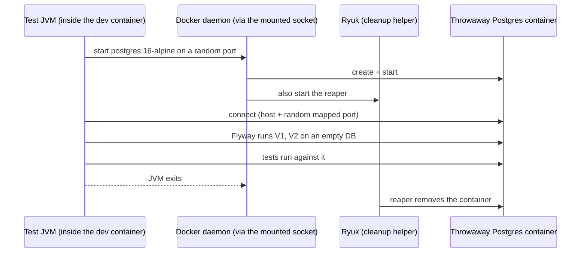

# Testcontainers and JPA Tests

## The problem

Our tests so far have two weaknesses:

1. `@SpringBootTest` tests connect to the **real dev database** (`postgres:5432/hello_db`) and run Flyway on it. They need it running, and they touch your data.
2. Nothing tests the **JPA layer for real**: dirty checking, `@Version`, the Flyway migrations from scratch, and `ddl-auto=validate` against the migrations are only checked by hand with `curl`.

Mocking the repository (as in `MessageServiceTest`) cannot find these bugs, because they live in the interaction with a real database.

## Why not an in-memory database (H2)?

It is a different engine. SQL types, identity columns, `timestamptz`, locking and error behaviour differ from Postgres, so a test can pass on H2 and fail in production (or the reverse). We want the **same engine as production**, but disposable.

## Testcontainers: a real database per test run

- The container gets a **random host port**, so tests never collide with anything.
- Spring Boot wires it automatically with `@ServiceConnection`: the datasource URL, user and password come from the container, not from `application.properties` or environment variables.
- The reaper container (Ryuk) removes leftovers even if the test JVM crashes.

## `@DataJpaTest`: the JPA slice

Like `@WebMvcTest` for the web layer, `@DataJpaTest` starts **only** the persistence layer: entities, repositories, Hibernate, the datasource, and Flyway. No controllers, no services.

- Each test runs in a transaction that is **rolled back** at the end, so tests do not leave data behind.
- Because of that rollback, to see what Hibernate really wrote you must `flush()` (send pending SQL) and `clear()` (forget the cached entities) before reading back.

## What these tests can prove that mocks cannot

| Behaviour | How |
|-----------|-----|
| Migrations `V1` + `V2` apply on an **empty** database | Flyway runs when the context starts |
| Entities match the migrations | `ddl-auto=validate` fails the context otherwise |
| `save` returns a generated id, `findById` round-trips | Real INSERT/SELECT |
| Dirty checking writes an UPDATE | Change field, `flush`, `clear`, reload |
| `@Version` increments and detects conflicts | Bump the version in SQL behind Hibernate's back, then update the stale entity |

## Our setup (Docker-in-Docker is "Docker-outside-of-Docker")

- Our tests run **inside** the `dev` container, so it needs the Docker socket: `/var/run/docker.sock` mounted in `compose.yaml`.
- **Security cost:** anything running in `dev` can then control every container on the Docker VM (start, stop, mount host paths). Acceptable on a personal learning machine; not on a shared one.
- Container-to-container networking (the test JVM reaching the Postgres it started) may need an extra setting. To be verified when we run it.

## What we will do (hands-on plan)
1. Mount the Docker socket into `dev`; add the four test dependencies; restart.
2. Write `MessageJpaRepositoryTest` with `@DataJpaTest` + a Postgres container: round trip, dirty checking, `@Version` conflict.
3. Break it on purpose (a migration/entity mismatch) and see the test catch it.
4. Point the existing `@SpringBootTest` classes at the container too, so nothing uses the dev database.
5. Record.
