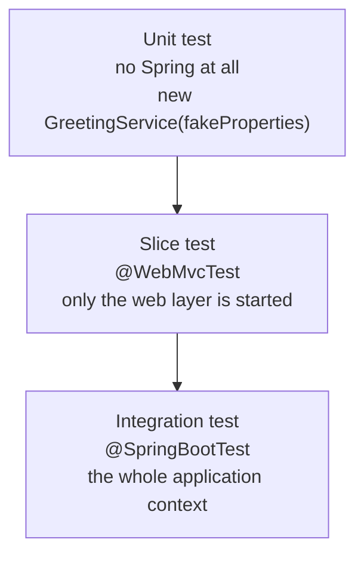

# Testing in Spring Boot

## The problem

Everything built so far was checked by hand with `curl`. That does not scale: each change risks breaking something that worked. Tests turn those manual checks into repeatable ones. They also make the "tests can pass fakes" benefit of dependency injection concrete.

## Three levels, from cheap to expensive



| Level | What starts | What is real | What is faked | Speed |
|-------|-------------|--------------|---------------|-------|
| Unit | Nothing (plain Java) | The class under test | Its collaborators (hand-made or mock) | milliseconds |
| Slice, `@WebMvcTest` | Web layer only: controllers, the `@RestControllerAdvice`, JSON converters, validation | Routing, argument binding, `@Valid`, error handler, JSON | The service (a mock bean) | seconds (5.4 s for the first slice start here, then fast) |
| Integration, `@SpringBootTest` | Everything: all beans, config, profiles | The full wiring | Nothing, or just external systems | slowest |

Rule of thumb: many unit tests, a moderate number of slice tests, a few integration tests.

## Which test catches what

| Behaviour we built | Best test |
|--------------------|-----------|
| `GreetingService` uses the configured prefix and default name | Unit |
| `POST /greetings` with a blank message returns 400 and our `ErrorResponse` | `@WebMvcTest` |
| Wrong `Content-Type` returns 415 in our error format | `@WebMvcTest` |
| `@Valid` is actually present (the silent-200 trap) | `@WebMvcTest` |
| Config binds and the app starts with the `dev` profile | `@SpringBootTest` |

## Tools

- **MockMvc**: calls the controller without a real HTTP server or port, and lets you assert on status, headers and JSON body.
- **Mock beans** (Mockito): replace the real `GreetingService` bean inside the slice with a controllable fake.
- **JUnit 5** assertions.

Boot 4 reorganised some test annotations and packages, so exact names are verified against the real jars before we write code.

## Our setup (Docker)

- Run tests inside the build container: `docker compose exec dev mvn test`. No Maven on the host.
- **Gotcha:** the container sets `SPRING_PROFILES_ACTIVE=dev`. Tests run with that environment too, so the `dev` profile leaks into them. A test that expects the base value `Hello` would see `Hi`. Pin it explicitly in the test (an active-profile setting or a test property) so results do not depend on where you run them.
- Test sources live in `src/test/java`, mirroring the main package tree.

## What we wrote

```java
// Unit test: no Spring. Constructor injection lets us hand over our own values.
private final GreetingService service = new GreetingService(new GreetingProperties("Yo", "Friend"));

// Slice test: web layer only, service replaced by a mock bean.
@WebMvcTest(HelloController.class)
class HelloControllerTest {
    @Autowired MockMvc mockMvc;
    @MockitoBean GreetingService greetingService;
    // ... mockMvc.perform(post("/greetings")...).andExpect(status().isBadRequest())
    //                                        .andExpect(jsonPath("$.fieldErrors.message").value("must not be blank"));
}

// Integration test with the profile pinned so it does not depend on the environment.
@SpringBootTest
@ActiveProfiles("test")
class GreetingPropertiesTest { ... }
```

Boot 4 moved some test classes (verified in the jars):
- `org.springframework.boot.webmvc.test.autoconfigure.WebMvcTest`
- `org.springframework.test.context.bean.override.mockito.MockitoBean`

Result: 9 tests (3 unit, 4 slice, 1 context-loads, 1 config binding), all green.

## What we saw
- A test must be able to fail. Removing `@Valid` made exactly one test fail: `Status expected:<400> but was:<200>`. That is the silent-200 bug from the validation lesson, now caught automatically.
- **The container's `SPRING_PROFILES_ACTIVE=dev` leaks into every test.** A config test expecting the base value failed with `expected: <Hello> but was: <Hi>`. `@ActiveProfiles("test")` fixed it. Tests that assert environment-dependent values must pin their profile.

## Commands (inside the build container)
```
docker compose exec dev mvn test                              # all tests
docker compose exec dev mvn test -Dtest=HelloControllerTest   # one class
```
Use the Bash tool with `MSYS_NO_PATHCONV=1` for `docker compose exec` commands that contain pipes or paths; PowerShell mangles the quoting.

## Gotchas
- Old tutorials use `@MockBean` and the old `@WebMvcTest` package. Those are not the Boot 4 locations listed above. (Not tested: whether the old names still compile on Boot 4, so check before copying old code.)
- A test that passes on a clean machine and fails in the container is usually an environment leak (profile, env var).
- `@WebMvcTest(Controller.class)` loads the `@RestControllerAdvice` too, so error-format tests work in the slice.
