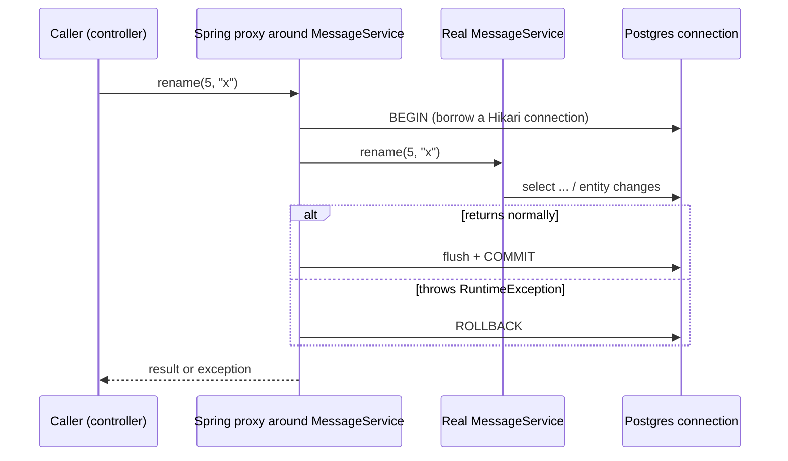

# Transactions in Spring and Postgres

## The problem

Real operations touch several rows or tables and must be **all-or-nothing**. Placing an order means: insert the order, reduce stock, record the payment. If step 2 fails after step 1 succeeded, you must not be left with an order and no reserved stock. A **transaction** groups statements so they commit together or roll back together.

ACID in one line each:

| Letter | Meaning |
|--------|---------|
| **A**tomic | All statements commit or none do |
| **C**onsistent | Constraints hold before and after |
| **I**solated | Concurrent transactions do not see each other's half-done work (to a degree you choose) |
| **D**urable | Once committed, it survives a crash |

This is the guarantee a single database gives. Across services (order service + payment service) there is no shared transaction, which is why the distributed-systems stage needs outbox and saga. Understanding the single-DB case first is the foundation.

## How `@Transactional` works: a proxy around your bean



- Spring does not change your class. It wraps the bean in a **proxy** that opens the transaction before the method and commits or rolls back after.
- The transaction holds **one database connection** from the pool for its whole duration. Long transactions starve the pool.

## Rollback rules (a classic surprise)

| Thrown inside the method | Default behaviour |
|--------------------------|-------------------|
| `RuntimeException` (unchecked) or `Error` | **Rollback** |
| Checked exception (`Exception`, `IOException`...) | **Commit!** Changes made before the throw are saved |

Change it with `@Transactional(rollbackFor = Exception.class)`.

## The self-invocation trap

Because the transaction lives in the **proxy**, only calls that go *through the proxy* are transactional.

```java
public void outer() {
    this.inner();          // direct call inside the same object: NO proxy, NO transaction
}
@Transactional
public void inner() { ... }
```

Same reason: `@Transactional` on `private` or `final` methods is ignored. Call it from another bean, or move the method to a different class.

## Propagation: what if a transactional method calls another one?

| Propagation | Meaning | Typical use |
|-------------|---------|-------------|
| `REQUIRED` (default) | Join the current transaction, or start one | Almost everything |
| `REQUIRES_NEW` | Suspend the current one, run in a brand-new independent transaction | An audit/log row that must survive the outer rollback |
| `NESTED` | Savepoint inside the current transaction | Partial rollback |
| `SUPPORTS` / `MANDATORY` / `NEVER` / `NOT_SUPPORTED` | Run with/require/forbid a transaction | Rare |

## Isolation: how much concurrent work can you see?

| Anomaly | Example |
|---------|---------|
| Dirty read | See another transaction's uncommitted change |
| Non-repeatable read | Read a row twice in one transaction, get different values |
| Phantom read | Re-run a query, new rows appear |
| **Lost update** | Two transactions read the same value, both write; one overwrite silently wins |

| Level | Postgres behaviour |
|-------|--------------------|
| `READ COMMITTED` (**Postgres default**) | No dirty reads; non-repeatable and phantom reads possible |
| `REPEATABLE READ` | Each transaction sees a snapshot; can fail with a serialization error you must retry |
| `SERIALIZABLE` | Behaves as if transactions ran one after another; can fail and need retry |

(Postgres treats `READ UNCOMMITTED` as `READ COMMITTED`.) A higher level is not free: more failures to retry, more contention.

## Lost updates and how to prevent them

| Approach | Idea | Cost |
|----------|------|------|
| **Optimistic locking** (`@Version` column) | Each update says `... where id=? and version=?`; if someone else got there first, 0 rows match and an exception is thrown | No locks held; the loser must retry or report a 409 |
| **Pessimistic locking** (`SELECT ... FOR UPDATE`) | Lock the row until commit | Blocks other writers; risk of deadlocks and long waits |

For things like **inventory stock** both appear in the capstone.

## What we will do (hands-on plan)
1. **Atomicity:** a service method that saves two messages and then fails. With `@Transactional` neither should exist; without it, the first one stays.
2. **Checked vs unchecked:** a checked exception does not roll back; fix with `rollbackFor`.
3. **Self-invocation:** a transactional method called from inside the same class.
4. **Lost update:** add a `version` column with a **`V2` Flyway migration**, `@Version` on the entity, and two conflicting updates; handle the failure as HTTP 409.
5. Tests where it makes sense, then record.
