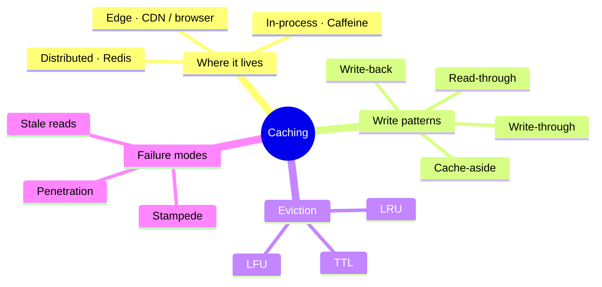
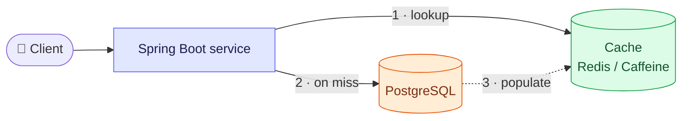
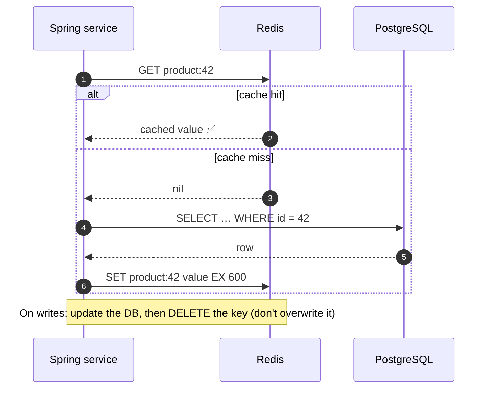
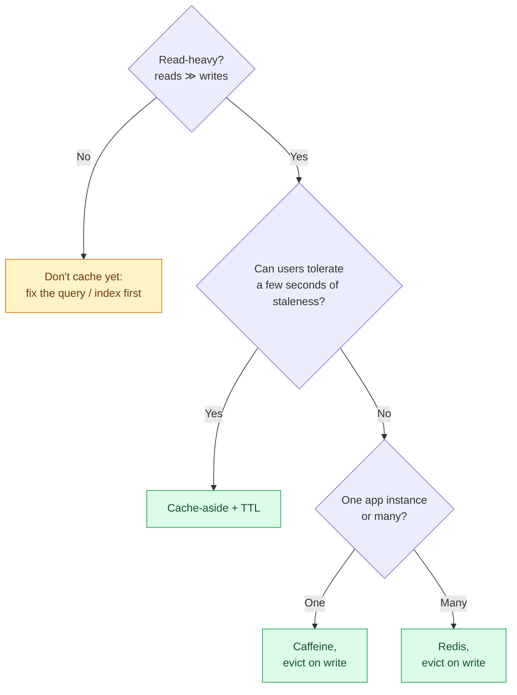
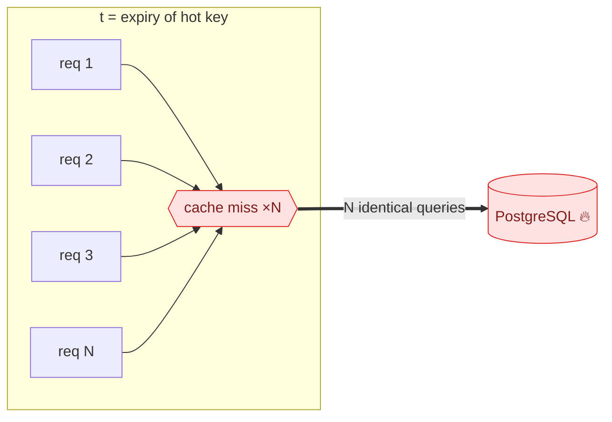

# Caching — Patterns, Pitfalls & Spring Boot

A cache trades **freshness** for **speed**. Every caching decision is really one
question: *how stale can this data be, and what happens when the cache is wrong?*

> [!TIP]
> **TL;DR: the 30-second interview answer**
> - Default to **cache-aside + TTL**: read cache → on miss read DB → populate cache.
> - The two hard problems are **invalidation** (stale reads) and **stampedes** (a hot key expires and floods the DB).
> - In Spring Boot: `@EnableCaching` + `@Cacheable` / `@CacheEvict`, backed by **Caffeine** (in-process) or **Redis** (shared across instances).

## The landscape at a glance



## Mental model: where the cache sits



The cache is a **copy**. The database stays the source of truth, so every design
choice below is about keeping that copy close enough to the truth.

### Why it pays off: the numbers

| Hop | Rough latency (order of magnitude) |
|---|---|
| In-process map (Caffeine) | ~100 ns |
| Redis, same data centre | ~0.5–1 ms |
| Indexed PostgreSQL query | ~1–10 ms |
| Cross-region call | ~50–150 ms |

With hit ratio $h$, the average read cost is

$$
T = h \cdot t_{cache} + (1 - h)\,(t_{cache} + t_{db})
$$

At $h = 0.9$, $t_{cache} = 1\text{ ms}$, $t_{db} = 10\text{ ms}$: $T = 0.9 + 0.1 \times 11 = 2\text{ ms}$, so
**5× faster** than always hitting the DB. The hit ratio matters more than how fast the cache is.

## How cache-aside works



> [!IMPORTANT]
> **Evict on write, don't update the cached value.** Two concurrent writers can
> interleave so the *older* value lands in the cache last and stays there until the TTL.
> Deleting is idempotent: the next read loads whatever is committed.

## The write patterns compared

| Pattern | Write path | Consistency | Main risk | Use when |
|---|---|---|---|---|
| **Cache-aside** | DB, then evict key | Eventual (TTL-bounded) | Stale window, stampede | ✅ Default for read-heavy data |
| **Read-through** | Cache loads from DB itself | Same as cache-aside | Cache becomes a hard dependency | Library has a loader (Caffeine `LoadingCache`) |
| **Write-through** | Cache + DB synchronously | Strong-ish | Slower writes | Reads right after writes must be fresh |
| **Write-back** | Cache now, DB later | Weak | ⚠️ **Data loss** if the cache dies | Counters, metrics, very high write volume |
| **Write-around** | DB only | — | First read always misses | Written once, rarely read |

## Choosing a strategy



## In Spring Boot

Spring's cache abstraction is a **proxy**: `@Cacheable` wraps the method, checks the
cache by key, and only calls your code on a miss.

```java
@Configuration
@EnableCaching
class CacheConfig {}

@Service
class ProductService {
    private final ProductRepository repo;

    ProductService(ProductRepository repo) { this.repo = repo; }

    // sync = true: only ONE thread per key computes on a miss (local stampede guard)
    @Cacheable(cacheNames = "products", key = "#id", sync = true)
    public ProductDto find(long id) {
        return repo.findById(id).map(ProductDto::from).orElseThrow();
    }

    @CacheEvict(cacheNames = "products", key = "#cmd.id()")
    public void rename(RenameProduct cmd) {
        repo.rename(cmd.id(), cmd.name());
    }
}
```

```yaml
spring:
  cache:
    type: redis
    redis:
      time-to-live: 10m   # every entry expires, which bounds staleness
```

> [!WARNING]
> **Self-invocation skips the cache.** Calling `find()` from another method *in the same
> class* never goes through the proxy, so nothing is cached. This is the same trap as
> `@Transactional`. Call it from another bean.

> [!CAUTION]
> **Evicting before the transaction commits** lets a concurrent read put the *old* row
> back into the cache. For writes inside `@Transactional`, evict in an
> `@TransactionalEventListener(phase = AFTER_COMMIT)` handler.

## Failure modes and fixes



| Problem | Symptom | Fix |
|---|---|---|
| **Stampede** | Hot key expires → DB CPU spikes | `sync = true` / single-flight, TTL **jitter**, refresh-ahead (`refreshAfterWrite`) |
| **Stale reads** | Users see old data after an update | Evict on write (after commit), shorter TTL |
| **Penetration** | Lookups for IDs that don't exist always miss | Cache the "not found" briefly, or put a Bloom filter in front |
| **Cold start** | Deploy → empty cache → slow first minutes | Warm the top-N keys on startup |

## Interview questions

<details>
<summary>Why delete the key on write instead of updating it?</summary>

Two writers can interleave (A writes DB, B writes DB, B sets cache, A sets cache) and the
older value A wrote wins in the cache until the TTL. Deleting is idempotent; the next read
repopulates from the committed row.
</details>

<details>
<summary>Caffeine or Redis: how do you choose?</summary>

Caffeine is in-process, ~100 ns, no network, but **each instance has its own copy**, so
evictions don't propagate. Redis is shared and consistent across instances at ~1 ms.
A common combination is Caffeine as L1 with a short TTL in front of Redis as L2.
</details>

<details>
<summary>What is a cache stampede and how do you prevent it?</summary>

A popular key expires and many concurrent requests miss at once, all hitting the DB.
Prevent it with request coalescing (`@Cacheable(sync = true)` or single-flight), random TTL
jitter so keys don't expire together, and refresh-ahead before expiry.
</details>

## Key takeaways

| Remember | Because |
|---|---|
| Cache-aside + TTL is the default | Simple, and the TTL bounds how stale you can get |
| Evict, don't update, and do it after commit | Avoids races that pin stale data |
| Hit ratio beats raw speed | 90% hits on a 1 ms cache is ~5× faster than no cache |
| `@Cacheable` is a proxy | Self-invocation silently bypasses it |

**Related:** [Transactions & locking](/notebook/spring-boot-system-design/02-persistence/transactions-in-spring)
