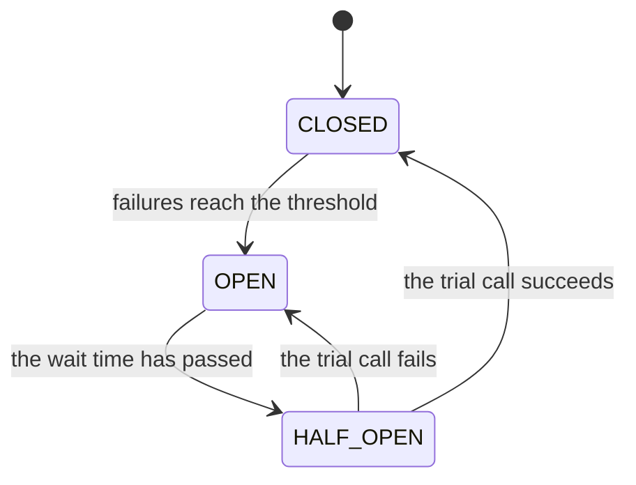
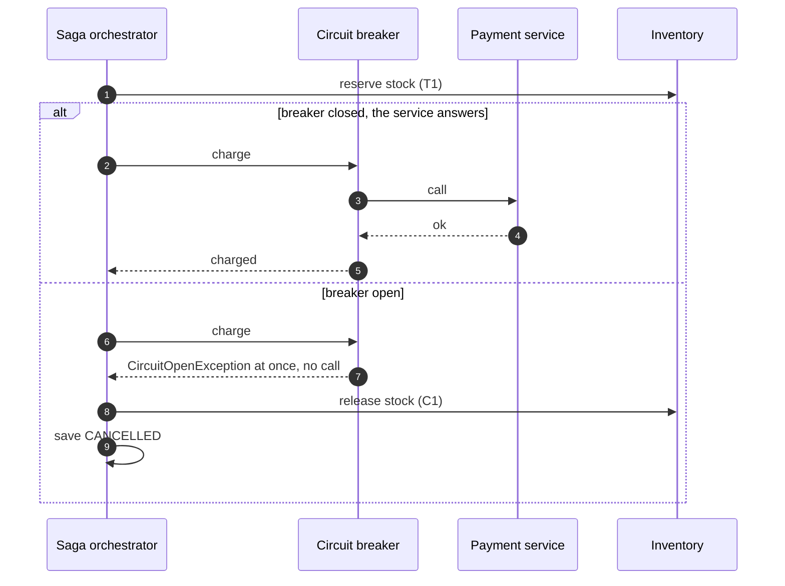
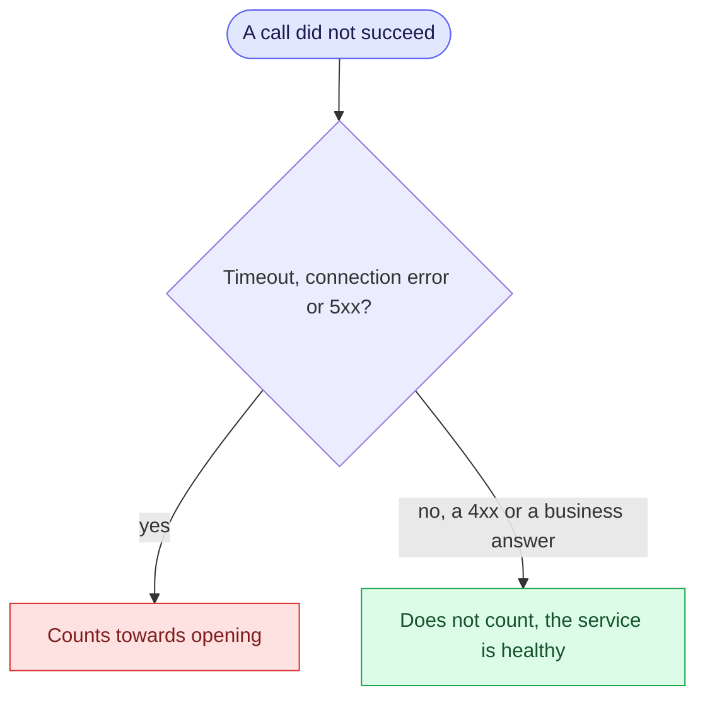

# Circuit Breaker — Stop Calling a Dependency That Is Down

A circuit breaker wraps a call to another service. After enough failures it stops making the call for a while and fails at once, so callers do not queue up behind a dependency that is already down.

> [!TIP]
> - **Three states:** closed (calls go through and failures are counted), open (calls are rejected at once, with no network call), half-open (one trial call decides whether to close or to open again).
> - **What it buys:** a fast failure instead of a full timeout per call, no threads stuck waiting, and a failing service that is left alone while it recovers.
> - **Count only technical failures** (timeouts, connection errors, 5xx). A business answer such as a declined card means the service is healthy, and it must not open the breaker.

## The three states



| State | What a call does | How it leaves the state |
|---|---|---|
| Closed | Runs the action. A success resets the failure count, a failure adds to it. | The failure threshold is reached, so it opens |
| Open | Is rejected with `CircuitOpenException` and the action is not run | The first call after the wait time moves it to half-open |
| Half-open | One trial call runs. Other calls are rejected while it is in flight. | A success closes it, and a failure opens it again |

Open means "do not even try". The wait time gives the dependency room to recover, and the single trial call checks whether it did.

## In a saga: the payment call

In the order saga, the charge (T2) is the call to guard. T1 has already committed the stock reservation. T2 waits on the payment service. If it fails, C1 releases the stock and C0 cancels the order.



With the payment service down, the two situations compare like this:

| | Without a breaker | With a breaker |
|---|---|---|
| Each order | T0, T1, a full timeout on T2, then C1 and C0 | After the breaker opens, T2 fails at once and the saga compensates |
| Stock | Held for the whole timeout, so other orders see "out of stock" | Held for milliseconds |
| Threads | Pile up waiting on the dead service | Free |
| Payment service | Receives every order, even while it recovers | Left alone until the breaker goes half-open |

**Design choice:** check the breaker before T1. If it is already open, reject the order with a 503 before reserving anything, so there is nothing to compensate.

The breaker is built in the `PaymentClient` of `playground/hello-boot`. The saga project (`playground/hld/saga-pattern`) has a toy `PaymentGateway` with a `DOWN` mode and no breaker.

## What counts as a failure



A declined card is the saga's `DECLINE` mode: the gateway answered correctly, and the order is compensated. If declines counted, a few bad cards would open the breaker and block every customer. The `DOWN` mode is the one that must count.

## A hand-written breaker

`CircuitBreaker` in `playground/hello-boot` has no framework. It opens after a number of failures in a row and allows one trial call after the wait time:

```java
public <T> T call(Supplier<T> action) {
    beforeCall();                       // may throw CircuitOpenException
    T result;
    try {
        result = action.get();          // the lock is NOT held while the (slow) action runs
    } catch (RuntimeException e) {
        onFailure();
        throw e;
    }
    onSuccess();
    return result;
}

private synchronized void beforeCall() {
    if (state == State.OPEN) {
        if (Instant.now().isBefore(openedAt.plus(openFor))) throw new CircuitOpenException(name);
        transition(State.HALF_OPEN);
    }
    if (state == State.HALF_OPEN) {
        if (trialInFlight) throw new CircuitOpenException(name);   // only one trial call at a time
        trialInFlight = true;
    }
}
```

Each state change and the failure count sit behind `synchronized`, but the action itself runs outside the lock, so a slow call does not block other callers from checking the state.

Example output with a threshold of 3 failures in a row and an open time of 500 ms, against a gateway that is down and then comes back:

```text
gateway is down:
call 1: the action failed, 503
call 2: the action failed, 503
  circuit 'payment-gateway' CLOSED -> OPEN
call 3: the action failed, 503
call 4: rejected at once, CircuitOpenException
call 5: rejected at once, CircuitOpenException
the action ran 3 times for 5 calls, state = OPEN
wait for the open period, the gateway is still down:
  circuit 'payment-gateway' OPEN -> HALF_OPEN
  circuit 'payment-gateway' HALF_OPEN -> OPEN
call 6: the action failed, 503
call 7: rejected at once, CircuitOpenException
wait again, the gateway is back:
  circuit 'payment-gateway' OPEN -> HALF_OPEN
  circuit 'payment-gateway' HALF_OPEN -> CLOSED
call 8: charged
call 9: charged
the action ran 6 times for 9 calls, state = CLOSED
```

Of 9 calls, the gateway was hit 6 times. Calls 4, 5 and 7 never reached it. After the wait time one trial call failed and reopened the circuit, and a second one succeeded and closed it.

The class checks the state with an enum and `if` statements. That is the shape that the [State pattern](/notebook/system-design/pattern/lld/state) replaces with one class per state.

## Retry and the breaker together

Retry covers a short blip, and the breaker covers a longer outage. Both are on `PaymentClient.charge`:

```java
@Retryable(includes = HttpServerErrorException.class, maxRetries = 4, delay = 200, multiplier = 2,
           jitter = 50, maxDelay = 2000)
public String charge(String orderId) {
    return breaker.call(() -> post(orderId));      // the breaker is inside, so each attempt passes through it
}
```

| Setting | Meaning |
|---|---|
| `includes = HttpServerErrorException.class` | Retry only on a 5xx |
| `maxRetries = 4`, `delay = 200`, `multiplier = 2`, `maxDelay = 2000` | Up to 4 retries, waiting 200 ms, then 400 ms, 800 ms, and so on, never more than 2 s |
| `jitter = 50` | Up to 50 ms of random extra delay, so clients do not retry in step |

The order of the layers matters. `@Retryable` is outside, so every attempt goes through the breaker. Once the breaker is open it throws `CircuitOpenException`, which is not a 5xx, so the retry does not repeat it. A retried charge is safe only because the call carries an idempotency key (the order id), as in [Idempotency keys](/notebook/spring-boot-system-design/05-distributed-problems/idempotency-keys).

Retry on its own multiplies the load on a failing service: with 4 retries, one call becomes up to 5 requests. The breaker is what stops that.

## In Spring Boot

| Piece | Where it comes from |
|---|---|
| Retry | Spring Framework 7: `@Retryable` and `@EnableResilientMethods` |
| Circuit breaker | Spring Framework has none. Write a small class, as above, or use Resilience4j. |
| The call | `RestClient` |

With Resilience4j the breaker is configured, not written. Artifact: `io.github.resilience4j:resilience4j-spring-boot4`, version 2.4.0 on Maven Central.

```yaml
resilience4j:
  circuitbreaker:
    instances:
      payment:
        slidingWindowSize: 10
        minimumNumberOfCalls: 5
        failureRateThreshold: 50
        waitDurationInOpenState: 10s
        permittedNumberOfCallsInHalfOpenState: 1
        ignoreExceptions:
          - com.example.CardDeclinedException     # a business answer, not a failure
```

```java
@CircuitBreaker(name = "payment", fallbackMethod = "chargeFallback")
public String charge(String orderId) { /* the remote call */ }

private String chargeFallback(String orderId, Throwable t) { /* a fallback value or a clear error */ }
```

| | Hand-written breaker | Resilience4j |
|---|---|---|
| Opens when | A number of failures in a row | The failure rate over a sliding window passes a percentage, after a minimum number of calls |
| Half-open | Exactly one trial call | A configured number of trial calls |
| Which errors count | Every `RuntimeException` | `recordExceptions` and `ignoreExceptions` |
| When open | Throws `CircuitOpenException` | Throws `CallNotPermittedException`, or calls the fallback |
| Wiring | `breaker.call(...)` | `@CircuitBreaker`, applied by a Spring AOP proxy, so a call from inside the same class skips it |

## Pitfalls

> [!WARNING]
> **Do not count business errors.** A declined card, a validation error or a 404 are answers from a healthy service. If they count, a few bad requests open the breaker and block every customer.

> [!WARNING]
> **One breaker per dependency.** A single shared breaker for the payment service, the inventory service and the mail service lets one failing dependency block calls to all of them. Name one breaker per dependency.

> [!NOTE]
> **State is local to one application instance.** Each instance has its own breaker, so with 5 instances each one opens after seeing its own failures.

| Symptom | Cause | Fix |
|---|---|---|
| The breaker opens during normal traffic | Business errors count, or the threshold is too small for the traffic | Exclude business errors, use a failure rate over a window with a minimum number of calls |
| Open breaker, and users see a raw exception | No fallback or compensation path | Return a clear error (503) or run the saga compensation |
| The dependency is overloaded after recovery | Many trial calls let through at once | Allow one or very few trial calls in half-open |
| The breaker annotation has no effect | The method is called from inside the same class | Call it through another bean, so the proxy is used |

## Interview questions

<details>
<summary>The payment service goes down and every order waits 30 seconds for a timeout. Threads run out and the whole API hangs. Which pattern helps, and how does it change the picture?</summary>

A circuit breaker around the payment call. After a few failures it opens, and later calls fail in milliseconds without a network call, so threads are freed and the stock reserved by the saga is held briefly instead of for the whole timeout. After the wait time one trial call checks whether the service is back. Fast failure also stops requests from piling up on a service that is trying to recover.
</details>

<details>
<summary>Customers are entering wrong card numbers, the payment gateway answers "declined" every time, and the breaker opens and blocks all payments. What is wrong?</summary>

Declines are counted as failures. A decline is a correct answer from a healthy gateway, so it must not count. Only technical failures, such as timeouts, connection errors and 5xx, should open the breaker. In Resilience4j that is `ignoreExceptions` and `recordExceptions`. In a hand-written breaker, count only the exceptions that mean the service is unhealthy.
</details>

<details>
<summary>A client method has both @Retryable and a circuit breaker. Which one is outside, and what happens once the breaker is open?</summary>

The retry is outside, so every attempt passes through the breaker. Once the breaker is open it throws `CircuitOpenException`, which is not an error the retry is configured for (it retries only 5xx), so the retry stops instead of hammering a service that is known to be down. If the breaker were outside the retry, one logical call would count as one success or failure, however many attempts it took.
</details>

<details>
<summary>Why does the half-open state allow only one trial call?</summary>

The dependency is probably still weak. If every waiting caller were let through at once, they would flood it and push it down again. One trial call tests recovery at the lowest cost: if it succeeds the circuit closes, and if it fails the circuit opens again. Resilience4j allows a small configured number of trial calls.
</details>

<details>
<summary>In the order saga the breaker is open when a new order arrives, and T1 has already reserved the stock. What happens, and how can it be avoided?</summary>

The charge fails at once with `CircuitOpenException`, the saga runs the compensation (release the stock, mark the order `CANCELLED`), and the customer sees a failure. It is correct, but it did a reserve and a release for nothing. Check the breaker before T1 and answer with a 503 straight away, so no stock is reserved and nothing needs compensating.
</details>

<details>
<summary>The service runs as 4 instances and the payment service fails. Does the breaker open in all of them at the same moment?</summary>

No. Each instance keeps its own breaker in memory and opens only after it has seen enough failures itself, so they open at slightly different times. Sharing the state across instances would need a shared store, which adds a dependency that can fail too, so most systems accept per-instance breakers.
</details>

## Key takeaways

| Remember | Because |
|---|---|
| Closed, open, half-open | Count failures, reject without calling, test with one call |
| Open means no network call | Callers fail in milliseconds, and threads and stock are not held |
| Count only technical failures | A declined card is a healthy service giving a business answer |
| Retry covers blips, the breaker covers outages | Retry alone turns one call into several requests on a failing service |
| Retry outside, breaker inside | Each attempt is checked, and an open breaker stops the retries |
| In a saga, check before reserving | An early 503 leaves nothing to compensate |
| State is per instance and per dependency | One breaker for everything blocks healthy calls |

**Related:** [HLD patterns: the map](/notebook/system-design/pattern/hld/overview) · [Saga](/notebook/system-design/pattern/hld/saga) · [Idempotency keys](/notebook/spring-boot-system-design/05-distributed-problems/idempotency-keys) · [State pattern](/notebook/system-design/pattern/lld/state)
