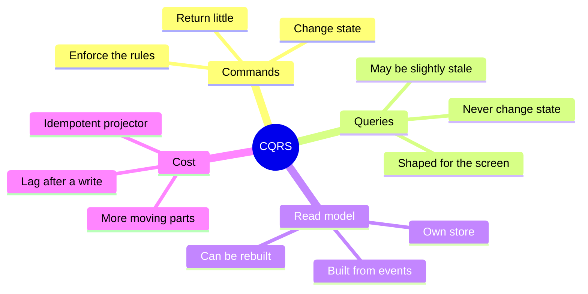
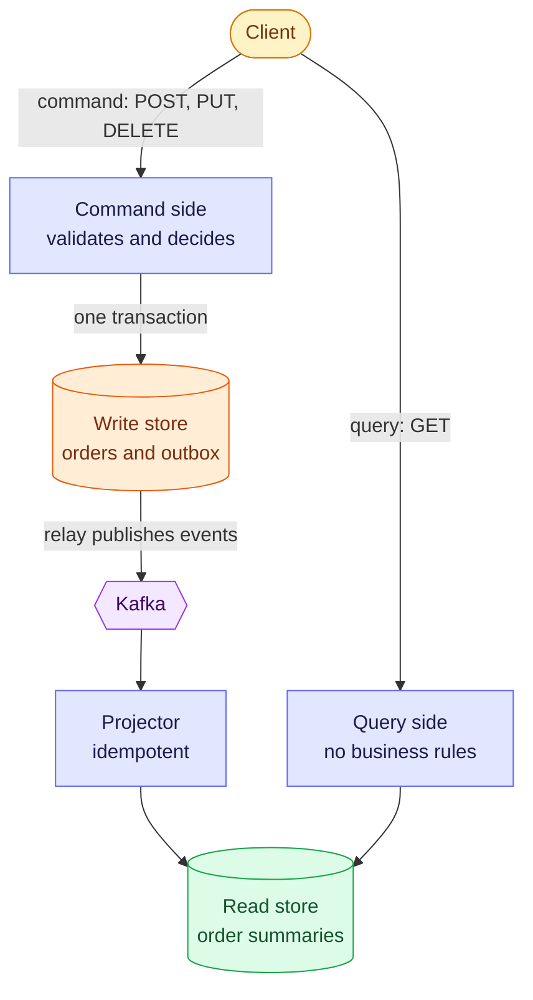
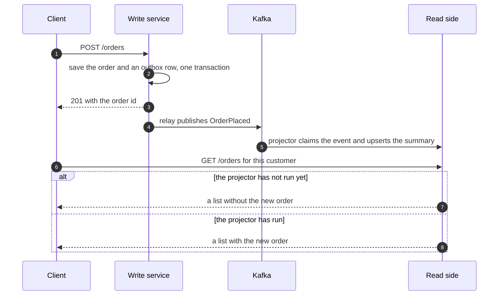
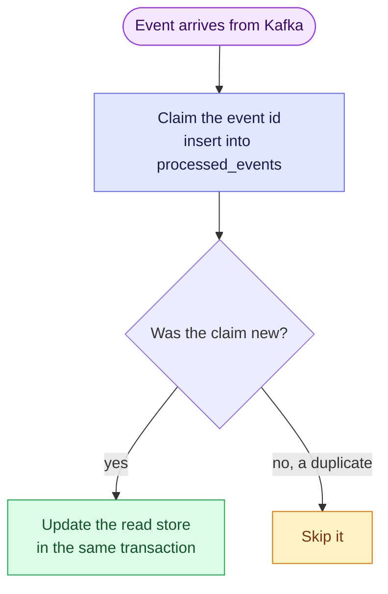
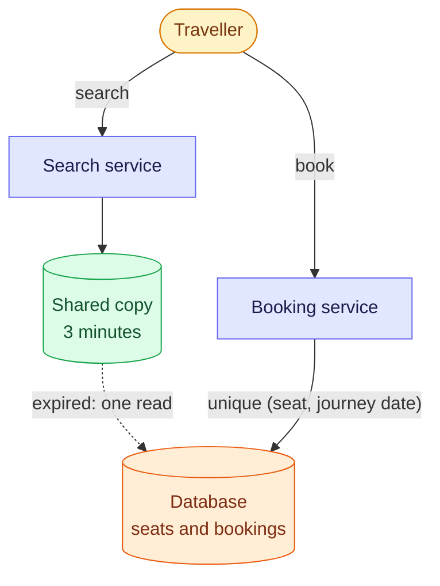
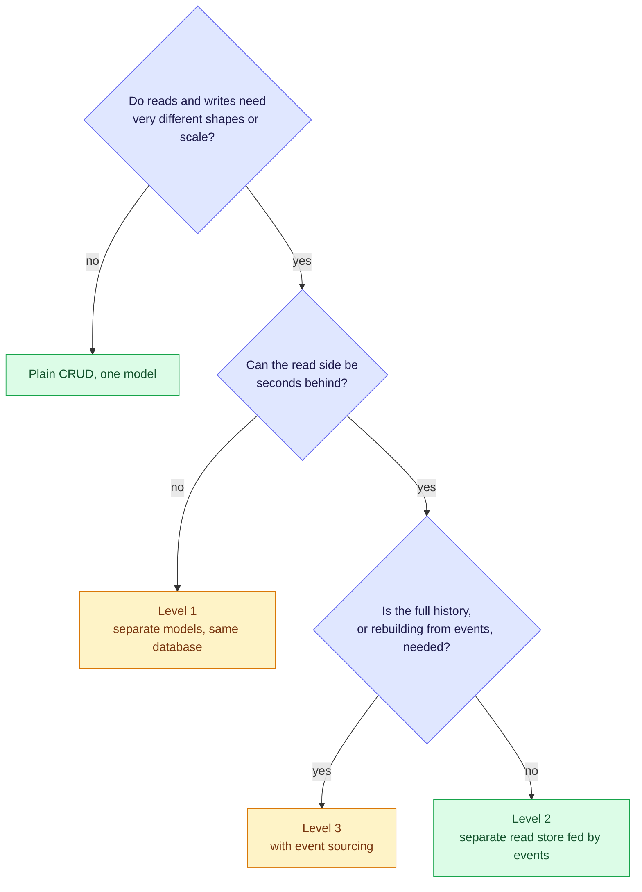

# CQRS — Separate the Model That Changes Data from the Model That Reads It

CQRS (Command Query Responsibility Segregation) splits a service in two: a **command** side that changes data and enforces the rules, and a **query** side that only reads, in whatever shape the screen needs. The two sides can use different models, and often different stores.

> [!TIP]
> - **Commands change state and return little** (an id or an acknowledgement). **Queries never change state** and return data shaped for the reader.
> - **Three levels:** separate models in one database, then a separate read store fed by events, then event sourcing underneath. Most systems need only the first two.
> - **The price is staleness.** A separate read store is updated after the write, so a read right after a write can miss it. The projector that builds the read store must be idempotent.

## CQRS at a glance



Commands and queries have different jobs, so they get different models. The read model is a copy built for reading, and the write side stays the source of truth.

## Mental model: two paths over one stream of events



The command side writes to the store that is the source of truth, and records an event in the same transaction (the transactional outbox). A relay publishes the event, and a projector turns events into rows in a read store designed for the queries. The query side reads only from that store and applies no business rules.

## Three levels

| Level | What is separate | Read side is | Use it when |
|---|---|---|---|
| 1. Separate models | Command and query classes, and read DTOs, in one application and one database | Always current | The write model is awkward for screens, or lists need joins and aggregates |
| 2. Separate read store | A read store (a table, a search index, a cache) fed by events from the write side | Eventually consistent | Reads outnumber writes by a lot, or reads need a very different shape or scale |
| 3. With event sourcing | The write side stores a log of events, and every read model is built from it | Eventually consistent | The full history matters, or read models must be rebuilt from scratch |

CQRS does not need event sourcing. Level 3 uses both patterns together, and level 2 is enough for most services.

## How it works: a command, an event, a query



Steps 4 and 5 happen after the response in step 3. In the outbox relay of `playground/hello-boot` the delay between the commit and the publish is up to one polling interval, 5 seconds. A query between step 3 and step 5 sees the old state.

## The staleness problem: read your own write

A customer places an order, lands on "My orders", and the new order is missing. Nothing is broken: the read store is behind. Options:

| Fix | How it works | Cost |
|---|---|---|
| Return the data from the command | The `201` carries the new order, and the client shows it without a query | The client must merge it into its list |
| Read recent items from the write side | For a short time after a write, the query side asks the write store for that customer | Extra read path, and the write store takes load |
| Wait for a version | The command returns a version number, and the query waits or retries until the read store reaches it | More code, and a possible delay |
| Accept it | Show "processing" or refresh in a moment | Fine when the delay is a second or two |

## Rules for the projector



| Rule | Why |
|---|---|
| **Idempotent** | Kafka delivers at least once. A duplicate event must not double a counter or insert a second row, so the event id is claimed with a unique insert, or the update is an upsert. |
| **The claim and the update are one transaction** | If the update fails after the claim, both roll back, and the retry can process the event again |
| **Per-order ordering** | Kafka orders events only within a partition, so the aggregate id (the order id) is the message key. A version number lets the projector ignore an event older than the row it holds. |
| **Rebuildable** | The read store is a copy. It can be dropped and rebuilt by replaying the topic, or by reading the write store, when a bug or a new view needs it. |
| **No decisions from it** | A command must not rely on the read store for a rule, because the read store can be stale. Rules use the write store. |

In `playground/hello-boot` the pieces for this path exist: the outbox table, the relay to the topic `message-events` (3 partitions), and a consumer group `message-projector` that claims each event id in `processed_events` and skips duplicates. Its listener only logs the event, so the read model itself is not built there.

## An example with trains: search is a read model



The train ticket design already follows this idea. Search reads a shared copy that is at most 3 minutes old, and booking writes to the database. A stale "available" on the search screen is allowed, and the write side's unique rule on `(seat, journey date)` is the final guard, so a seat is never sold twice. The read side may be wrong for a while, and the write side must never be.

## In Spring Boot

There is no `@CQRS` annotation. The pattern is ordinary Spring pieces arranged with a rule: the two sides do not share a model.

| Part | Spring piece |
|---|---|
| Command endpoint | A `@RestController` with `POST`, `PUT`, `DELETE`, calling a command service |
| Command service | A `@Service` with `@Transactional` that changes state and saves an outbox row |
| Event delivery | The transactional outbox, a relay and a Kafka topic |
| Projector | A `@KafkaListener` with `@Transactional`, claiming the event id before it updates the read store |
| Query endpoint | A separate `@RestController` with `GET`, calling a query service |
| Query service | A `@Service` with `@Transactional(readOnly = true)` that returns read DTOs, not entities |
| Read store | A table or view in the same database, a read replica, a search index or a cache |

A sketch of the shape. The class names are examples, and `claim` is the idempotent claim method used by the project's listener:

```java
// command side: change state, record the event in the same transaction
@Service
public class OrderCommandService {
    @Transactional
    public Long place(PlaceOrder command) {
        OrderEntity order = orders.save(OrderEntity.from(command));
        outbox.save(OutboxEventEntity.of("OrderPlaced", order.getId(), toJson(order)));
        return order.getId();
    }
}

// query side: read DTOs shaped for the screen, never entities, never business rules
@Service
public class OrderQueryService {
    @Transactional(readOnly = true)
    public List<OrderSummary> forCustomer(long customerId) {
        return summaries.findByCustomerIdOrderByPlacedAtDesc(customerId);
    }
}

// projector: claim the event, then update the read store, in one transaction
@KafkaListener(topics = "order-events", groupId = "order-summary-projector")
@Transactional
public void onEvent(ConsumerRecord<String, String> record) {
    long eventId = eventIdOf(record);
    if (!processed.claim(GROUP, eventId)) {
        return;                                   // duplicate: skip
    }
    summaries.upsert(OrderSummary.from(record.value()));
}
```

Axon Framework is a library built around this pattern (command bus, event bus, event sourcing), and it is a different route from plain Spring.

## Choosing



## CQRS compared with its neighbours

| | What it is | How it differs from CQRS |
|---|---|---|
| Event sourcing | The write side stores events, not current state | CQRS works without it. Event sourcing usually needs CQRS, because reading current state from an event log is slow. |
| Read replica | The database copies itself to a second server | Same data and same shape, only more read capacity. CQRS changes the shape. |
| Cache-aside | The application fills a cache on a miss | The reader pulls data into the cache. In CQRS the writer pushes events into the read model. |
| Materialized view | The database keeps a precomputed query result | A level-2 read model inside one database, refreshed by the database and not by events |

## Pitfalls

> [!WARNING]
> **Do not use CQRS on a simple CRUD service.** A single table with an admin screen gets two models, a topic, a projector and a lag, and nothing in return. The pattern pays off only when reads and writes really differ.

> [!WARNING]
> **Never write the read store from the command path.** Saving the order and updating the read store in two steps is the dual-write problem: a crash between them leaves them different. Write one store and one outbox row, and let the projector update the read store.

> [!CAUTION]
> **A projector that is not idempotent corrupts the read store quietly.** At-least-once delivery means duplicates will arrive. A counter that goes up twice or a row inserted twice shows up later as wrong numbers on a screen.

| Symptom | Cause | Fix |
|---|---|---|
| A new order is missing from "My orders" | The read store is behind the write | Return the data from the command, read recent items from the write side, or accept a short delay |
| A total is higher than the number of orders | A duplicate event was applied twice | Claim the event id, or use an upsert keyed by the aggregate id and version |
| An order shows `PLACED` after it was cancelled | The cancel event was applied before the place event, or the old one was applied last | Use the order id as the message key, and ignore events with an older version |
| A bug in the projector produced wrong rows | The read store was built by faulty code | Fix the code, drop the read store, replay the events |
| A rule passes on stale data | The command read the read store to decide | Decide only from the write store |

## Interview questions

<details>
<summary>A customer places an order and is sent to the "My orders" page, where the order is missing. A few seconds later it appears. What is happening, and what are the options?</summary>

The list is served from a read model that is updated asynchronously: the command committed, the event is still on its way, and the projector has not run. It is eventual consistency, not a lost write. Options: return the created order in the command response so the client shows it at once, read the customer's recent orders from the write store for a short time, return a version that the query waits for, or show a short "processing" state and accept the delay.
</details>

<details>
<summary>Kafka delivers an OrderPlaced event twice, and the order count on the dashboard goes up by two. How do you fix the projector?</summary>

Make it idempotent. Claim the event id with a unique insert (a `processed_events` table keyed by consumer and event id) in the same transaction as the update, and skip the event if the claim finds it already taken. An upsert keyed by the order id also works for rows that are overwritten, but not for counters, which need the claim.
</details>

<details>
<summary>Is CQRS the same thing as event sourcing?</summary>

No. CQRS separates the model that changes data from the model that reads it, and it works with an ordinary database on the write side. Event sourcing stores the changes as a log of events instead of the current state. They combine well, because reading current state from an event log needs a read model, but neither requires the other.
</details>

<details>
<summary>The command that books a seat checks the read store to see whether the seat is free. Why is that a bug?</summary>

The read store can be stale, so it can say "free" for a seat that was just taken, and two bookings can pass the check. A rule must be decided on the write side, which is the source of truth, and the final guard should be a database constraint such as a unique key on `(seat, journey date)`. The read side may be wrong for a while, and the write side may not.
</details>

<details>
<summary>The projector receives OrderCancelled before OrderPlaced for the same order and the read model ends up wrong. What went wrong, and how do you prevent it?</summary>

Kafka orders messages only inside one partition. If events for one order were sent with different keys, they can land in different partitions and arrive in any order. Use the order id as the message key so all events for an order share a partition, and carry a version number so the projector ignores an event older than the row it holds.
</details>

<details>
<summary>A teammate wants CQRS for an internal admin screen with one table and a few users. What do you say?</summary>

It is not worth it. Reads and writes use the same shape and load, so a second model, a topic, a projector and a delay are all cost with no gain. A plain service with entities is enough. If the screen later needs a heavy report, level 1 (a separate read DTO or query) is the first step, and a separate read store only comes when that is not enough.
</details>

## Key takeaways

| Remember | Because |
|---|---|
| Commands change state, queries only read | Each side can be shaped for its own job |
| The write side stays the source of truth | Rules and constraints are decided there, never on the read store |
| A separate read store means lag | A read right after a write can miss it, so plan read-your-own-write |
| Write one store plus an outbox row | Two writes from the command path can disagree after a crash |
| The projector must be idempotent | At-least-once delivery sends duplicates |
| Use the aggregate id as the message key | Events for one order then stay in order |
| The read model can be rebuilt | It is a copy: replay the events or read the write store |
| CQRS is not event sourcing | Each works without the other |
| Skip it for simple CRUD | The pattern costs more parts and a delay |

**Related:** [HLD patterns: the map](/notebook/system-design/pattern/hld/overview) · [Saga](/notebook/system-design/pattern/hld/saga) · [Transactional outbox](/notebook/spring-boot-system-design/05-distributed-problems/transactional-outbox) · [Idempotency keys](/notebook/spring-boot-system-design/05-distributed-problems/idempotency-keys) · [Circuit breaker](/notebook/system-design/pattern/hld/circuit-breaker) · [Train ticket booking](/notebook/system-design/practice/hld/train-ticket-booking)
