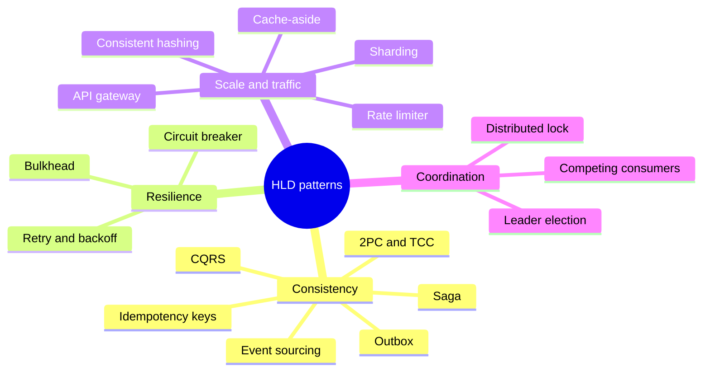

# 1. HLD patterns: the map

An HLD pattern is a named answer to a problem that shows up in almost every big design. Learn the problem first, and the name follows.

> [!TIP]
> - **What this folder is:** the patterns you reach for when you draw boxes and arrows between services, queues and stores.
> - **How to use it:** in an interview, find the problem in the table, then name the pattern and its trade-off.
> - **Where we are:** saga, outbox, idempotency keys and retry with a circuit breaker are done. The rest are planned.

## HLD patterns at a glance

Four families: keep data right across services, survive a failing dependency, handle load, and stop two workers from stepping on each other.

## The map

| Pattern | The problem it solves | Status |
|---|---|---|
| Saga | One business step spans several databases and one of them can fail | Done: [Saga](/notebook/system-design/pattern/hld/saga) |
| Transactional outbox | A row must be saved and an event must be sent, and both have to happen | Done: [Transactional outbox](/notebook/spring-boot-system-design/05-distributed-problems/transactional-outbox) |
| Idempotency keys | A retried or double-clicked request must act once | Done: [Idempotency keys](/notebook/spring-boot-system-design/05-distributed-problems/idempotency-keys) |
| Retry, backoff, circuit breaker | A dependency is slow or down and callers pile up | Built and verified in the sprint; no standalone note yet |
| CQRS | Reads and writes need different shapes | Planned |
| Event sourcing | You need the full history and the ability to rebuild state | Planned |
| 2PC and TCC | Compared with saga: strict atomicity across services | Planned |
| Bulkhead | One slow dependency must not take down everything | Planned |
| Cache-aside | The database cannot take every read | Planned |
| Sharding and consistent hashing | One database cannot hold or serve all the data | Planned |
| Rate limiter | One client or a bot floods the system | Planned |
| API gateway | Auth, limits and routing before the services | Planned |
| Leader election, distributed lock | A job or a seat must be owned by exactly one worker | Planned |
| Competing consumers | One queue, many workers, each message handled once | Planned |

**Related:** [LLD patterns: the map](/notebook/system-design/pattern/lld/overview) · [Train ticket booking board](/notebook/whiteboard/train-ticket-booking)
