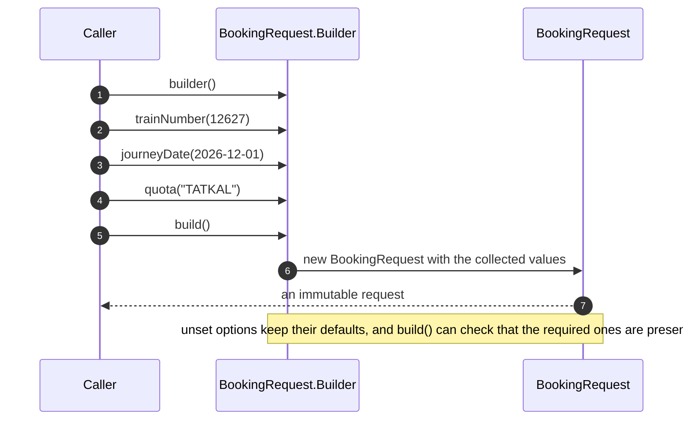
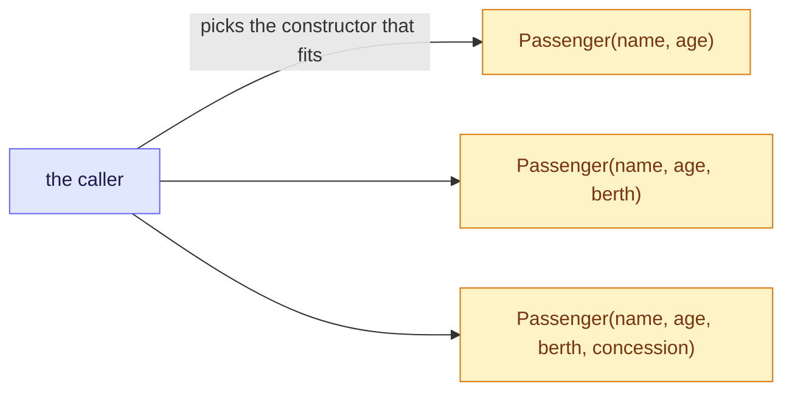
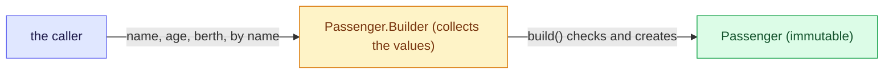
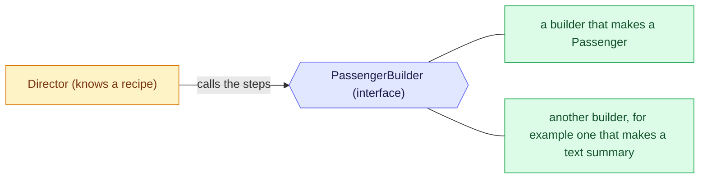

# 7. Builder: build an object step by step, and by name

Builder separates the construction of an object from the object itself, so you can set the parts you want by name, in any order, and get a finished object at the end. Unsure of a word? See the [glossary](/notebook/system-design/pattern/lld/glossary).

> [!TIP]
> - **The smell:** a constructor with many parameters, read by position, so two values of the same type can be swapped without the compiler noticing.
> - **The fix:** a builder that sets each value by name, fills in defaults, validates in `build()` and creates an immutable object.
> - **The catch:** the builder is mutable and must not be reused or shared, and a forgotten required value fails at run time.

## Step 1: the smell

This is how a booking request is created today. The fields and defaults are examples. The class is in `playground/lld/builder-pattern`.

```java
public class BookingRequest {
    public BookingRequest(int trainNumber, LocalDate journeyDate) { ... }
    public BookingRequest(int trainNumber, LocalDate journeyDate, String travelClass) { ... }
    public BookingRequest(int trainNumber, LocalDate journeyDate, String travelClass,
                          List<String> passengers) { ... }
    public BookingRequest(int trainNumber, LocalDate journeyDate, String travelClass,
                          List<String> passengers, String quota, String meal, boolean insurance) { ... }
}
```

And this is a call that uses all the options:

```java
BookingRequest request = new BookingRequest(12627, LocalDate.of(2026, 12, 1), "3A",
    List.of("Asha", "Ravi"), "TATKAL", "VEG", true);
```

Next month a berth preference arrives, and the month after that, a food-court option.

What hurts:

- There is one constructor per combination of options, so every new option means another constructor, and it is hard to track which parameter is which.
- A call is read by position. `"TATKAL"` and `"VEG"` are both `String`s, so swapping them still compiles, and the bug shows up only at run time.
- Someone who wants only the quota still has to pass every argument before it.

## Step 2: the idea

Put the construction in a separate **builder** object. The caller sets only the options it wants, each one by name, and then asks for the finished object. The builder keeps the values, fills in the defaults for anything unset, and creates the object once, in one step. The finished object never exists half-built, and it can stay immutable.



Each call names what it sets, so a swapped quota and meal is impossible to miss. The setting methods return the builder itself, so the calls chain one after another. That style is called **fluent**. The last call, `build()`, is the only one that creates the real object, and it is the one place where you can validate.

## Step 3: the variants

The examples use a smaller class, `Passenger`, with a required `name` and `age` and an optional `berth` and `concession`. That keeps the `BookingRequest` builder in Step 4 yours to write.

**1. Telescoping constructors.** One constructor per combination of options. This is the smell from Step 1.



```java
new Passenger("Asha", 34);
new Passenger("Asha", 34, "LOWER");
new Passenger("Asha", 34, "LOWER", "SENIOR");   // by position: which String is which?
```

It is fine for two or three parameters. Beyond that it becomes unreadable.

**2. JavaBean setters.** An empty object, then a `setX` call for each value.


```java
PassengerBean p = new PassengerBean();
p.setName("Asha");           // p is half-built from here on
p.setAge(34);
p.setBerth("UPPER");         // and anyone holding p can change it later
```

It is readable, but the object is mutable and incomplete between the calls, so you can pass a half-built object around by mistake. Some frameworks still need setters.

**3. Fluent builder.** A nested `Builder` collects the values by name, and `build()` creates the immutable object. This is the common form.



```java
public final class Passenger {
  private final String name;  private final int age;  private final String berth;
  private Passenger(Builder b) { this.name = b.name; this.age = b.age; this.berth = b.berth; }

  public static Builder builder() { return new Builder(); }

  public static class Builder {
    private String name;  private int age;  private String berth = "ANY";   // a default
    public Builder name(String name) { this.name = name; return this; }     // returns this: calls chain
    public Builder age(int age) { this.age = age; return this; }
    public Builder berth(String berth) { this.berth = berth; return this; }
    public Passenger build() {
      if (name == null) throw new IllegalStateException("name is required");   // validate in one place
      return new Passenger(this);
    }
  }
}

Passenger p = Passenger.builder().name("Asha").age(34).berth("LOWER").build();
```

**4. Lombok `@Builder`.** The compiler generates the fluent builder from an annotation.


```java
@Builder
public class Passenger {
  private final String name;
  private final int age;
  @Builder.Default private final String berth = "ANY";   // defaults need this annotation
}
```

It saves the boilerplate, but it does not enforce required fields: a builder without a name builds with `name` set to `null`, unless you add `@NonNull`. Lombok is not in this project's dependencies.

**5. Gang of Four Builder.** A builder interface, and a director that knows a ready-made recipe.



```java
interface PassengerBuilder {
  PassengerBuilder name(String name);  PassengerBuilder age(int age);
  PassengerBuilder berth(String berth);  Passenger build();
}

class PassengerDirector {                 // knows a recipe, and works through the interface
  Passenger seniorOnLowerBerth(PassengerBuilder b, String name, int age) {
    return b.name(name).age(age).berth("LOWER").build();
  }
}
```

The interface is only worth it when different builders produce different results from the same steps. In practice most code uses the fluent builder, with a recipe method now and then.

### Compared

| Variant | Readable | Immutable | Required fields enforced | Use it when |
|---|---|---|---|---|
| Telescoping constructors | No, by position | Yes | By the constructor | Two or three parameters at most |
| JavaBean setters | Yes | No | No | A framework needs setters |
| Fluent builder | Yes | Yes | In `build()` | Many optional parameters. The common choice |
| Lombok `@Builder` | Yes | Yes | No, unless `@NonNull` | You want the fluent builder with no boilerplate |
| Gang of Four Builder | Yes | Yes | In `build()` | One set of steps must produce different results, or you want ready-made recipes |

Checked by compiling and running the first three and the director in a scratch file. The Lombok example was compiled in a scratch folder with Lombok 1.18.36, and a builder without a name built with `name` as `null`. Lombok is not in your project.

## Step 4: build the fluent builder

Written in `playground/lld/builder-pattern`. `BookingRequest` gets a nested `Builder` and a `builder()` method, and its full constructor becomes private, so the only way to make a full request is through the builder:

```java
public static Builder builder() { return new Builder(); }

public static class Builder {
  private int trainNumber;
  private LocalDate journeyDate;
  private String travelClass = "SL";             // the defaults the old constructors used
  private List<String> passengers = List.of();
  private String quota = "GENERAL";
  private String meal = "NONE";
  private boolean insurance = false;

  public Builder trainNumber(int trainNumber) { this.trainNumber = trainNumber; return this; }
  public Builder quota(String quota) { this.quota = quota; return this; }
  // journeyDate, travelClass, passengers, meal and insurance are the same shape

  public BookingRequest build() {
    if (trainNumber == 0) throw new IllegalStateException("trainNumber is required");
    if (journeyDate == null) throw new IllegalStateException("journeyDate is required");
    return new BookingRequest(trainNumber, journeyDate, travelClass, List.copyOf(passengers), quota, meal, insurance);
  }
}
```

The call from Step 1 now reads:

```java
BookingRequest request = BookingRequest.builder()
    .trainNumber(12627).journeyDate(LocalDate.of(2026, 12, 1)).travelClass("3A")
    .passengers(List.of("Asha", "Ravi")).quota("TATKAL").meal("VEG").insurance(true)
    .build();
```

Checked with five tests in `BookingRequestBuilderTest`:

| Test | What it checks |
|---|---|
| `buildsARequestByNameWithTheOptionsYouSet` | every value lands in the right field, so quota and meal cannot be swapped |
| `unsetOptionsKeepTheirDefaults` | with only a train and a date, class is `SL`, quota `GENERAL`, meal `NONE`, no insurance and no passengers |
| `aMissingTrainNumberIsRejected` | `build()` throws `trainNumber is required` |
| `aMissingJourneyDateIsRejected` | `build()` throws `journeyDate is required` |
| `theBuiltRequestKeepsItsOwnCopyOfThePassengers` | adding to the caller's list after `build()` does not change the request, because of `List.copyOf` |

All five pass: `Tests run: 5, Failures: 0`.

## Step 5: break it by reusing a builder

A builder is a mutable helper, so it remembers everything you set. The test builds two requests from the same builder, and only means to change the train number the second time:

```java
BookingRequest.Builder builder = BookingRequest.builder()
    .journeyDate(date).quota("TATKAL").insurance(true);

BookingRequest first  = builder.trainNumber(12627).build();
BookingRequest second = builder.trainNumber(12951).build();   // only the train was meant to change
```

| Check on the second request | Result |
|---|---|
| quota | `TATKAL`, carried over from the first |
| insurance | `true`, carried over, which is a surprise |
| the first request | unchanged, because the built object is immutable |

A second request with insurance the caller never asked for is a real bug. The fix is simple: create a new builder for each request, which is cheap, and the second test confirms it (quota `GENERAL`, no insurance). Builders are also not thread-safe, so never share one between threads. Both tests are in `BuilderPitfallsTest` and both pass: `Tests run: 2, Failures: 0`. The first one asserts the surprise, so it passes while showing it.

There is one more trade-off against Step 1. A missing required value now fails at run time, in `build()`. With a constructor, leaving out an argument would not compile. The builder buys readability and immutability, and pays with that later failure. A step builder, where each required step returns a different type, brings the check back to compile time, at the cost of more code.

## Step 6: pitfalls and questions

| Symptom | Cause | Fix |
|---|---|---|
| Callers swap two values | Positional arguments of the same type | Name each value with a builder, or use enums for the quota and the meal |
| A second request has values nobody set | The builder was reused and keeps its old values | A new builder for each request, or a `reset()` method |
| A forgotten required value is found only at run time | The check lives in `build()` | Validate in `build()`, take the required values up front, or use a step builder |
| Mixed-up results when threads share a builder | A builder is mutable and not thread-safe | One builder for each request |
| The caller changes a list after `build()` and the request changes | The builder stored the caller's list | Copy collections in `build()`, as `List.copyOf` does |
| The boilerplate grows with every field | A nested builder repeats a method per field | Lombok `@Builder`, with `@NonNull` on the required fields |

<details>
<summary>A booking request has 8 fields, 3 required and 5 optional, and callers keep swapping two String arguments by mistake. What do you change, and what do you gain over the constructors?</summary>

Replace the long constructors with a fluent builder. Each value is set by name, so a swapped quota and meal cannot be missed. Unset options keep their defaults, and `build()` checks the three required fields and creates an immutable object. You can also use enums for the quota and the meal, so the compiler rejects a wrong value. The gain is readable calls, no swapped values, one place to validate, and an object that cannot change.
</details>

<details>
<summary>A teammate reuses one builder to create a second request, and the new request has insurance the caller never asked for. Why does that happen, and what are two ways to prevent it?</summary>

A builder is a mutable helper and keeps its fields between `build()` calls, so the second request inherits what the first one set. One way is to create a new builder for each request, which is cheap and the usual rule. The other is a `reset()` method that puts every field back to its default, called before the builder is reused. A shared builder is also not thread-safe.
</details>

<details>
<summary>Compared with a constructor, a builder gives readable calls and an immutable object. What does it cost, and how can you bring the lost check back?</summary>

A constructor does not compile if you leave out a required argument. With a builder you can forget a required value, and the error appears only when `build()` runs. It also costs more code, because the nested class repeats a method for every field. You can bring the check back by taking the required values up front, for example `BookingRequest.builder(trainNumber, date)`, so they cannot be skipped. A step builder does it with types: each required step returns a different type, so the compiler enforces them.
</details>

## Where to use it

| Where | How a builder shows up |
|---|---|
| Train-ticket bookings | `BookingRequest` with its many optional fields (this lesson) |
| Java | `StringBuilder`, `Stream.builder()`, `HttpRequest.newBuilder()` and `Locale.Builder` |
| Spring | `UriComponentsBuilder`, `RestClient.builder()` and `WebClient.builder()`, and `ResponseEntity.ok().header(...).body(...)` |
| Real products | Objects with many options: HTTP clients, test data, query builders and email messages |
| Libraries | Lombok `@Builder` and the Protocol Buffers builders |
| Machine-coding rounds | A pizza or burger order, a computer configuration, a meal combo, an HTTP request object |

## Key takeaways

| Remember | Because |
|---|---|
| A builder collects values by name, and `build()` creates the finished object | No swapped values and no half-built object |
| Give optional values defaults and validate the required ones in `build()` | There is one place for the checks |
| Make the built object immutable and copy its collections | The caller cannot change it afterwards |
| A builder is mutable and not thread-safe, so use one for each request | A reused builder carries old values over |
| The check for required values moves from compile time to run time | Take the required values up front, or use a step builder |
| Use it for many optional parameters | For two or three parameters, a constructor is simpler |

**Related:** [LLD patterns: the map](/notebook/system-design/pattern/lld/overview) · [Glossary](/notebook/system-design/pattern/lld/glossary) · [Factory Method](/notebook/system-design/pattern/lld/factory-method) · [Train ticket booking board](/notebook/whiteboard/train-ticket-booking)
