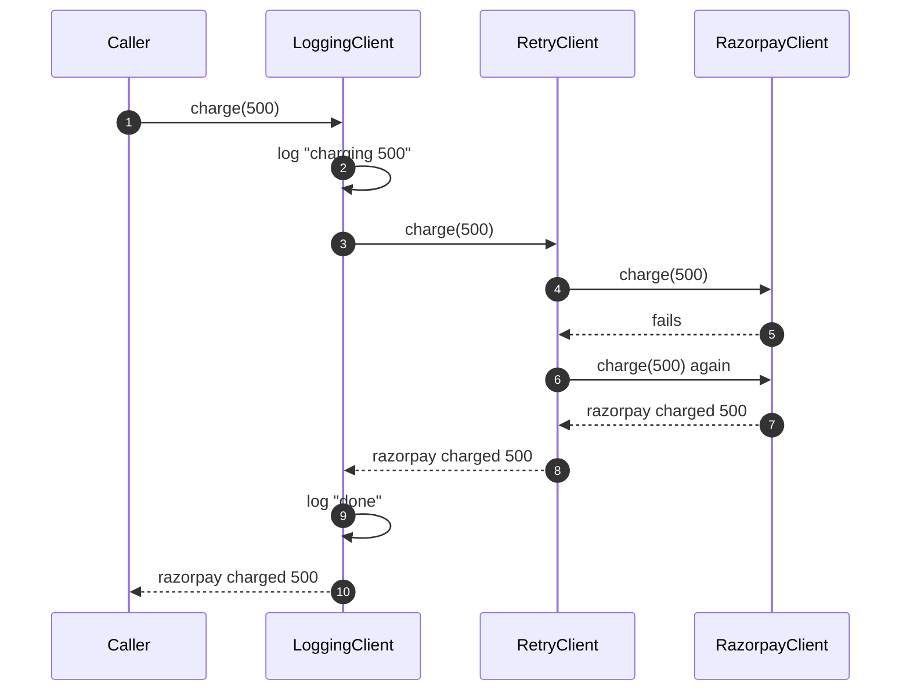
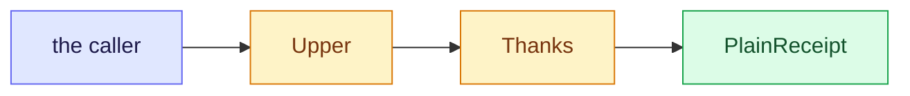
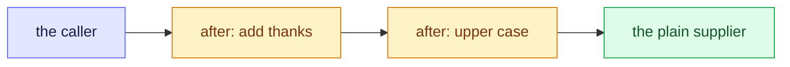
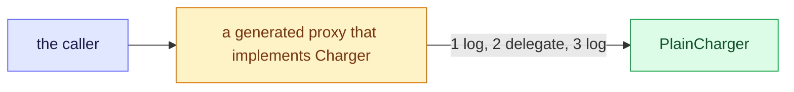
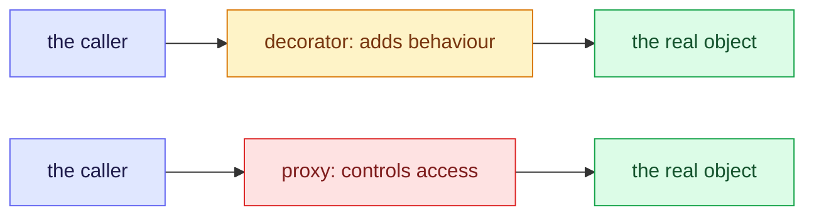

# 8. Decorator: add behaviour around an object without changing it

Decorator wraps an object in another object that has the same interface and adds behaviour before or after the call, so you can stack extras such as logging or retry without touching the original class. Unsure of a word? See the [glossary](/notebook/system-design/pattern/lld/glossary).

> [!TIP]
> - **The smell:** extras such as logging and retry are tangled into one class, or added through a subclass for every combination.
> - **The fix:** a small wrapper class for each extra, with the same interface as the object it wraps, stacked in any order.
> - **The catch:** the order of the layers changes what each one sees, and a blind retry can repeat a payment that must not be repeated.

## Step 1: the smell

This is what the payment client looks like once it needs logging, a rate limit and a retry. The numbers and calls are examples. The plain client is in `playground/lld/decorator-pattern`.

```java
public class RazorpayClient implements PaymentClient {
    public String charge(int amount) {
        log.info("charging " + amount);                            // logging
        if (!rateLimiter.tryAcquire()) {                           // rate limit
            throw new IllegalStateException("rate limited");
        }
        for (int attempt = 1; attempt <= 3; attempt++) {           // retry
            try {
                return send(amount);                               // the real work
            } catch (IOException e) {
                log.warn("attempt " + attempt + " failed");
            }
        }
        throw new IllegalStateException("payment failed");
    }
}
```

The other common way to add extras is subclassing, with a class for every combination: `LoggingRazorpayClient`, `RetryingRazorpayClient`, `LoggingRetryingRazorpayClient`, and so on.

Next month a second merchant, Paytm, needs the same logging and retry, and a timeout is added.

What hurts:

- Logging, the rate limit, the retry and the real work are tangled in one method. Every new extra edits `charge`, and Paytm would need a copy of all of it.
- With subclassing, the classes multiply: three extras give seven combinations, and a fourth extra doubles the count. The combination is also fixed when you write the class, so you cannot choose it at run time.

## Step 2: the idea

Make each extra a small class of its own that has the same interface as the client and holds another client inside. A call goes to the outer one, which does its extra work, passes the call to the one it wraps, and may do more work on the way back. You stack the layers you want: logging around retry around the plain client. Each layer is one class, any combination is possible, and the same layers work for Paytm too.



All three classes implement `PaymentClient`, so the caller cannot tell how many layers there are. It holds a `PaymentClient` and calls `charge`. The interface is the **component**, the plain client is the **concrete component**, and each wrapper is a **decorator**. Passing the call to the wrapped object is called **delegating**.

## Step 3: the variants

The examples use a text `Receipt` and a small `Charger`, so the payment decorators in Step 4 are not given away.

**1. Wrapper class by hand.** The classic form. Each decorator implements the interface and holds another one.



```java
interface Receipt { String render(); }

class PlainReceipt implements Receipt {
  public String render() { return "ticket 101"; }
}

class Upper implements Receipt {
  private final Receipt inner;
  Upper(Receipt inner) { this.inner = inner; }
  public String render() { return inner.render().toUpperCase(); }   // delegate, then add
}

class Thanks implements Receipt {
  private final Receipt inner;
  Thanks(Receipt inner) { this.inner = inner; }
  public String render() { return inner.render() + " (thanks)"; }
}

new Upper(new Thanks(new PlainReceipt())).render();   // TICKET 101 (THANKS)
new Thanks(new Upper(new PlainReceipt())).render();   // TICKET 101 (thanks)
```

The order of the layers matters. The same two decorators in a different order gave a different result.

**2. Java I/O style.** The JDK's streams and readers are decorators: each layer wraps the one inside it.


```java
LineNumberReader reader =
    new LineNumberReader(new BufferedReader(new StringReader("one\ntwo")));
reader.readLine();
reader.readLine();
reader.getLineNumber();   // 2
```

**3. Functional wrapping.** A function that takes a function and returns a new, wrapped one. There are no new classes.



```java
static Supplier<String> after(Supplier<String> inner, UnaryOperator<String> extra) {
  return () -> extra.apply(inner.get());
}

Supplier<String> plain = () -> "ticket 101";
Supplier<String> wrapped = after(after(plain, String::toUpperCase), s -> s + " (thanks)");
wrapped.get();   // TICKET 101 (thanks)
```

It is short and good for small, stateless extras. A class is better when the decorator has its own state or needs a name in logs and tests.

**4. Spring proxy or AOP.** The framework builds the decorator for you at run time, so you only write the annotation. A plain Java proxy shows the mechanism:



```java
static <T> T withLogging(T target, Class<T> type) {
  return (T) Proxy.newProxyInstance(type.getClassLoader(), new Class<?>[] { type },
      (proxy, method, args) -> {
        System.out.println("[log] calling " + method.getName());
        Object result = method.invoke(target, args);          // delegate
        System.out.println("[log] returned " + result);
        return result;
      });
}

Charger logged = withLogging(new PlainCharger(), Charger.class);
logged.charge(500);   // [log] calling charge, [log] returned charged 500
```

This is what `@Transactional` and `@Cacheable` do to a bean: Spring puts a generated wrapper with the same interface in front of it, and the caller never sees the difference.

**5. Decorator versus Proxy.** Both wrap an object that has the same interface, so they look the same in a class diagram. The difference is the intent.



| | Decorator | Proxy |
|---|---|---|
| Intent | Add behaviour to every call | Control access to the object |
| Typical uses | Logging, retry, formatting, buffering | Lazy loading, permission checks, a remote call, caching |
| Who chooses the layers | The caller stacks them | Usually the framework or one fixed wrapper |
| Stacking | Several layers in any order | Normally one |

Spring's `@Transactional` is mostly a proxy by intent, and `@Retryable`-style extras behave like decorators, but they use the same mechanism. In an interview, say the structure is the same and the intent differs.

### Compared

| Variant | New classes | Choose the combination at run time | Use it when |
|---|---|---|---|
| Wrapper class by hand | One per extra | Yes | The extras are real parts of the design, with their own state and tests |
| Java I/O style | Ready-made in the JDK | Yes | Reading and writing streams |
| Functional wrapping | None | Yes | Small, stateless extras |
| Spring proxy or AOP | None, generated | Fixed by the annotations | The same extra applies to many beans, such as transactions |
| Subclassing (the smell) | One per combination | No | Almost never |

Checked by compiling and running all four examples in a scratch file: the two orders gave `TICKET 101 (THANKS)` and `TICKET 101 (thanks)`, the reader counted 2 lines, the functional version gave `TICKET 101 (thanks)`, and the proxy logged before and after the call and returned `charged 500`.

## Step 4: build the payment decorators

Written in `playground/lld/decorator-pattern`. Both decorators implement `PaymentClient` and hold another one:

```java
public class LoggingPaymentClient implements PaymentClient {
  private final PaymentClient wrapped;
  private final Consumer<String> sink;   // where the lines go, so a test can read them

  public String charge(int amount) {
    sink.accept("charging " + amount);
    try {
      String result = wrapped.charge(amount);        // delegate
      sink.accept("charged: " + result);
      return result;
    } catch (RuntimeException e) {
      sink.accept("failed: " + e.getMessage());
      throw e;
    }
  }
}

public class RetryPaymentClient implements PaymentClient {
  private final PaymentClient wrapped;
  private final int maxAttempts;

  public String charge(int amount) {
    RuntimeException last = null;
    for (int attempt = 1; attempt <= maxAttempts; attempt++) {
      try {
        return wrapped.charge(amount);               // delegate
      } catch (RuntimeException e) {
        last = e;
      }
    }
    throw new IllegalStateException("payment failed after " + maxAttempts + " attempts", last);
  }
}
```

Checked with six tests in `PaymentDecoratorTest`, using a test client that fails a set number of times and then succeeds:

| Test | What it shows |
|---|---|
| `loggingWrapsTheCallAndPassesTheResultThrough` | the logger writes `charging 500` and `charged: razorpay charged 500` and returns the plain client's result |
| `retryTriesAgainUntilItSucceeds` | a client that fails twice succeeds on the third call, and the result is `ok` |
| `retryGivesUpAfterTheMaximumAttempts` | a client that always fails is called exactly 3 times, then `payment failed after 3 attempts` |
| `loggingAroundRetryLogsOnceBecauseTheRetryIsHiddenInside` | the log has 2 lines, because the logger only sees one call |
| `retryAroundLoggingLogsEveryAttempt` | the log has 6 lines: three `charging 500`, two `failed: boom` and one `charged: ok` |
| `theSameDecoratorsWorkForAnotherMerchantWithoutAnyChange` | the same two classes wrap a second merchant, written as a lambda |

All six pass: `Tests run: 6, Failures: 0`. The two order tests show that the stacking order changes what you see: logging around retry reports one call, and retry around logging reports every attempt.

## Step 5: pitfalls and questions

| Symptom | Cause | Fix |
|---|---|---|
| The log has fewer or more lines than expected | The order of the layers decides what each layer sees | Choose the order on purpose and test it |
| A declined card is charged again (not demonstrated here) | A retry decorator retries every failure, including ones that must not be retried | Retry only errors that are safe to retry, and send an idempotency key |
| A decorator needs a method that is not on the interface | It can only wrap what the interface offers | Keep the interface small, or add the method to it |
| It is hard to see the real object in a debugger | Several layers hide it | Give decorators clear names and a `toString` that names the wrapped object |
| Too many tiny classes | One decorator for every small extra | Use functional wrapping for small, stateless extras |

<details>
<summary>A teammate suggests a LoggingRetryingRazorpayClient subclass for the logging and retry. What goes wrong as you add a timeout and the Paytm client?</summary>

With subclasses every combination is its own class and is fixed when you write it. Logging, retry and a timeout give seven combinations, and each merchant needs its own set, so two merchants need fourteen classes, with the same extras copied for each. With decorators you write three small classes once, stack them over any client in any order, and choose the stack at run time.
</details>

<details>
<summary>You stack the logger around the retry in one place and the retry around the logger in another. What does each log show, and which is better for monitoring?</summary>

With the logger around the retry the log has two lines, `charging` and `charged`, because the logger sees one call and the retries are hidden inside. With the retry around the logger, a client that fails twice gives six lines: three `charging`, two `failed` and one `charged`, so every attempt is visible. For monitoring, retry around logging is usually better because you see each failed attempt. Logging around retry is better when you only want the final outcome of each call.
</details>

<details>
<summary>Decorator and Proxy both wrap an object with the same interface. How do you tell them apart, and which one is Spring's @Transactional closer to?</summary>

The structure is the same, and the intent differs. A decorator adds behaviour to every call, such as logging, retry or formatting, and the caller stacks the layers. A proxy controls access to the object, for example lazy loading, a permission check, a remote call or caching, and there is usually one fixed wrapper. `@Transactional` is closer to a proxy, because Spring generates a wrapper around the bean that starts and finishes a transaction around the call, even though it adds behaviour the way a decorator does.
</details>

## Where to use it

| Where | How a decorator shows up |
|---|---|
| Train-ticket payments | Logging, retry and rate limiting around the payment client (this lesson) |
| Java | `BufferedReader` and `BufferedInputStream`, `Collections.unmodifiableList` and `Collections.synchronizedList` |
| Spring | The generated proxies behind `@Transactional` and `@Cacheable` |
| Real products | Caching, metrics and timeouts around a service client, compression or encryption around a stream |
| Machine-coding rounds | A pizza or coffee with toppings, a text formatter, notification channels with extras |

## Key takeaways

| Remember | Because |
|---|---|
| A decorator has the same interface and holds another object | The extras stack in any combination, chosen at run time |
| One small class for each extra | No copying for every merchant, and no subclass explosion |
| The order of the layers matters | Logging outside sees one call, and retry outside sees every attempt |
| Decorator adds behaviour, Proxy controls access | The structure is the same and the intent differs |
| Spring generates the proxy for you | That is what `@Transactional` and `@Cacheable` do |
| Use functional wrapping for small, stateless extras | It needs no new classes |

**Related:** [LLD patterns: the map](/notebook/system-design/pattern/lld/overview) · [Glossary](/notebook/system-design/pattern/lld/glossary) · [Strategy](/notebook/system-design/pattern/lld/strategy) · [Train ticket booking board](/notebook/whiteboard/train-ticket-booking)
