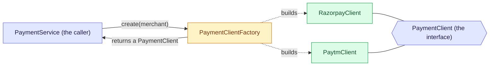
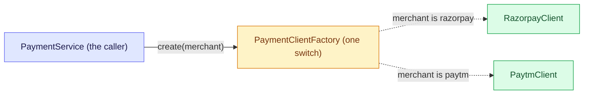
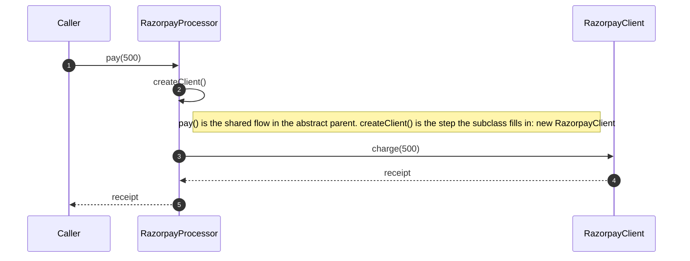
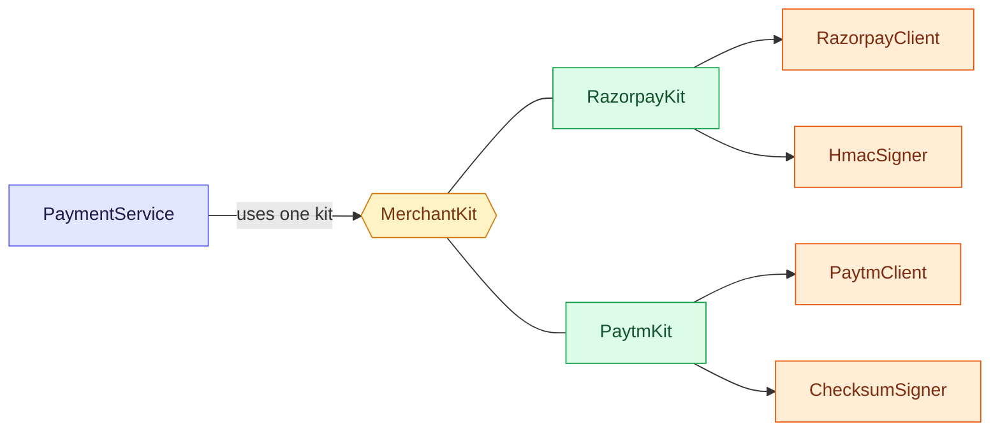

# 5. Factory Method: stop callers from choosing the class

Factory Method moves the decision of which concrete class to create, and how to build it, out of the callers and into one place, so callers ask for an object by what it does and never write `new`. Unsure of a word? See the [glossary](/notebook/system-design/pattern/lld/glossary).

> [!TIP]
> - **The smell:** callers write `new` and an `if/else` to choose the class, and each new class or constructor change edits every caller.
> - **The fix:** one place creates the object and returns the interface. It comes in three forms: the simple factory, the Factory Method and the Abstract Factory.
> - **The catch:** in Spring beans are singletons, so shared clients must be stateless.

## Step 1: the smell

This is how the payment code gets a client for a merchant today. The merchants, keys and constructors are examples.

```java
public Receipt pay(String merchant, int amount) {
    PaymentClient client;
    if (merchant.equals("razorpay")) {
        client = new RazorpayClient(razorpayKey);
    } else if (merchant.equals("paytm")) {
        client = new PaytmClient(paytmMerchantId, paytmSecret);
    } else {
        throw new IllegalArgumentException("unknown merchant " + merchant);
    }
    return client.charge(amount);
}

public Receipt refund(String merchant, String receiptId) {
    PaymentClient client;
    if (merchant.equals("razorpay")) {
        client = new RazorpayClient(razorpayKey);
    } else if (merchant.equals("paytm")) {
        client = new PaytmClient(paytmMerchantId, paytmSecret);
    } else {
        throw new IllegalArgumentException("unknown merchant " + merchant);
    }
    return client.refund(receiptId);
}
```

Next month PhonePe arrives, and the Razorpay client needs a new constructor argument.

What hurts:

- A new merchant means finding every method that has this chain, `pay` and `refund` and any other, and adding a branch to each. Missing one fails only for that merchant and only in that method.
- Every caller has to know the concrete class and how to build it, including its keys and constructor arguments. A constructor change edits every place that calls `new`.

## Step 2: the idea

Callers should ask for a client, not build one. Move the creation into one place that has one method, `create(merchant)`, which returns the interface. The caller never writes `new` and never learns which class it got. A new merchant is a new class plus one line in that one place, and a constructor change edits one place.



Notice that the caller talks to two things only: the factory to get an object, and the interface to use it. The **product** is what gets created (`PaymentClient`), a **concrete product** is one real class (`RazorpayClient`), and the **factory** is the one place that decides and builds. Strategy and Factory sit close together but answer different questions. Strategy is about how a job is done. Factory is about how an object is created.

## Step 3: the variants

"Factory" means three different things, and interviews ask for the difference.

| Variant | Who decides | What it creates | Use it when |
|---|---|---|---|
| Simple factory | One method with a `switch` or a map | One product | Callers must not know the concrete class. This is the most common form, and it is not a Gang of Four pattern |
| Factory Method | A subclass overrides the creating method | One product, inside a class that also has a shared flow | The flow is the same and only the object it needs differs |
| Abstract Factory | A kit object, chosen once | A family of matching products | Several related objects must match each other |

**Simple factory.** One method decides and builds:



The factory is the only place with the `switch`. The caller gets back a `PaymentClient` and never sees which class it is.

```java
class PaymentClientFactory {
  PaymentClient create(String merchant) {
    return switch (merchant) {
      case "razorpay" -> new RazorpayClient("rzp-key");
      case "paytm" -> new PaytmClient("pt-id", "pt-secret");
      default -> throw new IllegalArgumentException("unknown merchant " + merchant);
    };
  }
}
```

**Factory Method.** An abstract class has the shared flow and an abstract creating method, and each subclass says which product it needs:



The shared flow stays in the parent. Only the one creating step changes from subclass to subclass.

```java
abstract class PaymentProcessor {
  abstract PaymentClient createClient();        // the factory method: subclasses decide

  String pay(int amount) {
    PaymentClient client = createClient();      // the shared flow uses whatever was created
    return client.charge(amount);
  }
}
class RazorpayProcessor extends PaymentProcessor {
  PaymentClient createClient() { return new RazorpayClient("rzp-key"); }
}
```

**Abstract Factory.** Think of it as a simple factory that makes two or more things at once, and guarantees that they belong together. If you only ever need one product, you do not need it. A kit creates a whole family, so the pieces cannot be mixed up:



Each kit hands out a matching pair. The caller takes a client and a signer from the same kit, so a Razorpay client is never used with a Paytm signer.

```java
interface MerchantKit {                          // the abstract factory
  PaymentClient client();
  RequestSigner signer();
}
class RazorpayKit implements MerchantKit {       // a concrete factory: one family
  public PaymentClient client() { return new RazorpayClient("rzp-key"); }
  public RequestSigner signer() { return new HmacSigner("rzp-secret"); }
}
```

Checked by running all three: the simple factory returns the Razorpay and Paytm clients and rejects an unknown merchant (`unknown merchant phonepe`), both processors charge through their own client, and the Paytm kit gives a Paytm client with a checksum signer, so a Razorpay client never meets a Paytm signer.

In Spring, a `@Bean` method is a factory method for a bean, `FactoryBean<T>` lets a bean produce another object, and the `ApplicationContext` itself is a factory.

## Step 4: build the simple factory

Written in `playground/lld/factory-pattern`, in plain Java. `RazorPayClient` and `PaytmClient` implement the interface, and the factory is the only place that knows them:

```java
public interface PaymentClient {
  String charge(int amount);
  String refund(String receiptId);
}

public class PaymentClientFactory {
  public PaymentClient create(String merchant) {
    switch (merchant) {
      case "razorpay":
        return new RazorPayClient("rzp-key");
      case "paytm":
        return new PaytmClient("pt-id", "pt-secret");
      default:
        throw new IllegalArgumentException("unknown merchant " + merchant);
    }
  }
}
```

Checked with four tests in `PaymentClientFactoryTest`:

| Test | What it checks |
|---|---|
| `razorpayGivesARazorpayClient` | `create("razorpay")` returns a `RazorPayClient` |
| `paytmGivesAPaytmClient` | `create("paytm")` returns a `PaytmClient` |
| `anUnknownMerchantIsRejected` | `create("phonepe")` throws `unknown merchant phonepe` |
| `theCallerUsesOnlyTheInterface` | a caller holding only a `PaymentClient` can call `refund` without ever writing `new PaytmClient` |

All four pass: `Tests run: 4, Failures: 0`.

## Step 5: add a merchant and see what changes

We added PhonePe. It took one new class, `PhonePeClient`, and one new `case` in `PaymentClientFactory`. No caller changed, because callers only hold a `PaymentClient`.

| File | Change |
|---|---|
| `PhonePeClient` | new class |
| `PaymentClientFactory` | one new `case` |
| Callers of `create` | not edited |

The first test run after the change failed: `anUnknownMerchantIsRejected` had used `"phonepe"` as its example of an unknown merchant, and it stopped being unknown. The test now uses `"gpay"`. After that, `Tests run: 5, Failures: 0`.

Compare that with the code in Step 1, where PhonePe would have meant a new branch in `pay`, in `refund` and in every other method with the chain.

## Step 6: change a constructor and see what breaks

The second pain from Step 1: the Razorpay client needs a new constructor argument, `maxRetries`. We changed `RazorPayClient` to take `(String key, int maxRetries)` and then compiled.

| Check | Result |
|---|---|
| Places that write `new RazorPayClient(...)` before the change | one, in `PaymentClientFactory` |
| Compiler errors after changing the constructor | one error, in `PaymentClientFactory.java:10`. Callers and tests compile unchanged |
| After changing that one line to `new RazorPayClient("rzp-key", 3)` | `Tests run: 5, Failures: 0` |

In the Step 1 code, every method with the `if/else` chain would have needed the same edit. Now the factory is the only place that knows how a client is built, so a constructor change touches the client and the factory and nothing else.

## Step 7: in Spring, the beans are the factory

The simple factory still has two limits. A new merchant is still an edit to the `switch`, and the clients are built with `new` and hard-coded keys, so Spring cannot give them configuration. The Spring way has two parts:

```java
@Configuration
public class PaymentConfig {
  @Bean("razorpay")   // a @Bean method is a factory method: Spring calls it once and keeps the result
  PaymentClient razorpay(@Value("${razorpay.key:rzp-key}") String key) { return new RazorPayClient(key, 3); }
  // "paytm" and "phonepe" the same way
}

@Component
public class PaymentClientRegistry {
  private final Map<String, PaymentClient> clients;   // every PaymentClient bean, keyed by bean name

  public PaymentClientRegistry(Map<String, PaymentClient> clients) { this.clients = clients; }

  public PaymentClient create(String merchant) {
    PaymentClient client = clients.get(merchant);
    if (client == null) throw new IllegalArgumentException("unknown merchant " + merchant);
    return client;
  }
}
```

The keys come from configuration (the text after the colon is the default), and `create` is a map lookup with no `switch`. Checked with three tests in `PaymentClientRegistryTest`, and with the earlier five that is `Tests run: 8, Failures: 0`:

| Test | What it shows |
|---|---|
| `springFillsTheRegistryWithEveryClientBean` | `create("razorpay")` and `create("phonepe")` return the right clients |
| `aNewMerchantIsJustAnotherBean` | a test-only `@Bean("gpay")` is found by the registry, and the registry is not edited |
| `anUnknownMerchantIsStillRejected` | an unknown name still throws `unknown merchant gpay` |

One difference from a classic factory: a bean is a singleton by default, so the registry hands back the same instance on every call. That is fine for stateless clients. If each call needs a fresh object, keep a real factory method, or use a prototype-scoped bean.

## Step 8: build the Gang of Four Factory Method

Everything so far was a simple factory. The real Factory Method puts the creating step inside a class that has a shared flow. Only that one step is abstract:

```java
public abstract class PaymentProcessor {                  // the creator
  protected abstract PaymentClient createClient();        // the factory method: each subclass decides

  public String pay(int amount) {                         // the shared flow, real code
    if (amount <= 0) throw new IllegalArgumentException("amount must be positive");
    PaymentClient client = createClient();
    return client.charge(amount);
  }
}

public class RazorpayProcessor extends PaymentProcessor {
  @Override protected PaymentClient createClient() { return new RazorPayClient("rzp-key", 3); }
}
// PaytmProcessor is the same with new PaytmClient("pt-id", "pt-secret")
```

Checked with four tests in `PaymentProcessorTest`:

| Test | What it shows |
|---|---|
| `eachSubclassCreatesItsOwnClient` | `RazorpayProcessor` creates a `RazorPayClient` and `PaytmProcessor` a `PaytmClient` |
| `paySharesOneFlowAndEachSubclassChargesThroughItsOwnClient` | `pay(500)` runs the same flow and charges through each subclass's own client |
| `theSharedFlowRejectsABadAmountForEverySubclass` | the amount check lives once, in the parent, and applies to every subclass |
| `aTestCanOverrideTheFactoryMethodToUseAFakeClient` | a test overrides `createClient()` with a fake, and the real flow runs against it |

All twelve payment tests pass: `Tests run: 12, Failures: 0`.

When it fits: the flow is shared, only the object differs, and you own the class hierarchy. The cost is one subclass per variant, and the choice is fixed when you pick the subclass. When the choice comes from a request value or configuration, the simple factory or the Spring registry is the better fit.

## Step 9: pitfalls and questions

| Symptom | Cause | Fix |
|---|---|---|
| A new merchant needs edits in many places | `new` is spread over the callers, as in Step 1 | Create objects only in the factory |
| The factory `switch` keeps growing | A simple factory is edited for every new case | The Spring registry: one bean per case |
| A shared client gives wrong numbers under load | Beans are singletons, shared by every request | Keep clients stateless, or create a new object per call |
| A test fails when a new case is added | The test used a future name as its "unknown" example | Use a name that will never exist for the unknown-case test |
| An unknown name gives a `NullPointerException` | The map lookup returned `null` | Check for `null` and throw a clear error |
| One subclass per variant piles up | Factory Method needs a subclass for each choice | Use a simple factory or registry when the choice is a value |

<details>
<summary>PhonePe arrives next month. With the simple factory, what do you create and what do you edit? What changes if you use the Spring registry instead?</summary>

With the simple factory you create `PhonePeClient` and add one `case` to `PaymentClientFactory`. No caller is edited. With the Spring registry you create `PhonePeClient` and add one `@Bean("phonepe")` method, with its configuration property, in `PaymentConfig`. The registry class and the callers are not edited, because Spring puts the new bean into the map under its name.
</details>

<details>
<summary>In the Spring registry version, create("razorpay") returns the same RazorPayClient for every request. A teammate adds a mutable requestCount field to it, and the numbers come out wrong under load. Why, and what are two fixes?</summary>

A bean is a singleton, so every request thread shares one instance. `requestCount++` is not atomic, so two threads can overwrite each other's update. One fix is to keep the client stateless and put the count somewhere thread-safe, such as an `AtomicInteger` or a metrics counter. The other is to create a new object for each call, with a real factory method that does `new` inside `create`, or with a prototype-scoped bean.
</details>

<details>
<summary>Which would you use: the simple factory, the Factory Method or the Abstract Factory? (a) Pick the client from the merchant name in a request. (b) A shared pay flow where each merchant's subclass supplies its client. (c) Each merchant needs a matching client and signer.</summary>

(a) The simple factory, or the Spring registry, because the choice is a value from the request. (b) The Factory Method, because the flow is shared and only the creating step differs. (c) The Abstract Factory, because the client and the signer must match and come from the same kit.
</details>

## Where to use it

| Where | How a factory shows up |
|---|---|
| Train-ticket payments | Picking the client for a merchant (this lesson) |
| Java | Static factory methods such as `List.of`, `LocalDate.of` and `Calendar.getInstance()`. `Collection.iterator()` is a factory method that each collection implements |
| JDBC | `DriverManager.getConnection` picks the driver, and `Connection.createStatement()` creates the statement |
| Spring | `@Bean` methods, `FactoryBean` and the `ApplicationContext` itself |
| Real products | Notification senders (email, SMS, push), document parsers by file type (PDF, CSV), database dialects |
| Machine-coding rounds | A vehicle factory in a parking lot, a shape factory, a notification service, payment gateway selection |

## Key takeaways

| Remember | Because |
|---|---|
| Callers ask for the interface, and one place does `new` | A new class or a constructor change edits one place |
| Simple factory: one method decides. Factory Method: a subclass decides. Abstract Factory: a kit of matching products | Interviews ask for the difference |
| In Spring, a `@Bean` method is a factory method, and a `Map<String, T>` is a registry | A new merchant is just a new bean |
| Beans are singletons by default | Keep shared clients stateless, or create a new object per call |
| In Factory Method only the creating step is abstract | The shared flow stays in the parent, at the cost of one subclass per variant |
| Do not use a future name as the "unknown" example in a test | It fails the day that case is added |

**Related:** [LLD patterns: the map](/notebook/system-design/pattern/lld/overview) · [Glossary](/notebook/system-design/pattern/lld/glossary) · [Strategy](/notebook/system-design/pattern/lld/strategy) · [Train ticket booking board](/notebook/whiteboard/train-ticket-booking)
