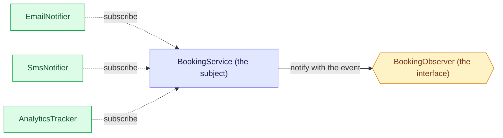

# 3. Observer: let others react without the sender knowing

Observer lets one object announce that something happened, and lets any number of other objects react to it, without the announcer knowing who they are. Unsure of a word? See the [glossary](/notebook/system-design/pattern/lld/glossary).

> [!TIP]
> - **The smell:** one method calls every reaction by name, so each new reaction edits it.
> - **The fix:** one observer interface, a list in the subject, and a loop that notifies all of them.
> - **The catch:** notification is synchronous by default, so isolate failures per observer and watch for slow ones.

## Step 1: the smell

This is what happens today when a booking is confirmed. The numbers and services are examples.

```java
public void confirm(Booking booking) {
    booking.setStatus(CONFIRMED);
    bookingRepository.save(booking);

    emailService.sendTicket(booking);
    smsService.sendTicket(booking);
    analyticsService.trackBooking(booking);
}
```

Next month a WhatsApp message arrives, then loyalty points, then a fraud check.

What hurts:

- Every new reaction means finding `confirm` and adding another line to it. The method has to know every service that cares about a confirmed booking.
- All of the calls run inside `confirm`. A slow SMS slows the confirmation, and if one call throws, the ones after it never run.

## Step 2: the idea

The common interface you suggested is the first half. Give every reaction the same interface, so a reaction is "something that can be told about a booking". The second half is that the booking service keeps a list of those and tells each one when something happens. The reactions register themselves on that list, so adding one does not edit `confirm`. The booking service never knows who is on the list.



Two directions to notice. The dotted arrows show each reaction subscribing to the subject. The solid arrow shows the subject notifying through the interface only, so it never mentions `EmailNotifier` or any other class by name. The **subject** is the one that announces, an **observer** is anything that reacts, and the **event** says what happened (a booking was confirmed).

## Step 3: the event, the interface and one concrete observer

Written in `playground/lld/observer-pattern`:

```java
public record BookingConfirmed(String bookingId, String passenger, int fare, boolean email) {}

public interface BookingObserver {
  void onConfirmed(BookingConfirmed event);
}

@Component
public class EmailNotifier implements BookingObserver {
  @Override
  public void onConfirmed(BookingConfirmed event) {
    if (event.email()) {
      System.out.println("Booking confirmed, email: " + event.bookingId());
    }
  }
}
```

The `email` field says whether the passenger asked for an email. The event only carries the facts, and each observer decides for itself what to do with them: `EmailNotifier` sends only when `email` is true.

Checked by running it: `new EmailNotifier().onConfirmed(new BookingConfirmed("B-101", "Sriram", 1300, true))` prints `Booking confirmed, email: B-101`, and with `false` it prints nothing.

## Step 4: the subject notifies every observer

```java
@Service
public class BookingService {
  List<BookingObserver> observers;   // Spring injects every BookingObserver bean

  BookingService(List<BookingObserver> observers) { this.observers = observers; }

  public void onBookingConfirmed(BookingConfirmed event) { this.onConfirmed(event); }

  private void onConfirmed(BookingConfirmed event) {
    observers.stream().forEach(o -> {
      try {
        o.onConfirmed(event);
      } catch (Exception e) {
        System.out.println(e.getMessage() + " something is failed in " + o.getClass().getName());
      }
    });
  }
}
```

Each `@Component` observer joins the list just by existing, which is how it subscribes. Two rules matter:

- **Notify all, not the first match.** Our first version used `findFirst`, which is the Strategy rule. With a second observer, only one of them was told. Observer tells every observer, and each one decides inside `onConfirmed` whether it cares (`EmailNotifier` checks `event.email()`).
- **One `try/catch` per observer.** With the `try/catch` around the whole loop, one observer that threw stopped all the ones after it.

Checked by running it with two extra throwaway observers, `BrokenNotifier` (throws) and `SmsNotifier`:

| Event | Output |
|---|---|
| `email=true` | the broken one is reported, then `SMS sent for booking B-101`, then `Booking confirmed, email: B-101` |
| `email=false` | the broken one is reported, then `SMS sent for booking B-102`, and the email is skipped |

## Step 5: add an observer and see what changes

We added `SmsNotifier`: one new class that implements `BookingObserver` and has `@Component`. `BookingService` and `EmailNotifier` were not edited.

The first version had no `@Component`. Spring never created the bean, so it never reached the list, and the SMS was silently skipped: only the email line printed and nothing reported an error.

| Event | Output |
|---|---|
| `email=true` | `Booking confirmed, email: B-101`, then `Sms sent for the booking id: B-101` |
| `email=false` | `Sms sent for the booking id: B-102` only, because `SmsNotifier` always sends and `EmailNotifier` checks the flag |

## Step 6: break it with a slow observer

The loop in `BookingService` runs the observers one after another on the same thread, so the caller waits for all of them. We timed one confirmation with a throwaway `SlowNotifier` that sleeps for 3 seconds:

| Setup | Time for one confirmation |
|---|---|
| `EmailNotifier` and `SmsNotifier` | 431 ms (the first call, which includes class loading) |
| plus a 3-second `SlowNotifier` | 3439 ms, and the email and SMS lines came only after the slow one finished |

One slow provider delays the booking and every observer behind it.

Spring's own version of the pattern behaves the same way. `ApplicationEventPublisher` is the subject and each `@EventListener` method is an observer. With a listener that sleeps for 2 seconds, `publishEvent` took 2359 ms, so it is synchronous by default.

Two ways out, neither built here. Run the observers on another thread (for example with `@Async`): the caller returns at once, but it no longer sees failures, the order is not guaranteed, and an event is lost if the app crashes before the thread runs. Or put the event on a queue and let separate consumers react, which is the outbox and Kafka route.

## Step 7: pitfalls and questions

| Symptom | Cause | Fix |
|---|---|---|
| An observer never runs and there is no error | Missing `@Component`, so no bean exists | Look at the bean list, then add the annotation |
| Only one observer is told | The subject uses Strategy's `findFirst` | Loop over all observers |
| One failing observer stops the rest | The `try/catch` is around the whole loop | One `try/catch` per observer |
| Confirming a booking is slow | Observers run one after another on the caller's thread | Run them on another thread or through a queue, and accept the costs |
| A failure shows as `null` or without a stack trace | Only `getMessage()` is printed | Log the exception itself |

<details>
<summary>A teammate adds PushNotifier, and it throws whenever the push service is down. What happens to the email and SMS for that booking, and what shows in the output?</summary>

Both still run, because `BookingService` has one `try/catch` per observer, so a failure is contained to that observer. The output shows the failure line naming `PushNotifier`. Only the message is printed, so log the exception itself if you want the class and the stack trace.
</details>

<details>
<summary>Support says confirming a booking sometimes takes 5 seconds, and it lines up with the SMS provider being slow. Why does the booking wait, and how do you stop it?</summary>

The loop is synchronous: it runs on the caller's thread, so the confirmation returns only after every observer has finished, including the slow one. One fix is to run the observers on another thread (for example with `@Async`). The caller returns quickly, but it no longer sees failures, the order is not guaranteed, and an event is lost if the app crashes before the task runs. The other fix is a queue such as the outbox with Kafka. It survives a crash and makes each observer a separate consumer, but it needs more infrastructure, delivery is eventual, and duplicates are possible, so consumers must be idempotent.
</details>

<details>
<summary>A teammate wants to copy the findFirst loop from the Strategy lesson into BookingService because it looks cleaner. What breaks?</summary>

Only the first matching observer would be told, and the others would be skipped silently. With the email and SMS observers, one of them would never be notified, depending on the list order. `orElseThrow` would also turn "nobody is interested" into an error. Strategy picks one, and Observer tells all and lets each observer decide.
</details>

## Key takeaways

| Remember | Because |
|---|---|
| The subject keeps a list of observers behind one interface and notifies all of them | It never names a concrete observer |
| Notify all, not the first match | That is the difference from Strategy |
| Each observer decides whether it cares | The event carries facts only |
| One `try/catch` per observer | One failure must not stop the others |
| Notification is synchronous by default | A slow observer delays the caller, and async or a queue each have costs |
| Every observer needs `@Component` | No annotation means no bean and a silent skip |

**Related:** [LLD patterns: the map](/notebook/system-design/pattern/lld/overview) · [Glossary](/notebook/system-design/pattern/lld/glossary) · [Strategy](/notebook/system-design/pattern/lld/strategy) · [Train ticket booking board](/notebook/whiteboard/train-ticket-booking)