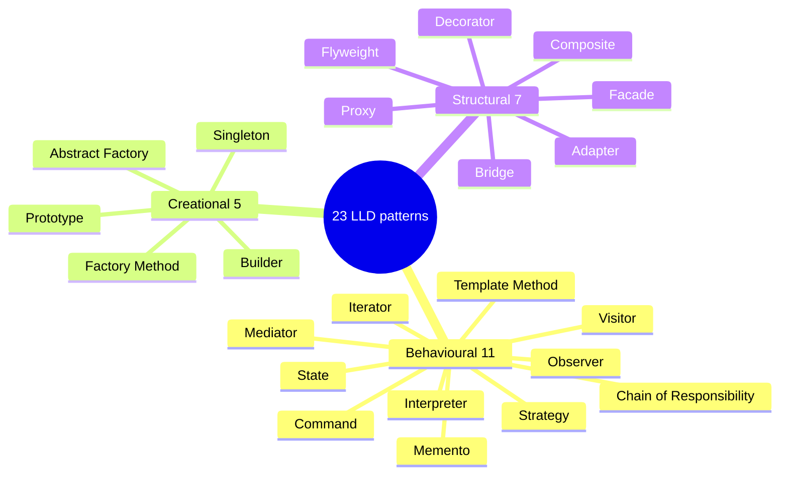

# 1. LLD patterns: the map

An LLD pattern is a way to arrange classes so that adding the next requirement means adding a class, not editing five existing ones.

> [!TIP]
> - **What this folder is:** the 23 classic (Gang of Four) patterns: 5 creational, 7 structural, 11 behavioural.
> - **How to use it:** in a machine-coding round, spot the smell in the table (a growing `if/else`, a status field, a tree), then name the pattern.
> - **Order we learn them:** by priority, in four tiers, most asked first and rarest last. One step at a time, each tied back to the train-ticket design.

## LLD patterns at a glance

Behavioural patterns decide who does what at run time, creational ones decide how objects are made, and structural ones decide how objects are wired together.

## The map, in priority order

### Tier 1: must know (asked in most LLD rounds)

| # | Pattern | Family | The smell it fixes | In the train-ticket design | Status |
|---|---|---|---|---|---|
| 1 | Strategy | Behavioural | An `if/else` chain choosing one of several algorithms | Fare: base, Tatkal surcharge, senior discount | Done: [Strategy](/notebook/system-design/pattern/lld/strategy) |
| 2 | Observer | Behavioural | One event, many reactions, and the sender should not know them | Booking confirmed: email, SMS, analytics | Done: [Observer](/notebook/system-design/pattern/lld/observer) |
| 3 | State | Behavioural | Behaviour depends on a status field, with `switch` everywhere | HELD, CONFIRMED, EXPIRED, CANCELLED | Next |
| 4 | Factory Method | Creational | Callers should not know which concrete class to build | Pick the payment client for a merchant | Planned |
| 5 | Singleton | Creational | Exactly one instance is needed and two threads must not make two (Spring beans already are one) | Config and shared clients | Planned |
| 6 | Builder | Creational | A constructor with many optional arguments | A booking request: passengers, class, quota, preferences | Planned |
| 7 | Decorator | Structural | Add behaviour around an object without changing it | Logging, retry and rate limit around the payment client | Planned |

### Tier 2: common in real code and in follow-up questions

| # | Pattern | Family | The smell it fixes | In the train-ticket design | Status |
|---|---|---|---|---|---|
| 8 | Command | Behavioural | A request must be stored, queued, retried or undone | Book, pay and refund as objects; the refund job retries stored commands | Planned |
| 9 | Chain of Responsibility | Behavioural | A request passes several checks, each able to stop it, and the list changes | Gateway checks: authentication, rate limit, validation (Spring's filter chain) | Planned |
| 10 | Adapter | Structural | A third-party API does not match your interface | One interface over every merchant's payment API | Planned |
| 11 | Facade | Structural | Callers juggle many classes to do one thing | One `book()` call that hides search, hold and pay | Planned |
| 12 | Proxy | Structural | Control access to an object without the caller knowing | Spring's `@Transactional` and `@Cacheable` proxies | Planned |
| 13 | Template Method | Behavioural | Several flows share the same steps in the same order and differ in one or two | Booking flow (validate, hold, pay, confirm) where Tatkal changes one step | Planned |
| 14 | Composite | Structural | A tree where one node and a group are treated the same | Train, coaches, seats: count free seats at any level | Planned |

### Tier 3: occasionally asked

| # | Pattern | Family | The smell it fixes | In the train-ticket design | Status |
|---|---|---|---|---|---|
| 15 | Abstract Factory | Creational | A family of related objects must match each other | A merchant's client, signer and parser built as one set | Planned |
| 16 | Iterator | Behavioural | Walk a collection without exposing how it is stored | Walk coaches and seats in order | Planned |
| 17 | Mediator | Behavioural | Many objects call each other directly and tangle | A booking coordinator between hold, payment and notification (the saga orchestrator is one) | Planned |
| 18 | Memento | Behavioural | Save a snapshot so you can restore it (undo) | A draft booking: undo a passenger edit | Planned |

### Tier 4: rare, so they go last

| # | Pattern | Family | The smell it fixes | In the train-ticket design | Status |
|---|---|---|---|---|---|
| 19 | Prototype | Creational | Copy an existing object instead of building a new one | Book the return journey from the same details | Planned |
| 20 | Bridge | Structural | Two things vary on their own and subclasses multiply | Notification type times channel (email, SMS, push) | Planned |
| 21 | Visitor | Behavioural | Add new operations to a class tree without editing it | On train, coaches and seats: count free seats, price, export | Planned |
| 22 | Flyweight | Structural | Millions of objects repeat the same data | One shared Station object for every booking | Planned |
| 23 | Interpreter | Behavioural | A small rule language must be evaluated | Quota rules such as "age over 60 and class SL" | Planned |

### Why this order

The order follows three things. First, how often machine-coding rounds (parking lot, elevator, vending machine, notification service) and design discussions use the pattern. Second, what must come first: Factory Method before Abstract Factory, Composite before Visitor and Iterator, Command before Memento, Decorator before Proxy. Third, what we have already touched in this workspace: Observer (transactional events), Proxy (the AOP module) and Chain of Responsibility (the filter chain). This is my judgment, not survey data. Factory Method and Abstract Factory are two different patterns, even though both are called "factory".

**Related:** [Glossary: the words patterns use](/notebook/system-design/pattern/lld/glossary) · [HLD patterns: the map](/notebook/system-design/pattern/hld/overview) · [Train ticket booking board](/notebook/whiteboard/train-ticket-booking)
