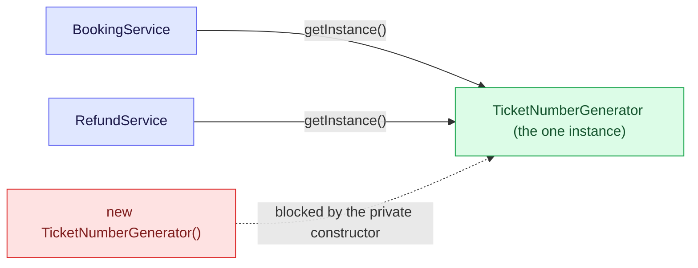
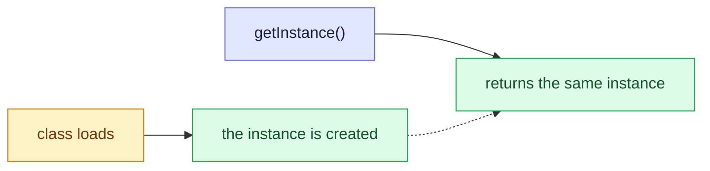
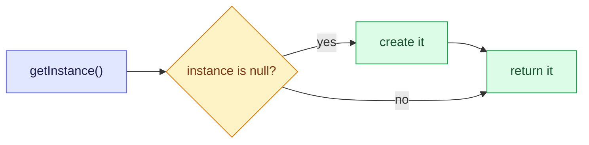
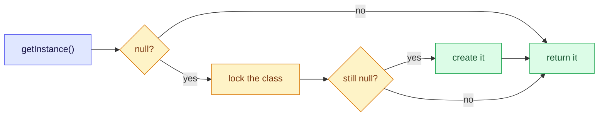
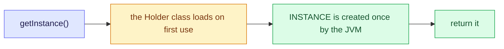
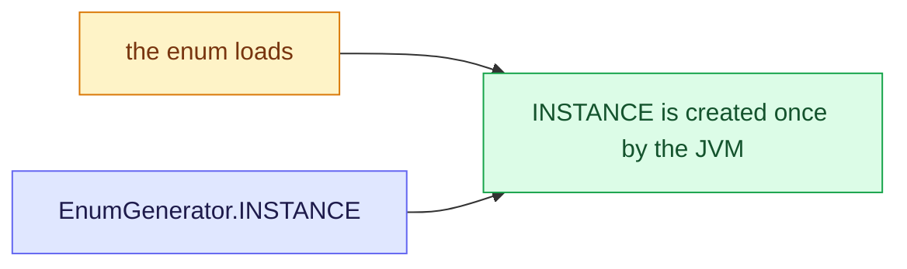
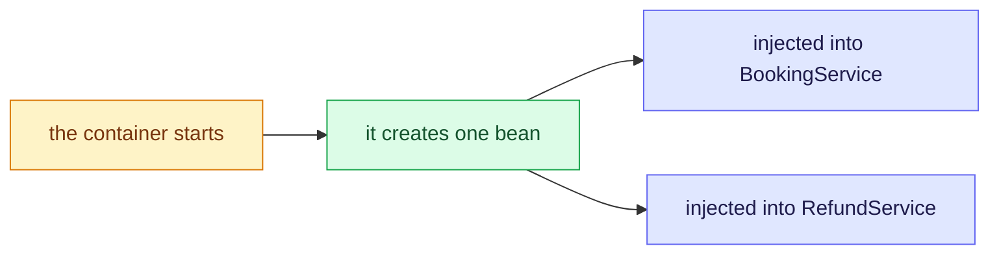

# 6. Singleton: one instance, shared on purpose

Singleton guarantees that a class has exactly one instance and gives every caller a way to reach it, for things that must be shared, such as an id counter, a configuration or a connection pool. Unsure of a word? See the [glossary](/notebook/system-design/pattern/lld/glossary).

> [!TIP]
> - **The smell:** every caller makes its own copy of something that must be shared, so counters restart and work is repeated.
> - **The fix:** one instance with a private constructor and an access point, or a container-managed bean.
> - **The catch:** creation and the shared state must both be thread-safe, and a global instance leaks state between tests.

## Step 1: the smell

This is how ticket numbers are produced today. The classes and the numbers are examples.

```java
public class TicketNumberGenerator {
    private int next = 1000;

    public int next() {
        return next++;
    }
}

public class BookingService {
    public int confirm() {
        TicketNumberGenerator numbers = new TicketNumberGenerator();
        return numbers.next();
    }
}

public class RefundService {
    public int reissue() {
        TicketNumberGenerator numbers = new TicketNumberGenerator();
        return numbers.next();
    }
}
```

Next month a third service needs ticket numbers too.

What hurts:

- Each service builds its own generator, so each one counts from 1000. `confirm()` and `reissue()` both return 1000, and two tickets get the same number.
- Every call creates a new object. That is wasted work when the object is expensive, such as one that loads a configuration file.
- Nothing in the class stops the next developer from writing another `new`.

## Step 2: the idea

Let the class control its own creation. Make the constructor private, so nobody outside can write `new`. Keep one shared instance inside the class, and give callers one method, `getInstance()`, that returns it. Every caller now gets the same object, so the counter lives in one place and the numbers continue: 1000, 1001, 1002.



Both services reach the same object through `getInstance()`, and a direct `new` is not possible. Two things are called "singleton", so keep them apart. The pattern is a class that controls its own single instance. Spring's singleton scope is a container that keeps one instance of a bean for you, without the class doing anything special.

## Step 3: the variants

The pattern has six common shapes. They differ in when the instance is created and in how they stay safe when many threads ask at once. One rule holds for all of them: the object is shared, so its own state must be thread-safe too. That is why the counter in every example is an `AtomicInteger`.

**1. Eager.** The instance is created when the class loads.



```java
public class EagerGenerator {
  private static final EagerGenerator INSTANCE = new EagerGenerator();   // built at class load
  private final AtomicInteger next = new AtomicInteger(1000);
  private EagerGenerator() {}
  public static EagerGenerator getInstance() { return INSTANCE; }
  public int next() { return next.getAndIncrement(); }
}
```

The JVM loads a class once and safely, so this is thread-safe with no extra code. The cost is that the instance is built even if nobody ever uses it.

**2. Lazy.** The instance is created on first use.



```java
private static LazyGenerator instance;

public static LazyGenerator getInstance() {
  if (instance == null) {
    instance = new LazyGenerator();   // two threads can both see null and both get here
  }
  return instance;
}
```

This is **not thread-safe**. Two threads can both see `null`, and each creates its own instance. It is only fine in a single-threaded program. We break it with a test in Step 7.

**3. Double-checked locking.** Lazy and thread-safe, with a lock taken only when the instance is missing.



```java
private static volatile DclGenerator instance;   // volatile: no thread sees a half-built object

public static DclGenerator getInstance() {
  if (instance == null) {                         // first check, without the lock
    synchronized (DclGenerator.class) {
      if (instance == null) {                     // second check, inside the lock
        instance = new DclGenerator();
      }
    }
  }
  return instance;
}
```

The first check avoids taking the lock on every call. The second check stops two threads that were waiting for the lock from each creating an instance. Without `volatile` it can break, so it is easy to get wrong.

**4. Holder idiom.** Lazy and thread-safe, with no lock in your code.



```java
public class HolderGenerator {
  private HolderGenerator() {}

  private static class Holder {
    static final HolderGenerator INSTANCE = new HolderGenerator();   // built when Holder first loads
  }

  public static HolderGenerator getInstance() { return Holder.INSTANCE; }
}
```

The inner class is not loaded until `getInstance()` first touches it, so the instance is lazy. The JVM guarantees that a class is initialised once, so it is thread-safe too.

**5. Enum.** The simplest form.



```java
public enum EnumGenerator {
  INSTANCE;
  private final AtomicInteger next = new AtomicInteger(1000);
  public int next() { return next.getAndIncrement(); }
}
```

The JVM guarantees one instance per enum constant. It is also safe against reflection and serialization, which can each break the class-based versions by creating a second instance. The limit is that an enum cannot extend another class.

**6. Spring singleton bean.** The container keeps the one instance. The class itself does nothing special.



```java
@Component   // singleton scope is the default
public class TicketNumberGenerator {
  private final AtomicInteger next = new AtomicInteger(1000);
  public int next() { return next.getAndIncrement(); }
}
// BookingService and RefundService take it in their constructors and get the same instance
```

The pattern's goal is met without a private constructor or `getInstance()`. The catch is that the one instance exists per container, not per JVM. Two application contexts have two instances.

### Compared

| Variant | Created when | Thread-safe | Use it when |
|---|---|---|---|
| Eager | The class loads | Yes, by the JVM | The object is cheap and always needed |
| Lazy | First use | **No** | Only in single-threaded code |
| Double-checked locking | First use | Yes, with `volatile` | You need laziness and cannot use the holder |
| Holder idiom | First use | Yes, by the JVM | A lazy singleton in plain Java |
| Enum | The enum loads | Yes, by the JVM | The simplest and safest plain-Java choice |
| Spring bean | The container starts | The container creates it once, but your state must be thread-safe | Any Spring application, which is the normal case |

Checked by running all six. Each returns the same instance every time. With 100 threads asking at once, the eager, double-checked and holder versions each produced exactly one instance. Two Spring services received the same generator, and the numbers continued 1000, 1001. The lazy version's race is not shown here, because it is a timing problem. We break it in Step 7.

## Step 4: build the singleton

Written in `playground/lld/singleton-pattern`, as a holder-idiom singleton in plain Java:

```java
public class TicketNumberGenerator {
  AtomicInteger atomicInt = new AtomicInteger(1000);

  private TicketNumberGenerator() {}                     // nobody outside can write new

  private static class Holder {
    static final TicketNumberGenerator INSTANCE = new TicketNumberGenerator();
  }

  public static TicketNumberGenerator getInstance() { return Holder.INSTANCE; }

  public int next() { return atomicInt.getAndIncrement(); }
}

public class BookingService {
  public int confirm() { return TicketNumberGenerator.getInstance().next(); }
}
// RefundService.reissue() is the same
```

Checked with four tests in `TicketNumberGeneratorTest`:

| Test | What it checks |
|---|---|
| `getInstanceAlwaysReturnsTheSameObject` | two `getInstance()` calls return the same object |
| `theConstructorIsPrivateSoNobodyCanWriteNew` | the constructor is private |
| `bothServicesShareOneCounter` | `confirm()` then `reissue()` return consecutive numbers, not the same one twice as in Step 1 |
| `aHundredThreadsAllGetDifferentNumbers` | 100 tasks on 20 threads get 100 different numbers |

All four pass: `Tests run: 4, Failures: 0`.

## Step 5: add a service and see what changes

A third service, `WaitlistService`, also needs ticket numbers. It is one new class, and it calls `TicketNumberGenerator.getInstance().next()`.

| File | Change |
|---|---|
| `WaitlistService` | new class |
| `TicketNumberGenerator`, `BookingService`, `RefundService` | not edited |

The new test `aThirdServiceJoinsTheSameCounterWithoutAnyChangeToTheOthers` calls `confirm()`, `reissue()` and `promote()` in turn and checks that the numbers are consecutive. All five tests pass: `Tests run: 5, Failures: 0`.

In Step 1 each new service would have created its own generator and started again from 1000. Now every service, present and future, shares one counter by calling `getInstance()`.

## Step 6: where the singleton hurts

**Problem 1: tests depend on each other.** The one instance lives as long as the JVM, and so does its counter. We wrote a test that expects the first ticket number to be 1000, and ran it twice:

| Run | Result |
|---|---|
| The test alone, in a fresh JVM | pass |
| The same test after `TicketNumberGeneratorTest`, using `-Dsurefire.runOrder=reversealphabetical` | **fail**: `expected: 1000 but was: 1105` |

The other tests had already used 105 numbers, and nothing resets the counter. The same code passes or fails depending on which tests ran before it. That is why tests that touch a singleton need relative assertions (this one number is one more than the last), or a way to reset it.

**Problem 2: a hidden dependency.** `BookingService.confirm()` reaches for `TicketNumberGenerator.getInstance()` inside its own body. Nothing in the class's signature says it needs a generator, and a test cannot give it a fake one. To test `confirm()` with a number of your choosing, you would have to change the production code.

## Step 7: the way out, a Spring singleton with constructor injection

The generator becomes an ordinary class that Spring keeps one of, and the services receive it through their constructors. We added this next to the plain-Java version, in a `spring` package:

```java
@Component   // the default scope is singleton: one instance, shared by the container
public class NumberGenerator {
  private final AtomicInteger next = new AtomicInteger(1000);
  public int next() { return next.getAndIncrement(); }
}

@Service
public class SpringBookingService {
  private final NumberGenerator numbers;   // the dependency is visible in the constructor

  public SpringBookingService(NumberGenerator numbers) { this.numbers = numbers; }

  public int confirm() { return numbers.next(); }
}
// SpringRefundService is the same with reissue()
```

There is no private constructor and no `getInstance()`. Checked with three tests in `NumberGeneratorSpringTest`:

| Test | What it shows |
|---|---|
| `problem1IsGoneEveryTestCanStartWithItsOwnGenerator` | `new SpringBookingService(new NumberGenerator()).confirm()` is 1000 every time, whatever ran before |
| `problem2IsGoneATestCanInjectAFakeGenerator` | a test passes a fake generator that returns 42, and `confirm()` returns 42 |
| `springStillGivesEveryServiceTheSameSingleInstance` | inside a Spring context, `confirm()` and `reissue()` return 1000 and 1001, and two `getBean` calls return the same object |

The whole project ran in reverse order: `Tests run: 9, Failures: 0, Skipped: 1`. The skipped test is `SingletonProblemTest`, marked `@Disabled` because it exists to show Problem 1, and removing the annotation makes it fail again.

The trade-off: the container now owns the "one instance" rule, so it holds per container, not per JVM. Code that builds `new NumberGenerator()` by hand gets a second counter, so keep construction in the container.

## Step 8: break the lazy singleton

The race in the lazy version is a timing problem, so the test makes it easy to see. Each version has a constructor that takes 50 ms, and 20 threads call `getInstance()` at the same instant. The test counts how many times the constructor ran. The slow constructor only widens the window. The bug exists with a fast constructor too, but it would show up rarely.

| Version | Times the constructor ran, with 20 threads |
|---|---|
| Lazy (`if (instance == null) instance = new ...`) | **20** |
| Double-checked locking | 1 |
| Holder idiom | 1 |

Every one of the 20 threads saw `null` before any thread had finished building, so each built its own instance, and the "singleton" was 20 objects. The last thread to assign wins, and the callers that got the earlier ones hold different objects. The double-checked and holder versions both gave exactly one. The test is `SingletonRaceTest`, and all three tests pass: `Tests run: 3, Failures: 0`. The lazy test asserts the bug, so it passes while showing it.

## Step 9: pitfalls and questions

| Symptom | Cause | Fix |
|---|---|---|
| Two instances appear under load | A lazy singleton without thread safety | The holder idiom, an enum, eager creation or a Spring bean. Double-checked locking only with `volatile` |
| Tests pass alone and fail together | The one instance, and its state, live as long as the JVM | Inject the dependency through the constructor, or reset it in test setup |
| Wrong numbers under load | State inside the shared instance is not thread-safe | Thread-safe state such as `AtomicInteger`, a stateless bean, or prototype scope |
| A second instance appears despite the private constructor | Reflection or serialization can create another one in the class-based versions | Use an enum singleton, and in Spring never construct the bean by hand |
| Two Spring contexts give two instances | The singleton scope is per container, not per JVM | Do not assume one per JVM in tests that start several contexts |
| The class is hard to test or reuse | Callers reach for `getInstance()` inside their methods | Constructor injection |

<details>
<summary>In a plain-Java project, a teammate writes the lazy singleton (if the instance is null, create it) and says it works because they tested it. What is wrong, and which two variants would you use instead?</summary>

It is not thread-safe. A single-threaded test passes, but when many threads make the first call at the same instant, each one sees `null` and builds its own instance. In our test 20 threads ran the constructor 20 times. Callers then hold different objects, and the state that should be shared is split. Use the holder idiom, which is lazy and thread-safe through JVM class loading with no locks, or an enum, which is the simplest and is safe against reflection and serialization. Double-checked locking also works with `volatile`, and eager creation is fine when the object is cheap.
</details>

<details>
<summary>A teammate adds a mutable field with a running total to a Spring component, and the numbers come out wrong under load. Which earlier lesson covered this, and what are two fixes?</summary>

The Factory Method lesson, in the question about a shared `requestCount`. A bean is a singleton, so every request thread shares one instance, and `total++` is not atomic, so two threads can overwrite each other's update. One fix is thread-safe state: an `AtomicInteger`, a metrics counter, or keeping the total in the database. The other is to make the bean stateless, or prototype-scoped, so each use gets its own instance.
</details>

<details>
<summary>Tests for a class that calls TicketNumberGenerator.getInstance() pass alone but fail when run together. Why, and what would you change in the design?</summary>

The one instance and its counter live as long as the JVM, so state left by earlier tests leaks into later ones. We saw `expected: 1000 but was: 1105`. It is shared state across tests, not a race. Change the design so the generator is passed in through the constructor, as a Spring singleton bean. Then each test builds its own generator or injects a fake.
</details>

## Where to use it

| Where | How a singleton shows up |
|---|---|
| Train-ticket bookings | The ticket-number generator, configuration and shared payment clients (this lesson) |
| Java | `Runtime.getRuntime()` returns the one runtime object of the JVM |
| Spring | Every bean is a singleton by default, which is the singleton scope |
| Real products | Configuration holders, connection pools, caches, loggers and thread pools |
| Machine-coding rounds | A parking lot, a logger, an in-memory cache, a vending-machine controller |
| A caution | A singleton that other code reaches into is often a sign to use dependency injection instead |

## Key takeaways

| Remember | Because |
|---|---|
| A singleton is one instance, a private constructor and an access point | Every caller shares the same object |
| In plain Java prefer the holder idiom or an enum, and in Spring a bean | They are lazy or safe without tricks |
| The lazy version is not thread-safe | 20 threads built 20 instances in our test |
| The shared object's own state must be thread-safe | Every caller uses it at once |
| It lives as long as the JVM | Tests leak state, so inject dependencies instead |
| In Spring it is one per container, not per JVM | Two contexts have two instances |

**Related:** [LLD patterns: the map](/notebook/system-design/pattern/lld/overview) · [Glossary](/notebook/system-design/pattern/lld/glossary) · [Factory Method](/notebook/system-design/pattern/lld/factory-method) · [Train ticket booking board](/notebook/whiteboard/train-ticket-booking)
