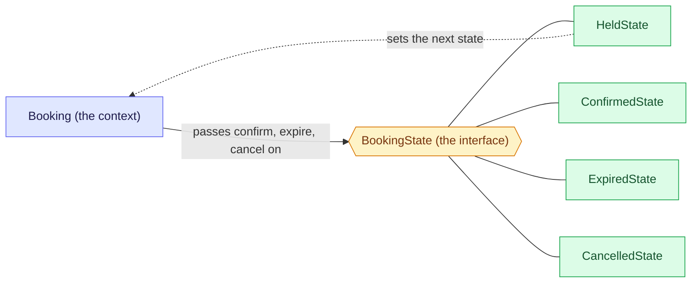

# 4. State: let the status decide the behaviour

State lets an object change its behaviour when its status changes, by moving the rules of each status into their own class, so the object stops asking "what status am I?" in every method. Unsure of a word? See the [glossary](/notebook/system-design/pattern/lld/glossary).

## Step 1: the smell

This is how a booking handles its status today. The statuses are the ones from the train-ticket board.

```java
public class Booking {
    private Status status = Status.HELD;

    public void confirm() {
        if (status == Status.HELD) {
            status = Status.CONFIRMED;
        } else {
            throw new IllegalStateException("cannot confirm a " + status + " booking");
        }
    }

    public void expire() {
        if (status == Status.HELD) {
            status = Status.EXPIRED;
        }   // any other status: nothing to do
    }

    public void cancel() {
        if (status == Status.HELD) {
            status = Status.CANCELLED;
        } else {
            throw new IllegalStateException("cannot cancel a " + status + " booking");
        }
    }
}
```

Next month two more statuses arrive, REFUNDED and PAYMENT_PENDING.

What hurts:

- A new status means touching every method that already works (`confirm`, `expire`, `cancel`), and forgetting one gives the wrong behaviour with no error.
- The lifecycle, meaning which move is legal from which status, is not in one place. To know it you have to read every method.

## Step 2: the idea

Make each status its own class, and give all of those classes the same interface. The booking holds the current state object and passes every call to it, so `confirm()` becomes "ask my current state to confirm". Each state class knows only its own rules: what it allows, and which state comes next. A move to the next status is a **transition**, and the state itself asks the booking to switch to the next state object.



Notice the dotted arrow: a state does not just answer, it can move the booking to a new state. That is what separates State from Strategy. In Strategy the caller chooses the class and nothing changes it. In State the object's own status chooses the class, and the states change it. A new status is a new class, and only the states that lead into it change.

## Step 3: the context, the interface and one concrete state

Written in `playground/lld/state-pattern`, in plain Java:

```java
public class Booking {                       // the context
  BookingState state;
  public void setState(BookingState state) { this.state = state; }
  public BookingState getState() { return this.state; }
}

public interface BookingState {              // every state answers the same three calls
  void confirm(Booking booking);
  void expire(Booking booking);
  void cancel(Booking booking);
}

public class ConfirmedState implements BookingState {
  @Override
  public void confirm(Booking booking) { throw new IllegalStateException("Already confirmed"); }

  @Override
  public void expire(Booking booking) { /* a confirmed ticket never expires */ }

  @Override
  public void cancel(Booking booking) { throw new IllegalStateException("Cannot cancel a confirmed booking"); }
}
```

Each method takes the booking, so a state can move it to the next state later with `booking.setState(...)`. `ConfirmedState` is the simplest one because it has no transitions.

Checked by running it: `confirm` throws `IllegalStateException: Already confirmed`, `expire` returns normally and does nothing, and `cancel` throws `IllegalStateException: Cannot cancel a confirmed booking`.
