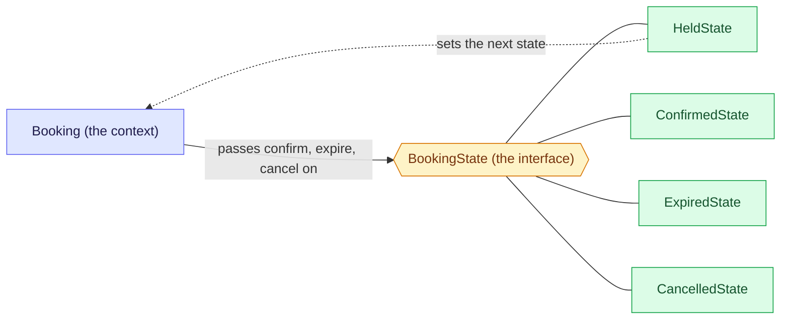

# 4. State: let the status decide the behaviour

State lets an object change its behaviour when its status changes, by moving the rules of each status into their own class, so the object stops asking "what status am I?" in every method. Unsure of a word? See the [glossary](/notebook/system-design/pattern/lld/glossary).

> [!TIP]
> - **The smell:** an `if` or `switch` on the status in every method, so each new status edits all of them.
> - **The fix:** one class per status behind one interface. The object passes calls to its current state, and the states move it to the next one.
> - **The catch:** a forgotten override fails at run time, and a new operation changes the interface.

## Step 1: the smell

This is how a booking handles its status today. The statuses are the ones from the train-ticket board.

```java
public class Booking {
    private Status status = Status.HELD;

    public void confirm() {
        if (status == Status.HELD) {
            status = Status.CONFIRMED;
        } else {
            throw new IllegalStateException("cannot confirm a " + status + " booking");
        }
    }

    public void expire() {
        if (status == Status.HELD) {
            status = Status.EXPIRED;
        }   // any other status: nothing to do
    }

    public void cancel() {
        if (status == Status.HELD) {
            status = Status.CANCELLED;
        } else {
            throw new IllegalStateException("cannot cancel a " + status + " booking");
        }
    }
}
```

Next month two more statuses arrive, REFUNDED and PAYMENT_PENDING.

What hurts:

- A new status means touching every method that already works (`confirm`, `expire`, `cancel`), and forgetting one gives the wrong behaviour with no error.
- The lifecycle, meaning which move is legal from which status, is not in one place. To know it you have to read every method.

## Step 2: the idea

Make each status its own class, and give all of those classes the same interface. The booking holds the current state object and passes every call to it, so `confirm()` becomes "ask my current state to confirm". Each state class knows only its own rules: what it allows, and which state comes next. A move to the next status is a **transition**, and the state itself asks the booking to switch to the next state object.



Notice the dotted arrow: a state does not just answer, it can move the booking to a new state. That is what separates State from Strategy. In Strategy the caller chooses the class and nothing changes it. In State the object's own status chooses the class, and the states change it. A new status is a new class, and only the states that lead into it change.

## Step 3: the context, the interface and one concrete state

Written in `playground/lld/state-pattern`, in plain Java:

```java
public class Booking {                       // the context
  BookingState state;
  public void setState(BookingState state) { this.state = state; }
  public BookingState getState() { return this.state; }
}

public interface BookingState {              // every state answers the same three calls
  void confirm(Booking booking);
  void expire(Booking booking);
  void cancel(Booking booking);
}

public class ConfirmedState implements BookingState {
  @Override
  public void confirm(Booking booking) { throw new IllegalStateException("Already confirmed"); }

  @Override
  public void expire(Booking booking) { /* a confirmed ticket never expires */ }

  @Override
  public void cancel(Booking booking) { throw new IllegalStateException("Cannot cancel a confirmed booking"); }
}
```

Each method takes the booking, so a state can move it to the next state later with `booking.setState(...)`. `ConfirmedState` is the simplest one because it has no transitions.

Checked by running it: `confirm` throws `IllegalStateException: Already confirmed`, `expire` returns normally and does nothing, and `cancel` throws `IllegalStateException: Cannot cancel a confirmed booking`.

## Step 4: the transitions

`HeldState` is the state that moves. It decides the next state and tells the booking to switch:

```java
public class HeldState implements BookingState {
  @Override
  public void confirm(Booking booking) { booking.setState(new ConfirmedState()); }

  @Override
  public void expire(Booking booking) { booking.setState(new ExpiredState()); }

  @Override
  public void cancel(Booking booking) { booking.setState(new CancelledState()); }
}
```

`ExpiredState` and `CancelledState` are built like `ConfirmedState`: no transitions out, and `confirm` or `cancel` throw `IllegalStateException`. The booking itself now has no rules and no `if` on its status. It starts held and passes every call to the current state:

```java
public class Booking {
  BookingState state = new HeldState();   // a new booking starts held

  public void confirm() { state.confirm(this); }
  public void expire()  { state.expire(this); }
  public void cancel()  { state.cancel(this); }
  // setState and getState as before
}
```

Checked by running three lifecycles from a new booking:

| Booking | Calls | Result |
|---|---|---|
| A | `confirm`, then `cancel`, then `expire` | ConfirmedState, then "Cannot cancel a confirmed booking" and still ConfirmedState, then still ConfirmedState |
| B | `expire`, then `confirm` | ExpiredState, then "Cannot confirm an expired booking" and still ExpiredState |
| C | `cancel`, then `confirm` | CancelledState, then "Cannot confirm a cancelled booking" and still CancelledState |

## Step 5: add a status and see what changes

We added `PaymentPendingState`: a held booking starts a payment, and the payment then ends with `confirm` (the merchant said success), `expire` (the hold ran out) or `cancel` (the merchant answered PENDING or FAILED). Starting a payment is a new operation, `pay()`, so the interface grew by one method.

| File | Change |
|---|---|
| `PaymentPendingState` | new class, holds the rules of the new status |
| `BookingState` | a new `pay` method, written as a `default` method that throws |
| `HeldState` | overrides `pay` to move to `PaymentPendingState` |
| `Booking` | a new `pay()` that passes the call to the current state |
| `ConfirmedState`, `ExpiredState`, `CancelledState` | not edited |

Checked by running four lifecycles: a held booking can pay once, `pay` twice is rejected ("Cannot start a payment in PaymentPendingState"), a pending payment can confirm, expire or cancel, and a confirmed or cancelled booking cannot pay.

The honest cost of State: a new status is cheap, but a new operation touches the interface. Without the `default` method, `pay` would have forced an edit in every state class. With it, only the state that allows the operation changes.

## Step 6: make "illegal" the default for every operation

`ConfirmedState`, `ExpiredState` and `CancelledState` were mostly copies of the same `throw`, because most states reject the same operations. So the default moved into the interface for all of them. This replaces the explicit bodies of those three classes shown in Steps 3 and 4.

```java
public interface BookingState {
  default void confirm(Booking booking) { throw illegal("confirm"); }
  default void expire(Booking booking)  { /* no-op */ }
  default void cancel(Booking booking)  { throw illegal("cancel"); }
  default void pay(Booking booking)     { throw illegal("start a payment"); }

  private IllegalStateException illegal(String action) {
    return new IllegalStateException("Cannot " + action + " in " + getClass().getSimpleName());
  }
}
```

`expire` is a no-op by default, because a job may call it on any booking, and the other three throw. `ConfirmedState`, `ExpiredState` and `CancelledState` are now empty classes, and `HeldState` and `PaymentPendingState` override only what they allow. Each state class now shows exactly its legal moves.

Checked by rerunning both lifecycles: the same results, with generic messages such as "Cannot confirm in ExpiredState" instead of the custom ones.

The trade-off: a state that forgets to override a legal operation now fails at run time with an "illegal" error. With abstract methods the compiler would have made you decide for every state, so a test per state is the safety net.

## Step 7: break it

Both breaks are tests in `playground/lld/state-pattern/src/test/java/com/learn/state/BookingStateTest.java`.

**An illegal order.** Confirm a booking, then try to cancel it. The `default` method throws `Cannot cancel in ConfirmedState`, and the state stays `ConfirmedState`.

**A forgotten override.** A copy of the pending state that overrides `expire` and `cancel` but forgets `confirm`:

```java
static class ForgetfulPendingState implements BookingState {
  @Override public void expire(Booking b) { b.setState(new ExpiredState()); }
  @Override public void cancel(Booking b) { b.setState(new CancelledState()); }
}

booking.setState(new ForgetfulPendingState());
booking.confirm();   // the merchant says "paid", but this throws: Cannot confirm in ForgetfulPendingState
```

It compiles and gives no warning, and a legal move is simply rejected at run time. The safety net is a test on the real state: `aPendingPaymentCanBeConfirmed` pays a booking and confirms it, and it would fail the moment someone removes the `confirm` override.

Checked by running the three tests: `Tests run: 3, Failures: 0`.

## Step 8: pitfalls and questions

| Symptom | Cause | Fix |
|---|---|---|
| A legal move is rejected at run time | A state forgot to override it and inherited the "illegal" default | One test per state for its legal moves |
| Adding a status touches many files | The change was a new operation, which lives in the interface | Make the new operation a `default` method, so only the states that allow it change |
| Hard to see the whole lifecycle | The transitions are spread over the state classes | Keep one diagram of the transitions and one test per transition |
| Two requests change the same booking at once | Swapping a state object in memory is not thread-safe | Persist the status and change it with a guarded update, such as `UPDATE ... WHERE status = 'HELD'` |

<details>
<summary>The business wants a new status, REFUND_PENDING, entered from a cancelled booking whose payment was taken. In our design, which files do you create, which do you change, and which stay untouched?</summary>

Create `RefundPendingState`, which holds the rules of the new status. Change three files: `BookingState` gets a new `refund` default method, `CancelledState` overrides `refund` to move to `RefundPendingState`, and `Booking` gets a `refund()` that passes the call to the current state. That is four files. `HeldState`, `ConfirmedState`, `ExpiredState` and `PaymentPendingState` stay untouched, because the new operation is a `default` method.
</details>

<details>
<summary>A teammate wants the four BookingState methods to be abstract again, so the compiler forces every state to decide. What do we gain and what do we lose, compared with the defaults?</summary>

With abstract methods we gain compile-time safety: a state cannot forget a legal move, because it has to write every method. We lose brevity: every state repeats the same throwing methods, and every new operation forces an edit in every state class. With defaults, a state lists only what it allows, but a forgotten override fails at run time, so a test per state is the safety net. A state can still override any default, for example to give a custom message.
</details>

<details>
<summary>State and Strategy are both an interface with several classes behind it. For the booking status, why State and not Strategy?</summary>

Strategy is a set of interchangeable ways to do one job. The caller picks one and nothing changes that choice by itself. In State the behaviour follows the object's own status, and the state classes themselves move the booking to the next state. HELD to PAYMENT_PENDING to CONFIRMED is a lifecycle with transitions, so it is State.
</details>

## Variants

| Variant | Idea | Use it when |
|---|---|---|
| State classes (ours) | One class per status, and the states do the transitions | Each status has its own behaviour and dependencies |
| Enum with behaviour | The enum constants hold the rules and return the next status | A small lifecycle that you store as the enum name in the database |
| Table-driven | A table of status and event to the next status | You want the whole lifecycle visible as data in one place |

```java
// enum with behaviour: each transition returns the next status
enum Status {
  HELD { Status confirm() { return CONFIRMED; } Status expire() { return EXPIRED; } },
  CONFIRMED, EXPIRED;
  Status confirm() { throw new IllegalStateException("Cannot confirm in " + this); }
  Status expire()  { throw new IllegalStateException("Cannot expire in " + this); }
}

// table-driven: the lifecycle is data
Map<Status, Map<Event, Status>> TRANSITIONS = Map.of(
    Status.HELD, Map.of(Event.CONFIRM, Status.CONFIRMED, Event.EXPIRE, Status.EXPIRED));
```

Checked by running both: `HELD.confirm()` gives CONFIRMED, `CONFIRMED.confirm()` throws "Cannot confirm in CONFIRMED", HELD plus EXPIRE gives EXPIRED, and EXPIRED plus CONFIRM throws "Cannot CONFIRM in EXPIRED".

The enum is the smallest, but its rules grow into one big file. The table shows the whole lifecycle at a glance, but side effects on a transition (send an email) need extra hooks. Spring Statemachine builds on the table idea.

## Where to use it

| Where | How State shows up |
|---|---|
| Train-ticket bookings | HELD, PAYMENT_PENDING, CONFIRMED, EXPIRED and CANCELLED (this lesson) |
| Order lifecycle | Placed, paid, shipped, delivered, returned |
| Protocols | A TCP connection moves through LISTEN, ESTABLISHED, CLOSE_WAIT and more |
| Workflows | Document approval: draft, in review, approved, rejected |
| Libraries | Spring Statemachine, for large lifecycles that outgrow hand-written state classes |
| Machine-coding rounds | Vending machine, ATM, elevator, traffic light |

## Key takeaways

| Remember | Because |
|---|---|
| One class per status behind one interface, and the booking passes calls to the current state | The booking has no `if` on its status |
| The current state decides the next state | The lifecycle lives in the state classes |
| Make "illegal" the default and override only what a state allows | Each state class shows exactly its legal moves |
| A new status is a new class, a new operation changes the interface | A `default` method keeps the second cheap |
| Test the legal moves of every state | A forgotten override fails only at run time |
| An in-memory state swap is not concurrency-safe | A real service persists the status and guards the change |

**Related:** [LLD patterns: the map](/notebook/system-design/pattern/lld/overview) · [Glossary](/notebook/system-design/pattern/lld/glossary) · [Strategy](/notebook/system-design/pattern/lld/strategy) · [Observer](/notebook/system-design/pattern/lld/observer) · [Train ticket booking board](/notebook/whiteboard/train-ticket-booking)
