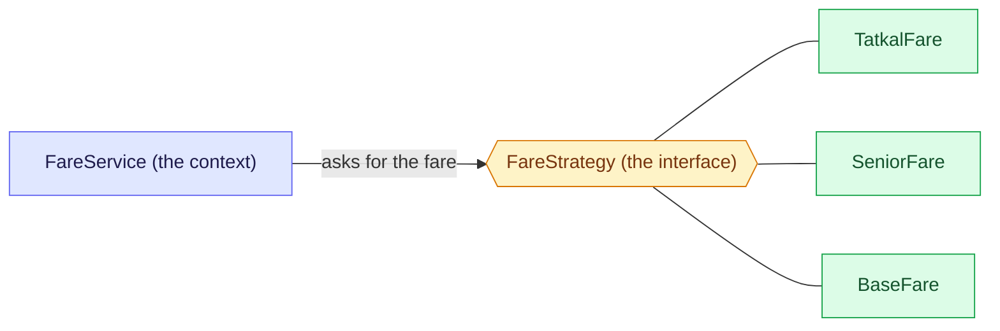

# 2. Strategy: replace the if/else with one class per way

Strategy puts each way of doing one job in its own class behind one interface, so the caller picks one at run time instead of branching on a flag. Unsure of a word? See the [glossary](/notebook/system-design/pattern/lld/glossary).

> [!TIP]
> - **The smell:** an `if/else` that picks an algorithm, with a new branch for every new rule.
> - **The fix:** one interface, one class per rule, and a context that holds the list and never branches.
> - **The catch:** with "first match wins", the order of the strategies is part of the design, and a forgotten annotation fails silently.

## Step 1: the smell

This is how the train fare is calculated today. The numbers are made up, not real railway rules.

```java
public int fare(Booking b) {
    if (b.tatkal()) {
        return b.baseFare() * 130 / 100;      // 30% surcharge
    } else if (b.senior()) {
        return b.baseFare() * 60 / 100;       // discount
    }
    return b.baseFare();
}
```

Next month a ladies quota and a rail-pass fare arrive, and the month after that, another rule.

What hurts:

- Every new rule edits this same method, so everyone's change lands in one place and conflicts.
- Every test has to walk all the branches, and a fix to one rule can break another.
- The method keeps growing, and nobody can tell which rule applies without reading all of it.

## Step 2: the idea

Take each branch out into its own class. Give all of the classes the same interface. The caller holds only the interface and asks it for the fare, so the caller has no `if/else` left. A new rule is a new class, and the old classes are not edited.



Three parts have names. The **context** is the caller that needs a fare. The **strategy** is the interface. The **concrete strategies** are the classes, one per rule. The caller knows only the interface, so which class answers can change without touching the caller. The diagram does not show who picks the class, and that is Step 4.

## Step 3: the interface and one concrete strategy

Written in `playground/lld/strategy-pattern`, in plain Java with no Spring annotations yet:

```java
public interface FareStrategy {
  public int getFare(Booking booking);
}

public class TatkalFare implements FareStrategy {
  @Override
  public int getFare(Booking book) {
    return book.baseFare() + (int) (book.baseFare() * 0.3);
  }
}
```

Checked by running it: a base fare of 1000 gives 1300.

The first version had `book.baseFare() * (30 / 100)`. Both numbers are `int`, so `30 / 100` is integer division, which drops the fraction and gives 0. The surcharge was always zero, and a base fare of 1000 came back as 1000. Two safe ways to write it: multiply before dividing (`baseFare * 130 / 100`), or use `0.3` and cast back to `int`, as above.

## Step 4: let each strategy say when it applies

The first `FareService` was correct, but the `if/else` had only moved into it, and it did `new` on every concrete class. A new rule would still have meant editing `FareService`. The fix is to ask each strategy whether it applies.

```java
public interface FareStrategy {
  boolean appliesTo(Booking booking);   // new: the strategy says when it is the right one
  int getFare(Booking booking);
}

@Service
public class FareService {
  private final List<FareStrategy> strategies; // every FareStrategy bean, sorted by @Order

  public FareService(List<FareStrategy> strategies) { this.strategies = strategies; }

  public int fare(Booking booking) {
    return strategies.stream()
        .filter(s -> s.appliesTo(booking))
        .findFirst()
        .orElseThrow()
        .getFare(booking);
  }
}
```

Each concrete strategy is a `@Component` with an `@Order`: `TatkalFare` is 1, `SeniorFare` is 2 and `BaseFare` is 3. Spring injects the `List` already sorted by `@Order`. `BaseFare.appliesTo` always returns true, so it has to be last: the first match wins.

Checked through a real Spring context with a base fare of 1000:

| Booking | Fare |
|---|---|
| plain | 1000 |
| senior | 600 |
| Tatkal | 1300 |
| both | 1300 (Tatkal is first in the order) |

## Step 5: add a rule and see what changes

We added a rail-pass fare (half the base fare, an example number). It took one new class, `RailPassFare`, and one new field, `railPass`, on `Booking`. `FareService` was not edited.

The first run was wrong. `RailPassFare` had `@Order(20)`, but the others were 1, 2 and 3, so it sorted after `BaseFare`, which always applies. A rail-pass booking came back as 1000, not 500. With consecutive numbers there is no whole number between 1 and 2, so inserting a rule forced a renumbering. We changed the numbers to Tatkal 10, rail pass 20, senior 30 and base 100. Only the `@Order` numbers changed in the three older classes.

| Booking (base fare 1000) | Fare |
|---|---|
| plain | 1000 |
| senior | 600 |
| Tatkal | 1300 |
| rail pass | 500 |
| rail pass and senior | 500 (rail pass comes first) |
| Tatkal and rail pass | 1300 (Tatkal comes first) |

Lesson: leave gaps in the order numbers (10, 20, 30) and keep the catch-all default far at the end, so the next rule slots in without touching the old ones.

## Step 6: break it, the forgotten `@Component`

We added a throwaway strategy, `GhostFare`, that applies only when the base fare is 777 and returns 1. We ran it twice: once with `@Component` and once without.

| | Beans that are a `FareStrategy` | Fare for a base fare of 777 |
|---|---|---|
| With `@Component` | ghostFare, baseFare, railPassFare, seniorFare, tatkalFare | 1 |
| Without `@Component` | baseFare, railPassFare, seniorFare, tatkalFare | 777 |

Without the annotation the class compiles, the app starts and no error appears, but Spring never creates the bean, so the rule is silently skipped. A new strategy that "does nothing" is usually a missing `@Component`.

## Step 7: pitfalls and questions

| Symptom | Cause | Fix |
|---|---|---|
| A new strategy never applies and there is no error | Missing `@Component`, so no bean exists | Look at the bean list, then add the annotation |
| The bean exists but its rule never applies | No `@Order` (a bean without one sorts last, after the catch-all) or a number past the default | Give it a number before the default |
| Two rules match and only one applies | First match wins | Decide the precedence on purpose. If both must apply, strategy is the wrong tool |
| Adding a rule means renumbering the old ones | Consecutive `@Order` numbers | Space them (10, 20, 30) and keep the default far at the end |

<details>
<summary>A senior citizen books a Tatkal ticket and is charged 1300, with no senior discount, although SeniorFare has no bug. What decides this?</summary>

`FareService.fare` walks the injected list in order and stops at the first strategy whose `appliesTo` is true (`findFirst`). `TatkalFare` has `@Order(10)`, which is before `SeniorFare` (30), and it applies, so `SeniorFare` is never even asked. The result is decided by the order numbers and the first-match rule together.
</details>

<details>
<summary>A teammate adds LadiesFare. It compiles and the app starts, but ladies bookings still pay the base fare. What are the two most likely causes?</summary>

It is missing `@Component`, so Spring never creates the bean and it is not in the list. Or it is a bean without `@Order` (or with a number past the default), so it sorts after `BaseFare`, which always applies, and the loop stops before reaching it. Tell them apart by printing the beans of type `FareStrategy`: if it is missing from the list, it is the annotation, and if it is present, look at the order.
</details>

<details>
<summary>A student fare must beat the senior fare but lose to the rail pass. Which @Order number does it get, and which existing files change?</summary>

A number between rail pass (20) and senior (30), for example 25. No existing strategy and not `FareService` change, because the numbers were spaced. The only edits are the new class and, if the rule needs new data, a new field on `Booking`.
</details>

## Variants

Ours was classes in a Spring list, each saying `appliesTo`. Strategy has other common shapes:

| Variant | Idea | Use it when |
|---|---|---|
| Classes in a list (ours) | One `@Component` per rule, each says `appliesTo` | Rules have dependencies, need their own tests, and keep arriving |
| Lambda | The interface has one method, so a rule is a lambda | Small, stateless rules |
| Enum with behaviour | Each enum constant holds its own rule | A closed set that is known at compile time |
| Map by name | A `Map<String, Strategy>` injected by Spring, and the caller names the strategy | The request says which one to use, such as `"upi"` |

```java
// lambda: a one-method interface, so a rule is one line
interface FareRule { int fare(Booking b); }
FareRule tatkal = b -> b.baseFare() * 130 / 100;

// enum with behaviour: a closed set, with no Spring wiring
enum Quota {
  SENIOR { int fare(int base) { return base * 60 / 100; } },
  TATKAL { int fare(int base) { return base * 130 / 100; } };
  abstract int fare(int base);
}
```

Checked by running the lambda and the enum: Tatkal on 1000 gives 1300 and `Quota.SENIOR.fare(1000)` gives 600. The map variant was not run here.

## Where to use it

| Where | How Strategy shows up |
|---|---|
| Train-ticket fares | Base, Tatkal, senior and rail-pass rules (this lesson) |
| Payment methods | One class per method (card, UPI, wallet), picked from the request |
| Sorting | A `java.util.Comparator` passed to `sort` is a strategy for the ordering |
| Spring Security | `PasswordEncoder` implementations (BCrypt, Argon2) are interchangeable strategies |
| Spring transactions | `PlatformTransactionManager` has one implementation per technology, such as JPA or JDBC |
| Machine-coding rounds | Parking-lot pricing, ride fare calculation, discount engines, and rate-limiter algorithms (token bucket or sliding window) |

## Key takeaways

| Remember | Because |
|---|---|
| Strategy is an interface, one class per rule, and a context that never branches | The `if/else` leaves the caller |
| Each strategy says when it applies (`appliesTo`) | The context stays unchanged when a rule is added |
| Spring injects every bean of a type as a `List`, sorted by `@Order` | The container is the registry |
| First match wins, so the order is a rule you declare | No order means last, and a catch-all must be last |
| Space the order numbers | The next rule slots in without renumbering |
| Every strategy needs `@Component` | No annotation means no bean and a silent skip |

**Related:** [LLD patterns: the map](/notebook/system-design/pattern/lld/overview) · [Glossary](/notebook/system-design/pattern/lld/glossary) · [Train ticket booking board](/notebook/whiteboard/train-ticket-booking)
